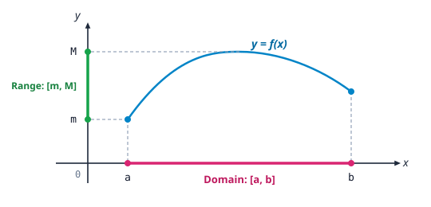
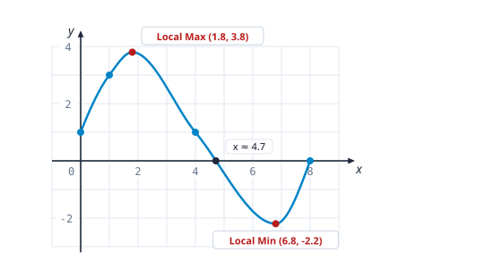
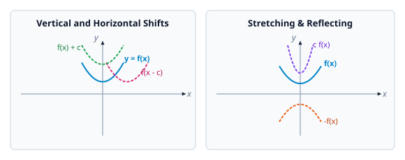
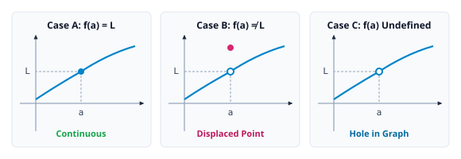
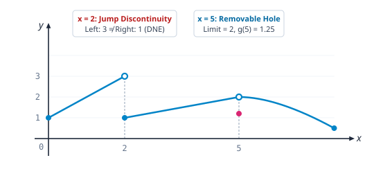

# 001: Functions, Transformations, and Limits

**Prerequisites:** high-school algebra, basic coordinate geometry, and function notation. **Next:** Handout 002, *Limit Laws, Squeeze Theorem, Continuity, and the IVT*.

Calculus investigates continuous change and instantaneous rates of change. Before determining slopes of tangent lines or areas beneath curves, continuous mathematics requires a firm foundation in functions, their admissible inputs and outputs, graph transformations, and the limiting behavior of functions near points of interest.

A calculus problem frequently requires evaluating function behavior at or near singular boundaries, such as removable holes, vertical asymptotes, or piecewise transition points. This handout provides the toolkit for those situations: algebraic domain determination, geometric graph reading, a transformation catalog, one-sided and two-sided limits, the basic limit laws, and first techniques for resolving the indeterminate form $\dfrac{0}{0}$.

## Functions, domain, and range

A **function** $f$ is a rule that assigns to each element $x$ in a specified set $D$ (the **domain**) exactly one output $f(x)$ in a target set $E$. The **range** of $f$ is the set of all realized output values:

$$\operatorname{range}(f) = \{f(x) \mid x \in D\}$$

In single-variable calculus, functions have real inputs and real outputs ($D, E \subseteq \mathbb{R}$). When a function is given by a formula with no stated domain, the **natural domain** is the largest set of real numbers for which the formula produces a real number.

**Interval notation.** This course writes an excluded endpoint with a reversed bracket and an included endpoint with an ordinary bracket: $\mathopen{]}a, b\mathclose{[}$ excludes both ends, $[a, b\mathclose{[}$ includes $a$ only, and $[a, b]$ includes both. An infinite end is never included, so $\mathopen{]}-\infty, +\infty\mathclose{[}$ is all of $\mathbb{R}$ and $[0, +\infty\mathclose{[}$ is the set of non-negative reals. Parentheses $(a, b)$ always denote an ordered pair, a point in the plane.

### Natural domain restrictions

Algebraic constraints govern the natural domain of elementary functions:

| Constraint type | General expression | Domain condition | Mathematical justification |
| :--- | :--- | :--- | :--- |
| **Non-zero denominator** | $\frac{P(x)}{Q(x)}$ | $Q(x) \neq 0$ | Division by zero is undefined in real arithmetic. |
| **Even-index radical** | $\sqrt[2n]{g(x)}$ | $g(x) \ge 0$ | Even roots of negative numbers are not real numbers. |
| **Even radical in denominator** | $\frac{P(x)}{\sqrt[2n]{g(x)}}$ | $g(x) > 0$ | The radicand must be non-negative and the denominator non-zero. |
| **Odd-index radical** | $\sqrt[2n+1]{g(x)}$ | No condition from the root itself | Odd roots are defined for every real number. |
| **Nested fractions** | $\frac{A(x)}{B(x) + \frac{C(x)}{D(x)}}$ | $D(x) \neq 0$ and $B(x) + \frac{C(x)}{D(x)} \neq 0$ | Every denominator at every level must be non-zero simultaneously. |

The same conditions govern functions of several variables. For example, $f(x, y) = \sqrt{9 - x^2 - y^2}$ requires $x^2 + y^2 \le 9$, a closed disk in the plane.

### Visual representation of domain and range

On a graph, the domain and range are shadows (projections) of the curve onto the coordinate axes:
- The **domain** is the projection of the curve onto the horizontal $x$-axis.
- The **range** is the projection of the curve onto the vertical $y$-axis, from the lowest to the highest value the curve reaches.

### Reading function features from coordinate grids

On a scaled grid, function values, intercepts, extrema, and domain can be read directly:

From the grid above:
- **Evaluation at specific inputs:** $f(0) = 1$, $f(1) = 3$, and $f(4) = 1$.
- **Extrema:** a local maximum near $(1.8, 3.8)$ and a local minimum near $(6.8, -2.2)$.
- **Intercepts:** the $y$-intercept is $(0, 1)$; the $x$-intercepts are near $x \approx 4.7$ and at the right endpoint $(8, 0)$.
- **Domain and range:** the domain is $[0, 8]$ and the range is $[-2.2, 3.8]$.

## Graph transformations and combinations

Building new functions from known prototype curves is a core modeling skill. Given a base graph $y = f(x)$ and a constant $c > 0$, each transformation moves, flips, or rescales the graph without changing its basic shape.

### Transformation catalog

| Transformation formula | Geometric effect | Coordinate rule | Domain / Range impact |
| :--- | :--- | :--- | :--- |
| $y = f(x) + c$ | Shift upward by $c$ units | $(x, y) \to (x, y + c)$ | Domain unchanged; range shifts up by $c$. |
| $y = f(x) - c$ | Shift downward by $c$ units | $(x, y) \to (x, y - c)$ | Domain unchanged; range shifts down by $c$. |
| $y = f(x - c)$ | Shift right by $c$ units | $(x, y) \to (x + c, y)$ | Domain shifts right by $c$; range unchanged. |
| $y = f(x + c)$ | Shift left by $c$ units | $(x, y) \to (x - c, y)$ | Domain shifts left by $c$; range unchanged. |
| $y = c f(x)$ ($c > 1$) | Stretch vertically by factor $c$ | $(x, y) \to (x, c y)$ | Domain unchanged; range values multiplied by $c$. |
| $y = \frac{1}{c} f(x)$ ($c > 1$) | Compress vertically by factor $c$ | $(x, y) \to (x, \frac{1}{c} y)$ | Domain unchanged; range values divided by $c$. |
| $y = -f(x)$ | Reflect across the $x$-axis | $(x, y) \to (x, -y)$ | Domain unchanged; range values change sign (largest and smallest swap). |
| $y = f(-x)$ | Reflect across the $y$-axis | $(x, y) \to (-x, y)$ | Domain values change sign; range unchanged. |

### Function composition and domain criteria

Given two functions $f$ and $g$, the **composite function** $f \circ g$ is defined by $(f \circ g)(x) = f(g(x))$. Its domain requires two simultaneous conditions:
- **Condition 1:** $x$ lies in the domain of the inner function $g$.
- **Condition 2:** the intermediate output $g(x)$ lies in the domain of the outer function $f$.

## The limit of a function

The idea that separates calculus from precalculus algebra is the **limit**. Limits describe the trend of a function near a point, even when the function cannot be evaluated at that exact point.

### Intuitive definition and three fundamental cases

We write $\displaystyle \lim_{x \to a} f(x) = L$ if the outputs $f(x)$ get arbitrarily close to $L$ as $x$ approaches $a$ from both sides, with $x \neq a$. The limit depends only on function values **near** $a$, never **at** $a$:

- **Case A (continuous at $a$):** the limit exists and $f(a) = L$. The curve passes through $(a, L)$ without a break; this is what it means for $f$ to be continuous at $a$.
- **Case B (displaced isolated point):** $f(a)$ is defined, but $f(a) \neq L$. The graph has a hole at $(a, L)$ and an isolated point at $(a, f(a))$. The limit is still $L$.
- **Case C (undefined at $a$):** $f(a)$ does not exist. The graph has a hole at $(a, L)$, and the limit is still $L$.

### One-sided limits and existence

- **Left-hand limit:** $\displaystyle \lim_{x \to a^-} f(x) = L_1$ means $x$ approaches $a$ through values with $x < a$.
- **Right-hand limit:** $\displaystyle \lim_{x \to a^+} f(x) = L_2$ means $x$ approaches $a$ through values with $x > a$.
- **Existence theorem:** $\displaystyle \lim_{x \to a} f(x) = L$ if and only if both one-sided limits exist and each equals $L$.

If the one-sided limits are different finite numbers ($L_1 \neq L_2$), the two-sided limit **does not exist (DNE)** and the graph has a **jump discontinuity**.

In the figure above:
- At $x = 2$: $\displaystyle \lim_{x \to 2^-} g(x) = 3$ and $\displaystyle \lim_{x \to 2^+} g(x) = 1$. Because $3 \neq 1$, $\displaystyle \lim_{x \to 2} g(x)$ does not exist.
- At $x = 5$: both one-sided limits equal $2$, so $\displaystyle \lim_{x \to 5} g(x) = 2$, even though the isolated point is $g(5) = 1.25$.

### Types of discontinuity

A function has a **discontinuity** at $a$ when its graph breaks there. Three types appear in this course:
- **Removable:** $\displaystyle \lim_{x \to a} f(x)$ exists, but $f(a)$ is undefined or differs from the limit (Cases B and C above).
- **Jump:** both one-sided limits are finite but unequal.
- **Infinite:** the function grows without bound near $a$, producing a vertical asymptote. Handout 002 treats infinite limits and continuity formally.

## Calculating limits using limit laws

Suppose $c$ is a constant and both limits $\displaystyle \lim_{x \to a} f(x)$ and $\displaystyle \lim_{x \to a} g(x)$ exist.

| Limit law | Statement | Application condition |
| :--- | :--- | :--- |
| **Sum / Difference** | $\lim_{x \to a} [f(x) \pm g(x)] = \lim_{x \to a} f(x) \pm \lim_{x \to a} g(x)$ | Both individual limits exist. |
| **Constant Multiple** | $\lim_{x \to a} [c f(x)] = c \lim_{x \to a} f(x)$ | The individual limit exists; $c \in \mathbb{R}$. |
| **Product Law** | $\lim_{x \to a} [f(x) g(x)] = \left(\lim_{x \to a} f(x)\right) \cdot \left(\lim_{x \to a} g(x)\right)$ | Both individual limits exist. |
| **Quotient Law** | $\lim_{x \to a} \frac{f(x)}{g(x)} = \frac{\lim_{x \to a} f(x)}{\lim_{x \to a} g(x)}$ | Both limits exist and $\lim_{x \to a} g(x) \neq 0$. |
| **Power / Root** | $\lim_{x \to a} [f(x)]^n = \left[\lim_{x \to a} f(x)\right]^n$ and $\lim_{x \to a} \sqrt[n]{f(x)} = \sqrt[n]{\lim_{x \to a} f(x)}$ | $n \in \mathbb{Z}^+$; for even $n$ the limit of $f$ must be positive. |

### Direct substitution and indeterminate forms

If $f$ is a polynomial or rational function and $a$ lies in the domain of $f$, then $\displaystyle \lim_{x \to a} f(x) = f(a)$. When direct substitution produces the **indeterminate form** $\dfrac{0}{0}$, the expression has a common factor that vanishes at $a$, and algebra must remove it first:
- **Factoring and cancellation:** for rational functions, factor and cancel $(x - a)$ for $x \neq a$.
- **Conjugate rationalization:** for a radical difference $\sqrt{A} - B$, multiply top and bottom by the conjugate $\sqrt{A} + B$ and use $u^2 - v^2 = (u - v)(u + v)$.
- **Clearing compound fractions:** combine the fractions in the numerator over a common denominator, then divide by the remaining factor.
- **Sine limit:** $\displaystyle \lim_{\theta \to 0} \frac{\sin\theta}{\theta} = 1$, with $\theta$ in radians. For small $\theta$ the arc length $\theta$ and the height $\sin\theta$ on the unit circle are nearly equal. When the argument is scaled, write $\dfrac{\sin(k\theta)}{m\theta} = \dfrac{k}{m} \cdot \dfrac{\sin(k\theta)}{k\theta}$ so that the argument of the sine matches the denominator of the fraction.

Handout 002 extends this toolkit with the Squeeze Theorem, the formal definition of continuity, and the Intermediate Value Theorem.

## Mistakes, edge cases & strategies

| Trap | Correct reasoning | Strategy |
| :--- | :--- | :--- |
| **Canceling terms across sums** | In $\frac{x^2 - 4}{x - 2}$, terms joined by addition or subtraction cannot be canceled. | Factor completely into products before canceling: $\frac{(x-2)(x+2)}{x-2} = x + 2$. |
| **Horizontal shift direction confusion** | $f(x - c)$ shifts the graph **right**; $f(x + c)$ shifts it **left**. | Find the new input that plays the role of $0$: $x - c = 0$ gives $x = c > 0$, a shift to the right. |
| **Misapplying the Quotient Law** | The law requires $\lim g(x) \neq 0$. If $\lim g(x) = 0$, it cannot be used. | Check the denominator limit first. If it is $0$, look for $\frac{0}{0}$ preparation or a vertical asymptote. |
| **Confusing limit value with function value** | $\lim_{x \to a} f(x)$ describes behavior **near** $a$; $f(a)$ is the output **at** $a$. | Sketch an open circle at $(a, L)$. The limit exists whether or not a point sits at $(a, f(a))$. |
| **Overlooking inner domain in composition** | The domain of $f \circ g$ is not the domain of the simplified formula. | Enforce both criteria: $x \in \operatorname{dom}(g)$ and $g(x) \in \operatorname{dom}(f)$. |
| **Confusing even and odd radical domains** | Even roots need a non-negative radicand; odd roots accept every real number. | Read the radical index first. An odd index adds no restriction. |
| **Assuming one-sided limits are equal** | Piecewise definitions often have jumps where the directional limits differ. | Compute the left-hand and right-hand limits independently before concluding. |
| **Dropping the scale factor in a sine limit** | $\lim_{\theta \to 0} \frac{\sin(k\theta)}{\theta} = k$, not $1$. | Multiply and divide by $k$ so the sine argument matches the denominator. |

## Strategy routines

Apply this four-stage routine to analysis problems:
- **S1 Classify & Domain:** identify the function family (polynomial, rational, radical, composite, piecewise) and check natural domain restrictions ($Q(x) \neq 0$, even radicand $\ge 0$). In limit problems, test direct substitution first.
- **S2 Algebraic Preparation:** if direct substitution gives $\dfrac{0}{0}$, classify the structure: factor, multiply by a radical conjugate, clear a compound fraction, or rescale a sine argument.
- **S3 Core Operation:** execute the main step: cancel the common factor, apply the limit laws piece by piece, or evaluate each one-sided limit separately.
- **S4 Interpretation & Boundary Check:** confirm that every canceled factor is nonzero near $a$ ($x \neq a$), then compare the limit $L$ with $f(a)$ to classify the discontinuity (removable, jump, or infinite).

## Worked examples

### Example 1: Domain of a radical-over-linear function

Determine the natural domain of $f(x) = \dfrac{\sqrt{9 - x^2}}{x - 2}$ and write it in interval notation.

> **Stage 1 (Classification & Domain).** The even radical needs $9 - x^2 \ge 0$; the denominator needs $x - 2 \ne 0$.
>
> **Stage 2 (Algebraic Preparation).** $9 - x^2 \ge 0 \;\Longrightarrow\; x^2 \le 9 \;\Longrightarrow\; -3 \le x \le 3$, so the radical allows $[-3, 3]$. The denominator vanishes only at $x = 2$.
>
> **Stage 3 (Core Operation).** Intersect $[-3, 3]$ with $x \ne 2$: $[-3, 2\mathclose{[} \cup \mathopen{]}2, 3]$.
>
> **Stage 4 (Interpretation & Boundary Check).** At $x = \pm 3$ the radicand is $0$, which is allowed (closed brackets). At $x = 2$ the denominator is $0$ (excluded end).
>
> Verified domain: $[-3, 2\mathclose{[} \cup \mathopen{]}2, 3]$.

### Example 2: Sequential transformations with domain and range

Start from $y = \sqrt{x}$, with domain $[0, +\infty\mathclose{[}$ and range $[0, +\infty\mathclose{[}$. Find the formula, domain, and range of $g$ obtained by shifting left $4$ units, stretching vertically by factor $2$, reflecting across the $x$-axis, and shifting up $3$ units.

> **Stage 1 (Classification & Domain).** Base function $y = \sqrt{x}$. Apply in order: left $4$, stretch $2$, reflect in the $x$-axis, up $3$.
>
> **Stage 2 (Algebraic Preparation).**
>
> $\sqrt{x} \;\to\; \sqrt{x + 4} \;\to\; 2\sqrt{x + 4} \;\to\; -2\sqrt{x + 4} \;\to\; g(x) = 3 - 2\sqrt{x + 4}$
>
> **Stage 3 (Core Operation).** Domain: $x + 4 \ge 0$, so $[-4, +\infty\mathclose{[}$.
>
> Range: $\sqrt{x + 4} \ge 0 \;\Rightarrow\; -2\sqrt{x + 4} \le 0 \;\Rightarrow\; 3 - 2\sqrt{x + 4} \le 3$, so the range is $\mathopen{]}-\infty, 3]$.
>
> **Stage 4 (Interpretation & Boundary Check).** $g(-4) = 3$ is the highest point (the vertex at $(-4, 3)$), and $g(x) \to -\infty$ as $x \to +\infty$.
>
> Verified: $g(x) = 3 - 2\sqrt{x + 4}$; domain $[-4, +\infty\mathclose{[}$; range $\mathopen{]}-\infty, 3]$.

### Example 3: One-sided limits and discontinuity type

Let $f(x) = \begin{cases} \dfrac{x^2 - 4}{x - 2} & \text{if } x < 2 \\ 1 & \text{if } x = 2 \\ 2x - 1 & \text{if } x > 2 \end{cases}$. Evaluate $\displaystyle \lim_{x \to 2^-} f(x)$ and $\displaystyle \lim_{x \to 2^+} f(x)$, decide whether $\displaystyle \lim_{x \to 2} f(x)$ exists, and classify the discontinuity at $x = 2$.

> **Stage 1 (Classification & Domain).** Piecewise function with a boundary at $x = 2$. Each directional limit is computed from its own piece.
>
> **Stage 2 (Algebraic Preparation).** For $x < 2$:
>
> $\displaystyle \frac{x^2 - 4}{x - 2} = \frac{(x - 2)(x + 2)}{x - 2} = x + 2 \quad (x \ne 2)$
>
> **Stage 3 (Core Operation).**
>
> $\displaystyle \lim_{x \to 2^-} f(x) = \lim_{x \to 2^-} (x + 2) = 4 \qquad \lim_{x \to 2^+} f(x) = \lim_{x \to 2^+} (2x - 1) = 3$
>
> **Stage 4 (Interpretation & Boundary Check).** Since $4 \ne 3$, $\displaystyle \lim_{x \to 2} f(x)$ does not exist. The function has a jump discontinuity of size $|4 - 3| = 1$ at $x = 2$; the value $f(2) = 1$ matches neither side.

### Example 4: An indeterminate limit by conjugate rationalization

Evaluate $\displaystyle \lim_{x \to 0} \frac{\sqrt{x + 25} - 5}{x}$.

> **Stage 1 (Classification & Domain).** Direct substitution gives $\dfrac{\sqrt{25} - 5}{0} = \dfrac{0}{0}$, an indeterminate form.
>
> **Stage 2 (Algebraic Preparation).** Multiply top and bottom by the conjugate $\sqrt{x + 25} + 5$:
>
> $\displaystyle \frac{(\sqrt{x + 25} - 5)(\sqrt{x + 25} + 5)}{x(\sqrt{x + 25} + 5)} = \frac{(x + 25) - 25}{x(\sqrt{x + 25} + 5)} = \frac{x}{x(\sqrt{x + 25} + 5)}$
>
> **Stage 3 (Core Operation).** Cancel $x$ (allowed because $x \ne 0$ near the limit), then substitute:
>
> $\displaystyle \frac{1}{\sqrt{x + 25} + 5} \;\longrightarrow\; \frac{1}{\sqrt{25} + 5} = \frac{1}{10}$
>
> **Stage 4 (Interpretation & Boundary Check).** Numerical check: at $x = 0.01$, $\dfrac{\sqrt{25.01} - 5}{0.01} \approx 0.09999 \approx 0.10$.
>
> Verified limit: $\dfrac{1}{10}$.

### Example 5: A compound fraction and a scaled sine

Evaluate (a) $\displaystyle \lim_{x \to 3} \frac{\frac{1}{x} - \frac{1}{3}}{x - 3}$ and (b) $\displaystyle \lim_{\theta \to 0} \frac{\sin(7\theta)}{2\theta}$.

> **Stage 1 (Classification & Domain).** (a) Substitution gives $\dfrac{\frac13 - \frac13}{0} = \dfrac{0}{0}$. (b) Substitution gives $\dfrac{0}{0}$.
>
> **Stage 2 (Algebraic Preparation).** (a) Combine the numerator over a common denominator:
>
> $\displaystyle \frac{1}{x} - \frac{1}{3} = \frac{3 - x}{3x} = \frac{-(x - 3)}{3x}$
>
> (b) Rescale so the sine argument matches the denominator:
>
> $\displaystyle \frac{\sin(7\theta)}{2\theta} = \frac{7}{2} \cdot \frac{\sin(7\theta)}{7\theta}$
>
> **Stage 3 (Core Operation).** (a) Divide by $(x - 3)$ and cancel, valid for $x \ne 3$:
>
> $\displaystyle \lim_{x \to 3} \frac{-(x - 3)}{3x (x - 3)} = \lim_{x \to 3} \frac{-1}{3x} = -\frac{1}{9}$
>
> (b) With $u = 7\theta \to 0$: $\displaystyle \frac{7}{2} \cdot \lim_{u \to 0} \frac{\sin u}{u} = \frac{7}{2} \cdot 1 = \frac{7}{2}$.
>
> **Stage 4 (Interpretation & Boundary Check).** (a) At $x = 3.01$ the quotient is $\approx -0.1107$ and $-\frac{1}{9} \approx -0.1111$. (b) At $\theta = 0.001$ the quotient is $\approx 3.49997$.
>
> Verified limits: (a) $-\dfrac{1}{9}$; (b) $\dfrac{7}{2}$.

## Exercises

Show every intermediate step, and write every interval in the notation used in this handout.

### Q1

**1.** Determine the natural domain of $f(x) = \dfrac{3x - 1}{x^2 - 4x - 12}$ in interval notation.

**2.** Determine the natural domain of $g(t) = \sqrt{5 - t} - \sqrt{t + 3}$ in interval notation.

**3.** Determine the natural domain of $h(x) = \dfrac{2x + 7}{\sqrt[4]{x^2 - 4x}}$ in interval notation.

**4.** Determine the natural domain of $k(u) = \dfrac{u - 2}{2 - \frac{6}{u + 1}}$ in interval notation.

**5.** Determine the natural domain of $m(x) = \sqrt[3]{4 - x^2} + \sqrt{x + 1}$ in interval notation.

### Q2

**1.** Consider the piecewise function $g(x)$ defined by:

$$g(x) = \begin{cases} x^2 - 2x + 3 & \text{if } x < 2 \\ 5 & \text{if } x = 2 \\ 7 - 2x & \text{if } x > 2 \end{cases}$$

Which of the following statements about $g(x)$ at $x = 2$ is correct?

- A) The limit $\displaystyle \lim_{x \to 2} g(x)$ does not exist because $g(2) \neq 3$.
- B) The function $g$ is continuous at $x = 2$ because both one-sided limits are finite real numbers.
- C) The one-sided limits $\displaystyle \lim_{x \to 2^-} g(x)$ and $\displaystyle \lim_{x \to 2^+} g(x)$ are unequal, creating a jump discontinuity at $x = 2$.
- D) The limit $\displaystyle \lim_{x \to 2} g(x) = 3$, and $g$ has a removable discontinuity at $x = 2$ because $\displaystyle \lim_{x \to 2} g(x) \neq g(2)$.
- E) The limit $\displaystyle \lim_{x \to 2} g(x) = 5$ because direct evaluation at $x = 2$ gives $g(2) = 5$.

### Q3

**1.** The graph of $y = |x|$ is shifted right by $2$ units, stretched vertically by a factor of $3$, reflected across the $x$-axis, and then shifted down by $1$ unit. Write the formula for the resulting function $h(x)$ and state its domain and range in interval notation.

**2.** A function $f$ has domain $[-2, 4]$ and range $[1, 5]$. Let $p(x) = 3 - 2f(x - 1)$. State the domain and range of $p$ in interval notation.

**3.** For $f(x) = \sqrt{x}$ and $g(x) = 9 - x^2$, determine the composite formula $(f \circ g)(x)$ and state its exact domain in interval notation.

**4.** For $f(x) = \sqrt{x}$ and $g(x) = 9 - x^2$, determine the composite formula $(g \circ f)(x)$ and state its exact domain and range in interval notation.

### Q4

**1.** Evaluate $\displaystyle \lim_{x \to 3} \frac{2x^2 - 5x - 3}{x^2 - 9}$.

**2.** Evaluate $\displaystyle \lim_{t \to 0} \frac{\sqrt{t + 16} - 4}{t}$.

**3.** Evaluate $\displaystyle \lim_{x \to -2} \frac{\frac{1}{x + 4} - \frac{1}{2}}{x + 2}$.

**4.** Evaluate $\displaystyle \lim_{\theta \to 0} \frac{\sin(5\theta)}{3\theta}$.

### Q5

**1.** An industrial electric kiln follows a computer-controlled temperature profile $T(t)$ (in hundreds of degrees Celsius) as a function of elapsed heating time $t$ (in hours) on the domain $[0, 6]$:

$$T(t) = \begin{cases} 2 + 1.5t & \text{if } 0 \le t < 2 \\ 5 & \text{if } t = 2 \\ 8 - \dfrac{6}{t + 1} & \text{if } 2 < t \le 6 \end{cases}$$

Compute the one-sided limits $\displaystyle \lim_{t \to 2^-} T(t)$ and $\displaystyle \lim_{t \to 2^+} T(t)$.

**2.** State whether the two-sided limit $\displaystyle \lim_{t \to 2} T(t)$ exists, and classify the discontinuity of $T$ at $t = 2$.

**3.** Determine the absolute minimum and absolute maximum temperatures attained by the kiln on $[0, 6]$, and state the complete range of $T$ in interval notation.

### Q6

**1.** An autonomous transit shuttle follows a programmed forward velocity profile $v(t)$ (in meters per second) over the mission window $[0, 30]$ seconds:

$$v(t) = \begin{cases} \dfrac{kt + 2}{t + 2} & \text{if } 0 \le t < 10 \\ c & \text{if } t = 10 \\ \dfrac{\sqrt{t - 1} - 3}{t - 10} + 5 & \text{if } 10 < t \le 30 \end{cases}$$

where $k$ and $c$ are constants chosen by the designers. Evaluate the right-hand limit $\displaystyle \lim_{t \to 10^+} v(t)$ algebraically.

**2.** Determine the exact value of $k$ for which $\displaystyle \lim_{t \to 10^-} v(t) = \lim_{t \to 10^+} v(t)$, so that $\displaystyle \lim_{t \to 10} v(t)$ exists.

**3.** With $k$ from part 2, determine the exact value of $c$ for which $v$ is continuous at $t = 10$.

**4.** Compute the average acceleration of the shuttle over $[17, 26]$ seconds, defined by $\bar{a} = \dfrac{v(26) - v(17)}{26 - 17}$, in $\text{m/s}^2$.
