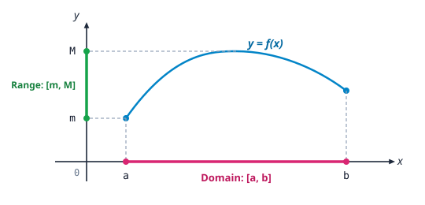
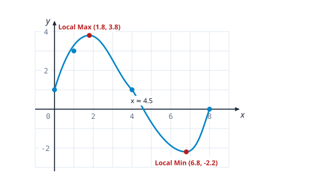
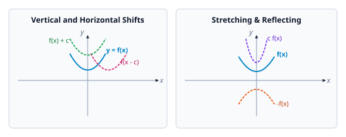
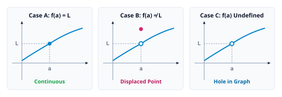
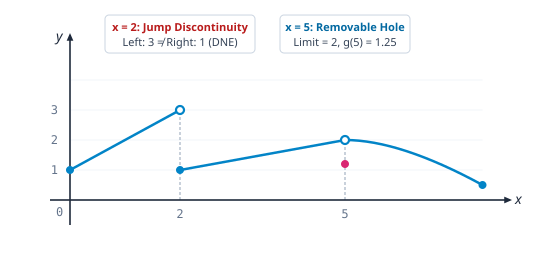

# 002: Functions, Transformations, and Limits

Calculus investigates continuous change and instantaneous rates of change. Before determining slopes of tangent lines or areas beneath curves, continuous mathematics requires a rigorous foundation in functions, their admissible inputs and outputs, graph transformations, and the limiting behavior of functions near points of interest.

A calculus problem frequently requires evaluating function behavior at or near singular boundaries—such as removable holes, vertical asymptotes, or piecewise transition interfaces. This handout provides a foundational toolkit covering algebraic domain determination, geometric graph reading, transformation catalogs, one-sided and two-sided limits, fundamental limit laws, and systematic techniques for resolving indeterminate forms.

## Functions, domain, and range

A **function** $f$ is a mathematical rule that assigns to each element $x$ in a specified set $D$ (called the **domain**) exactly one output element $f(x)$ in a target set $E$. The **range** of $f$ is the set of all realized output values:

$$\operatorname{range}(f) = \{f(x) \mid x \in D\}$$

In real single-variable calculus, functions have real inputs and real outputs ($D, E \subseteq \mathbb{R}$). When a function is defined algebraically without an explicit domain, the **natural domain** is the largest subset of real numbers for which the formula produces a well-defined real number.

### Natural domain restrictions

Three primary algebraic constraints govern the natural domain of elementary functions:

| Constraint type | General expression | Domain condition | Mathematical justification |
| :--- | :--- | :--- | :--- |
| **Non-zero denominator** | $\frac{P(x)}{Q(x)}$ | $Q(x) \neq 0$ | Division by zero is undefined in real arithmetic. |
| **Even-index radical** | $\sqrt[2n]{g(x)}$ | $g(x) \ge 0$ | Even roots of negative numbers are not real numbers. |
| **Radical in denominator** | $\frac{P(x)}{\sqrt[2n]{g(x)}}$ | $g(x) > 0$ | Radicand must be non-negative; division by zero prohibited. |
| **Odd-index radical** | $\sqrt[2n+1]{g(x)}$ | $\operatorname{dom}(g)$ | Odd roots are defined for all real numbers. |
| **Nested fractions** | $\frac{A(x)}{B(x) + \frac{C(x)}{D(x)}}$ | $D(x) \neq 0, B(x) + \frac{C(x)}{D(x)} \neq 0$ | Every denominator at every level must be non-zero simultaneously. |

### Visual representation of domain and range

When graphed in the Cartesian coordinate plane, a function's domain and range correspond directly to geometric shadows (projections) onto the coordinate axes:
- The **domain** is the projection of the continuous curve onto the horizontal $x$-axis.
- The **range** is the projection of the continuous curve onto the vertical $y$-axis, spanning from its absolute minimum value to its absolute maximum value.



### Reading function features from coordinate grids

On a scaled coordinate grid, function values, intercepts, extrema, and interval domains can be read directly:



From the coordinate grid above:
- **Evaluation at specific inputs:** The function value $f(0) = 1$, $f(1) = 3$, and $f(4) = 1$.
- **Extrema:** A local maximum occurs near $(1.8, 3.8)$ with peak value approximately $3.8$; a local minimum occurs near $(6.8, -2.2)$ with trough value approximately $-2.2$.
- **Intercepts:** The vertical $y$-intercept is $(0, 1)$; horizontal $x$-intercepts occur near $x \approx 4.5$ and at the right boundary $(8, 0)$.
- **Domain and range:** The domain is the closed interval $[0, 8]$; the range spans the vertical interval $[-2.2, 3.8]$.

## Graph transformations and combinations

Constructing new functions from basic prototype curves is a core skill in calculus modeling. Given a known base graph $y = f(x)$ and a positive real constant $c > 0$, transformations alter the position, orientation, or scale of the graph without changing its fundamental geometry.

### Transformation catalog

| Transformation formula | Geometric effect | Coordinate rule | Domain / Range impact |
| :--- | :--- | :--- | :--- |
| $y = f(x) + c$ | Shift upward by $c$ units | $(x, y) \to (x, y + c)$ | Domain unchanged; range shifts up by $c$. |
| $y = f(x) - c$ | Shift downward by $c$ units | $(x, y) \to (x, y - c)$ | Domain unchanged; range shifts down by $c$. |
| $y = f(x - c)$ | Shift right by $c$ units | $(x, y) \to (x + c, y)$ | Domain shifts right by $c$; range unchanged. |
| $y = f(x + c)$ | Shift left by $c$ units | $(x, y) \to (x - c, y)$ | Domain shifts left by $c$; range unchanged. |
| $y = c f(x)$ ($c > 1$) | Stretch vertically by factor $c$ | $(x, y) \to (x, c y)$ | Domain unchanged; vertical distances scaled by $c$. |
| $y = \frac{1}{c} f(x)$ ($c > 1$) | Compress vertically by factor $c$ | $(x, y) \to (x, \frac{1}{c} y)$ | Domain unchanged; vertical distances compressed. |
| $y = -f(x)$ | Reflect across the horizontal $x$-axis | $(x, y) \to (x, -y)$ | Domain unchanged; range values inverted across $0$. |
| $y = f(-x)$ | Reflect across the vertical $y$-axis | $(x, y) \to (-x, y)$ | Domain inverted across $0$; range unchanged. |



### Function composition and domain criteria

Given two functions $f$ and $g$, the **composite function** $(f \circ g)(x)$ is defined by $(f \circ g)(x) = f(g(x))$. Its domain requires two simultaneous conditions:
- **Condition 1:** The input $x$ must lie in the domain of the inner function $g$: $x \in \operatorname{dom}(g)$.
- **Condition 2:** The intermediate output $g(x)$ must lie in the domain of the outer function $f$: $g(x) \in \operatorname{dom}(f)$.

## The limit of a function

The fundamental concept separating calculus from precalculus algebra is the **limit**. Limits allow the analysis of local function trends near a point, even when direct algebraic evaluation at that exact point is impossible or indeterminate.

### Intuitive definition and three fundamental cases

We write $\lim_{x \to a} f(x) = L$ if output values $f(x)$ get arbitrarily close to $L$ as $x$ approaches $a$ from both sides ($x \neq a$). The limit depends strictly on function values **near** $a$, never **at** $a$:



- **Case A (Continuous at $a$):** $f(a) = L$. The curve passes smoothly through $(a, L)$ without a break.
- **Case B (Displaced isolated point):** $f(a)$ is defined, but $f(a) \neq L$. The graph contains a removable hole at $(a, L)$ and an isolated point at $(a, f(a))$. The limit remains $\lim_{x \to a} f(x) = L$.
- **Case C (Undefined at $a$):** $f(a)$ is completely undefined. The graph contains a hole at $(a, L)$. The limit remains $\lim_{x \to a} f(x) = L$.

### One-sided limits and existence

- **Left-hand limit:** $\lim_{x \to a^-} f(x) = L_1$ means $x$ approaches $a$ through values strictly less than $a$ ($x < a$).
- **Right-hand limit:** $\lim_{x \to a^+} f(x) = L_2$ means $x$ approaches $a$ through values strictly greater than $a$ ($x > a$).
- **Existence theorem:** $\lim_{x \to a} f(x) = L \iff \lim_{x \to a^-} f(x) = L \text{ and } \lim_{x \to a^+} f(x) = L$.

If directional limits differ ($L_1 \neq L_2$), the two-sided limit **does not exist (DNE)**, producing a **jump discontinuity**.



In the figure above:
- At $x = 2$: $\lim_{x \to 2^-} g(x) = 3$ and $\lim_{x \to 2^+} g(x) = 1$. Because $3 \neq 1$, $\lim_{x \to 2} g(x)$ does not exist (jump discontinuity).
- At $x = 5$: $\lim_{x \to 5^-} g(x) = 2$ and $\lim_{x \to 5^+} g(x) = 2$. Therefore, the two-sided limit exists: $\lim_{x \to 5} g(x) = 2$, even though the isolated point is $g(5) \approx 1.25$ (removable discontinuity).

## Calculating limits using limit laws

Suppose $c$ is a constant and both limits $\lim_{x \to a} f(x)$ and $\lim_{x \to a} g(x)$ exist.

| Limit law | Statement | Application condition |
| :--- | :--- | :--- |
| **Sum / Difference** | $\lim_{x \to a} [f(x) \pm g(x)] = \lim_{x \to a} f(x) \pm \lim_{x \to a} g(x)$ | Both individual limits exist. |
| **Constant Multiple** | $\lim_{x \to a} [c f(x)] = c \lim_{x \to a} f(x)$ | Individual limit exists; $c \in \mathbb{R}$. |
| **Product Law** | $\lim_{x \to a} [f(x) g(x)] = \left(\lim_{x \to a} f(x)\right) \cdot \left(\lim_{x \to a} g(x)\right)$ | Both individual limits exist. |
| **Quotient Law** | $\lim_{x \to a} \frac{f(x)}{g(x)} = \frac{\lim_{x \to a} f(x)}{\lim_{x \to a} g(x)}$ | Both limits exist, and $\lim_{x \to a} g(x) \neq 0$. |
| **Power / Root** | $\lim_{x \to a} [f(x)]^n = [\lim f(x)]^n; \lim \sqrt[n]{f(x)} = \sqrt[n]{\lim f(x)}$ | $n \in \mathbb{Z}^+$; $\lim f(x) > 0$ if $n$ is even. |

### Direct substitution and indeterminate forms

If $f$ is a polynomial or rational function and $a \in \operatorname{dom}(f)$, then $\lim_{x \to a} f(x) = f(a)$. When direct evaluation yields the **indeterminate form** $\frac{0}{0}$, algebraic preparation cancels the singular factor $(x - a)$:
- **Factoring and cancellation:** For rational functions, factor polynomials and cancel $(x - a)$ for $x \neq a$.
- **Conjugate rationalization:** For radical differences $(\sqrt{A} - B)$, multiply by conjugate $(\sqrt{A} + B)$ using $u^2 - v^2$.
- **Clearing compound fractions:** Multiply numerator and denominator by common denominators of all inner fractions.
- **Trigonometric limit identity:** Use the fundamental limit $\lim_{\theta \to 0} \frac{\sin\theta}{\theta} = 1$ ($\theta$ in radians).

## Strategy routines

Apply this four-stage routine to resolve continuous analysis problems systematically:
- **S1 Classify & Domain:** Identify function family (polynomial, rational, radical, composite, piecewise). Check natural domain restrictions ($Q(x) \neq 0$, radicand $\ge 0$). In limit problems, test direct substitution first.
- **S2 Algebraic Preparation:** If direct substitution produces $\frac{0}{0}$, classify structure: factor quadratics, multiply by radical conjugates, clear compound fraction denominators, or apply trigonometric identities.
- **S3 Core Operation:** Execute primary calculus operation (cancel common factors, apply limit laws component by component, or evaluate one-sided limits).
- **S4 Interpretation & Boundary Check:** Verify that canceled factors satisfy domain caveats ($x \neq a$). Contrast limit value $L$ against function value $f(a)$ to classify continuity or discontinuity type (removable vs jump vs infinite).

## Mistakes, edge cases & strategies

| Trap | Correct reasoning | Strategy |
| :--- | :--- | :--- |
| **Canceling terms across sums** | In $\frac{x^2 - 4}{x - 2}$, terms cannot be canceled across addition or subtraction. | Factor polynomials completely into products before canceling: $\frac{(x-2)(x+2)}{x-2} = x + 2$. |
| **Horizontal shift direction confusion** | The transformation $f(x - c)$ shifts the graph **right**, whereas $f(x + c)$ shifts **left**. | Find new input yielding zero: solving $x - c = 0$ gives $x = c > 0$, shifting rightward. |
| **Misapplying the Quotient Limit Law** | Quotient Law requires $\lim g(x) \neq 0$. If $\lim g(x) = 0$, the law is invalid. | Check denominator limit first. If zero, inspect for $\frac{0}{0}$ preparation or vertical asymptotes. |
| **Confusing limit value with function value** | $\lim_{x \to a} f(x)$ measures behavior **near** $a$, whereas $f(a)$ is output **at** $a$. | Draw open circle at $(a, L)$. The limit exists regardless of whether a point exists at $(a, f(a))$. |
| **Overlooking inner domain in composition** | Domain of $(f \circ g)(x)$ is not simply the domain of the simplified formula. | Enforce two criteria: $x \in \operatorname{dom}(g)$ and $g(x) \in \operatorname{dom}(f)$. Never rely on simplified formula alone. |
| **Confusing even and odd radical domains** | Even roots require non-negative radicands ($x \ge 0$). Odd roots accept all real numbers. | Inspect radical index. Odd indices impose no sign constraints on radicands. |
| **Assuming one-sided limits are always equal** | Piecewise definitions often exhibit jump discontinuities where directional limits differ. | Compute left-hand ($x \to a^-$) and right-hand ($x \to a^+$) limits independently before concluding. |

## Worked examples

### Example 1: Domain determination of composite radical and rational function

Determine the natural domain of $f(x) = \frac{\sqrt{9 - x^2}}{x - 2}$ and express the result in interval notation.

```text
Stage 1 (Classification & Domain):
Even radical in numerator requires 9 - x^2 >= 0; denominator requires x - 2 != 0.

Stage 2 (Algebraic Preparation):
9 - x^2 >= 0  ==>  x^2 <= 9  ==>  -3 <= x <= 3  ==>  [-3, 3].
Denominator singularity: x - 2 = 0  ==>  x = 2.

Stage 3 (Core Operation):
Intersect requirements: x in [-3, 3] with x != 2  ==>  [-3, 2) U (2, 3].

Stage 4 (Interpretation & Boundary Check):
At x = -3 and x = 3, radicand is 0 (valid closed brackets).
At x = 2, division by zero occurs (open parentheses).
Verified domain: [-3, 2) U (2, 3].
```

### Example 2: Sequential graph transformations and domain/range identification

Given prototype $y = \sqrt{x}$ with domain $[0, \infty)$ and range $[0, \infty)$, determine the explicit formula, domain, and range for $g(x)$ formed by shifting left by $4$ units, stretching vertically by factor $2$, reflecting across the $x$-axis, and shifting upward by $3$ units.

```text
Stage 1 (Classification & Domain):
Base: y = sqrt(x). Apply left shift 4, vertical scale 2, x-axis reflection, up shift 3.

Stage 2 (Algebraic Preparation):
Shift left 4: sqrt(x + 4). Scale 2 and reflect: -2*sqrt(x + 4).
Shift up 3: g(x) = 3 - 2*sqrt(x + 4).

Stage 3 (Core Operation):
Domain: x + 4 >= 0  ==>  x >= -4  ==>  [-4, inf).
Range: sqrt(x + 4) >= 0  ==>  -2*sqrt(x + 4) <= 0  ==>  3 - 2*sqrt(...) <= 3.
Range is (-inf, 3].

Stage 4 (Interpretation & Boundary Check):
At x = -4: g(-4) = 3 (absolute maximum at vertex (-4, 3)). As x -> inf, g(x) -> -inf.
Verified formula: g(x) = 3 - 2*sqrt(x + 4); Domain: [-4, inf); Range: (-inf, 3].
```

### Example 3: One-sided limits and discontinuity analysis on a piecewise curve

Consider piecewise function $f(x) = \begin{cases} \frac{x^2 - 4}{x - 2} & \text{if } x < 2 \\ 1 & \text{if } x = 2 \\ 2x - 1 & \text{if } x > 2 \end{cases}$. Evaluate $\lim_{x \to 2^-} f(x)$, $\lim_{x \to 2^+} f(x)$, and determine whether $\lim_{x \to 2} f(x)$ exists. Classify any discontinuity at $x = 2$.

```text
Stage 1 (Classification & Domain):
Piecewise function with boundary transition at x = 2. Test directional limits.

Stage 2 (Algebraic Preparation):
For x < 2: (x^2 - 4)/(x - 2) = (x - 2)(x + 2)/(x - 2) = x + 2 for x != 2.

Stage 3 (Core Operation):
Left-hand limit: lim_{x -> 2^-} (x + 2) = 2 + 2 = 4.
Right-hand limit: lim_{x -> 2^+} (2x - 1) = 2(2) - 1 = 3.

Stage 4 (Interpretation & Boundary Check):
Because left limit (4) != right limit (3), the two-sided limit lim_{x -> 2} f(x) DNE.
The function exhibits a jump discontinuity of magnitude |4 - 3| = 1 at x = 2.
```

### Example 4: Evaluating an indeterminate limit via conjugate rationalization

Evaluate the limit $\lim_{x \to 0} \frac{\sqrt{x + 25} - 5}{x}$.

```text
Stage 1 (Classification & Domain):
Direct substitution at x = 0 yields (sqrt(25) - 5)/0 = 0/0 (indeterminate form).

Stage 2 (Algebraic Preparation):
Multiply numerator and denominator by conjugate (sqrt(x + 25) + 5):
[(sqrt(x + 25) - 5)(sqrt(x + 25) + 5)] / [x(sqrt(x + 25) + 5)]
= [(x + 25) - 25] / [x(sqrt(x + 25) + 5)] = x / [x(sqrt(x + 25) + 5)].

Stage 3 (Core Operation):
Cancel non-zero factor x for x != 0: 1 / (sqrt(x + 25) + 5).
Apply Quotient and Root Laws: 1 / (sqrt(0 + 25) + 5) = 1 / (5 + 5) = 1/10.

Stage 4 (Interpretation & Boundary Check):
Numerical check: At x = 0.01, (sqrt(25.01) - 5)/0.01 approx 0.09999 approx 0.10.
The limit exists and equals 1/10.
```

## Exercises

### Q1

**1.** Determine the natural domain of $f(x) = \frac{3x - 1}{x^2 - 4x - 12}$ in interval notation.

**2.** Determine the natural domain of $g(t) = \sqrt{5 - t} - \sqrt{t + 3}$ in interval notation.

**3.** Determine the natural domain of $h(x) = \frac{2x + 7}{\sqrt[4]{x^2 - 4x}}$ in interval notation.

**4.** Determine the natural domain of $k(u) = \frac{u - 2}{2 - \frac{6}{u + 1}}$ in interval notation.

### Q2

**1.** Consider the piecewise function $g(x)$ defined by:

$$g(x) = \begin{cases} x^2 - 2x + 3 & \text{if } x < 2 \\ 5 & \text{if } x = 2 \\ 7 - 2x & \text{if } x > 2 \end{cases}$$

Which of the following statements regarding the behavior of $g(x)$ at $x = 2$ is mathematically correct?

- A) The limit $\lim_{x \to 2} g(x)$ does not exist because $g(2) \neq 3$.
- B) The limit $\lim_{x \to 2} g(x) = 3$, and $g(x)$ has a removable discontinuity at $x = 2$ because $\lim_{x \to 2} g(x) \neq g(2)$.
- C) The function $g(x)$ is continuous at $x = 2$ because both one-sided limits are finite real numbers.
- D) The limit $\lim_{x \to 2} g(x) = 5$ because direct evaluation at $x = 2$ gives $g(2) = 5$.
- E) The one-sided limits $\lim_{x \to 2^-} g(x)$ and $\lim_{x \to 2^+} g(x)$ are unequal, creating a jump discontinuity at $x = 2$.

### Q3

**1.** Let prototype function $f(x) = \sqrt{x}$. Write the explicit formula for the transformed function $h(x)$ obtained by shifting the graph of $f(x)$ horizontally to the right by $3$ units, reflecting it across the $x$-axis, stretching it vertically by a factor of $2$, and shifting it vertically upward by $5$ units. State the domain and range of $h(x)$ in interval notation.

**2.** For $f(x) = \sqrt{x}$ and $g(x) = 9 - x^2$, determine the composite formula $(f \circ g)(x)$ and state its exact domain in interval notation.

**3.** For $f(x) = \sqrt{x}$ and $g(x) = 9 - x^2$, determine the composite formula $(g \circ f)(x)$ and state its exact domain and range in interval notation.

### Q4

**1.** Evaluate the algebraic limit $\lim_{x \to 3} \frac{2x^2 - 5x - 3}{x^2 - 9}$.

**2.** Evaluate the algebraic limit $\lim_{t \to 0} \frac{\sqrt{t + 16} - 4}{t}$.

**3.** Evaluate the algebraic limit $\lim_{x \to -2} \frac{\frac{1}{x + 4} - \frac{1}{2}}{x + 2}$.

**4.** Evaluate the trigonometric limit $\lim_{\theta \to 0} \frac{\sin(5\theta)}{3\theta}$.

### Q5

**1.** An industrial electric kiln operates according to a computer-controlled temperature profile $T(t)$ (measured in hundreds of degrees Celsius) as a function of elapsed heating time $t$ (in hours) on the domain $[0, 6]$:

$$T(t) = \begin{cases} 2 + 1.5t & \text{if } 0 \le t < 2 \\ 5 & \text{if } t = 2 \\ 8 - \frac{6}{t + 1} & \text{if } 2 < t \le 6 \end{cases}$$

Compute the one-sided limits $\lim_{t \to 2^-} T(t)$ and $\lim_{t \to 2^+} T(t)$.

**2.** State whether the two-sided limit $\lim_{t \to 2} T(t)$ exists, and classify the mathematical discontinuity of $T(t)$ at $t = 2$.

**3.** Determine the absolute minimum temperature and absolute maximum temperature attained by the kiln on $[0, 6]$, and state the complete range of $T(t)$ in interval notation.

### Q6

**1.** An autonomous transit shuttle navigates a dedicated transit corridor according to a programmed forward velocity profile $v(t)$ (in meters per second) over the mission window $[0, 30]$ seconds:

$$v(t) = \begin{cases} \frac{a t^2 + 12t}{t + 4} & \text{if } 0 \le t < 10 \\ b & \text{if } t = 10 \\ \frac{\sqrt{t - 1} - 3}{t - 10} + 15 & \text{if } 10 < t \le 30 \end{cases}$$

where $a$ and $b$ are design parameters. Evaluate the right-hand velocity limit $\lim_{t \to 10^+} v(t)$ algebraically using conjugate rationalization.

**2.** Determine the exact value of parameter $a$ required so that the left-hand limit $\lim_{t \to 10^-} v(t)$ equals the right-hand limit $\lim_{t \to 10^+} v(t)$, establishing the existence of $\lim_{t \to 10} v(t)$.

**3.** Determine the exact value of parameter $b$ such that the velocity profile $v(t)$ is continuous at $t = 10$.

**4.** Compute the average acceleration of the shuttle over the interval $[17, 26]$ seconds, defined by $\bar{a} = \frac{v(26) - v(17)}{26 - 17}$.
