# 002: Limit Laws, Squeeze Theorem, Continuity, and the IVT

This handout builds on Handout 001, *Functions, Transformations, and Limits*, which established natural domains, function transformations, piecewise curves, and intuitive one-sided and two-sided limits.

Calculus analyzes continuous change and local behavior near boundary interfaces. In Handout 001, limits were estimated numerically from tables or read intuitively from graphs. However, numerical approximations can be misleading due to rapid oscillation or finite calculator precision, and graphs provide only visual estimates. Rigorous continuous mathematics requires operational Limit Laws, systematic algebraic transformations for indeterminate forms, bounding theorems, a precise definition of continuity, and the topological guarantees of the Intermediate Value Theorem.

Mastery of these single-variable limit laws and continuity criteria directly establishes the analytical framework required in multivariable calculus (MATH 254), where students must evaluate limits along distinct approach paths in the $xy$-plane ($\lim_{(x,y) \to (a,b)} f(x,y)$), verify scalar field continuity, and apply multi-dimensional bounding techniques.

## Limit laws catalog

The fundamental Limit Laws allow limits of complex algebraic, exponential, and trigonometric combinations to be computed directly from the limits of their constituent components.

### The algebraic limit laws

Suppose that $c$ is a constant and the limits $\lim_{x \to a} f(x)$ and $\lim_{x \to a} g(x)$ both exist as finite real numbers. The following properties govern all algebraic combinations:

| Limit law | Mathematical statement | Verbal description | Operational constraint |
| :--- | :--- | :--- | :--- |
| **Sum Law** | $\lim_{x \to a} [f(x) + g(x)] = \lim_{x \to a} f(x) + \lim_{x \to a} g(x)$ | Limit of a sum is the sum of limits. | Both component limits must exist. |
| **Difference Law** | $\lim_{x \to a} [f(x) - g(x)] = \lim_{x \to a} f(x) - \lim_{x \to a} g(x)$ | Limit of a difference is the difference of limits. | Both component limits must exist. |
| **Constant Multiple** | $\lim_{x \to a} [c f(x)] = c \lim_{x \to a} f(x)$ | A constant factor may be factored out. | Constant $c \in \mathbb{R}$. |
| **Product Law** | $\lim_{x \to a} [f(x) g(x)] = \lim_{x \to a} f(x) \cdot \lim_{x \to a} g(x)$ | Limit of a product is the product of limits. | Both component limits must exist. |
| **Quotient Law** | $\lim_{x \to a} \frac{f(x)}{g(x)} = \frac{\lim_{x \to a} f(x)}{\lim_{x \to a} g(x)}$ | Limit of a quotient is the quotient of limits. | Denominator limit $\lim_{x \to a} g(x) \neq 0$. |

### Power, root, and monomial laws

Applying the Product Law repeatedly with $g(x) = f(x)$ yields power and root extensions:
- **Power Law:** $\lim_{x \to a} [f(x)]^n = [\lim_{x \to a} f(x)]^n$, where $n$ is a positive integer.
- **Elementary Base Limits:** For any constant $c$ and real number $a$, $\lim_{x \to a} c = c$ and $\lim_{x \to a} x = a$.
- **Monomial Power Law:** $\lim_{x \to a} x^n = a^n$, where $n$ is a positive integer.
- **Root Law:** $\lim_{x \to a} \sqrt[n]{f(x)} = \sqrt[n]{\lim_{x \to a} f(x)}$, where $n$ is a positive integer. If $n$ is even, assume $\lim_{x \to a} f(x) > 0$.

### The Direct Substitution Property

A function $f$ possesses the **Direct Substitution Property** at $x = a$ if $\lim_{x \to a} f(x) = f(a)$.
- **Polynomials:** Every polynomial $P(x) = c_n x^n + \dots + c_0$ satisfies direct substitution on $\mathbb{R}$: $\lim_{x \to a} P(x) = P(a)$.
- **Rational Functions:** If $R(x) = P(x)/Q(x)$ is rational and $Q(a) \neq 0$, then $\lim_{x \to a} R(x) = R(a)$.

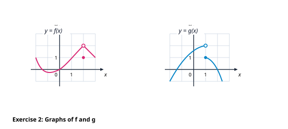

## Indeterminate forms and algebraic strategies

When direct substitution into a quotient $\frac{f(x)}{g(x)}$ yields $\frac{0}{0}$, the limit cannot be evaluated by the Quotient Law because the denominator limit is zero. The form $\frac{0}{0}$ is called an **indeterminate form**. It indicates that the numerator and denominator share a common vanishing factor $(x - a)$.

### Factoring and cancellation

If $P(a) = 0$ and $Q(a) = 0$, the Factor Theorem guarantees $(x - a)$ divides both polynomials: $P(x) = (x - a) P_1(x)$ and $Q(x) = (x - a) Q_1(x)$. Because the limit considers $x \neq a$, $(x - a) \neq 0$, so dividing out $(x - a)$ is valid:

$$\lim_{x \to a} \frac{P(x)}{Q(x)} = \lim_{x \to a} \frac{(x - a) P_1(x)}{(x - a) Q_1(x)} = \lim_{x \to a} \frac{P_1(x)}{Q_1(x)} = \frac{P_1(a)}{Q_1(a)} \quad (\text{if } Q_1(a) \neq 0)$$

### Conjugate rationalization

When an indeterminate form involves a radical difference $\sqrt{A(x)} - B$, direct factoring is blocked. Multiplying numerator and denominator by conjugate $\sqrt{A(x)} + B$ utilizes the difference of squares $(\sqrt{A} - B)(\sqrt{A} + B) = A - B^2$, clearing the radical and exposing the factor $(x - a)$.

### Simplifying compound fractions

When nested fractions appear, such as $\frac{\frac{1}{x+k} - \frac{1}{k}}{x}$, combining the numerator over common denominator $k(x + k)$ produces $\frac{-x}{k(x+k)}$. The factor $x$ then cancels against the denominator, resolving the limit to $-\frac{1}{k^2}$.

## One-sided limits and absolute value splits

Many piecewise and non-smooth functions exhibit directional behavior that differs from the left and right.

- **One-Sided Limits:** The left-hand limit $\lim_{x \to a^-} f(x) = L_1$ restricts $x < a$. The right-hand limit $\lim_{x \to a^+} f(x) = L_2$ restricts $x > a$.
- **Directional Agreement Theorem:** $\lim_{x \to a} f(x) = L \iff \lim_{x \to a^-} f(x) = L \text{ and } \lim_{x \to a^+} f(x) = L$. If directional limits differ, the two-sided limit does not exist (DNE).

### Absolute value splits

The absolute value function is defined piecewise: $|x| = x$ for $x \ge 0$, and $|x| = -x$ for $x < 0$. For limits involving $|x - a|$, split into directional branches: for $x \to a^+$, $|x - a| = x - a$; for $x \to a^-$, $|x - a| = -(x - a)$.

For $\frac{|x|}{x}$: as $x \to 0^+$, $\frac{x}{x} = 1$; as $x \to 0^-$, $\frac{-x}{x} = -1$. Because $1 \neq -1$, $\lim_{x \to 0} \frac{|x|}{x}$ does not exist.

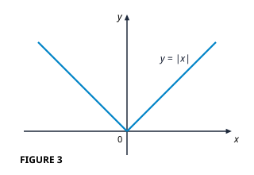

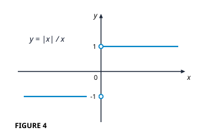

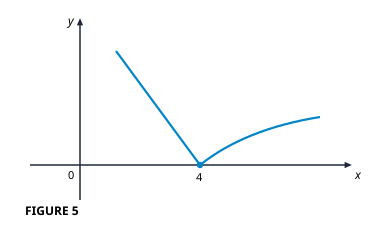

## The Squeeze (Sandwich) Theorem

Some limits cannot be evaluated by factoring or rationalization because the expression oscillates infinitely near the target point. The Squeeze Theorem traps the target function between two bounding functions.

- **Theorem Statement:** If $f(x) \le g(x) \le h(x)$ near $a$ (except possibly at $a$) and $\lim_{x \to a} f(x) = \lim_{x \to a} h(x) = L$, then $\lim_{x \to a} g(x) = L$.

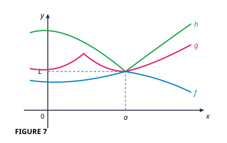

### Bounding oscillating functions

Because $-1 \le \sin(1/x) \le 1$ for all $x \neq 0$, multiplying by $x^2 \ge 0$ gives:

$$-x^2 \le x^2 \sin\left(\frac{1}{x}\right) \le x^2$$

Because $\lim_{x \to 0} (-x^2) = 0$ and $\lim_{x \to 0} x^2 = 0$, the Squeeze Theorem forces $\lim_{x \to 0} x^2 \sin(1/x) = 0$.

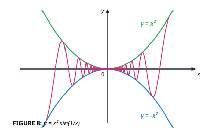

## Precise intuition: tolerance bands

The formal $(\varepsilon, \delta)$ definition of a limit translates intuitive proximity into a precision challenge: $\lim_{x \to a} f(x) = L \iff \forall \varepsilon > 0, \; \exists \delta > 0$ such that $0 < |x - a| < \delta \implies |f(x) - L| < \varepsilon$. An allowable output band $\mathopen{]}L - \varepsilon, L + \varepsilon\mathclose{[}$ requires finding a control window $\mathopen{]}a - \delta, a + \delta\mathclose{[}$ whose outputs all lie within the target band.

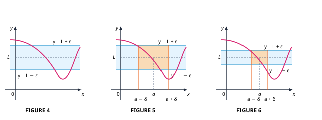

## Continuity at a number and on an interval

Continuity formalizes the geometric property that a curve has no breaks, jumps, holes, or vertical gaps.

### The 3-condition continuity test

A function $f$ is **continuous at a number $a$** if and only if:
- **Condition 1:** $f(a)$ is defined ($a \in \operatorname{dom}(f)$).
- **Condition 2:** $\lim_{x \to a} f(x)$ exists as a finite real number.
- **Condition 3:** $\lim_{x \to a} f(x) = f(a)$.

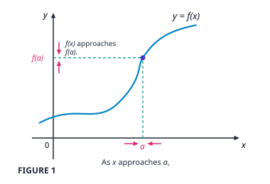

### Classification of discontinuities

- **Removable Discontinuity (Hole):** $\lim_{x \to a} f(x) = L$ exists, but $f(a)$ is undefined or $f(a) \neq L$.
- **Jump Discontinuity:** Both one-sided limits exist as finite numbers, but $\lim_{x \to a^-} f(x) \neq \lim_{x \to a^+} f(x)$.
- **Infinite Discontinuity (Vertical Asymptote):** One or both one-sided limits diverge to $+\infty$ or $-\infty$.

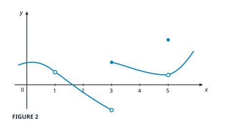

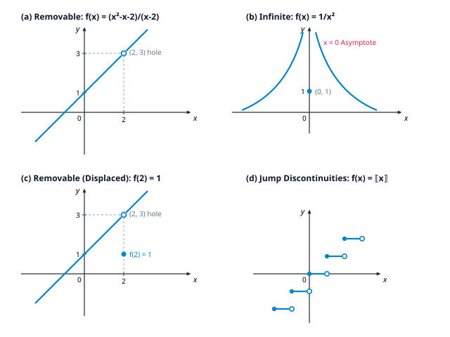

### Continuity on intervals and composite functions

- A function $f$ is continuous on $[a, b]$ if it is continuous on $\mathopen{]}a, b\mathclose{[}$, right-continuous at $a$ ($\lim_{x \to a^+} f(x) = f(a)$), and left-continuous at $b$ ($\lim_{x \to b^-} f(x) = f(b)$).
- Polynomials, rational functions, radicals, exponentials, logarithms, and trigonometric functions are continuous on their natural domains.
- If $g$ is continuous at $a$ and $f$ is continuous at $g(a)$, composite $(f \circ g)(x) = f(g(x))$ is continuous at $a$: $\lim_{x \to a} f(g(x)) = f(\lim_{x \to a} g(x)) = f(g(a))$.

## The Intermediate Value Theorem (IVT)

If $f$ is continuous on the closed bounded interval $[a, b]$ and $u$ is any number strictly between $f(a)$ and $f(b)$, where $f(a) \neq f(b)$, then there exists at least one number $c \in \mathopen{]}a, b\mathclose{[}$ such that $f(c) = u$.

- **Hypotheses:** (1) $f$ must be continuous on the entire closed interval $[a, b]$; (2) $u$ must lie strictly between $f(a)$ and $f(b)$.
- **Root Finding:** If $f(a) \cdot f(b) < 0$ and $f$ is continuous on $[a, b]$, there exists at least one root $c \in \mathopen{]}a, b\mathclose{[}$ where $f(c) = 0$. The IVT guarantees existence, not uniqueness.

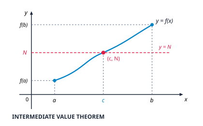

## Strategy routine

- **Stage 1 (Classification & Domain):** Classify function family. Check domain conditions ($g(x) \neq 0$, radicands $\ge 0$). Test direct substitution; detect $0/0$ or piecewise split boundaries.
- **Stage 2 (Algebraic Preparation):** Factor polynomials, multiply by radical conjugates, combine compound fractions, or split absolute values into directional branches ($x < a$ vs $x > a$).
- **Stage 3 (Core Operation):** Cancel common vanishing factor $(x - a)$, apply Squeeze Theorem with verified bounds, or evaluate the 3-condition continuity criteria.
- **Stage 4 (Interpretation & Boundary Check):** Confirm interval endpoints in Bourbaki notation ($[a, b]$, $\mathopen{]}a, b\mathclose{[}$). Classify discontinuities. When using IVT, verify continuity on closed $[a, b]$ and confirm sign change.

## Mistakes, edge cases & strategies

| Trap | Correct reasoning | Strategy |
| :--- | :--- | :--- |
| **Quotient Law with zero denominator** | $\lim \frac{f}{g} = \frac{\lim f}{\lim g}$ requires $\lim g \neq 0$. If $\lim g = 0$, law is invalid. | If direct substitution gives $0/0$, algebraically factor or rationalize before taking limits. |
| **Assuming $\frac{0}{0}$ means limit DNE** | Form $\frac{0}{0}$ is indeterminate; common factor $(x - a)$ must be cancelled. | Factor or rationalize to expose and cancel $(x - a)$ before concluding. |
| **Forgetting that $\sqrt{x^2} = \|x\|$** | $\sqrt{x^2} = \|x\|$, which equals $-x$ for negative $x$. Assuming $\sqrt{x^2} = x$ causes sign errors. | Replace $\sqrt{u^2}$ with $\|u\|$, then evaluate directional limits using one-sided branches. |
| **Classifying $\pm\infty$ as a jump** | Jump discontinuity requires *both* one-sided limits to be finite numbers. | If either directional limit diverges to $\pm\infty$, classify as an infinite discontinuity. |
| **Applying IVT across a discontinuity** | IVT requires continuity on the full closed interval $[a, b]$ without breaks. | Verify domain and continuity on $[a, b]$ before checking endpoint signs ($1/x$ on $[-1, 1]$ fails). |
| **Claiming IVT proves unique root** | IVT guarantees *at least one* root, not uniqueness; multiple crossings may occur. | Conclude existence only. Uniqueness requires proving strict monotonicity. |

## Worked examples

### Worked Example 1: Limit Laws applied to graphical curves

Using the graphs of $f$ and $g$ from Section 1 (Limit laws catalog), evaluate $\lim_{x \to 2} [3f(x) - (g(x))^2]$ if it exists, or explain why it does not exist.

> **Stage 1 (Classification & Domain).** Linear combination and power of $f$ and $g$. Limit Laws apply if both component limits $\lim_{x \to 2} f(x)$ and $\lim_{x \to 2} g(x)$ exist as finite real numbers.
>
> **Stage 2 (Algebraic Preparation).** Inspect Section 1 graphs near $x = 2$: for $f(x)$, both sides approach the open hole at $(2, 2)$, so $\lim_{x \to 2} f(x) = 2$ (note $f(2) = 1$). For $g(x)$, both sides pass through $(2, 0)$, so $\lim_{x \to 2} g(x) = 0$.
>
> **Stage 3 (Core Operation).** Apply the Difference Law, Constant Multiple Law, and Power Law:
>
> $\displaystyle \lim_{x \to 2} [3f(x) - (g(x))^2] = 3\left(\lim_{x \to 2} f(x)\right) - \left(\lim_{x \to 2} g(x)\right)^2 = 3(2) - (0)^2 = 6$
>
> **Stage 4 (Interpretation & Boundary Check).** Limits depend on values near $x = 2$, not at $x = 2$. Verified limit: $6$.

### Worked Example 2: Resolving an indeterminate form $0/0$ by factoring

Evaluate the algebraic limit $\lim_{x \to 1} \frac{x^2 - 1}{x^2 + 5x - 6}$.

> **Stage 1 (Classification & Domain).** Direct substitution yields $\frac{0}{0}$, an indeterminate rational form.
>
> **Stage 2 (Algebraic Preparation).** Factor numerator and denominator: $x^2 - 1 = (x - 1)(x + 1)$ and $x^2 + 5x - 6 = (x - 1)(x + 6)$. For $x \neq 1$, cancel $(x - 1)$: $\frac{x + 1}{x + 6}$.
>
> **Stage 3 (Core Operation).** Apply the Quotient Law:
>
> $\displaystyle \lim_{x \to 1} \frac{x + 1}{x + 6} = \frac{1 + 1}{1 + 6} = \frac{2}{7}$
>
> **Stage 4 (Interpretation & Boundary Check).** The curve has a removable discontinuity at $x = 1$ with limiting value $\frac{2}{7}$.

### Worked Example 3: Evaluating an indeterminate limit via conjugate rationalization

Evaluate the algebraic limit $\lim_{t \to 0} \frac{\sqrt{t + 9} - 3}{t}$.

> **Stage 1 (Classification & Domain).** Direct substitution gives $\frac{0}{0}$, an indeterminate radical difference.
>
> **Stage 2 (Algebraic Preparation).** Multiply numerator and denominator by conjugate $\sqrt{t + 9} + 3$:
>
> $\displaystyle \frac{(\sqrt{t + 9} - 3)(\sqrt{t + 9} + 3)}{t(\sqrt{t + 9} + 3)} = \frac{(t + 9) - 9}{t(\sqrt{t + 9} + 3)} = \frac{t}{t(\sqrt{t + 9} + 3)}$
>
> **Stage 3 (Core Operation).** Cancel $t$ for $t \neq 0$:
>
> $\displaystyle \lim_{t \to 0} \frac{1}{\sqrt{t + 9} + 3} = \frac{1}{\sqrt{0 + 9} + 3} = \frac{1}{3 + 3} = \frac{1}{6}$
>
> **Stage 4 (Interpretation & Boundary Check).** Domain requires $t \ge -9$ with $t \neq 0$. Verified limit: $\frac{1}{6}$.

### Worked Example 4: Squeeze Theorem evaluation of oscillating functions

Evaluate the limit $\lim_{x \to 0} x^4 \cos\left(\frac{2}{x}\right)$.

> **Stage 1 (Classification & Domain).** Direct substitution fails because $\cos(2/x)$ oscillates infinitely between $-1$ and $1$ as $x \to 0$.
>
> **Stage 2 (Algebraic Preparation).** Bound the cosine factor: $-1 \le \cos(2/x) \le 1$ for all $x \neq 0$. Multiplying by $x^4 > 0$ preserves inequalities: $-x^4 \le x^4 \cos(2/x) \le x^4$.
>
> **Stage 3 (Core Operation).** Evaluate bounding limits: $\lim_{x \to 0} (-x^4) = 0$ and $\lim_{x \to 0} x^4 = 0$. By the Squeeze Theorem:
>
> $\displaystyle \lim_{x \to 0} x^4 \cos\left(\frac{2}{x}\right) = 0$
>
> **Stage 4 (Interpretation & Boundary Check).** The envelope curves $y = \pm x^4$ pinch the oscillation to zero at the origin.

### Worked Example 5: Classifying discontinuities analytically

Determine all points of discontinuity of $f(x) = \begin{cases} \frac{x^2 - x - 2}{x - 2} & \text{if } x < 2 \\ 5 & \text{if } x = 2 \\ 2x - 1 & \text{if } x > 2 \end{cases}$ and classify the discontinuity at $x = 2$.

> **Stage 1 (Classification & Domain).** Piecewise function with interface at $x = 2$. Both branches are continuous on their open intervals.
>
> **Stage 2 (Algebraic Preparation).** For $x < 2$: $\frac{x^2 - x - 2}{x - 2} = \frac{(x - 2)(x + 1)}{x - 2} = x + 1$.
>
> **Stage 3 (Core Operation).** Test the 3-condition continuity criteria at $x = 2$: $f(2) = 5$ is defined; $\lim_{x \to 2^-} f(x) = 2 + 1 = 3$; $\lim_{x \to 2^+} f(x) = 2(2) - 1 = 3$. The limit exists ($\lim_{x \to 2} f(x) = 3$), but $\lim_{x \to 2} f(x) = 3 \neq 5 = f(2)$.
>
> **Stage 4 (Interpretation & Boundary Check).** Because the limit exists but does not equal $f(2)$, $f$ has a **removable discontinuity** at $x = 2$.

### Worked Example 6: Proving root existence using the Intermediate Value Theorem

Prove that the polynomial equation $4x^3 - 6x^2 + 3x - 2 = 0$ has at least one real root in $\mathopen{]}1, 2\mathclose{[}$.

> **Stage 1 (Classification & Domain).** Let $f(x) = 4x^3 - 6x^2 + 3x - 2$. Root finding corresponds to solving $f(x) = 0$.
>
> **Stage 2 (Algebraic Preparation).** Check IVT Hypothesis 1: As a polynomial, $f$ is continuous on $\mathbb{R}$, hence continuous on closed interval $[1, 2]$.
>
> **Stage 3 (Core Operation).** Evaluate endpoints: $f(1) = 4(1) - 6(1) + 3(1) - 2 = -1 < 0$ and $f(2) = 4(8) - 6(4) + 3(2) - 2 = 12 > 0$. Target $u = 0$ lies strictly between $f(1) = -1$ and $f(2) = 12$.
>
> **Stage 4 (Interpretation & Boundary Check).** Both hypotheses are satisfied. By the IVT, there exists at least one $c \in \mathopen{]}1, 2\mathclose{[}$ such that $f(c) = 0$.

## Exercises

### Q1

**1.** Evaluate the algebraic limit $\lim_{x \to 3} \frac{x^3 - 2x^2 - 9}{x^2 - 2x - 3}$ showing all factoring and cancellation steps.

**2.** Evaluate the algebraic limit $\lim_{x \to 2} \frac{\sqrt{x^2 + 12} - 4}{x - 2}$ using conjugate rationalization.

**3.** Evaluate the algebraic limit $\lim_{x \to -1} \frac{\frac{2}{x + 3} - 1}{x + 1}$ by simplifying compound fractions.

### Q2

**1.** Using the graphs of $f$ and $g$ in `figures/sec2_3_ex2_graphs_fg.svg`, evaluate the following limits or state that they do not exist: (a) $\lim_{x \to 1^-} g(x)$, (b) $\lim_{x \to 1^+} g(x)$, (c) $\lim_{x \to 1} g(x)$, (d) $\lim_{x \to 2} f(x)$, and (e) the value $f(2)$.

**2.** Consider the piecewise function $h(x)$ defined by:

$$h(x) = \begin{cases} \frac{x^2 - 9}{|x - 3|} & \text{if } x \neq 3 \\ 6 & \text{if } x = 3 \end{cases}$$

Evaluate the one-sided limits $\lim_{x \to 3^-} h(x)$ and $\lim_{x \to 3^+} h(x)$, and state whether the two-sided limit $\lim_{x \to 3} h(x)$ exists.

### Q3

**1.** Which of the following statements regarding limits, the Squeeze Theorem, and continuity is mathematically valid?

- A) If $1 - x \le f(x) \le 2 + x^2$ for all $x$, then $\lim_{x \to 0} f(x) = 1.5$ by averaging the bounding limits.
- B) If $\lim_{x \to a^-} f(x) = 3$ and $\lim_{x \to a^+} f(x) = +\infty$, then $f$ has a jump discontinuity at $x = a$ of infinite magnitude.
- C) If $\lim_{x \to a} f(x) = 0$ and $\lim_{x \to a} g(x) = 0$, then by the Quotient Law, $\lim_{x \to a} \frac{f(x)}{g(x)} = \frac{0}{0}$, so the limit cannot exist.
- D) If $f$ is continuous on $[0, 4]$ with $f(0) = -2$ and $f(4) = 5$, then the Intermediate Value Theorem guarantees that there is exactly one solution to $f(c) = 0$ in $\mathopen{]}0, 4\mathclose{[}$.
- E) If $2 - x^2 \le g(x) \le 2 \cos(x)$ for all $x \in \mathopen{]}-1, 1\mathclose{[}$, then $\lim_{x \to 0} g(x) = 2$ by the Squeeze Theorem.

### Q4

**1.** Determine all real numbers $x$ at which the rational function $f(x) = \frac{(x^2 - 1)(x - 3)}{(x - 1)(x - 3)^2 (x + 2)}$ is discontinuous, and classify each point of discontinuity as removable, jump, or infinite.

**2.** Consider the piecewise function $g(x)$ defined on $\mathbb{R}$ by:

$$g(x) = \begin{cases} k x^2 + 2x - 1 & \text{if } x < 1 \\ m & \text{if } x = 1 \\ \frac{\sqrt{x + 3} - 2}{x - 1} + 3 & \text{if } x > 1 \end{cases}$$

Determine the exact rational values of the constants $k$ and $m$ such that $g(x)$ is continuous everywhere on $\mathbb{R}$.

### Q5

**1.** Verify that the hypotheses of the Intermediate Value Theorem are satisfied for the equation $x^3 - 3x + 1 = 0$ on the closed interval $[1, 2]$, and prove that the equation has at least one real root in $\mathopen{]}1, 2\mathclose{[}$.

**2.** Apply two successive iterations of interval bisection starting on $[1, 2]$ to locate the root within a subinterval of width $\le 0.25$, stating the exact midpoint evaluations and the final containing subinterval in Bourbaki notation.

### Q6

**1.** A microfluidic bio-separation channel transports fluid through a selective membrane filter located at interface $x = 2$ millimeters. The fluid pressure distribution $P(x)$ (in kilopascals, kPa) along the channel axis $x \in [0, 5]$ is governed by:

$$P(x) = \begin{cases} \frac{\alpha x^2 + 8x}{x + 2} & \text{if } 0 \le x < 2 \\ \beta & \text{if } x = 2 \\ \frac{\sqrt{3x + 10} - 4}{x - 2} + 7 & \text{if } 2 < x \le 5 \end{cases}$$

where $\alpha$ is a channel upstream geometry coefficient, and $\beta$ is the membrane interface pressure. Evaluate the downstream limiting pressure $\lim_{x \to 2^+} P(x)$ algebraically using conjugate rationalization.

**2.** To prevent mechanical cavitation and shear stress failure at the membrane, the pressure distribution must not experience an abrupt jump at $x = 2$. Determine the unique value of the geometry parameter $\alpha$ such that $\lim_{x \to 2^-} P(x) = \lim_{x \to 2^+} P(x)$, and determine the membrane pressure $\beta$ required for $P(x)$ to be continuous at $x = 2$.

**3.** With $\alpha = \frac{27}{8}$ and $\beta = \frac{59}{8}$, the pressure profile $P(x)$ is continuous on the entire channel $[0, 5]$. An embedded pressure-sensitive sensor valve triggers an alarm if the local pressure equals exactly $5.0\text{ kPa}$. Apply the Intermediate Value Theorem on $[0, 2]$ to prove that there exists at least one trigger location $x_c \in \mathopen{]}0, 2\mathclose{[}$ where $P(x_c) = 5.0\text{ kPa}$, and compute the exact analytical coordinate $x_c$.
