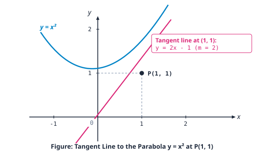
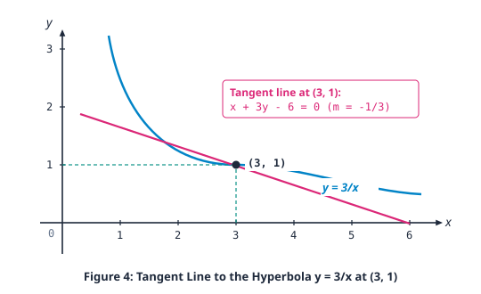
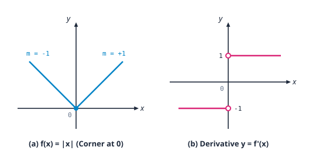
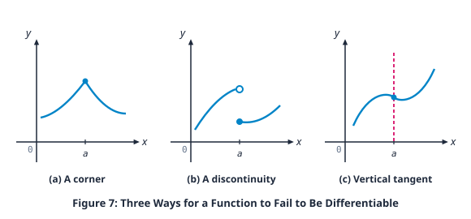
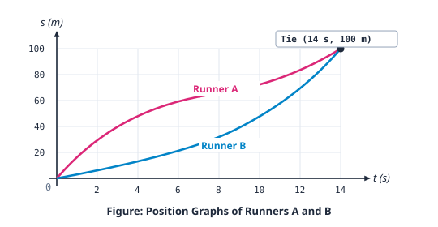

# 003: Tangent Lines, Differentiability, and Rates of Change

This handout builds on Handout 001, *Functions, Transformations, and Limits*, and Handout 002, *Limit Laws, Squeeze Theorem, and Continuity*. Calculus investigates continuous variation and instantaneous rates of change. While algebra measures average rate of change over an extended interval, differential calculus formulates instantaneous rates of change by passing secant slopes to their limiting values.

The limit of a difference quotient is the mathematical engine of differential calculus. It determines the tangent line to a geometric curve, calculates instantaneous velocities in physics, governs marginal rates in economics, and establishes the foundational machinery for multivariable calculus—where difference quotients generalize directly to partial derivatives and tangent hyperplanes.

## The tangent line and secant slopes

The central geometric problem of differential calculus is finding the tangent line to a continuous curve $y = f(x)$ at a specified point $P(a, f(a))$.

To construct this line, choose a distinct neighboring point $Q(x, f(x))$ on the curve. The line passing through $P$ and $Q$ is called a **secant line**. The slope of this secant line, denoted $m_{PQ}$, represents the average rate of change of $y$ with respect to $x$ across the interval between $a$ and $x$:

$$m_{PQ} = \frac{\Delta y}{\Delta x} = \frac{f(x) - f(a)}{x - a}$$

As $x$ approaches $a$, the point $Q$ slides along the curve toward $P$. If the secant slope $m_{PQ}$ approaches a unique finite real limiting value $m$, then the line passing through $P$ with slope $m$ is defined as the tangent line.

### Definition of the tangent line

The **tangent line** to the curve $y = f(x)$ at the point $P(a, f(a))$ is the line through $P$ with slope:

$$m = \lim_{x \to a} \frac{f(x) - f(a)}{x - a}$$

provided that this limit exists as a finite real number. The point-slope equation of the tangent line is:

$$y - f(a) = m(x - a)$$

### Alternative formulation using the increment $h$

In algebraic calculations, working with the displacement increment $h = x - a$ is often more convenient than working with $x - a$. Setting $x = a + h$, the condition $x \to a$ is mathematically equivalent to $h \to 0$. Substituting these into the tangent slope definition yields:

$$m = \lim_{h \to 0} \frac{f(a + h) - f(a)}{h}$$

### Worked examples: tangent lines to curves

**Worked Example 1.** Determine an equation of the tangent line to the parabola $y = x^2$ at the point $P(1, 1)$.

> **Stage 1 (Classification & Domain).** The function $f(x) = x^2$ is a polynomial with domain $\mathopen{]}-\infty, +\infty\mathclose{[}$. The contact point is $(a, f(a)) = (1, 1)$.
>
> **Stage 2 (Algebraic Preparation).** Set up the difference quotient using the increment formulation with $a = 1$:
>
> $\displaystyle \frac{f(1 + h) - f(1)}{h} = \frac{(1 + h)^2 - 1^2}{h} = \frac{1 + 2h + h^2 - 1}{h} = \frac{2h + h^2}{h}$
>
> **Stage 3 (Core Operation).** Factor out $h$ for $h \ne 0$ and evaluate the limit as $h \to 0$:
>
> $\displaystyle m = \lim_{h \to 0} \frac{h(2 + h)}{h} = \lim_{h \to 0} (2 + h) = 2 + 0 = 2$
>
> **Stage 4 (Interpretation & Boundary Check).** The tangent slope is $m = 2$. Using point-slope form $y - y_0 = m(x - x_0)$ at $(1, 1)$:
>
> $\displaystyle y - 1 = 2(x - 1) \;\Longrightarrow\; y = 2x - 1$
>
> Verified tangent equation: $y = 2x - 1$.

**Worked Example 2.** Determine an equation of the tangent line to the hyperbola $y = \frac{3}{x}$ at the point $(3, 1)$.

> **Stage 1 (Classification & Domain).** The rational function $f(x) = \frac{3}{x}$ has domain $\mathopen{]}-\infty, 0\mathclose{[} \cup \mathopen{]}0, +\infty\mathclose{[}$. At $a = 3$, $f(3) = 1$, which is well inside the domain.
>
> **Stage 2 (Algebraic Preparation).** Formulate the difference quotient at $a = 3$:
>
> $\displaystyle \frac{f(3 + h) - f(3)}{h} = \frac{\frac{3}{3 + h} - 1}{h}$
>
> Combine terms in the numerator over a common denominator:
>
> $\displaystyle \frac{3 - (3 + h)}{3 + h} = \frac{-h}{3 + h} \;\Longrightarrow\; \frac{\frac{-h}{3 + h}}{h} = \frac{-h}{h(3 + h)}$
>
> **Stage 3 (Core Operation).** Cancel the non-zero factor $h$ and evaluate the limit:
>
> $\displaystyle m = \lim_{h \to 0} \frac{-1}{3 + h} = -\frac{1}{3 + 0} = -\frac{1}{3}$
>
> **Stage 4 (Interpretation & Boundary Check).** Using point-slope form at $(3, 1)$:
>
> $\displaystyle y - 1 = -\frac{1}{3}(x - 3) \;\Longrightarrow\; 3(y - 1) = -(x - 3) \;\Longrightarrow\; x + 3y - 6 = 0$
>
> Verified tangent equation: $x + 3y - 6 = 0$ (or $y = -\frac{1}{3}x + 2$).

## The derivative at a point and linear approximation

Because limits of difference quotients govern tangent lines, instantaneous velocities, and instantaneous reaction rates across science and engineering, this limit is formalized as the fundamental operation of differential calculus.

### Definition of the derivative at a point

The **derivative of a function $f$ at a number $a$**, denoted by $f'(a)$ (read "$f$ prime of $a$"), is defined by:

$$f'(a) = \lim_{h \to 0} \frac{f(a + h) - f(a)}{h}$$

provided this limit exists. Equivalently, substituting $x = a + h$:

$$f'(a) = \lim_{x \to a} \frac{f(x) - f(a)}{x - a}$$

Geometrically, $f'(a)$ is the exact slope of the tangent line to the curve $y = f(x)$ at the point $(a, f(a))$.

### Linear approximation (tangent line approximation)

Near the point of tangency $x = a$, the tangent line remains extremely close to the curve $y = f(x)$. Solving the tangent line equation $y - f(a) = f'(a)(x - a)$ for $y$ yields the **linearization** $L(x)$:

$$L(x) = f(a) + f'(a)(x - a)$$

The approximation $f(x) \approx L(x)$ is called the **linear approximation** (or tangent line approximation) of $f$ near $a$.

> **Multivariable Connection (MATH 254).** In multivariable calculus, the single-variable linear approximation $L(x) = f(a) + f'(a)(x - a)$ generalizes directly to the tangent plane and total differential for a surface $z = f(x, y)$ at $(x_0, y_0)$:
>
> $\displaystyle L(x, y) = f(x_0, y_0) + f_x(x_0, y_0)(x - x_0) + f_y(x_0, y_0)(y - y_0)$
>
> where the partial derivatives $f_x$ and $f_y$ are single-variable difference-quotient limits holding one coordinate fixed.

**Worked Example 3.** For the quadratic function $f(x) = x^2 - 8x + 9$:
- (a) Compute $f'(a)$ for any arbitrary real number $a$.
- (b) Construct the linear approximation $L(x)$ at $a = 2$ and estimate $f(2.05)$.

> **Stage 1 (Classification & Domain).** The function $f(x) = x^2 - 8x + 9$ is a polynomial defined on $\mathopen{]}-\infty, +\infty\mathclose{[}$.
>
> **Stage 2 (Algebraic Preparation).** Form the difference quotient at an arbitrary point $a$:
>
> $\displaystyle f(a + h) = (a + h)^2 - 8(a + h) + 9 = a^2 + 2ah + h^2 - 8a - 8h + 9$
>
> $\displaystyle f(a + h) - f(a) = (2ah + h^2 - 8h) = h(2a + h - 8)$
>
> **Stage 3 (Core Operation).** Divide by $h$ and compute the limit as $h \to 0$:
>
> $\displaystyle f'(a) = \lim_{h \to 0} \frac{h(2a + h - 8)}{h} = \lim_{h \to 0} (2a + h - 8) = 2a - 8$
>
> For part (b), evaluate at $a = 2$: $f(2) = 2^2 - 8(2) + 9 = -3$, and $f'(2) = 2(2) - 8 = -4$.
>
> The linear approximation formula gives:
>
> $\displaystyle L(x) = -3 - 4(x - 2)$
>
> Evaluate at $x = 2.05$: $L(2.05) = -3 - 4(0.05) = -3 - 0.20 = -3.20$.
>
> **Stage 4 (Interpretation & Boundary Check).** The exact value is $f(2.05) = (2.05)^2 - 8(2.05) + 9 = 4.2025 - 16.40 + 9 = -3.1975$. The linear approximation error is $|-3.1975 - (-3.20)| = 0.0025$, confirming high accuracy near $a = 2$.
>
> Verified derivative: $f'(a) = 2a - 8$; verified estimate: $L(2.05) = -3.20$.

## The derivative as a function

When we allow the point $a$ to vary over the entire domain of $f$, the derivative becomes a new function $f'$, defined by:

$$f'(x) = \lim_{h \to 0} \frac{f(x + h) - f(x)}{h}$$

The domain of $f'$ is the set of all numbers $x$ for which this limit exists:

$$\operatorname{dom}(f') = \{x \in \operatorname{dom}(f) \mid f'(x) \text{ exists}\} \subseteq \operatorname{dom}(f)$$

A function is **differentiable at $a$** if $f'(a)$ exists. It is **differentiable on an open interval** $\mathopen{]}a, b\mathclose{[}$ if it is differentiable at every number in the interval.

**Worked Example 4.** Determine where the absolute value function $f(x) = |x|$ is differentiable, and compute its derivative function.

> **Stage 1 (Classification & Domain).** The function $f(x) = |x|$ is defined on $\mathopen{]}-\infty, +\infty\mathclose{[}$. We partition the analysis into three natural regions: $x > 0$, $x < 0$, and the transition point $x = 0$.
>
> **Stage 2 (Algebraic Preparation).**
> - For $x > 0$, $|x| = x$. For small $h$, $x + h > 0$, so $|x + h| = x + h$.
> - For $x < 0$, $|x| = -x$. For small $h$, $x + h < 0$, so $|x + h| = -(x + h)$.
> - At $x = 0$, $f(0) = 0$, and the difference quotient is $\frac{|0 + h| - |0|}{h} = \frac{|h|}{h}$.
>
> **Stage 3 (Core Operation).**
> - For $x > 0$: $\displaystyle \lim_{h \to 0} \frac{(x + h) - x}{h} = \lim_{h \to 0} \frac{h}{h} = 1$.
> - For $x < 0$: $\displaystyle \lim_{h \to 0} \frac{-(x + h) - (-x)}{h} = \lim_{h \to 0} \frac{-h}{h} = -1$.
> - At $x = 0$, evaluate one-sided limits:
>
> $\displaystyle \lim_{h \to 0^+} \frac{|h|}{h} = \lim_{h \to 0^+} \frac{h}{h} = 1, \qquad \lim_{h \to 0^-} \frac{|h|}{h} = \lim_{h \to 0^-} \frac{-h}{h} = -1$
>
> Because the one-sided limits are unequal ($1 \ne -1$), the two-sided limit does not exist.
>
> **Stage 4 (Interpretation & Boundary Check).** The derivative $f'(0)$ does not exist. The function $f(x) = |x|$ is differentiable on $\mathopen{]}-\infty, 0\mathclose{[} \cup \mathopen{]}0, +\infty\mathclose{[}$ with:
>
> $\displaystyle f'(x) = \begin{cases} 1 & \text{if } x > 0 \\ -1 & \text{if } x < 0 \end{cases}$
>
> Verified result: $f$ is differentiable for all $x \ne 0$, but fails to be differentiable at $x = 0$.

## Differentiability and continuity

A cornerstone theorem of differential calculus establishes that differentiability is a strictly stronger condition than continuity.

### Differentiability implies continuity

**Theorem.** If a function $f$ is differentiable at $a$, then $f$ is continuous at $a$.

*Analytical Justification.* To prove continuity, we must show that $\lim_{x \to a} f(x) = f(a)$, which is equivalent to proving that $\lim_{x \to a} [f(x) - f(a)] = 0$.

For any $x \ne a$, write the identity:

$$f(x) - f(a) = \frac{f(x) - f(a)}{x - a} \cdot (x - a)$$

Taking limits as $x \to a$ and applying the Product Law for limits:

$$\lim_{x \to a} [f(x) - f(a)] = \lim_{x \to a} \left[ \frac{f(x) - f(a)}{x - a} \cdot (x - a) \right] = \lim_{x \to a} \frac{f(x) - f(a)}{x - a} \cdot \lim_{x \to a} (x - a) = f'(a) \cdot 0 = 0$$

Therefore:

$$\lim_{x \to a} f(x) = \lim_{x \to a} [f(a) + (f(x) - f(a))] = f(a) + 0 = f(a)$$

which establishes that $f$ is continuous at $a$.

### The converse is false

Continuity does **not** imply differentiability. As demonstrated in Worked Example 4, $f(x) = |x|$ is continuous everywhere on $\mathbb{R}$ (including at $x = 0$), yet it fails to be differentiable at $x = 0$. Continuity requires only that the graph have no breaks or jumps; differentiability requires that the graph be locally smooth with a well-defined non-vertical tangent line.

### Geometric taxonomy of differentiability failure modes

A continuous or discontinuous function can fail to possess a derivative at a point $a$ in three primary ways:

- **1. A sharp corner or cusp:** The curve changes direction abruptly at $a$. The one-sided difference quotients approach different finite numbers ($\lim_{h \to 0^-} \ne \lim_{h \to 0^+}$, as in $|x|$ at $0$), or they blow up to infinity with opposite signs (a cusp, e.g. $x^{2/3}$ at $0$). No unique tangent line exists.
- **2. A discontinuity:** If $f$ is not continuous at $a$, it automatically fails to be differentiable at $a$ by the contrapositive of the theorem. Any jump, removable hole, or vertical asymptote destroys differentiability.
- **3. A vertical tangent line:** The curve is continuous at $a$, but the secant lines become infinitely steep as $x \to a$, so that $\lim_{x \to a} |f'(x)| = \infty$. Geometrically, a vertical tangent line $x = a$ exists, but analytically the slope is undefined (infinite), so $f'(a)$ does not exist as a real number (e.g. $f(x) = \sqrt[3]{x}$ at $x = 0$).

## Physical and kinematic rates of change

In physics and engineering, the derivative represents the instantaneous rate of change of any physical quantity. The most direct physical application is the motion of a particle along a straight coordinate axis.

Let $s = f(t)$ denote the position function of a particle at time $t$.
- Over a time interval $[t_1, t_2]$, the average velocity is:

$$v_{\text{avg}} = \frac{\Delta s}{\Delta t} = \frac{s(t_2) - s(t_1)}{t_2 - t_1}$$

- The **instantaneous velocity** $v(t)$ at time $t$ is the derivative of position:

$$v(t) = s'(t) = \lim_{\Delta t \to 0} \frac{s(t + \Delta t) - s(t)}{\Delta t}$$

- **Speed** is the absolute magnitude of velocity: $\text{speed} = |v(t)|$. Velocity has a sign indicating direction of motion; speed is always non-negative.
- **Acceleration** $a(t)$ is the instantaneous rate of change of velocity:

$$a(t) = v'(t) = s''(t) = \lim_{\Delta t \to 0} \frac{v(t + \Delta t) - v(t)}{\Delta t}$$

**Worked Example 5.** The figure below shows the position functions $s_A(t)$ and $s_B(t)$ of two runners, A and B, competing in a 100-meter sprint and finishing in a tie at $t = 14\text{ seconds}$.
- (a) Determine which runner has a higher initial velocity at the start line $t = 0$.
- (b) Determine the time at which the physical separation between the runners is greatest.
- (c) Identify when the two runners possess the exact same instantaneous velocity.

> **Stage 1 (Classification & Domain).** Both position functions $s_A(t)$ and $s_B(t)$ are continuous and differentiable on the race domain $[0, 14]$. Boundary values: $s_A(0) = s_B(0) = 0\text{ m}$ and $s_A(14) = s_B(14) = 100\text{ m}$.
>
> **Stage 2 (Algebraic Preparation).** The instantaneous velocity of each runner is the slope of the tangent line to their respective position curve: $v_A(t) = s'_A(t)$ and $v_B(t) = s'_B(t)$. The distance between the runners is $D(t) = s_A(t) - s_B(t)$.
>
> **Stage 3 (Core Operation).**
> - (a) At $t = 0$, the tangent slope of curve A is steep, whereas the tangent slope of curve B is nearly horizontal. Therefore $s'_A(0) > s'_B(0)$: Runner A starts with a much higher initial velocity.
> - (b) To find the maximum separation, set $D'(t) = 0 \;\Longrightarrow\; s'_A(t) - s'_B(t) = 0 \;\Longrightarrow\; s'_A(t) = s'_B(t)$. This occurs when the tangent lines to curves A and B are parallel. On the coordinate grid, the parallel tangent slopes occur between $t \approx 8\text{ s}$ and $t \approx 9\text{ s}$, where curve A reaches $s_A \approx 56\text{ m}$ and curve B is at $s_B \approx 24\text{ m}$, yielding a maximum separation of approximately $32\text{ meters}$.
> - (c) The runners have the same instantaneous velocity when $s'_A(t) = s'_B(t)$, which coincides exactly with the instant of maximum separation at $t \approx 8\text{ to } 9\text{ seconds}$.
>
> **Stage 4 (Interpretation & Boundary Check).** Runner A accelerates quickly and decelerates late (curve A is concave down, $s''_A(t) < 0$). Runner B starts slowly and accelerates continuously throughout the race (curve B is concave up, $s''_B(t) > 0$), surging over the final 5 seconds to match Runner A at the finish tape.
>
> Verified conclusions: Runner A has higher initial velocity; maximum separation occurs at $t \approx 8\text{ to } 9\text{ s}$; equal velocities occur at $t \approx 8\text{ to } 9\text{ s}$.

### Geometric inflection and acceleration in kinematics

The geometric curvature of a position-time graph reveals the sign of the instantaneous acceleration $a(t) = s''(t)$:
- When a position curve is **concave upward** ($s''(t) > 0$), the tangent slopes are becoming steeper over time. The instantaneous velocity $v(t)$ is increasing, indicating positive forward acceleration (as demonstrated by Runner B's late-race surge).
- When a position curve is **concave downward** ($s''(t) < 0$), the tangent slopes are flattening over time. The instantaneous velocity $v(t)$ is decreasing, indicating deceleration (as demonstrated by Runner A's fatigue over the final stretch).
- At the instant of maximum lead separation ($t \approx 8.5\text{ s}$), the velocity difference $v_A(t) - v_B(t) = 0$, meaning both runners move at identical speeds of approximately $7\text{ m/s}$ before Runner B pulls ahead in rate.

## Mistakes, edge cases & strategies

### Diagnostic table

| Trap | Correct reasoning | Strategy |
| :--- | :--- | :--- |
| **Confusing average rate with instantaneous rate** | The average rate of change $\frac{\Delta y}{\Delta x} = \frac{f(b) - f(a)}{b - a}$ is a secant slope over a finite interval $[a, b]$; the instantaneous rate is the limit of difference quotients as $h \to 0$ at a single instant. | Always identify whether the problem asks for an interval average ($\Delta s / \Delta t$) or a point derivative ($s'(t)$). |
| **Assuming continuity implies differentiability** | Differentiability requires local smoothness and a unique non-vertical tangent line. A function can be continuous but fail to be differentiable at corners, cusps, or vertical tangents. | Never conclude $f'(a)$ exists solely because $\lim_{x \to a} f(x) = f(a)$. Verify the limit of the difference quotient. |
| **Confusing vertical tangents with differentiability** | A vertical line $x = a$ is a valid geometric tangent line, but its slope is infinite. Analytically, $f'(a)$ exists only when the limit is a finite real number. | When the difference quotient blows up to $\pm\infty$, state that the curve possesses a vertical tangent line but $f$ is not differentiable at that point. |
| **Dropping limit notation prematurely** | Writing $\frac{f(a+h) - f(a)}{h} = f'(a)$ before taking the limit leads to invalid algebra and division-by-zero errors. | Retain $\lim_{h \to 0}$ on every line of intermediate algebraic simplification until $h$ is evaluated at $0$. |
| **Neglecting one-sided limits at piecewise boundaries** | A piecewise function can match function values at an interface while having unequal left-hand and right-hand slopes, forming a sharp corner. | To establish differentiability at a boundary $x = c$, compute both $\lim_{h \to 0^-} \frac{f(c+h)-f(c)}{h}$ and $\lim_{h \to 0^+} \frac{f(c+h)-f(c)}{h}$ separately and prove they are equal. |

### Systematic problem-solving habits

- **S1 (Classify & Domain):** State the formula family, determine natural domain restrictions, and check whether the point of interest lies in an open domain interval.
- **S2 (Algebraic Preparation):** Form the difference quotient $\frac{f(a+h) - f(a)}{h}$. Clear compound fractions with common denominators, expand polynomial terms, or rationalize radical expressions using conjugates.
- **S3 (Core Operation):** Factor and cancel the denominator factor $h$ (valid since $h \ne 0$ inside the limit), then evaluate the resulting expression at $h = 0$.
- **S4 (Interpretation & Boundary Check):** Confirm units (e.g. $\text{m/s}$ or $\text{m/s}^2$), verify that tangent lines agree geometrically with coordinate curves, and check continuity before asserting differentiability.

## Exercises

### Q1

**1.** Use the limit definition of the derivative, $f'(a) = \lim_{h \to 0} \frac{f(a + h) - f(a)}{h}$, to calculate the exact derivative value $f'(1)$ for the rational function $f(x) = \frac{2}{x + 3}$. Show all intermediate algebraic steps.

**2.** Use the limit definition of the derivative as a function, $f'(x) = \lim_{h \to 0} \frac{f(x + h) - f(x)}{h}$, to determine the derivative formula $f'(x)$ for the radical function $f(x) = \sqrt{3x + 1}$. State the domain of $f(x)$ and the domain of $f'(x)$ in Bourbaki interval notation.

### Q2

**1.** Determine the exact equation of the tangent line to the cubic curve $y = x^3 - 4x + 1$ at the point $(2, 1)$. State the equation in point-slope form and in slope-intercept form.

**2.** Construct the linear approximation function $L(x)$ for $f(x) = x^3 - 4x + 1$ centered at $a = 2$. Use $L(x)$ to estimate the function values $f(2.03)$ and $f(1.97)$, and compare these linear estimates with the exact decimal values of $f(2.03)$ and $f(1.97)$.

### Q3

**1.** Consider the continuous real-valued function $f(x) = \sqrt[3]{x}$ on the real line $\mathbb{R}$. Which of the following statements correctly characterizes the differentiability and geometric behavior of $f(x)$ at $x = 0$?

- A) The function $f$ is continuous at $x = 0$ and possesses a vertical tangent line $x = 0$, but is not differentiable at $x = 0$ because the difference quotient approaches $+\infty$.
- B) The function $f$ is not differentiable at $x = 0$ because $f(x)$ possesses an essential jump discontinuity at the origin.
- C) The function $f$ is differentiable at $x = 0$ because the tangent line $x = 0$ exists and is geometrically well-defined.
- D) The function $f$ has a sharp corner at $x = 0$ because the left-hand difference quotient approaches $-1$ while the right-hand difference quotient approaches $+1$.
- E) The function $f$ is differentiable at $x = 0$ because $\lim_{x \to 0} \sqrt[3]{x} = 0 = f(0)$ establishes continuity, which guarantees differentiability.

### Q4

**1.** A particle moves along a straight coordinate axis with position function given by $s(t) = 2t^3 - 9t^2 + 12t$ for time $t \ge 0$, where $s$ is measured in meters and $t$ is measured in seconds. Determine formulas for the instantaneous velocity $v(t)$ and instantaneous acceleration $a(t)$.

**2.** Determine all time intervals in Bourbaki interval notation during which the particle is moving in the positive direction ($s$ increasing), moving in the negative direction ($s$ decreasing), and state all specific instants when the particle is temporarily at rest.

**3.** Calculate the net displacement $\Delta s = s(3) - s(0)$ and the total physical distance traveled by the particle over the time interval $[0, 3]$.

### Q5

**1.** Consider the piecewise function $f(x)$ defined on $\mathbb{R}$ by:

$$f(x) = \begin{cases} x^2 + 2x & \text{if } x \le 1 \\ mx + b & \text{if } x > 1 \end{cases}$$

Determine the unique real values of constants $m$ and $b$ such that $f(x)$ is continuous and differentiable everywhere on $\mathbb{R}$.

**2.** Using the parameters determined in subpart 1, formulate both the left-hand difference quotient $\lim_{h \to 0^-} \frac{f(1 + h) - f(1)}{h}$ and the right-hand difference quotient $\lim_{h \to 0^+} \frac{f(1 + h) - f(1)}{h}$ to prove rigorously that $f'(1)$ exists.

### Q6

**1.** A two-stage sounding rocket is launched vertically from ground level at $t = 0$. During its first stage, the solid rocket motor provides powered ascent according to the quadratic altitude profile:

$$y_1(t) = 4t^2 \quad (0 \le t \le 10)$$

where altitude $y$ is in meters and time $t$ is in seconds. Using the limit definition of the derivative, compute the instantaneous velocity function $v_1(t)$ for $t \in [0, 10]$, and calculate the rocket's burnout velocity $v_1(10)$ and burnout altitude $y_1(10)$ at staging time $t = 10\text{ s}$.

**2.** Immediately following stage separation at $t = 10\text{ s}$, the unpowered upper stage continues upward in sustained aerodynamic ascent according to the radical altitude model:

$$y_2(t) = k \sqrt{t - 1} + h_0 \quad (t > 10)$$

To ensure physical continuity of flight and prevent instantaneous velocity jumps (infinite acceleration impulses), the altitude function $y(t)$ must be both continuous and differentiable at the staging transition $t = 10\text{ s}$. Determine the exact values of parameters $k$ and $h_0$.

**3.** Construct the linear approximation function $L(t)$ for the rocket's trajectory centered at the staging instant $t = 10\text{ s}$. Use $L(t)$ to estimate the rocket's altitude at $t = 10.5\text{ seconds}$, and calculate the difference between $L(10.5)$ and the true model altitude $y_2(10.5)$.

**4.** Compute the instantaneous acceleration $a(t) = y''(t)$ for the powered phase $t \in [0, 10\mathclose{[}$ and for the unpowered glide phase $t \in \mathopen{]}10, 26\mathclose{]}$. Evaluate the instantaneous acceleration at $t = 17\text{ s}$, and determine whether the acceleration function $a(t)$ is continuous across the staging boundary at $t = 10\text{ s}$.
