# 005: Implicit Differentiation, Critical Points, and the Mean Value Theorem

Calculus analyzes continuous change and instantaneous rates. When mathematical models express relationships between variables as intertwined equations rather than explicit formulas $y = f(x)$, determining rates of change requires differentiating equations implicitly. Once derivatives are established, calculus provides powerful analytical machinery to optimize systems by locating local and absolute extrema, screening critical numbers, and establishing existence guarantees via the Extreme Value Theorem, Rolle's Theorem, and the Mean Value Theorem.

This handout builds on Handout 003, *Tangent Lines, Difference Quotients, and Differentiability*, and Handout 004, *Derivative Rules and Transcendental Derivatives*. It establishes the foundational machinery for Handout 006, *Applied Optimization and Economic Models*, and Handout 007, *Antiderivatives, Riemann Sums, and the Definite Integral*.

In multivariable calculus (MATH 254), implicit differentiation forms the conceptual precursor to level surfaces $F(x, y, z) = c$, the Implicit Function Theorem, and Lagrange multiplier constraint equations ($\nabla f = \lambda \nabla g$). Locating interior critical points and testing them against closed boundaries via the Closed Interval Method provides the exact algorithmic blueprint for optimizing functions $f(x, y)$ over compact regions $D \subset \mathbb{R}^2$. Furthermore, Rolle's Theorem and the Mean Value Theorem provide the theoretical foundation for conservative vector fields and path independence in line integrals ($\int_C \nabla f \cdot d\mathbf{r}$).

## Implicit functions and the Chain Rule

An **explicit function** defines the dependent variable directly in terms of the independent variable:
$$y = f(x) \quad\text{such as}\quad y = \sqrt{25 - x^2} \quad\text{or}\quad y = x \sin(x)$$
Many geometric curves and physical relationships, however, are specified **implicitly** by an equation involving both $x$ and $y$:
$$F(x, y) = 0 \quad\text{such as}\quad x^2 + y^2 = 25 \quad\text{or}\quad x^3 + y^3 = 6xy$$

In simple cases, an implicit relation can be decomposed into several explicit functional branches. For example, solving $x^2 + y^2 = 25$ for $y$ yields two distinct explicit functions:
$$y = +\sqrt{25 - x^2} \quad\text{(upper semicircle)} \quad\text{and}\quad y = -\sqrt{25 - x^2} \quad\text{(lower semicircle)}$$

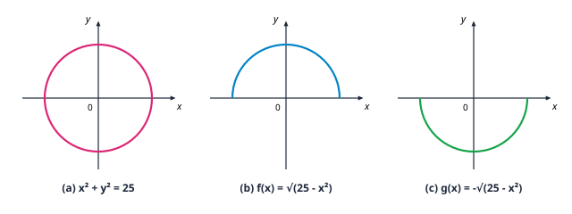

For most implicit equations, solving explicitly for $y$ is algebraically impossible or yields intractable formulas. The method of **implicit differentiation** bypasses the need for an explicit formula by differentiating both sides of the equation with respect to $x$, regarding $y$ as an unknown differentiable function $y = y(x)$.

### The Chain Rule on implicit terms

Because $y$ represents a function of $x$, every derivative of a term containing $y$ requires the Chain Rule:
$$\frac{d}{dx}[g(y)] = \frac{d}{dy}[g(y)] \cdot \frac{dy}{dx} = g'(y) \frac{dy}{dx}$$

Standard differentiation patterns include:
- **Powers of $y$:** $\displaystyle \frac{d}{dx}[y^n] = n y^{n-1} \frac{dy}{dx}$
- **Products of $x$ and $y$:** $\displaystyle \frac{d}{dx}[x y] = (1)y + x \frac{dy}{dx} = y + x \frac{dy}{dx}$
- **Higher products:** $\displaystyle \frac{d}{dx}[x^2 y^3] = 2x y^3 + x^2 (3y^2) \frac{dy}{dx} = 2x y^3 + 3x^2 y^2 \frac{dy}{dx}$
- **Trigonometric compositions:** $\displaystyle \frac{d}{dx}[\sin(y)] = \cos(y) \frac{dy}{dx}, \quad \frac{d}{dx}[\cos(x y)] = -\sin(x y)\left(y + x \frac{dy}{dx}\right)$

### Systematic four-step procedure for implicit derivatives

- **Step 1:** Differentiate both sides of the equation with respect to $x$, applying the Chain Rule and Product/Quotient Rules to all expressions involving $y$.
- **Step 2:** Expand products and collect all terms containing $\frac{dy}{dx}$ on the left-hand side of the equation.
- **Step 3:** Move all terms that do not contain $\frac{dy}{dx}$ to the right-hand side.
- **Step 4:** Factor out $\frac{dy}{dx}$ on the left-hand side and divide by its algebraic coefficient.

### Worked example 1: Tangent line to an implicit circle

Find $\frac{dy}{dx}$ for the circle $x^2 + y^2 = 25$, and determine the equation of the tangent line at the point $(3, 4)$.

> **Stage 1 (Classification & Domain).** The relation $x^2 + y^2 = 25$ defines a circle centered at the origin with radius $5$. The point $(3, 4)$ satisfies $3^2 + 4^2 = 9 + 16 = 25$.
>
> **Stage 2 (Algebraic Preparation).** Treat $y$ as a differentiable function of $x$ on an open neighborhood of $(3, 4)$.
>
> **Stage 3 (Core Operation).** Differentiate both sides with respect to $x$:
>
> $\displaystyle \frac{d}{dx}[x^2 + y^2] = \frac{d}{dx}[25] \;\Longrightarrow\; 2x + 2y \frac{dy}{dx} = 0$
>
> Isolate $\frac{dy}{dx}$:
>
> $\displaystyle 2y \frac{dy}{dx} = -2x \;\Longrightarrow\; \frac{dy}{dx} = -\frac{x}{y} \quad (y \ne 0)$
>
> Evaluate the slope at $(3, 4)$:
>
> $\displaystyle m = \frac{dy}{dx}\Bigg|_{(3, 4)} = -\frac{3}{4}$
>
> Formulate the point-slope tangent line:
>
> $\displaystyle y - 4 = -\frac{3}{4}(x - 3) \;\Longrightarrow\; 4(y - 4) = -3(x - 3) \;\Longrightarrow\; 3x + 4y = 25$
>
> **Stage 4 (Interpretation & Boundary Check).** Radial line from $(0, 0)$ to $(3, 4)$ has slope $m_{\text{rad}} = \frac{4}{3}$. Tangent line has slope $-\frac{3}{4}$, satisfying the perpendicularity condition $m_{\text{tan}} \cdot m_{\text{rad}} = -\frac{3}{4} \cdot \frac{4}{3} = -1$.
>
> Verified tangent equation: $3x + 4y = 25$.

## The Folium of Descartes and branch decompositions

A classic curve illustrating the power of implicit differentiation is the **Folium of Descartes**, defined by:
$$x^3 + y^3 = 6xy$$

Proposed by René Descartes in 1638, the folium consists of a closed loop in the first quadrant and two infinite asymptotic branches approaching the oblique line $x + y + 2 = 0$.

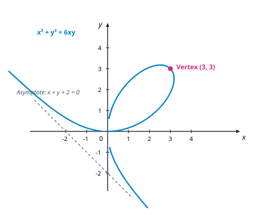

Solving $x^3 + y^3 = 6xy$ explicitly for $y$ requires Cardano's cubic formula and generates cumbersome expressions with nested radicals. Geometrically, the vertical line test fails for the complete curve; however, near any point where the tangent is not vertical, the folium decomposes into distinct single-valued differentiable branches.

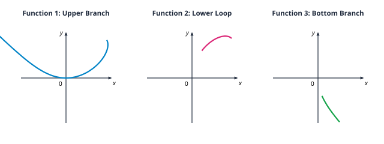

## Tangent lines and extrema on implicit curves

Horizontal and vertical tangent lines reveal the geometric boundaries and local extrema of implicit curves:

| Tangent type | Calculus condition | Algebraic condition | Geometric behavior |
| :--- | :--- | :--- | :--- |
| **Horizontal tangent** | $\frac{dy}{dx} = 0$ | Numerator of $\frac{dy}{dx} = 0$ while denominator $\ne 0$ | Curve attains local vertical peak or trough |
| **Vertical tangent** | $\frac{dx}{dy} = 0$ ($\frac{dy}{dx}$ undefined) | Denominator of $\frac{dy}{dx} = 0$ while numerator $\ne 0$ | Curve turns horizontally; vertical slope |
| **Singular node / cusp** | Indeterminate $\frac{0}{0}$ | Numerator and denominator vanish simultaneously | Self-intersection, node, or sharp corner |

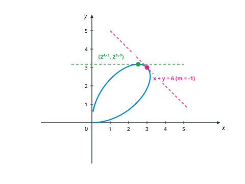

### Worked example 2: Tangents and local extrema on the Folium of Descartes

For the Folium of Descartes $x^3 + y^3 = 6xy$:
- (a) Determine the derivative $\frac{dy}{dx}$.
- (b) Find the equation of the tangent line at $(3, 3)$.
- (c) Determine the coordinates of the point in the first quadrant where the tangent line is horizontal.

> **Stage 1 (Classification & Domain).** The equation $x^3 + y^3 = 6xy$ is a third-degree implicit polynomial. At $(3, 3)$, $3^3 + 3^3 = 27 + 27 = 54$ and $6(3)(3) = 54$, verifying the point lies on the curve.
>
> **Stage 2 (Algebraic Preparation).** Apply the Product Rule to the mixed term $6xy$: $\frac{d}{dx}[6xy] = 6y + 6x \frac{dy}{dx}$.
>
> **Stage 3 (Core Operation).** Differentiate both sides with respect to $x$:
>
> $\displaystyle 3x^2 + 3y^2 \frac{dy}{dx} = 6y + 6x \frac{dy}{dx}$
>
> Divide through by $3$ and collect $\frac{dy}{dx}$ terms:
>
> $\displaystyle x^2 + y^2 \frac{dy}{dx} = 2y + 2x \frac{dy}{dx} \;\Longrightarrow\; (y^2 - 2x)\frac{dy}{dx} = 2y - x^2$
>
> $\displaystyle \frac{dy}{dx} = \frac{2y - x^2}{y^2 - 2x} \quad (y^2 - 2x \ne 0)$
>
> At $(3, 3)$:
>
> $\displaystyle \frac{dy}{dx}\Bigg|_{(3, 3)} = \frac{2(3) - 3^2}{3^2 - 2(3)} = \frac{6 - 9}{9 - 6} = \frac{-3}{3} = -1$
>
> Tangent line at $(3, 3)$:
>
> $\displaystyle y - 3 = -1(x - 3) \;\Longrightarrow\; x + y = 6$
>
> For a horizontal tangent, set the numerator to zero: $2y - x^2 = 0 \;\Longrightarrow\; y = \frac{1}{2}x^2$.
>
> Substitute $y = \frac{1}{2}x^2$ into the folium equation:
>
> $\displaystyle x^3 + \left(\frac{1}{2}x^2\right)^3 = 6x\left(\frac{1}{2}x^2\right) \;\Longrightarrow\; x^3 + \frac{1}{8}x^6 = 3x^3 \;\Longrightarrow\; \frac{1}{8}x^6 = 2x^3$
>
> For the first-quadrant loop ($x > 0$), divide by $x^3$:
>
> $\displaystyle x^3 = 16 \;\Longrightarrow\; x = 16^{1/3} = 2^{4/3} = 2\sqrt[3]{2}$
>
> Evaluate $y$:
>
> $\displaystyle y = \frac{1}{2}(2^{4/3})^2 = \frac{1}{2}(2^{8/3}) = 2^{5/3} = 2\sqrt[3]{4}$
>
> **Stage 4 (Interpretation & Boundary Check).** Check denominator at $(2^{4/3}, 2^{5/3})$: $y^2 - 2x = (2^{5/3})^2 - 2(2^{4/3}) = 2^{10/3} - 2^{7/3} = 2^{7/3}(2 - 1) = 2^{7/3} \ne 0$. Denominator is non-zero, validating the horizontal tangent.
>
> Verified horizontal tangent point: $(2^{4/3}, 2^{5/3}) = (2\sqrt[3]{2}, 2\sqrt[3]{4})$.

## Higher implicit derivatives

Computing the second derivative $\frac{d^2y}{dx^2}$ of an implicit relation requires differentiating the first-derivative expression $\frac{dy}{dx}$ with respect to $x$. Because $\frac{dy}{dx}$ contains both $x$ and $y$, the Quotient Rule and Chain Rule are applied simultaneously, followed by substituting the expression for $\frac{dy}{dx}$ back into the result to express $\frac{d^2y}{dx^2}$ purely in terms of $x$ and $y$.

### Worked example 3: Second derivative of an implicit curve

Compute $\frac{d^2y}{dx^2}$ for the circle $x^2 + y^2 = 25$, and simplify the resulting expression completely.

> **Stage 1 (Classification & Domain).** The first derivative of $x^2 + y^2 = 25$ is $\frac{dy}{dx} = -\frac{x}{y}$, defined for all points with $y \ne 0$.
>
> **Stage 2 (Algebraic Preparation).** Apply the Quotient Rule to $-\frac{x}{y}$:
>
> $\displaystyle \frac{d^2y}{dx^2} = \frac{d}{dx}\left[-\frac{x}{y}\right] = -\frac{(1)(y) - x\left(\frac{dy}{dx}\right)}{y^2} = -\frac{y - x\frac{dy}{dx}}{y^2}$
>
> **Stage 3 (Core Operation).** Substitute $\frac{dy}{dx} = -\frac{x}{y}$:
>
> $\displaystyle \frac{d^2y}{dx^2} = -\frac{y - x\left(-\frac{x}{y}\right)}{y^2} = -\frac{y + \frac{x^2}{y}}{y^2} = -\frac{\frac{y^2 + x^2}{y}}{y^2} = -\frac{x^2 + y^2}{y^3}$
>
> Substitute the original relation $x^2 + y^2 = 25$:
>
> $\displaystyle \frac{d^2y}{dx^2} = -\frac{25}{y^3}$
>
> **Stage 4 (Interpretation & Boundary Check).** On the upper semicircle ($y > 0$), $y^3 > 0$, so $\frac{d^2y}{dx^2} = -\frac{25}{y^3} < 0$, confirming the upper semicircle is strictly concave downward. On the lower semicircle ($y < 0$), $y^3 < 0$, so $\frac{d^2y}{dx^2} > 0$, confirming the lower semicircle is strictly concave upward.
>
> Verified second derivative: $\frac{d^2y}{dx^2} = -\frac{25}{y^3}$.

## Extrema definitions and the Extreme Value Theorem

Optimization requires clear mathematical distinctions between local and absolute extrema:

- **Absolute Maximum:** A function $f$ has an absolute maximum at $c$ on domain $D$ if $f(c) \ge f(x)$ for all $x \in D$. The value $f(c)$ is the absolute maximum value.
- **Absolute Minimum:** A function $f$ has an absolute minimum at $c$ on domain $D$ if $f(c) \le f(x)$ for all $x \in D$. The value $f(c)$ is the absolute minimum value.
- **Local Maximum:** A function $f$ has a local maximum at $c$ if $f(c) \ge f(x)$ for all $x$ in some open interval containing $c$.
- **Local Minimum:** A function $f$ has a local minimum at $c$ if $f(c) \le f(x)$ for all $x$ in some open interval containing $c$.

### The Extreme Value Theorem (EVT)

If $f$ is continuous on a closed, bounded interval $[a, b]$, then $f$ attains an absolute maximum value $f(c)$ and an absolute minimum value $f(d)$ at some numbers $c, d \in [a, b]$.

Both hypotheses are essential:
- **Failure of Closed Interval:** The function $f(x) = x$ on the open interval $\mathopen{]}0, 1\mathclose{[}$ is continuous, but attains neither an absolute maximum nor an absolute minimum because values approach $1$ and $0$ without reaching them.
- **Failure of Continuity:** The function $f(x) = \frac{1}{x}$ on $[-1, 1]$ (with $f(0) = 0$) has a closed interval domain but is discontinuous at $x = 0$; it grows without bound and lacks extrema.

## Critical points and Fermat's Theorem

**Fermat's Theorem:** If $f$ has a local maximum or minimum at $c$, and if $f'(c)$ exists, then $f'(c) = 0$.

### Proof outline of Fermat's Theorem

Suppose $f$ attains a local maximum at $c$. For sufficiently small $h \ne 0$, $f(c + h) - f(c) \le 0$.
- For $h > 0$: $\displaystyle \frac{f(c + h) - f(c)}{h} \le 0 \;\Longrightarrow\; \lim_{h \to 0^+} \frac{f(c + h) - f(c)}{h} \le 0 \;\Longrightarrow\; f'(c) \le 0$.
- For $h < 0$: dividing by negative $h$ reverses the inequality: $\displaystyle \frac{f(c + h) - f(c)}{h} \ge 0 \;\Longrightarrow\; \lim_{h \to 0^-} \frac{f(c + h) - f(c)}{h} \ge 0 \;\Longrightarrow\; f'(c) \ge 0$.

Because $f'(c)$ exists, the two one-sided limits are equal: $f'(c) \le 0$ and $f'(c) \ge 0$ simultaneously, which necessitates $f'(c) = 0$.

### Definition of a critical number

A **critical number** of a function $f$ is a number $c$ in the domain of $f$ such that either:
$$f'(c) = 0 \quad\text{or}\quad f'(c) \text{ does not exist}$$

Fermat's Theorem states that local extrema occur only at critical numbers. However, the converse of Fermat's Theorem is false:

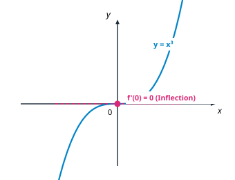

- **Stationary inflection points:** For $f(x) = x^3$, $f'(0) = 0$, but $x = 0$ is neither a local maximum nor a local minimum.
- **Non-differentiable extrema:** For $f(x) = |x|$, an absolute minimum occurs at $x = 0$, but $f'(0)$ does not exist due to a sharp corner.

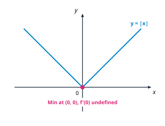

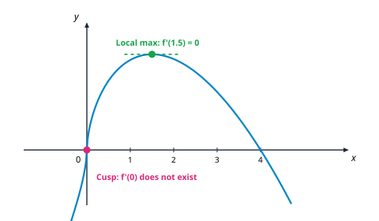

## The Closed Interval Method

The Closed Interval Method provides an algorithmic procedure to find absolute extrema of a continuous function on $[a, b]$:

- **Step 1 (Interior Critical Values):** Find all critical numbers of $f$ in the open interval $\mathopen{]}a, b\mathclose{[}$ (where $f'(x) = 0$ or $f'(x)$ is undefined) and evaluate $f$ at each critical number.
- **Step 2 (Boundary Endpoint Values):** Evaluate $f$ at both boundary endpoints: $f(a)$ and $f(b)$.
- **Step 3 (Comparison):** The largest value obtained from Steps 1 and 2 is the absolute maximum value; the smallest is the absolute minimum value.

### Worked example 4: The Closed Interval Method

Find the absolute maximum and absolute minimum values of $f(x) = x^3 - 3x^2 + 1$ on the closed interval $\left[-\frac{1}{2}, 4\right]$.

> **Stage 1 (Classification & Domain).** The function $f(x) = x^3 - 3x^2 + 1$ is a polynomial, continuous and differentiable on all of $\mathbb{R}$. The domain is the closed, bounded interval $\left[-\frac{1}{2}, 4\right]$. EVT guarantees absolute extrema exist.
>
> **Stage 2 (Algebraic Preparation).** Compute the derivative:
>
> $\displaystyle f'(x) = 3x^2 - 6x = 3x(x - 2)$
>
> **Stage 3 (Core Operation).** Set $f'(x) = 0$ to locate interior critical numbers:
>
> $\displaystyle 3x(x - 2) = 0 \;\Longrightarrow\; x = 0 \quad\text{or}\quad x = 2$
>
> Both critical numbers lie strictly inside the open interval $\mathopen{]}-\frac{1}{2}, 4\mathclose{[}$.
>
> Evaluate $f$ at interior critical points:
>
> $\displaystyle f(0) = (0)^3 - 3(0)^2 + 1 = 1$
>
> $\displaystyle f(2) = (2)^3 - 3(2)^2 + 1 = 8 - 12 + 1 = -3$
>
> Evaluate $f$ at boundary endpoints:
>
> $\displaystyle f\left(-\frac{1}{2}\right) = \left(-\frac{1}{2}\right)^3 - 3\left(-\frac{1}{2}\right)^2 + 1 = -\frac{1}{8} - \frac{3}{4} + 1 = -\frac{7}{8} + 1 = \frac{1}{8}$
>
> $\displaystyle f(4) = (4)^3 - 3(4)^2 + 1 = 64 - 48 + 1 = 17$
>
> **Stage 4 (Interpretation & Boundary Check).** Compare all candidate values:
>
> $\displaystyle \left\{f\left(-\frac{1}{2}\right) = \frac{1}{8},\; f(0) = 1,\; f(2) = -3,\; f(4) = 17\right\}$
>
> The largest value is $17$ (at the right endpoint $x = 4$). The smallest value is $-3$ (at the interior critical point $x = 2$).
>
> Verified extrema: absolute maximum value is $17$; absolute minimum value is $-3$.

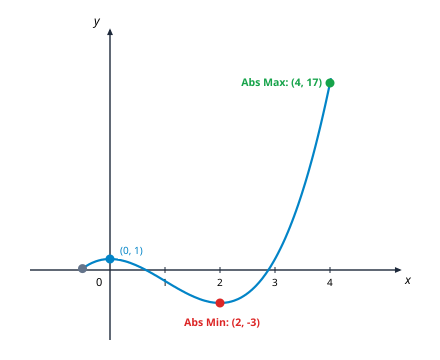

## Rolle's Theorem and the Mean Value Theorem

**Rolle's Theorem:** Let $f$ be a function satisfying three hypotheses:
- $f$ is continuous on the closed interval $[a, b]$.
- $f$ is differentiable on the open interval $\mathopen{]}a, b\mathclose{[}$.
- $f(a) = f(b)$.

Then there exists at least one number $c \in \mathopen{]}a, b\mathclose{[}$ such that $f'(c) = 0$.

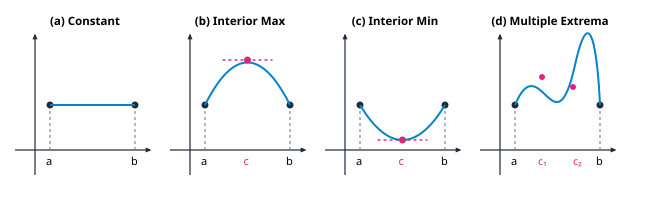

### The Mean Value Theorem (MVT)

The Mean Value Theorem generalizes Rolle's Theorem by removing the requirement that $f(a) = f(b)$.

**Theorem:** If $f$ is continuous on $[a, b]$ and differentiable on $\mathopen{]}a, b\mathclose{[}$, then there exists at least one number $c \in \mathopen{]}a, b\mathclose{[}$ such that:
$$f'(c) = \frac{f(b) - f(a)}{b - a} \quad\iff\quad f(b) - f(a) = f'(c)(b - a)$$

Geometrically, the right-hand side represents the slope of the secant line joining $A(a, f(a))$ and $B(b, f(b))$. The theorem guarantees that there is at least one point where the tangent line to the curve is parallel to the secant line.

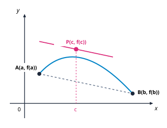

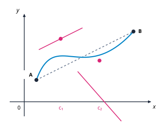

### Proof outline of the Mean Value Theorem

Define an auxiliary function $h(x)$ measuring the vertical distance between the curve $y = f(x)$ and the secant line connecting $(a, f(a))$ and $(b, f(b))$:
$$h(x) = f(x) - f(a) - \frac{f(b) - f(a)}{b - a}(x - a)$$

- $h$ is continuous on $[a, b]$ and differentiable on $\mathopen{]}a, b\mathclose{[}$ because $f$ is continuous and linear polynomials are continuous and differentiable.
- Evaluating endpoints gives $h(a) = 0$ and $h(b) = 0$, so $h(a) = h(b)$.

By Rolle's Theorem, there exists $c \in \mathopen{]}a, b\mathclose{[}$ such that $h'(c) = 0$. Differentiating $h(x)$:
$$h'(x) = f'(x) - \frac{f(b) - f(a)}{b - a} \;\Longrightarrow\; 0 = f'(c) - \frac{f(b) - f(a)}{b - a} \;\Longrightarrow\; f'(c) = \frac{f(b) - f(a)}{b - a}$$

### Worked example 5: Applying the Mean Value Theorem

Verify that $f(x) = x^3 - x$ satisfies the hypotheses of the Mean Value Theorem on $[0, 2]$, and find all numbers $c$ that satisfy the conclusion of the theorem.

> **Stage 1 (Classification & Domain).** The function $f(x) = x^3 - x$ is a polynomial, continuous on $[0, 2]$ and differentiable on $\mathopen{]}0, 2\mathclose{[}$. Both MVT hypotheses are satisfied.
>
> **Stage 2 (Algebraic Preparation).** Compute the endpoint values and the secant slope:
>
> $\displaystyle f(0) = 0^3 - 0 = 0, \quad f(2) = 2^3 - 2 = 8 - 2 = 6$
>
> $\displaystyle m_{\text{sec}} = \frac{f(2) - f(0)}{2 - 0} = \frac{6 - 0}{2} = 3$
>
> **Stage 3 (Core Operation).** Compute the derivative $f'(x) = 3x^2 - 1$. Set $f'(c) = m_{\text{sec}}$:
>
> $\displaystyle 3c^2 - 1 = 3 \;\Longrightarrow\; 3c^2 = 4 \;\Longrightarrow\; c^2 = \frac{4}{3} \;\Longrightarrow\; c = \pm\frac{2}{\sqrt{3}}$
>
> Filter for numbers in the open interval $\mathopen{]}0, 2\mathclose{[}$:
>
> $\displaystyle c = \frac{2}{\sqrt{3}} = \frac{2\sqrt{3}}{3} \approx 1.155 \in \mathopen{]}0, 2\mathclose{[}$
>
> (The negative root $-\frac{2}{\sqrt{3}} \notin \mathopen{]}0, 2\mathclose{[}$ is discarded).
>
> **Stage 4 (Interpretation & Boundary Check).** At $c = \frac{2}{\sqrt{3}}$, $f'(c) = 3\left(\frac{4}{3}\right) - 1 = 3$, which exactly matches the average rate of change across $[0, 2]$.
>
> Verified value: $c = \frac{2}{\sqrt{3}}$.

## Strategy routines

Apply these four systematic habits to continuous optimization and implicit curves:

- **S1 Classify & Domain:** Check whether the relation is explicit or implicit. For optimization, verify whether the interval is closed and bounded ($[a, b]$) and whether the function is continuous. For MVT, confirm continuity on $[a, b]$ and differentiability on $\mathopen{]}a, b\mathclose{[}$.
- **S2 Algebraic Preparation:** For implicit equations, apply the Chain Rule to each $y$-term with bracketed placeholders ($n y^{n-1} \frac{dy}{dx}$). For closed-interval optimization, simplify derivatives into single factored rational expressions to easily identify both zeros and undefined denominator points.
- **S3 Core Operation:** Isolate $\frac{dy}{dx}$ by collecting all derivative terms on one side. When testing for critical numbers, solve both $f'(x) = 0$ (numerator zero) and $f'(x)$ undefined (denominator zero), keeping only values within the domain.
- **S4 Interpretation & Boundary Check:** Never omit boundary endpoints $a$ and $b$ during closed-interval optimization. For second derivatives, back-substitute the first derivative and simplify using the original curve equation.

## Mistakes, edge cases & strategies

| Trap | Correct reasoning | Strategy |
| :--- | :--- | :--- |
| **Omitting the Chain factor $\frac{dy}{dx}$** | $y$ is a function of $x$, so $\frac{d}{dx}[y^2] = 2y \frac{dy}{dx}$, not $2y$. | Treat $y$ as an undisturbed inner layer: write $\frac{d}{dy}[g(y)] \cdot \frac{dy}{dx}$ explicitly. |
| **Sign errors in the implicit Product Rule** | Differentiating $-xy$ produces $-(y + x\frac{dy}{dx}) = -y - x\frac{dy}{dx}$. | Wrap product terms in brackets before distributing negative coefficients. |
| **Omitting back-substitution in $\frac{d^2y}{dx^2}$** | The second derivative $\frac{d^2y}{dx^2}$ must be expressed in terms of $x$ and $y$ only. | Immediately replace every occurrence of $\frac{dy}{dx}$ with its previously derived formula. |
| **Assuming $f'(c) = 0$ guarantees an extremum** | A zero derivative can be a stationary inflection point ($f(x) = x^3$). | Classify critical points by sign change of $f'$ or direct function value comparison. |
| **Ignoring non-differentiable critical points** | Extrema can occur where $f'(c)$ is undefined ($f(x) = |x|$ or $x^{2/3}$). | Check where the derivative denominator vanishes in addition to numerator zeros. |
| **Omitting boundary endpoints in EVT** | Absolute extrema frequently occur at endpoints where $f'(x) \ne 0$. | Always evaluate $f(a)$ and $f(b)$ alongside interior critical points in the candidate table. |
| **Applying MVT across interior non-differentiability** | Differentiability on $\mathopen{]}a, b\mathclose{[}$ is mandatory; $f(x) = |x|$ on $[-1, 2]$ violates MVT. | Verify that no corners, cusps, or vertical asymptotes lie inside the open interval. |

## Exercises

### Q1

**1.** Consider the rotated ellipse defined by the implicit equation $x^2 - xy + y^2 = 7$. Compute the derivative $\frac{dy}{dx}$ in terms of $x$ and $y$ using implicit differentiation.

**2.** Determine the equation of the tangent line to the ellipse at the point $(2, 3)$, expressing the final line equation in standard form $Ax + By = C$.

### Q2

**1.** Consider the algebraic curve $x^3 + y^3 = 3xy$. Compute $\frac{dy}{dx}$ and determine all coordinates $(x, y)$ where the curve has a horizontal tangent line.

**2.** Determine all coordinates $(x, y)$ where the curve $x^3 + y^3 = 3xy$ has a vertical tangent line.

**3.** Calculate the exact value of the second derivative $\frac{d^2y}{dx^2}$ at the non-zero point on the curve where $x = y$, expressing the final fraction in simplest reduced form.

### Q3

**1.** Evaluate the mathematical validity of the following statements regarding critical numbers, the Extreme Value Theorem, and the Mean Value Theorem. Which statement is strictly correct?

- A) If $f$ is continuous on the closed interval $[a, b]$ and differentiable on the open interval $\mathopen{]}a, b\mathclose{[}$, then there exists at least one number $c \in \mathopen{]}a, b\mathclose{[}$ such that $f(b) - f(a) = f'(c)(b - a)$.
- B) If a function $f$ is continuous on the open interval $\mathopen{]}0, 1\mathclose{[}$, the Extreme Value Theorem guarantees that $f$ attains both an absolute maximum and an absolute minimum on $\mathopen{]}0, 1\mathclose{[}$.
- C) If $f$ attains a local minimum at $x = c$, then $f'(c)$ must exist and equal zero.
- D) For any function continuous on $[-1, 2]$, the Mean Value Theorem guarantees a point where the tangent is parallel to the secant line joining $(-1, f(-1))$ and $(2, f(2))$.
- E) If $f'(c) = 0$ for a number $c$ in the domain of $f$, then $f$ must attain either a local maximum or a local minimum at $x = c$.

### Q4

**1.** Find the absolute maximum and absolute minimum values of $f(x) = 2\cos(x) + \sin(2x)$ on the closed interval $\left[0, \frac{\pi}{2}\right]$ using the Closed Interval Method. State the exact coordinates and values.

**2.** Find the absolute maximum and absolute minimum values of $g(x) = x^{2/3}(5 - x)$ on the closed interval $[-1, 5]$, explicitly identifying all interior critical numbers where $g'(x) = 0$ and where $g'(x)$ does not exist.

### Q5

**1.** Prove that the cubic equation $2x^3 + 3x - 5 = 0$ has exactly one real root by using the Intermediate Value Theorem to establish existence and Rolle's Theorem to establish uniqueness.

**2.** An automated toll system records a commercial delivery van passing Mile Marker 120 at 1:00 PM and Mile Marker 170 at 1:42 PM on a highway with an enforced speed limit of $65\text{ mph}$. Use the Mean Value Theorem to prove that the driver exceeded the speed limit during this trip.

### Q6

**1.** In electromagnetic field theory, the magnetic flux line of a planar dipole is modeled by the Lemniscate of Bernoulli $(x^2 + y^2)^2 = 2a^2(x^2 - y^2)$, where $a > 0$ is a physical scale constant. Compute $\frac{dy}{dx}$ by implicit differentiation and express the derivative as a single factored rational expression.

**2.** In the first quadrant ($x > 0, y > 0$), determine the exact coordinates $(x, y)$ of the point of maximum vertical displacement above the horizontal axis.

**3.** Compute the second derivative $\frac{d^2y}{dx^2}$ at the critical point found in subpart 2, and verify that the curve is concave downward at this point.

**4.** The upper loop of the lemniscate in the first quadrant forms a continuous curve $y = y(x)$ starting at the origin $(0, 0)$ and terminating at the positive $x$-intercept $(a\sqrt{2}, 0)$. Apply Rolle's Theorem to prove that there exists an interior point $c \in \mathopen{]}0, a\sqrt{2}\mathclose{[}$ where the tangent line is horizontal, and confirm that this point matches the $x$-coordinate obtained in subpart 2.
