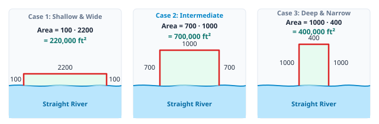
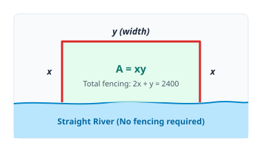
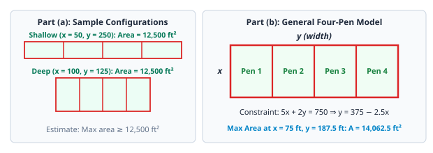
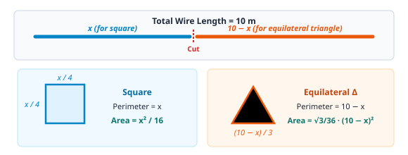
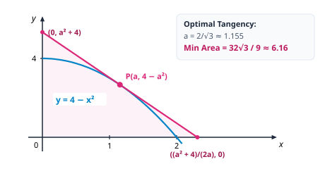

# 006: Applied Optimization and Economic Models

This handout builds on Handout 004 (*Differentiation Rules and Operational Fluency*) and Handout 005 (*Extrema, Fermat's Theorem, and the Closed Interval Method*). It establishes the foundational modeling discipline for constrained continuous optimization, establishing the physical boundary mindset that directly precedes multivariable optimization via Lagrange multipliers ($\nabla f = \lambda \nabla g$).

## The Six-Step Applied Optimization Procedure

Applied optimization translates verbal, geometric, or physical descriptions into formal single-variable calculus models. In pure calculus, an objective function $f(x)$ is often given explicitly on an abstract interval. In applied problems, the central mathematical challenge is constructing the objective function from geometric relationships and physical laws, identifying auxiliary variables, and eliminating them via constraint equations while establishing the feasible physical domain.

To solve continuous optimization problems systematically, follow this repeatable six-step procedure:

- **Step 1 (Understand the Scenario):** Read the problem carefully. Distinguish between fixed constants (given quantities that do not change) and variable dimensions. Identify the primary target quantity to maximize or minimize (such as area, volume, profit, cost, or travel time).
- **Step 2 (Draw and Label a Diagram):** When geometry is involved, sketch the configuration. Clearly label known dimensions, fixed boundaries (such as rivers or existing walls), and all unknown dimensions with appropriate variable names.
- **Step 3 (Introduce Notation):** Assign a primary symbol to the objective quantity ($Q$, $A$, $V$, $C$, or $P$). Assign distinct auxiliary variable symbols ($x$, $y$, $r$, $h$, $\theta$) to all independent geometric or physical quantities.
- **Step 4 (Formulate the Objective Function):** Write an algebraic equation expressing $Q$ in terms of the auxiliary variables: $Q = f(x, y)$ or $Q = g(r, h)$.
- **Step 5 (Eliminate Auxiliary Variables and Establish the Feasible Domain):** Use the scenario's constraint equations (perimeter, surface area, volume, budget, or Pythagorean relations) to express all auxiliary variables in terms of a single primary variable $x$. Substitute this relationship into the objective equation to obtain a single-variable function:
  $$Q = Q(x)$$
  Establish the **feasible physical domain** $[a, b]$ by applying non-negativity requirements to all geometric dimensions ($x \ge 0$, $y \ge 0$). Feasible domains are bounded by physical reality, not mere algebraic formula existence.
- **Step 6 (Locate Absolute Extrema and Verify Boundaries):** Differentiate $Q(x)$ to find critical numbers in $\mathopen{]}a, b\mathclose{[}$. If the feasible domain is a closed interval $[a, b]$, evaluate $Q(x)$ at all interior critical numbers and at both endpoints $x = a$ and $x = b$ using the Closed Interval Method. If the domain is an open or unbounded interval, verify concavity using the Second Derivative Test ($Q''(x)$) or analyze signs with the First Derivative Test for Absolute Extrema. Conclude by calculating all requested auxiliary dimensions, verifying units, and checking physical plausibility.

## Classic Geometric & Physical Paradigms

Applied optimization encompasses recurring mathematical patterns across geometry, physics, and engineering:

- **Enclosure Problems:** Maximizing enclosed rectangular area subject to linear fencing constraints. Variations include utilizing natural boundaries (rivers, existing structures) requiring no fencing, internal dividing fences creating multi-compartment pens, and differential fencing costs (e.g., heavy exterior boundary fencing versus lighter interior divider materials).
- **Open-Top and Closed Containers:** Designing boxes, cans, or silos to maximize storage capacity for a given material budget, or minimizing total sheet material for a specified target volume. Symmetrical cylindrical open-top containers consistently balance base and lateral area when height equals radius ($h = r$).
- **Distance Minimization and the Squared-Distance Trick:** Finding the point on a curve $y = f(x)$ closest to an external coordinate $(x_0, y_0)$. The Euclidean distance is $D(x) = \sqrt{(x - x_0)^2 + (f(x) - y_0)^2}$. Because the square root function $g(u) = \sqrt{u}$ is strictly increasing for $u \ge 0$, $D(x)$ and the squared distance $S(x) = [D(x)]^2 = (x - x_0)^2 + (f(x) - y_0)^2$ achieve their absolute minimum at the exact same critical point $x$. Minimizing $S(x)$ eliminates radical differentiation and quotient algebra.
- **The Wire-Cutting Paradox (Interior vs. Boundary Extrema):** When cutting a fixed length of wire to form two distinct geometric shapes (such as a circle and a square, or a triangle and a hexagon), setting the first derivative of combined area to zero yields an interior critical point. However, because area is a quadratic function with a positive second derivative ($A''(x) > 0$), this interior critical point represents the **absolute minimum** combined area! The **absolute maximum** combined area occurs at a boundary endpoint (allocating the entire wire to the single shape with the greatest areal efficiency per perimeter).

## Business & Economic Optimization

Differential calculus provides analytical decision rules for commercial production and pricing models. Let $x$ represent the number of units of a commodity produced and sold:

- **Total Cost Function $C(x)$:** The overall monetary expenditure incurred to manufacture $x$ units.
- **Marginal Cost $C'(x)$:** The instantaneous rate of change of total cost with respect to production volume: $\text{Marginal Cost} = \frac{dC}{dx} = C'(x)$.
- **Average Cost Function $c(x)$:** The production expenditure distributed per unit manufactured: $c(x) = \frac{C(x)}{x}$.
- **Price-Demand Function $p(x)$:** The unit selling price the market will pay when $x$ units are supplied ($\frac{dp}{dx} \le 0$).
- **Total Revenue Function $R(x)$:** Gross commercial sales income, defined as quantity sold multiplied by unit price: $R(x) = x \cdot p(x)$.
- **Marginal Revenue $R'(x)$:** The instantaneous rate of change of total revenue: $\text{Marginal Revenue} = \frac{dR}{dx} = R'(x) = p(x) + x p'(x)$.
- **Total Profit Function $P(x)$:** Net operational earnings after deducting total costs from gross revenue: $P(x) = R(x) - C(x)$.
- **Marginal Profit $P'(x)$:** The instantaneous rate of change of profit: $P'(x) = R'(x) - C'(x)$.

### The Golden Rule of Profit Maximization

To locate the production level that maximizes net profit $P(x)$, we set the marginal profit derivative to zero:
$$P'(x) = R'(x) - C'(x) = 0 \iff R'(x) = C'(x)$$
Profit is maximized when **Marginal Revenue equals Marginal Cost** ($MR = MC$), provided the second-order condition $P''(x) = R''(x) - C''(x) < 0$ is satisfied (marginal cost curve cuts the marginal revenue curve from below).

### Minimizing Average Cost at Efficient Scale

To locate the production volume that minimizes average cost $c(x) = \frac{C(x)}{x}$, we apply the Quotient Rule:
$$c'(x) = \frac{x C'(x) - C(x) \cdot 1}{x^2}$$
Setting $c'(x) = 0$ for $x > 0$ yields:
$$x C'(x) - C(x) = 0 \iff C'(x) = \frac{C(x)}{x} = c(x)$$
Average cost achieves its absolute minimum at the production volume where **Marginal Cost equals Average Cost** ($MC = AC$). The marginal cost curve intersects the average cost curve at its absolute minimum point.

## Worked examples

Worked examples demonstrate the Four-Stage Continuous Problem Framework: Stage 1 (Classification & Domain), Stage 2 (Algebraic Preparation), Stage 3 (Core Operation), and Stage 4 (Interpretation & Boundary Check).

### Example 1: Enclosing a Field Bordered by a Straight River

A farmer has $2400\,\text{ft}$ of fencing to enclose a rectangular pasture bordering a straight river. No fencing is needed along the riverbank. Determine the dimensions that enclose the largest possible area.

> **Stage 1 (Classification & Domain).** Let $x$ denote the depth perpendicular to the riverbank and $y$ denote the width parallel to the riverbank (in feet). Objective: maximize area $A = xy$. Constraint: $2x + y = 2400$. Non-negativity requires $x \ge 0$ and $y \ge 0 \;\Rightarrow\; 2400 - 2x \ge 0 \;\Rightarrow\; x \le 1200$. The feasible domain is the closed interval $[0, 1200]$.
>
> **Stage 2 (Algebraic Preparation).** Solve the perimeter constraint for $y = 2400 - 2x$. Substitute into the area equation:
>
> $\displaystyle A(x) = x(2400 - 2x) = 2400x - 2x^2$
>
> **Stage 3 (Core Operation).** Differentiate with respect to $x$:
>
> $\displaystyle A'(x) = 2400 - 4x$
>
> Set $A'(x) = 0 \;\Rightarrow\; 4x = 2400 \;\Rightarrow\; x = 600\,\text{ft}$.
>
> **Stage 4 (Interpretation & Boundary Check).** Evaluate $A(x)$ at the interior critical number and at the domain endpoints using the Closed Interval Method:
>
> $\displaystyle A(0) = 0\,\text{ft}^2$
>
> $\displaystyle A(600) = 2400(600) - 2(600)^2 = 1{,}440{,}000 - 720{,}000 = 720{,}000\,\text{ft}^2$
>
> $\displaystyle A(1200) = 2400(1200) - 2(1200)^2 = 0\,\text{ft}^2$
>
> Second derivative test confirms concavity: $A''(x) = -4 < 0$ everywhere. The optimal width is $y = 2400 - 2(600) = 1200\,\text{ft}$. The field must be $600\,\text{ft}$ deep and $1200\,\text{ft}$ wide, enclosing an absolute maximum area of $720{,}000\,\text{ft}^2$.

### Example 2: Multi-Compartment Pasture Divided into Four Equal Pens

A livestock producer has $750\,\text{ft}$ of fencing to enclose a rectangular region and subdivide it into four equal pens using three internal dividing fences parallel to one side. Find the dimensions that maximize total enclosed area.

> **Stage 1 (Classification & Domain).** Let $x$ denote the length of each vertical dividing fence (5 fence segments total) and $y$ denote the overall horizontal width (2 fence segments total). Objective: maximize total area $A = xy$. Perimeter constraint: $5x + 2y = 750$. Domain: $x \ge 0$ and $y \ge 0 \;\Rightarrow\; 750 - 5x \ge 0 \;\Rightarrow\; x \le 150$. Feasible domain is $[0, 150]$.
>
> **Stage 2 (Algebraic Preparation).** Solve the constraint for $y$: $2y = 750 - 5x \;\Rightarrow\; y = 375 - 2.5x$. Substitute into the objective area equation:
>
> $\displaystyle A(x) = x(375 - 2.5x) = 375x - 2.5x^2$
>
> **Stage 3 (Core Operation).** Compute the derivative:
>
> $\displaystyle A'(x) = 375 - 5x$
>
> Set $A'(x) = 0 \;\Rightarrow\; 5x = 375 \;\Rightarrow\; x = 75\,\text{ft}$.
>
> **Stage 4 (Interpretation & Boundary Check).** Closed interval check on $[0, 150]$:
>
> $\displaystyle A(0) = 0\,\text{ft}^2, \quad A(150) = 0\,\text{ft}^2$
>
> $\displaystyle A(75) = 75(375 - 2.5 \cdot 75) = 75(187.5) = 14{,}062.5\,\text{ft}^2$
>
> Since $A''(x) = -5 < 0$ everywhere, $x = 75\,\text{ft}$ is the unique absolute maximum. The total width is $y = 187.5\,\text{ft}$. Each individual pen has width $\frac{187.5}{4} = 46.875\,\text{ft}$. The maximum total area is $14{,}062.5\,\text{ft}^2$.

### Example 3: The Wire-Cutting Paradox (Square vs. Equilateral Triangle)

A piece of wire $10\,\text{m}$ long is cut into two pieces. One piece of length $x$ is bent into a square and the remaining piece of length $10 - x$ is bent into an equilateral triangle. Determine how the wire should be cut to maximize and to minimize total enclosed area.

> **Stage 1 (Classification & Domain).** Let $x$ denote wire length allocated to the square, so $10 - x$ is allocated to the equilateral triangle. The feasible domain is the closed interval $[0, 10]$.
>
> **Stage 2 (Algebraic Preparation).** The square has side $s = \frac{x}{4}$ and area $A_{\text{sq}} = \left(\frac{x}{4}\right)^2 = \frac{x^2}{16}$. The equilateral triangle has side $t = \frac{10 - x}{3}$ and area $A_{\text{tri}} = \frac{\sqrt{3}}{4}t^2 = \frac{\sqrt{3}}{4}\left(\frac{10 - x}{3}\right)^2 = \frac{\sqrt{3}}{36}(10 - x)^2$. Total combined area is:
>
> $\displaystyle A(x) = \frac{x^2}{16} + \frac{\sqrt{3}}{36}(10 - x)^2, \quad x \in [0, 10]$
>
> **Stage 3 (Core Operation).** Differentiate $A(x)$ with respect to $x$:
>
> $\displaystyle A'(x) = \frac{x}{8} - \frac{\sqrt{3}}{18}(10 - x) = \left(\frac{1}{8} + \frac{\sqrt{3}}{18}\right)x - \frac{10\sqrt{3}}{18}$
>
> Multiply through by the common multiple 72:
>
> $\displaystyle 72 A'(x) = 9x + 4\sqrt{3}x - 40\sqrt{3} = (9 + 4\sqrt{3})x - 40\sqrt{3} = 0$
>
> $\displaystyle x = \frac{40\sqrt{3}}{9 + 4\sqrt{3}} \approx 4.35\,\text{m}$
>
> **Stage 4 (Interpretation & Boundary Check).** Second derivative check: $A''(x) = \frac{1}{8} + \frac{\sqrt{3}}{18} > 0$ for all $x$. Because the function is strictly concave upward everywhere, the critical point $x \approx 4.35\,\text{m}$ yields the **absolute minimum** area:
>
> $\displaystyle A(4.35) \approx \frac{(4.35)^2}{16} + \frac{\sqrt{3}}{36}(5.65)^2 \approx 1.183 + 1.536 \approx 2.72\,\text{m}^2$
>
> To find the **absolute maximum** area, we evaluate the boundary endpoints of $[0, 10]$:
>
> $\displaystyle A(0) = \frac{\sqrt{3}}{36}(100) = \frac{25\sqrt{3}}{9} \approx 4.81\,\text{m}^2 \quad (\text{entire wire forms triangle})$
>
> $\displaystyle A(10) = \frac{10^2}{16} = \frac{100}{16} = 6.25\,\text{m}^2 \quad (\text{entire wire forms square})$
>
> Conclusion: The minimum combined area occurs when the wire is cut with $\frac{40\sqrt{3}}{9 + 4\sqrt{3}} \approx 4.35\,\text{m}$ used for the square and $\approx 5.65\,\text{m}$ for the triangle. The maximum combined area occurs at the boundary $x = 10\,\text{m}$, where the wire is not cut and entirely forms the square ($A = 6.25\,\text{m}^2$).

### Example 4: Right Triangle with Tangent Hypotenuse to a Parabola

Determine the minimum area of a right triangle in the first quadrant whose legs lie along the coordinate axes and whose hypotenuse is tangent to the parabola $y = 4 - x^2$.

> **Stage 1 (Classification & Domain).** Let $P(a, 4 - a^2)$ be the point of tangency in the first quadrant, where $a \in \mathopen{]}0, 2\mathclose{[}$. Objective: minimize triangle area $A = \frac{1}{2} x_0 y_0$, where $x_0$ and $y_0$ are the intercepts of the tangent line.

> **Stage 2 (Algebraic Preparation).** The slope of $y = 4 - x^2$ at $x = a$ is $\frac{dy}{dx} = -2a$. The point-slope equation of the tangent line is:
>
> $\displaystyle y - (4 - a^2) = -2a(x - a) \;\Rightarrow\; y = -2ax + a^2 + 4$
>
> Intercepts with axes: $y$-intercept ($x = 0$) is $y_0 = a^2 + 4$. $x$-intercept ($y = 0$) is $0 = -2ax + a^2 + 4 \;\Rightarrow\; x_0 = \frac{a^2 + 4}{2a}$. Objective function for area:
>
> $\displaystyle A(a) = \frac{1}{2}\left(\frac{a^2 + 4}{2a}\right)(a^2 + 4) = \frac{(a^2 + 4)^2}{4a} = \frac{1}{4}\left(a^3 + 8a + \frac{16}{a}\right)$
>
> **Stage 3 (Core Operation).** Differentiate with respect to $a$:
>
> $\displaystyle A'(a) = \frac{1}{4}\left(3a^2 + 8 - \frac{16}{a^2}\right)$
>
> Set $A'(a) = 0 \;\Rightarrow\; 3a^4 + 8a^2 - 16 = 0$. Factor as a quadratic in $a^2$:
>
> $\displaystyle (3a^2 - 4)(a^2 + 4) = 0$
>
> Since $a^2 + 4 > 0$ for all real $a$, we have $3a^2 - 4 = 0 \;\Rightarrow\; a^2 = \frac{4}{3} \;\Rightarrow\; a = \frac{2}{\sqrt{3}} \approx 1.155$.
>
> **Stage 4 (Interpretation & Boundary Check).** Second derivative check on $\mathopen{]}0, 2\mathclose{[}$:
>
> $\displaystyle A''(a) = \frac{1}{4}\left(6a + \frac{32}{a^3}\right) > 0 \quad \text{for all } a > 0$
>
> Since $A''(a) > 0$ on the entire interval, $a = \frac{2}{\sqrt{3}}$ is the unique absolute minimum. At this point:
>
> $\displaystyle a^2 + 4 = \frac{4}{3} + 4 = \frac{16}{3}, \quad A\left(\frac{2}{\sqrt{3}}\right) = \frac{(16/3)^2}{4(2/\sqrt{3})} = \frac{256/9}{8/\sqrt{3}} = \frac{32\sqrt{3}}{9} \approx 6.16$
>
> The minimum possible triangle area is $\frac{32\sqrt{3}}{9} \approx 6.16$.

### Example 5: Revenue Maximization via Linear Demand and Rebates

An electronics retailer sells $200$ media players per week at $\$350$ each. Market research indicates that each $\$10$ price rebate increases sales by $20$ units per week. Find the rebate and unit price that maximize total weekly revenue.

> **Stage 1 (Classification & Domain).** Let $x$ denote weekly sales ($x \ge 200$). Objective: maximize revenue $R(x) = x \cdot p(x)$.
>
> **Stage 2 (Algebraic Preparation).** Price change rate is $\frac{\Delta p}{\Delta x} = \frac{-10}{20} = -0.50$. The linear demand price is $p(x) = 350 - 0.5(x - 200) = 450 - 0.5x$. Revenue is $R(x) = x(450 - 0.5x) = 450x - 0.5x^2$. Non-negativity requires $p(x) \ge 0 \;\Rightarrow\; x \le 900$. Feasible domain: $[0, 900]$.
>
> **Stage 3 (Core Operation).** Differentiate: $R'(x) = 450 - x$. Setting $R'(x) = 0$ yields $x = 450\,\text{units/week}$.
>
> **Stage 4 (Interpretation & Boundary Check).** Concavity: $R''(x) = -1 < 0$ everywhere, confirming an absolute maximum. Optimal unit price: $p(450) = 450 - 0.5(450) = \$225$. Optimal rebate: $350 - 225 = \$125$. Maximum gross weekly revenue: $R(450) = 450 \times 225 = \$101{,}250$.

## Mistakes, edge cases & strategies

| Trap | Correct reasoning | Strategy |
| :--- | :--- | :--- |
| Differentiating before eliminating auxiliary variables. | Calculus rules apply to single-variable functions; variables like $y$ or $h$ vary with $x$. | S2: Substitute the constraint into the objective to eliminate auxiliary variables before differentiating. |
| Neglecting the feasible domain ($\mathopen{]}-\infty, +\infty\mathclose{[}$). | Physical lengths and production quantities must satisfy non-negativity ($x \ge 0, y \ge 0$). | S1: Set variables $\ge 0$ to establish an explicit closed interval $[a, b]$ before computing derivatives. |
| Omitting boundary endpoints in closed domains. | Absolute extrema often occur at boundaries, especially when $Q''(x) > 0$. | S4: Test both domain endpoints alongside critical numbers (Closed Interval Method). |
| Assuming $Q'(x) = 0$ is automatically a maximum. | Critical numbers can be local minima or inflection points; $Q'(x) = 0$ is only a necessary condition. | S4: Apply the Second Derivative Test ($Q'' < 0$) or compare values across the interval. |
| Setting revenue equal to price $p(x)$ instead of $x \cdot p(x)$. | Revenue is gross income ($R = x \cdot p$), whereas $p(x)$ is unit selling price. | S2: Multiply unit price (\$/unit) by quantity sold ($x$) to obtain total revenue (\$). |
| Reporting $S(x)$ instead of $D(x) = \sqrt{S(x)}$. | Minimizing $S = D^2$ yields the optimal $x$, but $S$ is squared distance. | S4: If minimum distance is requested, compute $D = \sqrt{S}$ at the critical $x$. |

### Problem-Solving Strategy Habits

- **S1 (Classify & Establish Feasible Domain):** Begin by stating all variable non-negativity requirements ($x \ge 0$, $y \ge 0$, $h \ge 0$) and constraint limits to formulate an explicit closed interval $[a, b]$ or open interval $\mathopen{]}a, b\mathclose{[}$.
- **S2 (Algebraic Preparation & Variable Elimination):** Solve constraint equations for the variable that yields the cleanest algebraic substitution into the primary objective function.
- **S3 (Core Operation & Critical Points):** Compute $Q'(x)$, set $Q'(x) = 0$, and find points where $Q'(x)$ fails to exist. Retain only critical numbers that lie strictly within the interior of the feasible domain.
- **S4 (Boundary Evaluation & Interpretation):** Evaluate $Q(x)$ across all candidate points and domain boundaries. Verify physical units and calculate all required secondary dimensions.

## Exercises

### Q1

An open-top cylindrical storage tank must hold a fixed target volume $V_0 = 500\pi\,\text{m}^3$.

**1.** Express the exterior surface area $A$ of the tank as a function of the circular base radius $r$ only, stating the feasible physical domain.

**2.** Determine the radius $r$ and height $h$ that minimize the total exterior surface area, demonstrate that the optimal height equals the radius ($h = r$), and state the exact minimum surface area.

### Q2

A livestock rancher plans to construct a rectangular corral divided into three equal adjoining pens by two internal fences parallel to one side. Exterior perimeter fencing costs \$12 per linear foot, while interior dividing fences cost \$8 per linear foot. The rancher has an allocated budget of \$7,200.

**1.** Let $x$ denote the length of each fence segment parallel to the interior dividers (in feet). Formulate the objective function for total enclosed area $A(x)$ as a function of $x$ only, stating the feasible physical domain.

**2.** Determine the dimensions $x$ and $y$ that maximize total enclosed area, and calculate the maximum enclosed area in square feet.

### Q3

A student is setting up an applied optimization model to find the dimensions of an open-top box formed by cutting identical squares of side length $x$ from each corner of a $12\,\text{in} \times 12\,\text{in}$ square sheet of metal and folding up the flaps.

**1.** Which of the following statements correctly identifies the objective volume function $V(x)$, the feasible domain, and the absolute maximum volume?

- A) $V(x) = x(12 - 2x)^2$, with feasible domain $[0, 12]$, and absolute maximum volume occurring at the boundary $x = 6\,\text{in}$.
- B) $V(x) = x(12 - x)^2$, with feasible domain $[0, 12]$, and absolute maximum volume $256\,\text{in}^3$ occurring at $x = 4\,\text{in}$.
- C) $V(x) = x(144 - 4x^2)$, with feasible domain $[0, 6]$, and absolute maximum volume $192\,\text{in}^3$ occurring at $x = 2\sqrt{3}\,\text{in}$.
- D) $V(x) = x(12 - 2x)^2$, with feasible domain $[0, 6]$, and absolute maximum volume $128\,\text{in}^3$ occurring at $x = 2\,\text{in}$.
- E) $V(x) = x(12 - 2x)^2$, with feasible domain $[0, 6]$, and absolute maximum volume occurring at $x = 6\,\text{in}$ because $V'(6) = 0$.

### Q4

A piece of wire of total length $L = 20\,\text{m}$ is cut into two segments. One segment of length $x$ is bent into an equilateral triangle, and the remaining segment of length $20 - x$ is bent into a regular hexagon.

**1.** Express the total combined enclosed area $A(x)$ of both shapes as a function of $x$, stating the feasible domain interval.

**2.** Determine the length $x$ that minimizes the total combined area, and compute the exact minimal combined area.

**3.** Determine how the wire should be partitioned to maximize the total combined enclosed area, verifying both boundary endpoints.

### Q5

A manufacturing enterprise determines that the total cost of producing $x$ thousand units of an industrial component is given by $C(x) = 2x^3 - 12x^2 + 30x + 100$ (in thousands of dollars), and the market price-demand equation is $p(x) = 150 - 6x$ (in dollars per unit), where $x \ge 0$.

**1.** Formulate total profit $P(x)$, determine the production volume $x$ that maximizes total profit, and verify the Second Derivative condition.

**2.** Formulate average cost per unit $c(x)$, determine the production level $x$ that minimizes average cost, and verify that marginal cost equals average cost ($C'(x) = c(x)$) at that point.

### Q6

An offshore petroleum extraction platform is anchored at point $P$, located $8\,\text{km}$ out to sea from the nearest straight point $A$ on a shoreline. An oil refinery is located at point $B$, situated $20\,\text{km}$ down the coastline from $A$. A pipeline is to be laid connecting the platform $P$ directly to a shore landing point $D$ located at a distance $x$ from $A$ along the straight coast ($0 \le x \le 20$), and then continuing along the coastline from $D$ to the refinery $B$. Underwater pipeline construction costs \$5 million per kilometer, while overland coastal pipeline construction costs \$3 million per kilometer.

**1.** Express total construction cost $C(x)$ (in millions of dollars) as a function of the shoreline landing distance $x$, stating the feasible interval.

**2.** Locate all critical numbers of $C(x)$ within the feasible interval, and evaluate $C(x)$ at the critical numbers and at both boundary endpoints $x = 0$ and $x = 20$.

**3.** State the globally optimal landing position $x$, calculate the minimal construction cost, and verify that the optimal shore angle $\theta$ (the angle between the underwater pipeline and the shoreline) satisfies the continuous refraction condition $\cos \theta = \frac{3}{5}$ by evaluating the ratio $\frac{x}{\sqrt{x^2 + 64}}$ at the critical point.
