# 007: Antiderivatives, Riemann Sums, and the Definite Integral

Differential calculus investigates instantaneous rates of change, slopes of tangent lines, and optimization across continuous functions. The second foundational pillar of continuous mathematics inverts and extends this machinery to solve two profound geometric and physical problems: reconstructing an accumulated total quantity from its rate of change, and determining the exact area of a region enclosed by curved boundaries.

These two operations—antidifferentiation and the definite integral—are intimately linked through the limit concept. This handout establishes the theoretical foundations of antiderivatives, initial value problems, graphical rate reconstruction, approximating Riemann sums, and the formal definition of the definite integral as the limit of sums. In multivariable calculus (MATH 254), this Riemann limit architecture forms the indispensable theoretical basis for iterated double and triple integrals over multi-dimensional domains, vector line integrals for physical work and circulation ($\int_C \mathbf{F} \cdot d\mathbf{r}$), and surface flux integrals ($\iint_S \mathbf{F} \cdot d\mathbf{S}$).

## Antiderivatives and the general antiderivative

In differential calculus, given a function $f$, we compute its derivative $f'$. In countless engineering, physical, and economic contexts, the reverse challenge arises: given a rate of change $f$, we must reconstruct the original accumulation function.
- In kinematics, a telemetry system measures instantaneous acceleration $a(t)$ or velocity $v(t)$; navigation requires reconstructing vehicle position $s(t)$.
- In hydrology, an environmental sensor records variable flow rate $\frac{dV}{dt}$ (liters per minute) entering a reservoir; operators must determine net volume $V(t)$ accumulated over a shift.
- In energy systems, electrical power $P(t) = \frac{dE}{dt}$ varies over time; grid engineers integrate power to compute total energy consumption in kilowatt-hours.

### Formal definition and the constant of integration

A function $F$ is called an **antiderivative** of $f$ on an interval $I$ if:

$$F'(x) = f(x) \quad \text{for all } x \in I$$

For example, consider the quadratic rate $f(x) = x^2$. Recalling the Power Rule for differentiation, the cubic function $F(x) = \frac{1}{3}x^3$ satisfies $F'(x) = x^2$. However, $G(x) = \frac{1}{3}x^3 + 25$ and $H(x) = \frac{1}{3}x^3 - \pi$ also satisfy $G'(x) = x^2$ and $H'(x) = x^2$, because the derivative of any real constant is zero.

**Theorem 1 (The General Antiderivative).** If $F$ is an antiderivative of $f$ on a connected interval $I$, then the **most general antiderivative** of $f$ on $I$ is:

$$F(x) + C$$

where $C$ is an arbitrary real constant, termed the **constant of integration**.

*Mathematical Justification.* Suppose $F$ and $G$ are both antiderivatives of $f$ on interval $I$. Then $F'(x) = f(x)$ and $G'(x) = f(x)$ for all $x \in I$. Defining auxiliary difference function $D(x) = G(x) - F(x)$, differentiation yields $D'(x) = G'(x) - F'(x) = f(x) - f(x) = 0$. By the Mean Value Theorem (the Zero-Derivative Corollary), any function whose derivative vanishes identically throughout an interval must be constant. Therefore, $D(x) = C$, which proves $G(x) = F(x) + C$.

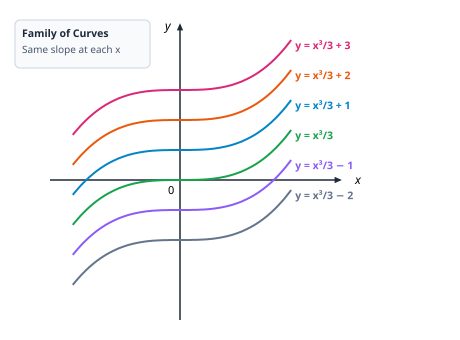

Geometrically, the family of antiderivatives $y = \frac{1}{3}x^3 + C$ represents vertical translations of one another. At any given horizontal coordinate $x$, every curve in the family exhibits the exact same tangent slope $f(x) = x^2$.

### Standard antiderivative catalog

Reversing elementary differentiation formulas establishes the fundamental catalog of indefinite antiderivatives:

| Function class | Rate formula $f(x)$ | Particular antiderivative $F(x)$ | Valid interval / Domain condition |
| :--- | :--- | :--- | :--- |
| **Power ($n \ne -1$)** | $x^n$ | $\frac{x^{n+1}}{n+1}$ | $\mathopen{]}-\infty, +\infty\mathclose{[}$ for $n \ge 0$; $x \ne 0$ for $n < -1$ |
| **Reciprocal ($n = -1$)** | $\frac{1}{x} = x^{-1}$ | $\ln|x|$ | $\mathopen{]}-\infty, 0\mathclose{[} \cup \mathopen{]}0, +\infty\mathclose{[}$ ($x \ne 0$) |
| **Exponential** | $e^{kx}$ ($k \ne 0$) | $\frac{1}{k}e^{kx}$ | $\mathopen{]}-\infty, +\infty\mathclose{[}$ |
| **Cosine** | $\cos(kx)$ | $\frac{1}{k}\sin(kx)$ | $\mathopen{]}-\infty, +\infty\mathclose{[}$ |
| **Sine** | $\sin(kx)$ | $-\frac{1}{k}\cos(kx)$ | $\mathopen{]}-\infty, +\infty\mathclose{[}$ |
| **Secant squared** | $\sec^2(x)$ | $\tan(x)$ | $x \ne \frac{\pi}{2} + k\pi$ |
| **Secant-tangent** | $\sec(x)\tan(x)$ | $\sec(x)$ | $x \ne \frac{\pi}{2} + k\pi$ |
| **Scalar multiple** | $c \cdot f(x)$ | $c \cdot F(x)$ | Shared domain with $f(x)$ |
| **Sum / Difference** | $f(x) \pm g(x)$ | $F(x) \pm G(x)$ | $\operatorname{dom}(f) \cap \operatorname{dom}(g)$ |

> **Domain Warning on Disconnected Intervals.** Theorem 1 holds strictly on connected intervals. If the domain consists of disconnected components—such as $f(x) = x^{-2}$ on $\mathopen{]}-\infty, 0\mathclose{[} \cup \mathopen{]}0, +\infty\mathclose{[}$—the general antiderivative allows independent arbitrary constants on each branch:
>
> $\displaystyle F(x) = \begin{cases} -\frac{1}{x} + C_1 & \text{if } x > 0 \\ -\frac{1}{x} + C_2 & \text{if } x < 0 \end{cases}$

### Worked examples: general antiderivatives

#### Example 1: Algebraic preparation before antidifferentiation

Find the most general antiderivative of $g(x) = \frac{6x^5 - 4\sqrt{x} + 7}{x}$ on the domain $\mathopen{]}0, +\infty\mathclose{[}$.

> **Stage 1 (Classification & Domain).** Rational combination of powers with single denominator term $x$. On domain $\mathopen{]}0, +\infty\mathclose{[}$, $x > 0$ and $|x| = x$.
>
> **Stage 2 (Algebraic Preparation).** Distribute the denominator $x$ across each individual numerator term:
>
> $\displaystyle g(x) = \frac{6x^5}{x} - \frac{4x^{1/2}}{x} + \frac{7}{x} = 6x^4 - 4x^{-1/2} + 7x^{-1}$
>
> **Stage 3 (Core Operation).** Apply catalog rules term by term:
>
> $\displaystyle G(x) = 6\left(\frac{x^5}{5}\right) - 4\left(\frac{x^{1/2}}{1/2}\right) + 7\ln|x| + C = \frac{6}{5}x^5 - 8\sqrt{x} + 7\ln(x) + C$
>
> **Stage 4 (Interpretation & Boundary Check).** Differentiating $G(x)$ confirms $G'(x) = g(x)$.
>
> Verified general antiderivative on $\mathopen{]}0, +\infty\mathclose{[}$: $G(x) = \frac{6}{5}x^5 - 8\sqrt{x} + 7\ln(x) + C$.

## Initial value problems and kinematics

While the general antiderivative contains an arbitrary constant $+ C$ representing a family of curves, physical applications specify side conditions that select one unique curve from the family. A differential equation paired with auxiliary boundary conditions is called an **Initial Value Problem (IVP)**.

In Newtonian mechanics, rectilinear motion is governed by acceleration $a(t) = s''(t) = v'(t)$. Reconstructing trajectory requires solving a two-stage initial value problem:
- **First Integration:** Velocity is reconstructed from acceleration: $v(t) = \int a(t)\,dt = V(t) + C_1$. An initial velocity $v(0) = v_0$ fixes constant $C_1$.
- **Second Integration:** Position is reconstructed from velocity: $s(t) = \int v(t)\,dt = S(t) + C_1 t + C_2$. An initial position $s(0) = s_0$ fixes constant $C_2$.

#### Example 2: Second-order kinematic initial value problem

A ballistic research vehicle undergoes rectilinear test motion with variable acceleration $a(t) = 18t - 12\cos(t)$ for elapsed time $t \ge 0$ (measured in seconds, with acceleration in $\text{m/s}^2$). Telemetry records initial velocity $v(0) = 4\text{ m/s}$ and initial position $s(0) = 10\text{ m}$. Determine the explicit position function $s(t)$.

> **Stage 1 (Classification & Domain).** Second-order linear kinematic system on $[0, +\infty\mathclose{[}$ with governing differential equation $s''(t) = 18t - 12\cos(t)$ and initial conditions $s'(0) = 4$, $s(0) = 10$.
>
> **Stage 2 (Algebraic Preparation).** Terms in $a(t)$ are standard power and trigonometric catalog functions.
>
> **Stage 3 (Core Operation).** Integrate acceleration to recover velocity:
>
> $\displaystyle v(t) = \int [18t - 12\cos(t)]\,dt = 18\left(\frac{t^2}{2}\right) - 12\sin(t) + C_1 = 9t^2 - 12\sin(t) + C_1$
>
> Apply initial velocity condition $v(0) = 4$:
>
> $\displaystyle v(0) = 9(0)^2 - 12\sin(0) + C_1 = 4 \;\Longrightarrow\; C_1 = 4 \;\Longrightarrow\; v(t) = 9t^2 - 12\sin(t) + 4$
>
> Integrate velocity to recover position:
>
> $\displaystyle s(t) = \int [9t^2 - 12\sin(t) + 4]\,dt = 9\left(\frac{t^3}{3}\right) - 12(-\cos(t)) + 4t + C_2 = 3t^3 + 12\cos(t) + 4t + C_2$
>
> Apply initial position condition $s(0) = 10$:
>
> $\displaystyle s(0) = 3(0)^3 + 12\cos(0) + 4(0) + C_2 = 10 \;\Longrightarrow\; 12(1) + C_2 = 10 \;\Longrightarrow\; C_2 = -2$
>
> **Stage 4 (Interpretation & Boundary Check).** Direct substitution confirms $s(0) = 10\text{ m}$, $s'(0) = 4\text{ m/s}$, and $s''(t) = a(t)$.
>
> Verified unique trajectory: $s(t) = 3t^3 + 12\cos(t) + 4t - 2$.

## Graphical antiderivative reconstruction

Before evaluating numerical integrals, a student of continuous mathematics must be able to visually translate qualitative features of a rate graph $y = f(x)$ into the geometric shape of its antiderivative $y = F(x)$.

Because $F'(x) = f(x)$, every geometric attribute of $F$ corresponds to an algebraic property of $f$:
- **Monotonicity (Slope of $F$):** Where $f(x) > 0$, $F$ is strictly increasing; where $f(x) < 0$, $F$ is strictly decreasing.
- **Horizontal Tangents & Extrema:** Where $f(x) = 0$, $F$ has a horizontal tangent ($F'(x) = 0$). By the First Derivative Test, if $f$ transitions from negative to positive at $x = c$, $F$ attains a **local minimum**; if $f$ transitions from positive to negative, $F$ attains a **local maximum**.
- **Concavity & Inflection Points (Curvature of $F$):** Because $F''(x) = f'(x)$, where $f$ is increasing ($f'(x) > 0$), $F$ is **concave upward**; where $f$ is decreasing ($f'(x) < 0$), $F$ is **concave downward**. Local extrema of $f$ correspond directly to **inflection points** of $F$.

| 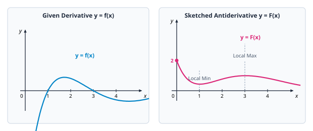 | 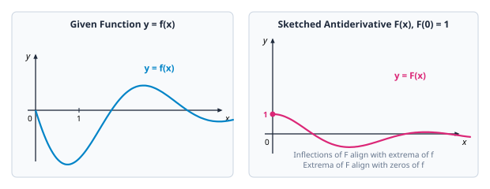 |
| :---: | :---: |
| **(a) Reading monotonicity and extrema of $F$** | **(b) Continuous trajectory with $F(0) = 0$** |

### Step and piecewise rate curves

When a rate curve $f(x)$ is piecewise constant (a step function), its antiderivative $F(x)$ is continuous and piecewise linear. On any interval where $f(x) = m$, the antiderivative has constant slope $m$.

| 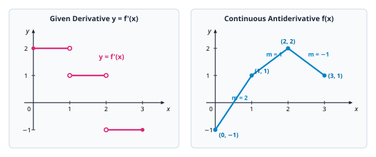 | 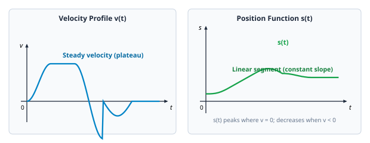 |
| :---: | :---: |
| **(a) Step derivative and piecewise linear antiderivative** | **(b) Kinematic position recovery from linear velocity** |

In panel (a) above, $f'(x)$ equals $2$ on $[0, 1\mathclose{[}$, drops to $1$ on $\mathopen{]}1, 2\mathclose{[}$, and drops to $-1$ on $\mathopen{]}2, 3]$. The continuous antiderivative $f(x)$ with initial condition $f(0) = -1$ consists of three connected straight line segments. Although $f'(1)$ and $f'(2)$ do not exist (sharp corners), the accumulation function $f(x)$ remains continuous throughout $[0, 3]$.

### Matching rate curves with candidate antiderivatives

Distinguishing between a function and its derivative is a core diagnostic skill in calculus:

| 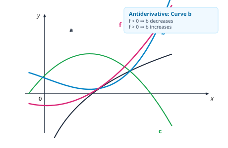 | 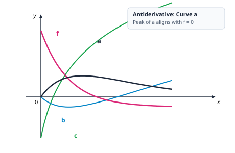 |
| :---: | :---: |
| **(a) Antiderivative matching pair 1** | **(b) Antiderivative matching pair 2** |

To determine which curve represents $f$ and which represents $F$:
- **Step 1.** Locate horizontal tangents of each candidate curve ($y' = 0$).
- **Step 2.** Check whether the other curve crosses the horizontal axis ($y = 0$) at those exact $x$-coordinates.
- **Step 3.** Test intervals of increase and decrease: if curve $A$ is increasing wherever curve $B$ lies strictly above the axis, then curve $A$ is the antiderivative of curve $B$.

## The area problem and approximating Riemann sums

We now address finding the exact area of the planar region $S$ that lies under the graph of a continuous, non-negative function $y = f(x)$ from $x = a$ to $x = b$:

$$S = \{(x, y) \mid a \le x \le b, \; 0 \le y \le f(x)\}$$

| 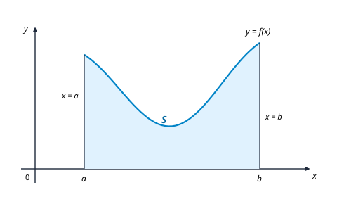 | 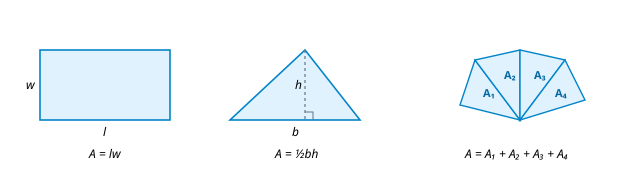 |
| :---: | :---: |
| **(a) Area beneath curved boundary $y = f(x)$** | **(b) Standard straight-sided Euclidean polygons** |

For straight-sided regions, Euclidean geometry defines area directly: rectangles ($A = lw$), triangles ($A = \frac{1}{2}bh$), and polygons via triangular decomposition. For curved boundaries, integral calculus defines area as the limit of approximating rectangular sums.

### The partition and approximating sums: $L_n, R_n, M_n$

To approximate the area under $y = f(x)$ on $[a, b]$:
- **Step 1.** Divide $[a, b]$ into $n$ subintervals of equal width $\Delta x = \frac{b - a}{n}$.
- **Step 2.** The partition grid points are $x_0 = a, x_1 = a + \Delta x, \dots, x_i = a + i\Delta x, \dots, x_n = b$.
- **Step 3.** Erect rectangles whose heights are sampled within each subinterval $[x_{i-1}, x_i]$:
  - **Left Endpoint Sum ($L_n$):** sampled at left boundary $x_{i-1}$: $L_n = \sum_{i=1}^n f(x_{i-1})\Delta x$.
  - **Right Endpoint Sum ($R_n$):** sampled at right boundary $x_i$: $R_n = \sum_{i=1}^n f(x_i)\Delta x$.
  - **Midpoint Sum ($M_n$):** sampled at midpoint $\bar{x}_i = \frac{x_{i-1} + x_i}{2}$: $M_n = \sum_{i=1}^n f(\bar{x}_i)\Delta x$.

### Case study: area under the parabola $y = x^2$ on $[0, 1]$

Consider the region under $y = x^2$ from $x = 0$ to $x = 1$. With $n = 4$ subintervals, $\Delta x = \frac{1}{4}$ and grid points are $x_0 = 0, x_1 = \frac{1}{4}, x_2 = \frac{1}{2}, x_3 = \frac{3}{4}, x_4 = 1$.

| 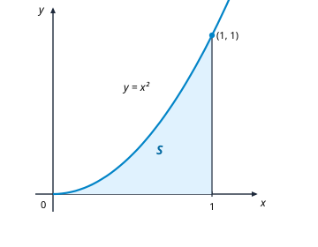 | 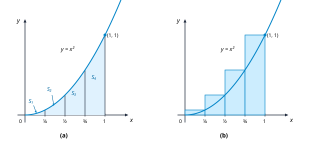 |
| :---: | :---: |
| **(a) Parabolic region $S$ on $[0, 1]$** | **(b) Right-endpoint approximating rectangles ($R_4 = 0.46875$)** |

Evaluating right endpoints gives $R_4 = \frac{1}{4}[(\frac{1}{4})^2 + (\frac{1}{2})^2 + (\frac{3}{4})^2 + 1^2] = \frac{15}{32} = 0.46875$.

| 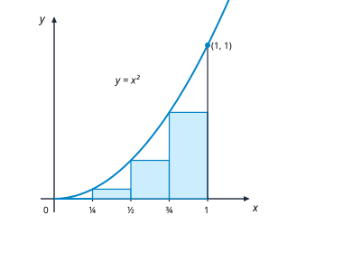 | 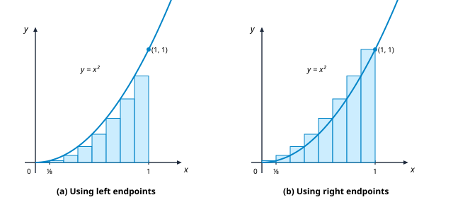 |
| :---: | :---: |
| **(a) Left-endpoint approximating rectangles ($L_4 = 0.21875$)** | **(b) Refined partition with eight rectangles ($n = 8$)** |

Evaluating left endpoints gives $L_4 = \frac{1}{4}[0^2 + (\frac{1}{4})^2 + (\frac{1}{2})^2 + (\frac{3}{4})^2] = \frac{7}{32} = 0.21875$. Exact area $A$ satisfies $0.21875 < A < 0.46875$. For $n = 8$, bounds tighten to $0.2734375 < A < 0.3984375$.

#### Convergence across increasing partitions

| Number of subintervals ($n$) | Left sum $L_n$ | Midpoint sum $M_n$ | Right sum $R_n$ | Envelope width ($R_n - L_n$) |
| :---: | :---: | :---: | :---: | :---: |
| **$10$** | $0.2850000$ | $0.3325000$ | $0.3850000$ | $0.1000000$ |
| **$20$** | $0.3087500$ | $0.3331250$ | $0.3587500$ | $0.0500000$ |
| **$50$** | $0.3234000$ | $0.3333000$ | $0.3434000$ | $0.0200000$ |
| **$100$** | $0.3283500$ | $0.3333250$ | $0.3383500$ | $0.0100000$ |
| **$1000$** | $0.3328335$ | $0.3333333$ | $0.3338335$ | $0.0010000$ |

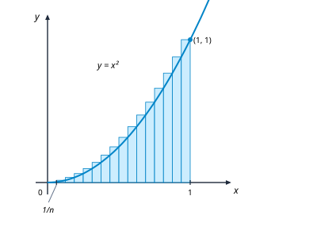

### Sigma algebra formulas and Darboux bounds

Evaluating limits of Riemann sums requires standard summation identities:

$$\sum_{i=1}^n 1 = n, \qquad \sum_{i=1}^n i = \frac{n(n + 1)}{2}, \qquad \sum_{i=1}^n i^2 = \frac{n(n + 1)(2n + 1)}{6}, \qquad \sum_{i=1}^n i^3 = \left[\frac{n(n + 1)}{2}\right]^2$$

| 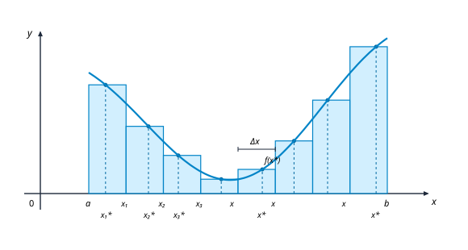 | 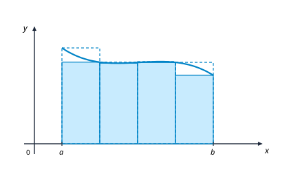 |
| :---: | :---: |
| **(a) Arbitrary sample points $x_i^* \in [x_{i-1}, x_i]$** | **(b) Inscribed lower sums and circumscribed upper sums** |

For continuous functions, choosing minimum values $m_i$ gives lower Darboux sums $L_D$, and maximum values $M_i$ gives upper Darboux sums $U_D$: $L_D \le \sum_{i=1}^n f(x_i^*)\Delta x \le U_D$. As $\Delta x \to 0$, both converge to exact area $A$.

## The definite integral and net signed area

Removing the restriction that $f(x) \ge 0$ establishes the definite integral.

### Formal definition of the definite integral

Let $f$ be defined on $[a, b]$. Subdivide $[a, b]$ into $n$ subintervals of equal width $\Delta x = \frac{b - a}{n}$ with arbitrary sample points $x_i^* \in [x_{i-1}, x_i]$. The **definite integral of $f$ from $a$ to $b$** is:

$$\int_a^b f(x)\,dx = \lim_{n \to \infty} \sum_{i=1}^n f(x_i^*)\,\Delta x$$

provided this limit exists and gives the same value for all sample points. If so, $f$ is **integrable** on $[a, b]$. Continuous functions and functions with finitely many jump discontinuities are always integrable.

### Anatomy of Leibniz integral notation and net signed area

In Leibniz notation $\int_a^b f(x)\,dx$, $\int$ is an elongated "S" (summa), $f(x)$ is the integrand, $a$ and $b$ are limits of integration, and $dx$ represents infinitesimal width $\Delta x$.

When $f(x)$ takes both positive and negative values, the definite integral computes **net signed area**:

$$\int_a^b f(x)\,dx = A_{\text{above}} - A_{\text{below}}$$

where $A_{\text{above}}$ is area above the $x$-axis beneath $y = f(x)$, and $A_{\text{below}}$ is area below the $x$-axis above $y = f(x)$. Total geometric area requires $A_{\text{total}} = \int_a^b |f(x)|\,dx = A_{\text{above}} + A_{\text{below}}$. For example, $\int_0^{2\pi} \sin(x)\,dx = 2 - 2 = 0$, while $\int_0^{2\pi} |\sin(x)|\,dx = 2 + 2 = 4$.

### Fundamental properties of the definite integral

- **Property 1 (Reversal of Integration Limits):** $\int_b^a f(x)\,dx = -\int_a^b f(x)\,dx$, and $\int_a^a f(x)\,dx = 0$.
- **Property 2 (Linearity):** $\int_a^b [c f(x) \pm k g(x)]\,dx = c\int_a^b f(x)\,dx \pm k\int_a^b g(x)\,dx$.
- **Property 3 (Interval Additivity):** $\int_a^c f(x)\,dx = \int_a^b f(x)\,dx + \int_b^c f(x)\,dx$.
- **Property 4 (Comparison Properties):** If $f(x) \ge 0$ on $[a, b]$, then $\int_a^b f(x)\,dx \ge 0$. If $f(x) \le g(x)$ on $[a, b]$, then $\int_a^b f(x)\,dx \le \int_a^b g(x)\,dx$.
- **Property 5 (Bounding Property / Min-Max Inequality):** If $m \le f(x) \le M$ for all $x \in [a, b]$, then $m(b - a) \le \int_a^b f(x)\,dx \le M(b - a)$.

#### Example 3: Evaluating a definite integral from the formal definition

Evaluate the definite integral $\int_0^3 (x^2 - 2x)\,dx$ directly from the limit of right-endpoint Riemann sums.

> **Stage 1 (Classification & Domain).** Continuous polynomial on $[0, 3]$; integrability guaranteed.
>
> **Stage 2 (Algebraic Preparation).** $\Delta x = \frac{3 - 0}{n} = \frac{3}{n}$ and $x_i = \frac{3i}{n}$. Expand $f(x_i) = (\frac{3i}{n})^2 - 2(\frac{3i}{n}) = \frac{9i^2}{n^2} - \frac{6i}{n}$.
>
> **Stage 3 (Core Operation).** Set up Riemann sum $R_n = \sum_{i=1}^n f(x_i)\Delta x$:
>
> $\displaystyle R_n = \sum_{i=1}^n \left(\frac{9i^2}{n^2} - \frac{6i}{n}\right)\frac{3}{n} = \frac{27}{n^3}\sum_{i=1}^n i^2 - \frac{18}{n^2}\sum_{i=1}^n i$
>
> $\displaystyle R_n = \frac{27}{n^3}\left[\frac{n(n + 1)(2n + 1)}{6}\right] - \frac{18}{n^2}\left[\frac{n(n + 1)}{2}\right] = \frac{9}{2}\left(1 + \frac{1}{n}\right)\left(2 + \frac{1}{n}\right) - 9\left(1 + \frac{1}{n}\right)$
>
> Taking the limit as $n \to \infty$:
>
> $\displaystyle \lim_{n \to \infty} R_n = \frac{9}{2}(1)(2) - 9(1) = 9 - 9 = 0$
>
> **Stage 4 (Interpretation & Boundary Check).** Net signed area is $0$. $A_{\text{below}} = \int_0^2 |x^2 - 2x|\,dx = \frac{4}{3}$, and $A_{\text{above}} = \int_2^3 (x^2 - 2x)\,dx = \frac{4}{3}$. Since $A_{\text{above}} = A_{\text{below}}$, net integral is exactly $0$.
>
> Verified limit: $\int_0^3 (x^2 - 2x)\,dx = 0$.

## Strategy routine

- **S1 (Classification & Domain):** Identify problem class (antiderivative, IVP, graphical slope reconstruction, finite Riemann sum, or limit of sums). Note domain $[a, b]$ and verify whether net signed area or total area is requested.
- **S2 (Algebraic Preparation):** Convert roots to rational exponents, distribute monomial denominators, and write out $\Delta x = \frac{b - a}{n}$ and $x_i = a + i\Delta x$ before expanding.
- **S3 (Core Operation):** Execute catalog antiderivatives with $+ C$; in IVPs, substitute initial conditions to determine constants. In Riemann limits, factor powers of $n$ out of sums, apply sigma formulas, and take $n \to \infty$.
- **S4 (Interpretation & Boundary Check):** Differentiate antiderivatives to recover integrand. Confirm units in applied kinematics. Check signs of definite integrals against area lobes.

## Mistakes, edge cases & strategies

| Trap | Correct reasoning | Strategy |
| :--- | :--- | :--- |
| **Omitting $+ C$ on indefinite integrals** | Indefinite integration yields an infinite family of curves differing by constants; omitting $+ C$ collapses the family. | Write $+ C$ immediately upon removing the integral sign in indefinite problems. |
| **Omitting absolute values: $\int \frac{1}{x} dx = \ln(x)$** | The reciprocal function $1/x$ is defined for all $x < 0$, where $\ln(x)$ is undefined. | Write $\ln\|x\| + C$. For strictly positive domains, note $\|x\| = x$ explicitly. |
| **Confusing net signed area with total area** | $\int_a^b f(x)\,dx$ weighs area below the axis as negative. Total area requires $\int_a^b \|f(x)\|\,dx$. | Sketch the integrand to locate zero crossings; split intervals into positive and negative lobes when total area is requested. |
| **Reversing limits without changing sign** | By definition, $\int_b^a f(x)\,dx = -\int_a^b f(x)\,dx$. Inverting bounds changes the sign of $\Delta x$. | Check orientation: if upper limit is smaller than lower limit, factor out a negative sign. |
| **Incorrect index expansion in Riemann sums** | Grid point is $x_i = a + i\Delta x$; omitting $a$ shifts the domain to $[0, b - a]$. | Always write out $x_i = a + i\frac{b - a}{n}$ explicitly and expand powers before applying sigma formulas. |
| **Assuming $\int_a^b f = 0 \implies f = 0$** | A definite integral evaluates to zero whenever positive area above the axis cancels equal negative area below. | Recognize that zero net signed area reflects balance of opposite lobes, not a trivial zero function. |

## Exercises

### Q1

**1.** Find the most general antiderivative $F(x)$ of the function:

$$f(x) = \frac{4}{\sqrt{x}} - \frac{3}{x} + 2\sec^2(x)$$

on the open interval $\mathopen{]}0, \pi/2\mathclose{[}$.

**2.** Solve the second-order initial value problem:

$$f''(x) = 12x^2 + 6x - 4, \quad f'(0) = 5, \quad f(1) = 8$$

showing all intermediate integration steps and determining the unique particular solution $f(x)$.

### Q2

**1.** The continuous rate of change $y = f(x)$ of a physical system is recorded over the interval $[-3, 5]$, as displayed in the coordinate graph below. The graph consists of four connected linear segments joining $(-3, -2)$, $(-1, 2)$, $(1, 2)$, $(3, -2)$, and $(5, 0)$.

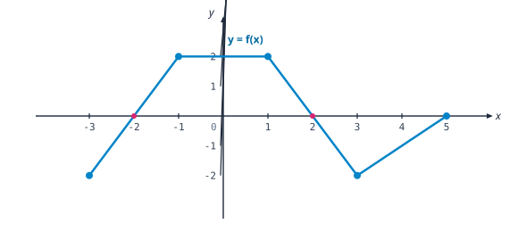

Let $F(x) = \int_0^x f(t)\,dt$. Identify all horizontal coordinates $x \in \mathopen{]}-3, 5\mathclose{[}$ where $F(x)$ attains a local minimum, a local maximum, or an inflection point.

**2.** Given the initial condition $F(0) = -2$, compute the exact numerical values of $F(x)$ at each integer coordinate $x \in \{-3, -2, -1, 0, 1, 2, 3, 4, 5\}$ using elementary geometric area calculations (rectangles and triangles).

### Q3

**1.** Which of the following statements regarding Riemann sums, net signed area, and the properties of the definite integral is mathematically correct?

- A) The definite integral $\int_a^b f(x)\,dx$ always evaluates to a strictly positive real number whenever $b > a$.
- B) If $m \le f(x) \le M$ for all $x \in [a, b]$, then $m(b - a) \le \int_a^b f(x)\,dx \le M(b - a)$, and if $f(x) \le g(x)$ on $[a, b]$, then $\int_a^b f(x)\,dx \le \int_a^b g(x)\,dx$.
- C) If $f$ is continuous on $[a, b]$ and $\int_a^b f(x)\,dx = 0$, then $f(x) = 0$ for all $x \in [a, b]$.
- D) Reversing the order of integration bounds preserves the numerical value of the definite integral: $\int_b^a f(x)\,dx = \int_a^b f(x)\,dx$.
- E) For any integrable function $f$ on $[a, b]$, the definite integral of its square equals the square of its integral: $\int_a^b [f(x)]^2\,dx = \left[\int_a^b f(x)\,dx\right]^2$.

### Q4

**1.** An industrial water reclamation plant monitors the effluent discharge rate $r(t)$ (measured in liters per minute) over an 8-hour shift. Flow telemetry is logged every 2 hours:

| Elapsed time $t$ (hours) | $0$ | $2$ | $4$ | $6$ | $8$ |
| :---: | :---: | :---: | :---: | :---: | :---: |
| Discharge rate $r(t)$ (L/min) | $120$ | $145$ | $170$ | $160$ | $130$ |

Compute the Left Endpoint Riemann sum approximation $L_4$ for the total effluent volume discharged over the 8-hour operational window (with $\Delta t = 2$ hours).

**2.** Compute the Right Endpoint Riemann sum approximation $R_4$ for the total effluent volume over the 8-hour window.

**3.** Subdivide the 8-hour shift into two 4-hour intervals ($[0, 4]$ and $[4, 8]$, with $\Delta t' = 4$ hours) and compute the Midpoint Riemann sum approximation $M_2$ using the logged mid-interval rates at $t = 2$ and $t = 6$.

### Q5

**1.** Consider the definite integral:

$$\int_1^4 (2x^2 - 3x + 1)\,dx$$

For a uniform partition of $[1, 4]$ into $n$ subintervals, state the explicit formulas for the subinterval width $\Delta x$ and the right endpoints $x_i$ in terms of $n$ and $i$.

**2.** Express the right-endpoint Riemann sum $R_n = \sum_{i=1}^n f(x_i)\Delta x$ in expanded form using the standard sigma summation identities for $\sum_{i=1}^n i$ and $\sum_{i=1}^n i^2$, expressing $R_n$ as a rational expression in $n$.

**3.** Compute the exact value of the definite integral by evaluating the limit of the Riemann sum:

$$\lim_{n \to \infty} R_n$$

showing all intermediate limit steps.

### Q6

**1.** A multi-stage variable-thrust meteorological sounding rocket is launched vertically from rest at ground level ($s(0) = 0$, $v(0) = 0$). During the powered burn phase ($0 \le t \le 10$ seconds), the propulsion system produces a linearly diminishing vertical acceleration $a(t) = 40 - 2t$ (in $\text{m/s}^2$). At burnout ($t = 10$ seconds), the motor shuts down and the vehicle coasts under gravitational acceleration alone ($a(t) = -9.8\text{ m/s}^2$ for $t > 10$).

$$a(t) = \begin{cases} 40 - 2t & \text{if } 0 \le t \le 10 \\ -9.8 & \text{if } t > 10 \end{cases}$$

Determine the piecewise velocity function $v(t)$ of the sounding rocket for all elapsed flight time $t \ge 0$, enforcing continuity of velocity across the transition at $t = 10$.

**2.** Determine the exact burnout velocity $v(10)$ and calculate the exact apogee time $t_{\text{apogee}}$ at which the rocket reaches its maximum altitude ($v(t_{\text{apogee}}) = 0$).

**3.** Formulate and evaluate the definite integrals representing the vertical displacement accumulated during the powered ascent stage ($0 \le t \le 10$) and during the unpowered coasting stage ($10 \le t \le t_{\text{apogee}}$). State the maximum altitude attained by the sounding rocket at apogee as an exact fraction and as a rounded decimal in meters.
