# Calculus Topics & Exercises

Source material: Stewart *Calculus: Early Transcendentals* (Chapters 1 & 2: Functions, Transformations, and Limits).

## 1. Functions, Domain, and Range

### 1.1 Core Definitions & Visual Representations

A **function** is a rule that assigns to each element $x$ in a set $D$ (the **domain**) exactly one element $f(x)$ in a set $E$.
The **range** of $f$ is the set of all possible resulting output values: $\{f(x) \mid x \in D\}$.

#### Visual Interpretation of Domain and Range

The graph of a function $f$ gives an immediate visual representation of both its domain and its range:
- The **domain** is the projection of the curve onto the horizontal $x$-axis.
- The **range** is the projection of the curve onto the vertical $y$-axis from its minimum value to its maximum value.

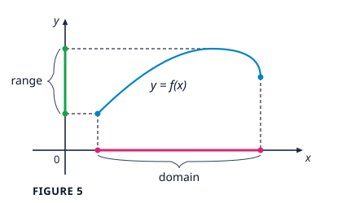

#### Reading Function Values and Properties from Graphs

When a function is given as a graph on a coordinate grid, specific values, domain, range, and local extrema can be read directly:

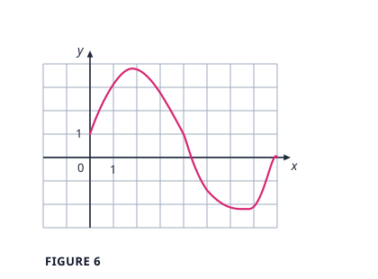

Key values observed from Figure 6:
- Initial value: $f(0) = 1$
- Intermediate values: $f(1) = 3$, $f(4) = 1$
- Local maximum: approximately $(1.8, 3.8)$ with value $\approx 3.8$
- $x$-intercept: approximately $(4.5, 0)$
- Local minimum: approximately $(6.8, -2.2)$
- Right endpoint: $(8, 0)$
- Domain: $[0, 8]$; Range: approximately $[-2.2, 3.8]$

### 1.2 Exercise Set: Finding Domains Algebraically

**Exercises 31–37: Find the domain of the function.**

**31.** $f(x) = \frac{x + 4}{x^2 - 9}$  
*Condition*: Denominator cannot be zero: $x^2 - 9 \ne 0 \implies x \ne \pm 3$.  
*Domain*: $(-\infty, -3) \cup (-3, 3) \cup (3, \infty)$ or $\{x \in \mathbb{R} \mid x \ne \pm 3\}$.

**32.** $f(x) = \frac{2x^3 - 5}{x^2 + x - 6}$  
*Condition*: Factor denominator: $x^2 + x - 6 = (x + 3)(x - 2) \ne 0 \implies x \ne -3, 2$.  
*Domain*: $(-\infty, -3) \cup (-3, 2) \cup (2, \infty)$ or $\{x \in \mathbb{R} \mid x \ne -3, 2\}$.

**33.** $f(t) = \sqrt[3]{2t - 1}$  
*Condition*: Odd roots (cube roots) are defined for all real numbers.  
*Domain*: $(-\infty, \infty)$ or $\mathbb{R}$.

**34.** $g(t) = \sqrt{3 - t} - \sqrt{2 + t}$  
*Condition*: Even roots require non-negative radicands:  
$3 - t \ge 0 \implies t \le 3$, and $2 + t \ge 0 \implies t \ge -2$.  
*Domain*: $[-2, 3]$ or $\{t \in \mathbb{R} \mid -2 \le t \le 3\}$.

**35.** $h(x) = \frac{1}{\sqrt[4]{x^2 - 5x}}$  
*Condition*: Fourth root in denominator requires strictly positive radicand:  
$x^2 - 5x > 0 \implies x(x - 5) > 0$.  
*Domain*: $(-\infty, 0) \cup (5, \infty)$ or $\{x \in \mathbb{R} \mid x < 0 \text{ or } x > 5\}$.

**36.** $f(u) = \frac{u + 1}{1 + \frac{1}{u + 1}}$  
*Condition*: Inner denominator $u + 1 \ne 0 \implies u \ne -1$.  
Outer denominator $1 + \frac{1}{u + 1} = \frac{u + 2}{u + 1} \ne 0 \implies u \ne -2$.  
*Domain*: $(-\infty, -2) \cup (-2, -1) \cup (-1, \infty)$ or $\{u \in \mathbb{R} \mid u \ne -2, -1\}$.

**37.** $F(p) = \sqrt{2 - \sqrt{p}}$  
*Condition*: Inner root requires $p \ge 0$.  
Outer root requires $2 - \sqrt{p} \ge 0 \implies \sqrt{p} \le 2 \implies 0 \le p \le 4$.  
*Domain*: $[0, 4]$ or $\{p \in \mathbb{R} \mid 0 \le p \le 4\}$.

### 1.3 Exercise Set: Domain and Graphing

**Exercises 39–50: Find the domain and sketch the graph of the function.**

**39.** $f(x) = 2 - 0.4x$  
*Domain*: $(-\infty, \infty)$  
*Graph*: Straight line with slope $m = -0.4$, $y$-intercept $(0, 2)$, and $x$-intercept $(5, 0)$.

**40.** $F(x) = x^2 - 2x + 1 = (x - 1)^2$  
*Domain*: $(-\infty, \infty)$  
*Graph*: Parabola opening upward with vertex and $x$-intercept at $(1, 0)$ and $y$-intercept at $(0, 1)$.

**41.** $f(t) = 2t + t^2 = t(t + 2)$  
*Domain*: $(-\infty, \infty)$  
*Graph*: Parabola opening upward with vertex at $(-1, -1)$ and intercepts at $(0, 0)$ and $(-2, 0)$.

**42.** $H(t) = \frac{4 - t^2}{2 - t}$  
*Domain*: $\{t \in \mathbb{R} \mid t \ne 2\} = (-\infty, 2) \cup (2, \infty)$  
*Simplification*: For $t \ne 2$, $H(t) = \frac{(2 - t)(2 + t)}{2 - t} = 2 + t$.  
*Graph*: Straight line $y = t + 2$ with a removable discontinuity (hole) at $(2, 4)$.

**43.** $g(x) = \sqrt{x - 5}$  
*Domain*: $[5, \infty)$  
*Graph*: Upper branch of horizontal parabola beginning at endpoint $(5, 0)$ and passing through $(6, 1)$ and $(9, 2)$.

**44.** $F(x) = |2x + 1|$  
*Domain*: $(-\infty, \infty)$  
*Graph*: V-shaped absolute value graph with corner vertex at $(-0.5, 0)$ and $y$-intercept at $(0, 1)$.

**45.** $G(x) = \frac{3x + |x|}{x}$  
*Domain*: $\{x \in \mathbb{R} \mid x \ne 0\}$  
*Piecewise Form*: $G(x) = 4$ for $x > 0$, and $G(x) = 2$ for $x < 0$.  
*Graph*: Two horizontal open rays: $y = 2$ for $x < 0$ and $y = 4$ for $x > 0$ with open holes on the $y$-axis.

**46.** $g(x) = |x| - x$  
*Domain*: $(-\infty, \infty)$  
*Piecewise Form*: $g(x) = 0$ for $x \ge 0$, and $g(x) = -2x$ for $x < 0$.  
*Graph*: Horizontal ray along positive $x$-axis and downward-sloping line of slope $-2$ for $x < 0$.

**47.** $f(x) = \begin{cases} x + 2 & \text{if } x < 0 \\ 1 - x & \text{if } x \ge 0 \end{cases}$  
*Domain*: $(-\infty, \infty)$  
*Graph*: Left ray ending with open circle at $(0, 2)$; right ray starting with solid point at $(0, 1)$ (jump discontinuity at $x = 0$).

**48.** $f(x) = \begin{cases} 3 - \frac{1}{2}x & \text{if } x \le 2 \\ 2x - 5 & \text{if } x > 2 \end{cases}$  
*Domain*: $(-\infty, \infty)$  
*Graph*: Left line ends at solid point $(2, 2)$; right ray approaches open circle at $(2, -1)$ (jump discontinuity at $x = 2$).

**49.** $f(x) = \begin{cases} x + 2 & \text{if } x \le -1 \\ x^2 & \text{if } x > -1 \end{cases}$  
*Domain*: $(-\infty, \infty)$  
*Graph*: Line segment ends at $(-1, 1)$; parabola starts at $(-1, 1)$ (continuous at $x = -1$).

**50.** $f(x) = \begin{cases} x + 9 & \text{if } x < -3 \\ -2x & \text{if } |x| \le 3 \\ -6 & \text{if } x > 3 \end{cases}$  
*Domain*: $(-\infty, \infty)$  
*Graph*: Three connected segments meeting continuously at $(-3, 6)$ and $(3, -6)$.

## 2. Transformations and Combinations of Functions

### 2.1 Rules for Graph Transformations

Suppose $c > 0$.

#### Vertical and Horizontal Shifts

- $y = f(x) + c$: Shift the graph of $y = f(x)$ upward by $c$ units.
- $y = f(x) - c$: Shift the graph of $y = f(x)$ downward by $c$ units.
- $y = f(x - c)$: Shift the graph of $y = f(x)$ to the right by $c$ units.
- $y = f(x + c)$: Shift the graph of $y = f(x)$ to the left by $c$ units.

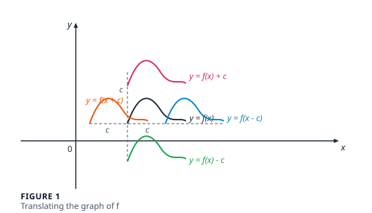

#### Vertical and Horizontal Stretching & Reflecting

- $y = c f(x)$ ($c > 1$): Stretch the graph vertically by a factor of $c$.
- $y = \frac{1}{c} f(x)$ ($c > 1$): Compress the graph vertically by a factor of $c$.
- $y = -f(x)$: Reflect the graph across the $x$-axis.
- $y = f(-x)$: Reflect the graph across the $y$-axis.

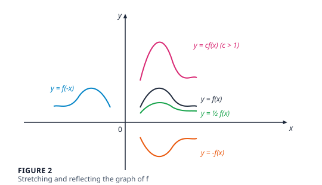

### 2.2 Worked Example: Transforming the Square Root Function

**Example 1**: Given the graph of the square root function $y = \sqrt{x}$, use transformations to graph:
- **(a)** $y = \sqrt{x}$ (base square root curve starting at $(0, 0)$)
- **(b)** $y = \sqrt{x} - 2$ (shift downward 2 units)
- **(c)** $y = \sqrt{x - 2}$ (shift right 2 units)
- **(d)** $y = -\sqrt{x}$ (reflect across $x$-axis)
- **(e)** $y = 2\sqrt{x}$ (vertical stretch by a factor of 2)
- **(f)** $y = \sqrt{-x}$ (reflect across $y$-axis; domain $x \le 0$)

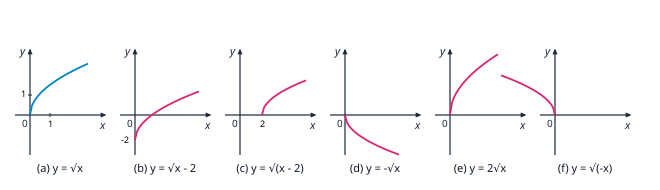

### 2.3 Composition of Functions

**Definition**: Given two functions $f$ and $g$, the **composite function** $f \circ g$ (also called the **composition** of $f$ and $g$) is defined by:
$$(f \circ g)(x) = f(g(x))$$

The domain of $f \circ g$ is the set of all $x$ in the domain of $g$ such that $g(x)$ is in the domain of $f$.

### 2.4 Exercise Set: Identifying Transformations from Graphs

**Exercises 6–7**: The graph of $y = \sqrt{3x - x^2}$ is given on $[0, 3]$ with vertex at $(1.5, 1.5)$. Use transformations to create a function whose graph is as shown.

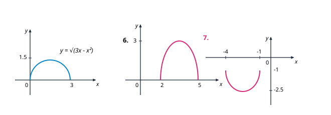

- **Exercise 6**:  
  The base graph is shifted 2 units to the right (domain changes from $[0, 3]$ to $[2, 5]$) and stretched vertically by a factor of 2 (peak changes from $1.5$ to $3$).  
  Resulting function:
  $$y = 2\sqrt{3(x - 2) - (x - 2)^2}$$

- **Exercise 7**:  
  The base graph is shifted 4 units to the left (domain changes to $[-4, -1]$), reflected across the $x$-axis, and vertically scaled/shifted to reach a trough at $-2.5$.

## 3. The Limit of a Function

### 3.1 Intuitive Concept and Three Cases

The notation
$$\lim_{x \to a} f(x) = L$$
means that as $x$ approaches $a$ from both sides (without $x$ ever equaling $a$), the function values $f(x)$ get arbitrarily close to $L$.

#### The Three Fundamental Limit Cases

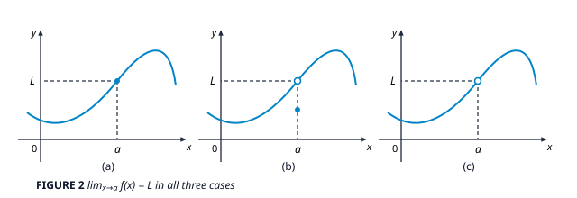

- **Case (a)**: $f(a) = L$. The function is continuous at $x = a$.
- **Case (b)**: $f(a)$ exists but $f(a) \ne L$. There is a removable hole at $(a, L)$ and an isolated point at $(a, f(a))$.
- **Case (c)**: $f(a)$ is undefined. There is a hole at $(a, L)$, but no point exists at $x = a$.

In all three cases, the limit as $x \to a$ exists and equals $L$, demonstrating that limits depend only on function behavior **near** $a$, not **at** $a$.

### 3.2 Numerical and Graphical Investigations

#### Example 1: Rational Function with a Removable Discontinuity

Investigate $\lim_{x \to 1} \frac{x - 1}{x^2 - 1}$.

- **Values approaching 1 from left ($x < 1$)**:  
  $f(0.5) = 0.666667$, $f(0.9) = 0.526316$, $f(0.99) = 0.502513$, $f(0.999) = 0.500250$, $f(0.9999) = 0.500025$.
- **Values approaching 1 from right ($x > 1$)**:  
  $f(1.5) = 0.400000$, $f(1.1) = 0.476190$, $f(1.01) = 0.497512$, $f(1.001) = 0.499750$, $f(1.0001) = 0.499975$.
- **Conclusion**:
  $$\lim_{x \to 1} \frac{x - 1}{x^2 - 1} = 0.5 = \frac{1}{2}$$

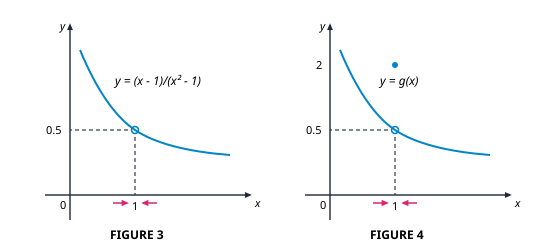

If the function is modified so that $g(1) = 2$, the limit $\lim_{x \to 1} g(x) = 0.5$ remains unchanged (Figure 4).

#### Example 3: Fundamental Trigonometric Limit

Investigate $\lim_{x \to 0} \frac{\sin x}{x}$ ($x$ in radians).

Although $\frac{\sin x}{x}$ is undefined at $x = 0$, constructing a table of values and viewing its graph shows that $f(x)$ approaches $1$ symmetrically from both sides:
$$\lim_{x \to 0} \frac{\sin x}{x} = 1$$

#### Example 4: Limit Failure via Infinite Oscillation

Investigate $\lim_{x \to 0} \sin\left(\frac{\pi}{x}\right)$.

Evaluating at $x = \frac{1}{n}$ for integers $n$:
$$f(1) = \sin \pi = 0, \quad f(1/2) = \sin 2\pi = 0, \quad f(0.1) = \sin 10\pi = 0, \quad f(0.01) = 0$$

A naive guess would suggest the limit is $0$. However, evaluating at $x = \frac{2}{4k + 1}$ produces values of $+1$:
$$f(2/5) = \sin(2.5\pi) = 1, \quad f(2/9) = \sin(4.5\pi) = 1$$

As $x \to 0$, the function oscillates infinitely often between $-1$ and $+1$. Consequently:
$$\lim_{x \to 0} \sin\left(\frac{\pi}{x}\right) \quad \text{Does Not Exist (DNE)}$$

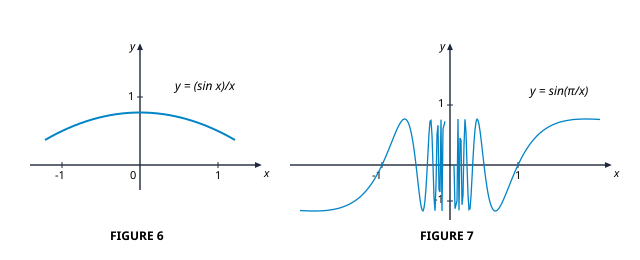

### 3.3 One-Sided Limits

- **Left-hand limit**: $\lim_{x \to a^-} f(x) = L$ indicates that $x$ approaches $a$ with $x < a$.
- **Right-hand limit**: $\lim_{x \to a^+} f(x) = L$ indicates that $x$ approaches $a$ with $x > a$.

#### Existence Theorem for Two-Sided Limits

$$\lim_{x \to a} f(x) = L \iff \lim_{x \to a^-} f(x) = L \quad\text{and}\quad \lim_{x \to a^+} f(x) = L$$

#### Example 7: Reading One-Sided and Two-Sided Limits from a Graph

Use the graph of $g$ in Figure 10 to state the values (if they exist) of the following limits:

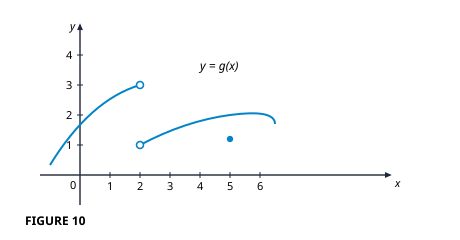

- **(a)** $\lim_{x \to 2^-} g(x) = 3$
- **(b)** $\lim_{x \to 2^+} g(x) = 1$
- **(c)** $\lim_{x \to 2} g(x) = \text{DNE}$ (since left-hand limit $\ne$ right-hand limit)
- **(d)** $\lim_{x \to 5^-} g(x) = 2$
- **(e)** $\lim_{x \to 5^+} g(x) = 2$
- **(f)** $\lim_{x \to 5} g(x) = 2$ (both one-sided limits are equal, even though $g(5) \approx 1.2 \ne 2$)

## 4. Calculating Limits Using the Limit Laws

### 4.1 The Fundamental Limit Laws

Suppose that $c$ is a constant and the limits $\lim_{x \to a} f(x)$ and $\lim_{x \to a} g(x)$ both exist.

**1. Sum Law**:
$$\lim_{x \to a} [f(x) + g(x)] = \lim_{x \to a} f(x) + \lim_{x \to a} g(x)$$

**2. Difference Law**:
$$\lim_{x \to a} [f(x) - g(x)] = \lim_{x \to a} f(x) - \lim_{x \to a} g(x)$$

**3. Constant Multiple Law**:
$$\lim_{x \to a} [c f(x)] = c \lim_{x \to a} f(x)$$

**4. Product Law**:
$$\lim_{x \to a} [f(x) g(x)] = \lim_{x \to a} f(x) \cdot \lim_{x \to a} g(x)$$

**5. Quotient Law**:
$$\lim_{x \to a} \frac{f(x)}{g(x)} = \frac{\lim_{x \to a} f(x)}{\lim_{x \to a} g(x)} \quad \text{if } \lim_{x \to a} g(x) \ne 0$$

### 4.2 Worked Example: Applying Limit Laws to Multiple Graphs

**Example 1**: Use the Limit Laws and the graphs of $f$ and $g$ in Figure 1 to evaluate the limits, if they exist:

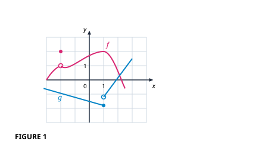

- **(a) Evaluate $\lim_{x \to -2} [f(x) + 5g(x)]$**:  
  From the graphs: $\lim_{x \to -2} f(x) = 1$ and $\lim_{x \to -2} g(x) = -1$.  
  Applying Sum and Constant Multiple Laws:
  $$\lim_{x \to -2} [f(x) + 5g(x)] = \lim_{x \to -2} f(x) + 5 \lim_{x \to -2} g(x) = 1 + 5(-1) = -4$$

- **(b) Evaluate $\lim_{x \to 1} [f(x) g(x)]$**:  
  From the graphs: $\lim_{x \to 1} f(x) = 2$.  
  For $g(x)$, the left-hand limit is $\lim_{x \to 1^-} g(x) = -2$ and the right-hand limit is $\lim_{x \to 1^+} g(x) = -1$.  
  Since the one-sided limits are not equal, $\lim_{x \to 1} g(x)$ does not exist.  
  Therefore, $\lim_{x \to 1} [f(x) g(x)]$ does not exist.

- **(c) Evaluate $\lim_{x \to 2} \frac{f(x)}{g(x)}$**:  
  From the graphs: $\lim_{x \to 2} f(x) \approx 1.4$ and $\lim_{x \to 2} g(x) = 0$.  
  Since the limit of the denominator is $0$ while the numerator limit is non-zero, the Quotient Law cannot be applied, and the limit does not exist.
