# Calculus Topics & Exercises: Limit Laws & The Precise Definition of a Limit

Source material: Stewart *Calculus: Early Transcendentals* (Chapter 2: Limits — The Limit Laws and The Precise Definition of a Limit).

## 1. Calculating Limits Using the Limit Laws

### 1.1 The Fundamental Limit Laws

Suppose that $c$ is a constant and the limits $\lim_{x \to a} f(x)$ and $\lim_{x \to a} g(x)$ both exist.

**1. Sum Law**:
$$\lim_{x \to a} [f(x) + g(x)] = \lim_{x \to a} f(x) + \lim_{x \to a} g(x)$$

**2. Difference Law**:
$$\lim_{x \to a} [f(x) - g(x)] = \lim_{x \to a} f(x) - \lim_{x \to a} g(x)$$

**3. Constant Multiple Law**:
$$\lim_{x \to a} [c f(x)] = c \lim_{x \to a} f(x)$$

**4. Product Law**:
$$\lim_{x \to a} [f(x) g(x)] = \lim_{x \to a} f(x) \cdot \lim_{x \to a} g(x)$$

**5. Quotient Law**:
$$\lim_{x \to a} \frac{f(x)}{g(x)} = \frac{\lim_{x \to a} f(x)}{\lim_{x \to a} g(x)} \quad \text{if } \lim_{x \to a} g(x) \ne 0$$

These five laws can be stated verbally as follows:
- **Sum**: The limit of a sum is the sum of the limits.
- **Difference**: The limit of a difference is the difference of the limits.
- **Constant Multiple**: The limit of a constant times a function is the constant times the limit of the function.
- **Product**: The limit of a product is the product of the limits.
- **Quotient**: The limit of a quotient is the quotient of the limits (provided that the limit of the denominator is not $0$).

*Intuitive justification*: If $f(x)$ is close to $L$ and $g(x)$ is close to $M$, it is reasonable to conclude that $f(x) + g(x)$ is close to $L + M$. In Section 2, the precise $(\varepsilon, \delta)$ definition of a limit is used to prove these laws rigorously.

### 1.2 Worked Example: Graphical Limit Evaluation

**Example 1**: Use the Limit Laws and the graphs of $f$ and $g$ in Figure 1 to evaluate the following limits, if they exist:

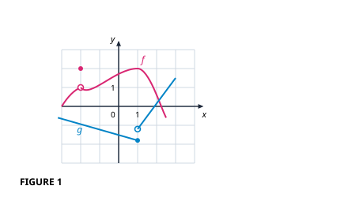

**(a) Evaluate $\lim_{x \to -2} [f(x) + 5g(x)]$**:

From the graphs of $f$ and $g$, we observe:
$$\lim_{x \to -2} f(x) = 1 \quad\text{and}\quad \lim_{x \to -2} g(x) = -1$$

Applying the Sum Law (Law 1) and Constant Multiple Law (Law 3):
$$\lim_{x \to -2} [f(x) + 5g(x)] = \lim_{x \to -2} f(x) + \lim_{x \to -2} [5g(x)] = \lim_{x \to -2} f(x) + 5 \lim_{x \to -2} g(x) = 1 + 5(-1) = -4$$

**(b) Evaluate $\lim_{x \to 1} [f(x) g(x)]$**:

From the graphs, $\lim_{x \to 1} f(x) = 2$. For $g(x)$, the left-hand and right-hand limits differ:
$$\lim_{x \to 1^-} g(x) = -2 \quad\text{and}\quad \lim_{x \to 1^+} g(x) = -1$$

Because the one-sided limits are unequal, $\lim_{x \to 1} g(x)$ does not exist, so Law 4 cannot be applied directly to the two-sided limit. Checking one-sided product limits:
$$\lim_{x \to 1^-} [f(x) g(x)] = 2 \cdot (-2) = -4$$

$$\lim_{x \to 1^+} [f(x) g(x)] = 2 \cdot (-1) = -2$$

Since the left- and right-hand limits are not equal, $\lim_{x \to 1} [f(x) g(x)]$ does not exist.

**(c) Evaluate $\lim_{x \to 2} \frac{f(x)}{g(x)}$**:

The graphs show that $\lim_{x \to 2} f(x) \approx 1.4$ and $\lim_{x \to 2} g(x) = 0$. Because the limit of the denominator is $0$, Law 5 cannot be used. The limit does not exist because the denominator approaches $0$ while the numerator approaches a nonzero number.

### 1.3 Power, Root, and Special Limit Laws

Repeated application of the Product Law with $g(x) = f(x)$ yields:

**6. Power Law**:
$$\lim_{x \to a} [f(x)]^n = \left[\lim_{x \to a} f(x)\right]^n \quad \text{where } n \text{ is a positive integer}$$

Two elementary base limits serve as building blocks:

**7. Constant Limit**:
$$\lim_{x \to a} c = c$$

**8. Identity Limit**:
$$\lim_{x \to a} x = a$$

Setting $f(x) = x$ in Law 6 and applying Law 8 gives:

**9. Monomial Power Law**:
$$\lim_{x \to a} x^n = a^n \quad \text{where } n \text{ is a positive integer}$$

**10. Root Law for $x$**:
$$\lim_{x \to a} \sqrt[n]{x} = \sqrt[n]{a} \quad \text{where } n \text{ is a positive integer (if } n \text{ is even, assume } a > 0)$$

**11. General Root Law**:
$$\lim_{x \to a} \sqrt[n]{f(x)} = \sqrt[n]{\lim_{x \to a} f(x)} \quad \text{where } n \text{ is a positive integer (if } n \text{ is even, assume } \lim_{x \to a} f(x) > 0)$$

### 1.4 Algebraic Limit Evaluation & The Direct Substitution Property

**Example 2**: Evaluate the limits and justify each step.

**(a) Evaluate $\lim_{x \to 5} (2x^2 - 3x + 4)$**:

$$\lim_{x \to 5} (2x^2 - 3x + 4) = \lim_{x \to 5} (2x^2) - \lim_{x \to 5} (3x) + \lim_{x \to 5} 4 \quad \text{(by Laws 2 and 1)}$$

$$= 2 \lim_{x \to 5} x^2 - 3 \lim_{x \to 5} x + \lim_{x \to 5} 4 \quad \text{(by Law 3)}$$

$$= 2(5^2) - 3(5) + 4 \quad \text{(by Laws 9, 8, and 7)}$$

$$= 2(25) - 15 + 4 = 39$$

**(b) Evaluate $\lim_{x \to -2} \frac{x^3 + 2x^2 - 1}{5 - 3x}$**:

Law 5 is applied provisionally and validated once both numerator and denominator limits exist and the denominator limit is nonzero:

$$\lim_{x \to -2} \frac{x^3 + 2x^2 - 1}{5 - 3x} = \frac{\lim_{x \to -2} (x^3 + 2x^2 - 1)}{\lim_{x \to -2} (5 - 3x)} \quad \text{(by Law 5)}$$

$$= \frac{\lim_{x \to -2} x^3 + 2 \lim_{x \to -2} x^2 - \lim_{x \to -2} 1}{\lim_{x \to -2} 5 - 3 \lim_{x \to -2} x} \quad \text{(by Laws 1, 2, and 3)}$$

$$= \frac{(-2)^3 + 2(-2)^2 - 1}{5 - 3(-2)} \quad \text{(by Laws 9, 8, and 7)}$$

$$= \frac{-8 + 8 - 1}{5 + 6} = -\frac{1}{11}$$

**Direct Substitution Property**: If $f$ is a polynomial or a rational function and $a$ is in the domain of $f$, then:
$$\lim_{x \to a} f(x) = f(a)$$

### 1.5 Limits of Absolute Value, Piecewise, and Step Functions

A foundational criterion connects two-sided and one-sided limits:

**Theorem 1**:
$$\lim_{x \to a} f(x) = L \iff \lim_{x \to a^-} f(x) = L = \lim_{x \to a^+} f(x)$$

**Example 7**: Show that $\lim_{x \to 0} |x| = 0$.

Recall the definition of the absolute value function:
$$|x| = \begin{cases} x & \text{if } x \ge 0 \\ -x & \text{if } x < 0 \end{cases}$$

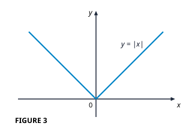

Evaluating one-sided limits:
- For $x > 0$: $\lim_{x \to 0^+} |x| = \lim_{x \to 0^+} x = 0$
- For $x < 0$: $\lim_{x \to 0^-} |x| = \lim_{x \to 0^-} (-x) = 0$

Since both one-sided limits are equal to $0$, Theorem 1 guarantees:
$$\lim_{x \to 0} |x| = 0$$

**Example 8**: Prove that $\lim_{x \to 0} \frac{|x|}{x}$ does not exist.

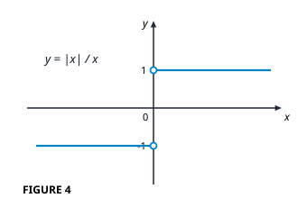

Examining the one-sided limits:
$$\lim_{x \to 0^+} \frac{|x|}{x} = \lim_{x \to 0^+} \frac{x}{x} = \lim_{x \to 0^+} 1 = 1$$

$$\lim_{x \to 0^-} \frac{|x|}{x} = \lim_{x \to 0^-} \frac{-x}{x} = \lim_{x \to 0^-} (-1) = -1$$

Since the right-hand and left-hand limits differ ($1 \ne -1$), Theorem 1 proves that $\lim_{x \to 0} \frac{|x|}{x}$ does not exist.

**Example 9**: For the piecewise function:
$$f(x) = \begin{cases} \sqrt{x - 4} & \text{if } x > 4 \\ 8 - 2x & \text{if } x < 4 \end{cases}$$
determine whether $\lim_{x \to 4} f(x)$ exists.

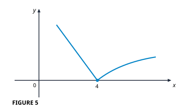

- Right-hand limit ($x > 4$): $\lim_{x \to 4^+} f(x) = \lim_{x \to 4^+} \sqrt{x - 4} = \sqrt{4 - 4} = 0$
- Left-hand limit ($x < 4$): $\lim_{x \to 4^-} f(x) = \lim_{x \to 4^-} (8 - 2x) = 8 - 2(4) = 0$

Because both one-sided limits are equal, the two-sided limit exists and:
$$\lim_{x \to 4} f(x) = 0$$

**Example 10**: The greatest integer function (floor function) is defined by $\llbracket x \rrbracket = \text{the largest integer } \le x$. Show that $\lim_{x \to 3} \llbracket x \rrbracket$ does not exist.

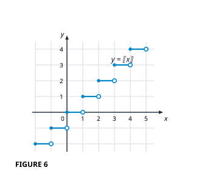

For $x$ approaching $3$:
- On the interval $[3, 4)$, $\llbracket x \rrbracket = 3$, so $\lim_{x \to 3^+} \llbracket x \rrbracket = 3$.
- On the interval $[2, 3)$, $\llbracket x \rrbracket = 2$, so $\lim_{x \to 3^-} \llbracket x \rrbracket = 2$.

Because the one-sided limits are unequal ($3 \ne 2$), Theorem 1 implies that $\lim_{x \to 3} \llbracket x \rrbracket$ does not exist.

### 1.6 The Squeeze Theorem & Oscillating Limits

**Theorem 2 (Inequality Preservation)**: If $f(x) \le g(x)$ when $x$ is near $a$ (except possibly at $a$) and the limits of $f$ and $g$ both exist as $x \to a$, then:
$$\lim_{x \to a} f(x) \le \lim_{x \to a} g(x)$$

**Theorem 3 (The Squeeze Theorem)**: If $f(x) \le g(x) \le h(x)$ when $x$ is near $a$ (except possibly at $a$) and:
$$\lim_{x \to a} f(x) = \lim_{x \to a} h(x) = L$$
then:
$$\lim_{x \to a} g(x) = L$$

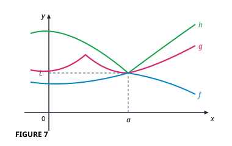

The Squeeze Theorem (also known as the Sandwich Theorem or Pinching Theorem) forces the middle curve $g(x)$ to converge to $L$ as both outer boundaries pinch together at $x = a$.

**Example 11**: Show that $\lim_{x \to 0} x^2 \sin\left(\frac{1}{x}\right) = 0$.

Direct application of the Product Law fails because $\lim_{x \to 0} \sin(1/x)$ does not exist due to infinite oscillation between $-1$ and $1$. Instead, we establish bounds using the range of the sine function:
$$-1 \le \sin\left(\frac{1}{x}\right) \le 1$$

Since $x^2 \ge 0$ for all real $x$, multiplying through by $x^2$ preserves the inequalities:
$$-x^2 \le x^2 \sin\left(\frac{1}{x}\right) \le x^2$$

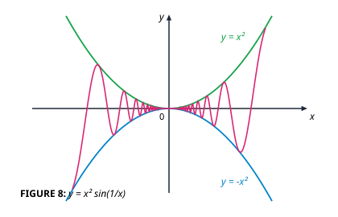

Taking the limits of the outer bounding functions:
$$\lim_{x \to 0} (-x^2) = 0 \quad\text{and}\quad \lim_{x \to 0} x^2 = 0$$

By the Squeeze Theorem, the trapped function must converge to the same limit:
$$\lim_{x \to 0} x^2 \sin\left(\frac{1}{x}\right) = 0$$

### 1.7 Exercise Set: Limit Laws, Factoring, and Squeeze Theorem

**1.** Given that $\lim_{x \to 2} f(x) = 4$, $\lim_{x \to 2} g(x) = -2$, and $\lim_{x \to 2} h(x) = 0$, find each limit if it exists:  
- **(a)** $\lim_{x \to 2} [f(x) + 5g(x)] = \lim_{x \to 2} f(x) + 5 \lim_{x \to 2} g(x) = 4 + 5(-2) = -6$  
- **(b)** $\lim_{x \to 2} [g(x)]^3 = [\lim_{x \to 2} g(x)]^3 = (-2)^3 = -8$  
- **(c)** $\lim_{x \to 2} \sqrt{f(x)} = \sqrt{\lim_{x \to 2} f(x)} = \sqrt{4} = 2$  
- **(d)** $\lim_{x \to 2} \frac{3f(x)}{g(x)} = \frac{3(4)}{-2} = -6$  
- **(e)** $\lim_{x \to 2} \frac{g(x)}{h(x)}$: Does not exist because the denominator approaches $0$ while the numerator approaches $-2 \ne 0$.  
- **(f)** $\lim_{x \to 2} \frac{g(x)h(x)}{f(x)} = \frac{(-2)(0)}{4} = 0$

**2.** The graphs of $f$ and $g$ are given in the figure below. Use them to evaluate each limit, if it exists:

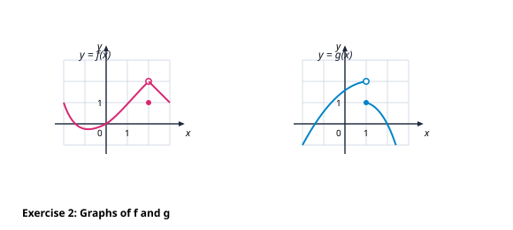

- **(a)** $\lim_{x \to 2} [f(x) + g(x)]$: From the graphs, $\lim_{x \to 2} f(x) = 2$ and $\lim_{x \to 2} g(x) = 0$. By the Sum Law: $2 + 0 = 2$.  
- **(b)** $\lim_{x \to 1} [f(x) + g(x)]$: $\lim_{x \to 1} f(x) = 1$. For $g(x)$, $\lim_{x \to 1^-} g(x) = 2$ and $\lim_{x \to 1^+} g(x) = 1$. Since the one-sided limits of $g$ disagree, $\lim_{x \to 1} g(x)$ does not exist, and so $\lim_{x \to 1} [f(x) + g(x)]$ does not exist.  
- **(c)** $\lim_{x \to 0} [f(x) g(x)]$: From the graphs, $\lim_{x \to 0} f(x) = 0$ and $\lim_{x \to 0} g(x) \approx 1.3$. By the Product Law: $0 \cdot 1.3 = 0$.  
- **(d)** $\lim_{x \to -1} \frac{f(x)}{g(x)}$: As $x \to -1$, $\lim_{x \to -1} f(x) = -1 \ne 0$ while $\lim_{x \to -1} g(x) = 0$. The limit does not exist.  
- **(e)** $\lim_{x \to 2} [x^3 f(x)] = (\lim_{x \to 2} x^3)(\lim_{x \to 2} f(x)) = (2^3)(2) = 8 \cdot 2 = 16$.  
- **(f)** $\lim_{x \to 1} \sqrt{3 + f(x)} = \sqrt{3 + \lim_{x \to 1} f(x)} = \sqrt{3 + 1} = \sqrt{4} = 2$.

**Exercises 3–9: Evaluate the limit and justify each step with Limit Laws.**

**3.** $\lim_{x \to 3} (5x^3 - 3x^2 + x - 6) = 5(3^3) - 3(3^2) + 3 - 6 = 135 - 27 + 3 - 6 = 105$. (Laws 1, 2, 3, 7, 8, 9)

**4.** $\lim_{x \to -1} (x^4 - 3x)(x^2 + 5x + 3) = [(-1)^4 - 3(-1)][(-1)^2 + 5(-1) + 3] = (1 + 3)(1 - 5 + 3) = 4(-1) = -4$. (Law 4)

**5.** $\lim_{t \to -2} \frac{t^4 - 2}{2t^2 - 3t + 2} = \frac{(-2)^4 - 2}{2(-2)^2 - 3(-2) + 2} = \frac{16 - 2}{8 + 6 + 2} = \frac{14}{16} = \frac{7}{8}$. (Law 5)

**6.** $\lim_{u \to -2} \sqrt{u^4 + 3u + 6} = \sqrt{(-2)^4 + 3(-2) + 6} = \sqrt{16 - 6 + 6} = \sqrt{16} = 4$. (Law 11)

**7.** $\lim_{x \to 8} (1 + \sqrt[3]{x})(2 - 6x^2 + x^3) = (1 + \sqrt[3]{8})(2 - 6(64) + 512) = (1 + 2)(2 - 384 + 512) = 3(130) = 390$. (Laws 4, 11)

**8.** $\lim_{t \to 2} \left(\frac{t^2 - 2}{t^3 - 3t + 5}\right)^2 = \left(\frac{2^2 - 2}{2^3 - 3(2) + 5}\right)^2 = \left(\frac{2}{7}\right)^2 = \frac{4}{49}$. (Laws 5, 6)

**9.** $\lim_{x \to 2} \sqrt{\frac{2x^2 + 1}{3x - 2}} = \sqrt{\frac{2(2^2) + 1}{3(2) - 2}} = \sqrt{\frac{9}{4}} = \frac{3}{2}$. (Laws 5, 11)

**10.**  
- **(a) What is wrong with the equation $\frac{x^2 + x - 6}{x - 2} = x + 3$?**  
  The two expressions are not equal for all real numbers because their domains differ: the rational function on the left is undefined at $x = 2$ (division by zero), whereas the linear function on the right is defined everywhere on $\mathbb{R}$. The equation is valid only under the restriction $x \ne 2$.  
- **(b) Explain why $\lim_{x \to 2} \frac{x^2 + x - 6}{x - 2} = \lim_{x \to 2} (x + 3)$ is correct.**  
  By definition, the limit as $x \to 2$ considers only values of $x$ close to $2$ where $x \ne 2$. Because $\frac{x^2 + x - 6}{x - 2} = x + 3$ holds identically for all $x \ne 2$, the two functions have identical local behaviors near $2$, making their limits identical: $2 + 3 = 5$.

**Exercises 11–26: Evaluate each limit if it exists.**

**11.** $\lim_{x \to 5} \frac{x^2 - 6x + 5}{x - 5} = \lim_{x \to 5} \frac{(x - 5)(x - 1)}{x - 5} = \lim_{x \to 5} (x - 1) = 5 - 1 = 4$.

**12.** $\lim_{x \to 4} \frac{x^2 - 4x}{x^2 - 3x - 4} = \lim_{x \to 4} \frac{x(x - 4)}{(x - 4)(x + 1)} = \lim_{x \to 4} \frac{x}{x + 1} = \frac{4}{5}$.

**13.** $\lim_{x \to 5} \frac{x^2 - 5x + 6}{x - 5}$: Direct substitution gives numerator $25 - 25 + 6 = 6$ and denominator $0$. The limit does not exist (the function approaches $-\infty$ from the left and $+\infty$ from the right).

**14.** $\lim_{x \to -1} \frac{x^2 - 4x}{x^2 - 3x - 4}$: Direct substitution gives numerator $(-1)^2 - 4(-1) = 5$ and denominator $(-1)^2 - 3(-1) - 4 = 0$. The limit does not exist.

**15.** $\lim_{t \to -3} \frac{t^2 - 9}{2t^2 + 7t + 3} = \lim_{t \to -3} \frac{(t - 3)(t + 3)}{(2t + 1)(t + 3)} = \lim_{t \to -3} \frac{t - 3}{2t + 1} = \frac{-6}{-5} = \frac{6}{5}$.

**16.** $\lim_{x \to -1} \frac{2x^2 + 3x + 1}{x^2 - 2x - 3} = \lim_{x \to -1} \frac{(2x + 1)(x + 1)}{(x - 3)(x + 1)} = \lim_{x \to -1} \frac{2x + 1}{x - 3} = \frac{-1}{-4} = \frac{1}{4}$.

**17.** $\lim_{h \to 0} \frac{(-5 + h)^2 - 25}{h} = \lim_{h \to 0} \frac{25 - 10h + h^2 - 25}{h} = \lim_{h \to 0} (-10 + h) = -10$.

**18.** $\lim_{h \to 0} \frac{(2 + h)^3 - 8}{h} = \lim_{h \to 0} \frac{8 + 12h + 6h^2 + h^3 - 8}{h} = \lim_{h \to 0} (12 + 6h + h^2) = 12$.

**19.** $\lim_{x \to -2} \frac{x + 2}{x^3 + 8} = \lim_{x \to -2} \frac{x + 2}{(x + 2)(x^2 - 2x + 4)} = \lim_{x \to -2} \frac{1}{x^2 - 2x + 4} = \frac{1}{4 + 4 + 4} = \frac{1}{12}$.

**20.** $\lim_{t \to 1} \frac{t^4 - 1}{t^3 - 1} = \lim_{t \to 1} \frac{(t - 1)(t + 1)(t^2 + 1)}{(t - 1)(t^2 + t + 1)} = \lim_{t \to 1} \frac{(t + 1)(t^2 + 1)}{t^2 + t + 1} = \frac{(2)(2)}{3} = \frac{4}{3}$.

**21.** $\lim_{h \to 0} \frac{\sqrt{9 + h} - 3}{h} = \lim_{h \to 0} \frac{(9 + h) - 9}{h(\sqrt{9 + h} + 3)} = \lim_{h \to 0} \frac{1}{\sqrt{9 + h} + 3} = \frac{1}{3 + 3} = \frac{1}{6}$.

**22.** $\lim_{u \to 2} \frac{\sqrt{4u + 1} - 3}{u - 2} = \lim_{u \to 2} \frac{(4u + 1) - 9}{(u - 2)(\sqrt{4u + 1} + 3)} = \lim_{u \to 2} \frac{4(u - 2)}{(u - 2)(\sqrt{4u + 1} + 3)} = \frac{4}{\sqrt{9} + 3} = \frac{4}{6} = \frac{2}{3}$.

**23.** $\lim_{x \to -4} \frac{\frac{1}{4} + \frac{1}{x}}{4 + x} = \lim_{x \to -4} \frac{\frac{x + 4}{4x}}{x + 4} = \lim_{x \to -4} \frac{1}{4x} = \frac{1}{4(-4)} = -\frac{1}{16}$.

**24.** $\lim_{x \to -1} \frac{x^2 + 2x + 1}{x^4 - 1} = \lim_{x \to -1} \frac{(x + 1)^2}{(x - 1)(x + 1)(x^2 + 1)} = \lim_{x \to -1} \frac{x + 1}{(x - 1)(x^2 + 1)} = \frac{0}{(-2)(2)} = 0$.

**25.** $\lim_{t \to 0} \frac{\sqrt{1 + t} - \sqrt{1 - t}}{t} = \lim_{t \to 0} \frac{(1 + t) - (1 - t)}{t(\sqrt{1 + t} + \sqrt{1 - t})} = \lim_{t \to 0} \frac{2t}{t(\sqrt{1 + t} + \sqrt{1 - t})} = \frac{2}{1 + 1} = 1$.

**26.** $\lim_{t \to 0} \left(\frac{1}{t} - \frac{1}{t^2 + t}\right) = \lim_{t \to 0} \frac{(t + 1) - 1}{t(t + 1)} = \lim_{t \to 0} \frac{t}{t(t + 1)} = \lim_{t \to 0} \frac{1}{t + 1} = 1$.

**Exercises 37–40: Squeeze Theorem Applications & Proofs.**

**37.** If $4x - 9 \le f(x) \le x^2 - 4x + 7$ for $x \ge 0$, find $\lim_{x \to 4} f(x)$.  
Evaluating the bounds: $\lim_{x \to 4} (4x - 9) = 16 - 9 = 7$, and $\lim_{x \to 4} (x^2 - 4x + 7) = 16 - 16 + 7 = 7$.  
Since both outer limits equal $7$, by the Squeeze Theorem:
$$\lim_{x \to 4} f(x) = 7$$

**38.** If $2x \le g(x) \le x^4 - x^2 + 2$ for all $x$, evaluate $\lim_{x \to 1} g(x)$.  
$\lim_{x \to 1} 2x = 2$, and $\lim_{x \to 1} (x^4 - x^2 + 2) = 1 - 1 + 2 = 2$.  
By the Squeeze Theorem:
$$\lim_{x \to 1} g(x) = 2$$

**39.** Prove that $\lim_{x \to 0} x^4 \cos\left(\frac{2}{x}\right) = 0$.  
For all $x \ne 0$, $-1 \le \cos(2/x) \le 1$. Multiplying through by $x^4 \ge 0$:
$$-x^4 \le x^4 \cos\left(\frac{2}{x}\right) \le x^4$$
Since $\lim_{x \to 0} (-x^4) = 0$ and $\lim_{x \to 0} x^4 = 0$, the Squeeze Theorem confirms:
$$\lim_{x \to 0} x^4 \cos\left(\frac{2}{x}\right) = 0$$

**40.** Prove that $\lim_{x \to 0^+} \sqrt{x} \left[1 + \sin^2\left(\frac{2\pi}{x}\right)\right] = 0$.  
Since $0 \le \sin^2(2\pi/x) \le 1$, we have $1 \le 1 + \sin^2(2\pi/x) \le 2$. For $x > 0$, multiplying by $\sqrt{x} > 0$ gives:
$$\sqrt{x} \le \sqrt{x} \left[1 + \sin^2\left(\frac{2\pi}{x}\right)\right] \le 2\sqrt{x}$$
Since $\lim_{x \to 0^+} \sqrt{x} = 0$ and $\lim_{x \to 0^+} 2\sqrt{x} = 0$, by the Squeeze Theorem:
$$\lim_{x \to 0^+} \sqrt{x} \left[1 + \sin^2\left(\frac{2\pi}{x}\right)\right] = 0$$

**Exercises 41–46: Absolute Value & One-Sided Limit Evaluations.**

**41.** $\lim_{x \to 3} (2x + |x - 3|)$: Since $|x - 3| \to 0$ as $x \to 3$ from both sides, $\lim_{x \to 3} (2x + |x - 3|) = 2(3) + 0 = 6$.

**42.** $\lim_{x \to -6} \frac{2x + 12}{|x + 6|} = \lim_{x \to -6} \frac{2(x + 6)}{|x + 6|}$.  
- From the right ($x > -6$): $\frac{2(x + 6)}{x + 6} = 2$.  
- From the left ($x < -6$): $\frac{2(x + 6)}{-(x + 6)} = -2$.  
Because $2 \ne -2$, the limit does not exist.

**43.** $\lim_{x \to 0.5^-} \frac{2x - 1}{|2x^3 - x^2|} = \lim_{x \to 0.5^-} \frac{2x - 1}{|x^2(2x - 1)|}$.  
For $x < 0.5$, $2x - 1 < 0$, so $|2x - 1| = -(2x - 1)$. Thus $\frac{2x - 1}{-x^2(2x - 1)} = -\frac{1}{x^2}$.  
Evaluating the limit: $-\frac{1}{(0.5)^2} = -4$.

**44.** $\lim_{x \to -2} \frac{2 - |x|}{2 + x}$: For $x$ near $-2$, $x < 0 \implies |x| = -x$.  
Then $\frac{2 - (-x)}{2 + x} = \frac{2 + x}{2 + x} = 1$ for all $x \ne -2$. The limit is $1$.

**45.** $\lim_{x \to 0^-} \left(\frac{1}{x} - \frac{1}{|x|}\right)$: For $x < 0$, $|x| = -x$, so $\frac{1}{x} - \left(-\frac{1}{x}\right) = \frac{2}{x}$. As $x \to 0^-$, $\frac{2}{x} \to -\infty$. The limit does not exist.

**46.** $\lim_{x \to 0^+} \left(\frac{1}{x} - \frac{1}{|x|}\right)$: For $x > 0$, $|x| = x$, so $\frac{1}{x} - \frac{1}{x} = 0$. The limit is $0$.

**47.** The signum (sign) function is defined by:
$$\operatorname{sgn}(x) = \begin{cases} -1 & \text{if } x < 0 \\ 0 & \text{if } x = 0 \\ 1 & \text{if } x > 0 \end{cases}$$

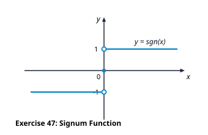

- **(a)** Graph shown in figure above with horizontal rays at $y = 1$ ($x > 0$) and $y = -1$ ($x < 0$), with an isolated dot at the origin $(0, 0)$.  
- **(b) Evaluate limits**:  
  - **(i)** $\lim_{x \to 0^+} \operatorname{sgn}(x) = 1$  
  - **(ii)** $\lim_{x \to 0^-} \operatorname{sgn}(x) = -1$  
  - **(iii)** $\lim_{x \to 0} \operatorname{sgn}(x)$ does not exist (one-sided limits differ).  
  - **(iv)** $\lim_{x \to 0} |\operatorname{sgn}(x)|$: For all $x \ne 0$, $|\operatorname{sgn}(x)| = |\pm 1| = 1$, so $\lim_{x \to 0} |\operatorname{sgn}(x)| = 1$.

**48.** Let:
$$f(x) = \begin{cases} x^2 + 1 & \text{if } x < 1 \\ (x - 2)^2 & \text{if } x \ge 1 \end{cases}$$

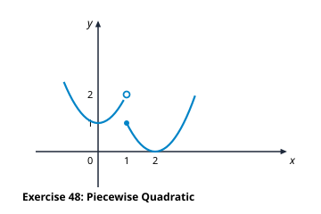

- **(a)** Left limit: $\lim_{x \to 1^-} f(x) = \lim_{x \to 1^-} (x^2 + 1) = 1^2 + 1 = 2$.  
  Right limit: $\lim_{x \to 1^+} f(x) = \lim_{x \to 1^+} (x - 2)^2 = (1 - 2)^2 = 1$.  
- **(b)** Does $\lim_{x \to 1} f(x)$ exist? No, because the one-sided limits are unequal ($2 \ne 1$).  
- **(c)** Graph sketched in figure above showing a jump discontinuity at $x = 1$.

## 2. The Precise Definition of a Limit

### 2.1 Intuition and the Epsilon-Delta Challenge Model

Consider the linear function $f(x) = 2x - 1$ as $x$ approaches $3$. We intuitively expect $\lim_{x \to 3} (2x - 1) = 5$. To make "close to" mathematically rigorous, consider requiring the distance $|f(x) - 5|$ to be strictly smaller than an arbitrary tolerance $\varepsilon > 0$:
$$|f(x) - 5| < \varepsilon \iff |(2x - 1) - 5| < \varepsilon \iff |2x - 6| < \varepsilon \iff 2|x - 3| < \varepsilon \iff |x - 3| < \frac{\varepsilon}{2}$$

Thus, whenever $x \ne 3$ satisfies $0 < |x - 3| < \delta = \frac{\varepsilon}{2}$, the output is guaranteed to satisfy $|f(x) - 5| < \varepsilon$. Rewriting in open intervals:
$$\text{if } 3 - \delta < x < 3 + \delta \quad (x \ne 3) \implies 5 - \varepsilon < f(x) < 5 + \varepsilon$$

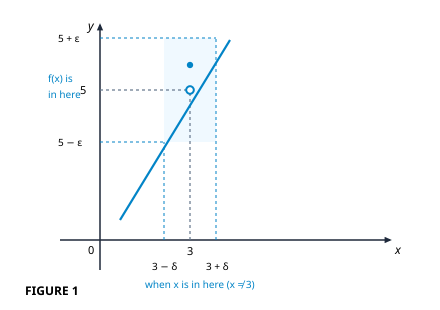

Using this relationship as the prototype, Cauchy and Weierstrass formulated the precise definition:

**Definition 2 (Precise Definition of a Limit)**: Let $f$ be a function defined on some open interval that contains the number $a$, except possibly at $a$ itself. We say that the **limit of $f(x)$ as $x$ approaches $a$ is $L$**, written:
$$\lim_{x \to a} f(x) = L$$
if for every number $\varepsilon > 0$ there is a number $\delta > 0$ such that:
$$\text{if } 0 < |x - a| < \delta \quad\text{then}\quad |f(x) - L| < \varepsilon$$

#### Alternative Formulations

1. **In Words**: $\lim_{x \to a} f(x) = L$ means that the distance between $f(x)$ and $L$ can be made arbitrarily small by taking the distance from $x$ to $a$ sufficiently small (but not $0$).
2. **Interval Formulation**: For every $\varepsilon > 0$, there exists $\delta > 0$ such that if $x \in (a - \delta, a + \delta)$ with $x \ne a$, then $f(x) \in (L - \varepsilon, L + \varepsilon)$.

#### The Challenge Game Analogy

Think of the limit definition as a game between two contestants, Challenger A and Responder B:
- **Challenger A** demands an accuracy tolerance $\varepsilon > 0$ (e.g., $\varepsilon = 0.01$).
- **Responder B** must find a control tolerance $\delta > 0$ such that whenever $x$ is trapped within $\delta$ of $a$, $f(x)$ stays within $\varepsilon$ of $L$.
- If Challenger A tightens the challenge (say, $\varepsilon = 0.0001$), Responder B must produce a new, typically smaller $\delta$.
- If Responder B always has a winning response $\delta(\varepsilon)$ for *every* possible positive $\varepsilon$, no matter how tiny, then $\lim_{x \to a} f(x) = L$.

### 2.2 Geometric Interpretations of the Limit Definition

The definition of a limit admits two complementary geometric perspectives:

#### 1. Arrow Diagrams on the Real Line

A function maps points from a domain subset of $\mathbb{R}$ to a target subset of $\mathbb{R}$. Figure 2 displays points $x$ and $a$ mapped via directed arrows to $f(x)$ and $f(a)$. Figure 3 shows the interval $(a - \delta, a + \delta)$ mapping entirely inside the target interval $(L - \varepsilon, L + \varepsilon)$.

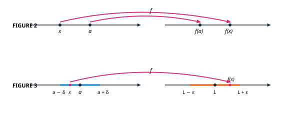

#### 2. Coordinate Bands on Cartesian Graphs

Plotting $y = f(x)$ on the coordinate plane yields a visual interpretation via horizontal and vertical bands:
- **Figure 4**: Challenger A specifies a horizontal band of width $2\varepsilon$ bounded by $y = L + \varepsilon$ and $y = L - \varepsilon$.
- **Figure 5**: Responder B determines a vertical strip of width $2\delta$ bounded by $x = a - \delta$ and $x = a + \delta$. For all points in the vertical strip (except possibly $x = a$), the curve remains trapped inside the horizontal band.
- **Figure 6**: When Challenger A shrinks $\varepsilon$, the horizontal band narrows, forcing Responder B to find a correspondingly narrower $\delta$ strip.

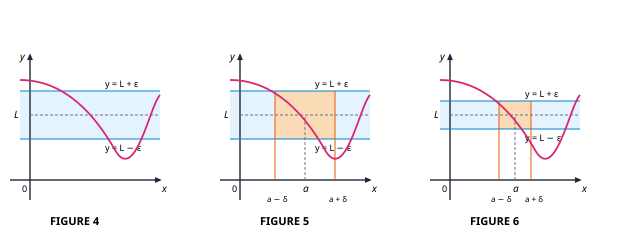

### 2.3 Graphical Determination of Delta

**Example 1**: Use a graph to find a number $\delta$ such that:
$$\text{if } |x - 1| < \delta \quad\text{then}\quad |(x^3 - 5x + 6) - 2| < 0.2$$
This corresponds to finding $\delta$ for $\varepsilon = 0.2$ in the limit $\lim_{x \to 1} (x^3 - 5x + 6) = 2$.

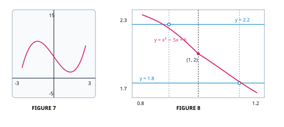

**Solution**:  
Rewriting the output tolerance inequality:
$$|(x^3 - 5x + 6) - 2| < 0.2 \iff 1.8 < x^3 - 5x + 6 < 2.2$$

We examine where the curve $y = x^3 - 5x + 6$ lies between the horizontal lines $y = 1.8$ and $y = 2.2$ near $(1, 2)$:
1. The line $y = 2.2$ intersects the curve at $x \approx 0.911$.
2. The line $y = 1.8$ intersects the curve at $x \approx 1.124$.

Rounding inwards to ensure safety within the target interval:
$$\text{if } 0.92 < x < 1.12 \implies 1.8 < x^3 - 5x + 6 < 2.2$$

Notice that the interval $(0.92, 1.12)$ is not centered symmetrically about $x = 1$:
- Distance to left endpoint: $1 - 0.92 = 0.08$
- Distance to right endpoint: $1.12 - 1 = 0.12$

To ensure both sides remain within bounds, we set $\delta$ to the smaller distance:
$$\delta = \min(0.08, 0.12) = 0.08$$

Whenever $|x - 1| < 0.08$, the value of $f(x)$ is guaranteed to stay within $0.2$ of $2$.

### 2.4 Epsilon-Delta Algebraic Proofs

A formal $\varepsilon$-$\delta$ proof consists of two distinct stages:
1. **Preliminary Analysis**: Working backwards from $|f(x) - L| < \varepsilon$ to deduce an explicit candidate expression for $\delta$ in terms of $\varepsilon$.
2. **Formal Verification**: Starting from $0 < |x - a| < \delta$ and moving forward to verify that $|f(x) - L| < \varepsilon$.

**Example 2**: Prove that $\lim_{x \to 3} (4x - 5) = 7$.

#### Step 1: Preliminary Analysis (Finding $\delta$)

Let $\varepsilon > 0$ be given. We seek $\delta > 0$ such that:
$$0 < |x - 3| < \delta \implies |(4x - 5) - 7| < \varepsilon$$

Simplifying the target expression:
$$|(4x - 5) - 7| = |4x - 12| = |4(x - 3)| = 4|x - 3|$$

We want $4|x - 3| < \varepsilon$, which is equivalent to:
$$|x - 3| < \frac{\varepsilon}{4}$$

This suggests choosing $\delta = \frac{\varepsilon}{4}$.

#### Step 2: Formal Proof (Verification)

Given $\varepsilon > 0$, choose $\delta = \frac{\varepsilon}{4}$. If $0 < |x - 3| < \delta$, then:
$$|(4x - 5) - 7| = |4x - 12| = 4|x - 3| < 4\delta = 4\left(\frac{\varepsilon}{4}\right) = \varepsilon$$

Thus, whenever $0 < |x - 3| < \delta$, $|(4x - 5) - 7| < \varepsilon$. By Definition 2:
$$\lim_{x \to 3} (4x - 5) = 7$$

### 2.5 Precise Definitions of Infinite Limits

Infinite limits describe vertical asymptotes where function values grow without bound.

**Definition 6 ($\lim_{x \to a} f(x) = \infty$)**: Let $f$ be defined on an open interval containing $a$, except possibly at $a$ itself. Then:
$$\lim_{x \to a} f(x) = \infty$$
means that for every positive number $M > 0$, there exists a positive number $\delta > 0$ such that:
$$\text{if } 0 < |x - a| < \delta \quad\text{then}\quad f(x) > M$$

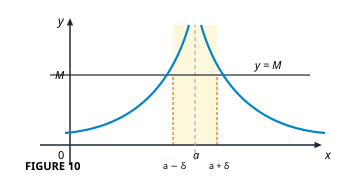

Geometric meaning: Given any arbitrarily high horizontal boundary line $y = M$, a vertical neighborhood $(a - \delta, a + \delta)$ can be found such that the curve remains strictly above $y = M$ everywhere inside the strip (except possibly at $a$).

**Example 5**: Use Definition 6 to prove that $\lim_{x \to 0} \frac{1}{x^2} = \infty$.

**Solution**:  
Let $M > 0$ be any positive number. We want to find $\delta > 0$ such that:
$$0 < |x| < \delta \implies \frac{1}{x^2} > M$$

Rearranging the inequality:
$$\frac{1}{x^2} > M \iff x^2 < \frac{1}{M} \iff |x| < \frac{1}{\sqrt{M}}$$

Choose $\delta = \frac{1}{\sqrt{M}}$. If $0 < |x| < \delta$, then:
$$x^2 < \delta^2 = \frac{1}{M} \implies \frac{1}{x^2} > M$$

Therefore, by Definition 6:
$$\lim_{x \to 0} \frac{1}{x^2} = \infty$$

**Definition 7 ($\lim_{x \to a} f(x) = -\infty$)**: Let $f$ be defined on an open interval containing $a$, except possibly at $a$ itself. Then:
$$\lim_{x \to a} f(x) = -\infty$$
means that for every negative number $N < 0$, there exists a positive number $\delta > 0$ such that:
$$\text{if } 0 < |x - a| < \delta \quad\text{then}\quad f(x) < N$$

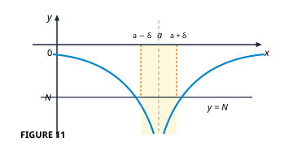

Geometric meaning: For any horizontal line $y = N$ below the axis, a vertical neighborhood $(a - \delta, a + \delta)$ exists such that the curve plunges strictly below $y = N$.
