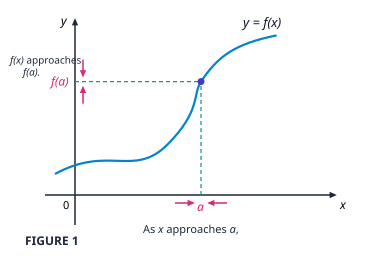
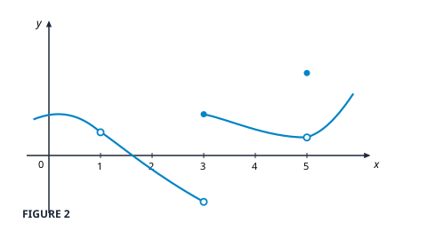
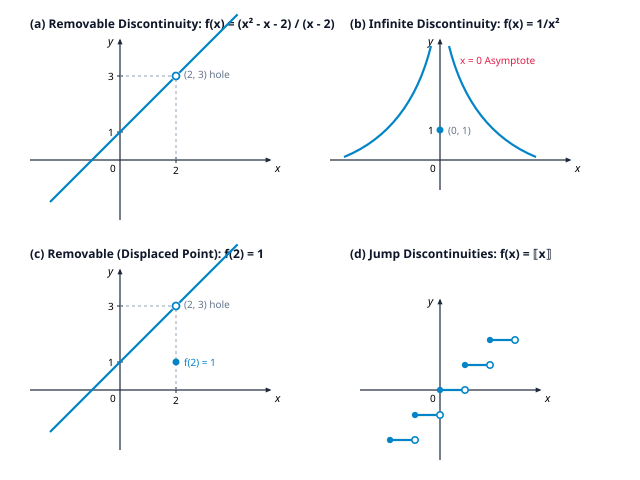
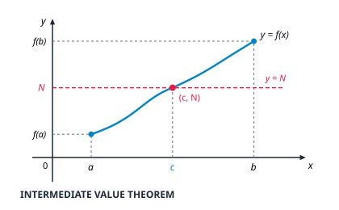

# Calculus Topics & Exercises: Continuity and Review Quiz

Source material: Stewart *Calculus: Early Transcendentals* (Section 2.5: Continuity, and Chapter 2 Review: True-False Quiz).

## 1. Continuity of Functions

### 1.1 Definition and Conditions for Continuity

The intuitive idea of a continuous function is one whose graph can be drawn without lifting the pen from the paper—there are no breaks, jumps, or missing points. Mathematically, continuity is formulated precisely in terms of limits.

As illustrated in Figure 1, if $f$ is continuous at a number $a$, then as $x$ approaches $a$, the point $(x, f(x))$ on the graph of $f$ approaches the point $(a, f(a))$ on the graph. Consequently, there is no gap or break in the curve at that point.

#### Definition 1: Continuity at a Number

A function $f$ is **continuous at a number $a$** if
$$\lim_{x \to a} f(x) = f(a)$$

Notice that Definition 1 implicitly requires three essential conditions for $f$ to be continuous at $a$:

**1.** $f(a)$ is defined (that is, $a$ is in the domain of $f$).  
**2.** $\lim_{x \to a} f(x)$ exists.  
**3.** $\lim_{x \to a} f(x) = f(a)$.  

The definition states that $f$ is continuous at $a$ if $f(x)$ approaches $f(a)$ as $x$ approaches $a$. Thus a continuous function $f$ possesses the stability property that a small change in $x$ produces only a small change in $f(x)$. In fact, the change in $f(x)$ can be kept as small as we please by keeping the change in $x$ sufficiently small.

If $f$ is defined near $a$ (that is, $f$ is defined on an open interval containing $a$, except perhaps at $a$), we say that $f$ is **discontinuous at $a$** (or that $f$ has a **discontinuity at $a$**) if $f$ fails to be continuous at $a$.

Physical phenomena are typically continuous. For instance, the displacement or velocity of a vehicle varies continuously with time, as does a person's height. However, discontinuities occur in physical applications such as electric currents (e.g., the Heaviside step function $H(t)$, which is discontinuous at $0$ because $\lim_{t \to 0} H(t)$ does not exist).

### 1.2 Graphical Analysis of Discontinuities

#### Example 1: Identifying Discontinuities from a Graph

Figure 2 illustrates the graph of a function $f$. At which numbers is $f$ discontinuous? Why?

**Solution:**

- **At $a = 1$:** The graph has a visible break with an open circle and no corresponding point defined at $x = 1$. The formal reason for the discontinuity is that **$f(1)$ is not defined** (condition 1 fails).
- **At $a = 3$:** The graph has a jump. Here $f(3)$ is defined ($f(3) = 1$), but the left-hand limit and right-hand limit are unequal:
  $$\lim_{x \to 3^-} f(x) \approx -1.5 \ne \lim_{x \to 3^+} f(x) = 1$$
  Therefore, **$\lim_{x \to 3} f(x)$ does not exist** (condition 2 fails).
- **At $a = 5$:** Both the function value and the two-sided limit exist: $f(5) = 2.5$, and $\lim_{x \to 5} f(x) = 0.5$ (since both the left and right branches approach $0.5$). However:
  $$\lim_{x \to 5} f(x) \ne f(5)$$
  Because the limit does not equal the function value, $f$ is **discontinuous at $5$** (condition 3 fails).

### 1.3 Detecting Discontinuities Analytically

#### Example 2: Analyzing Formulas for Points of Discontinuity

Where are each of the following functions discontinuous?

**(a)** $f(x) = \frac{x^2 - x - 2}{x - 2}$  
*Analysis*: Notice that $f(2)$ is not defined because substitution produces zero in the denominator. For all $x \ne 2$, we can factor and simplify:
$$f(x) = \frac{(x - 2)(x + 1)}{x - 2} = x + 1 \quad (x \ne 2)$$
Thus $\lim_{x \to 2} f(x) = \lim_{x \to 2} (x + 1) = 3$. Although the limit exists, $f$ is **discontinuous at $2$** because $f(2)$ does not exist. (This is a *removable discontinuity*).

**(b)** $f(x) = \begin{cases} \frac{1}{x^2} & \text{if } x \ne 0 \\ 1 & \text{if } x = 0 \end{cases}$  
*Analysis*: Here $f(0) = 1$ is defined. However, as $x \to 0$, $1/x^2 \to \infty$. Thus:
$$\lim_{x \to 0} f(x) = \lim_{x \to 0} \frac{1}{x^2} = \infty$$
Because the limit does not exist as a finite real number, $f$ is **discontinuous at $0$**. (This is an *infinite discontinuity*).

**(c)** $f(x) = \begin{cases} \frac{x^2 - x - 2}{x - 2} & \text{if } x \ne 2 \\ 1 & \text{if } x = 2 \end{cases}$  
*Analysis*: Here $f(2) = 1$ is explicitly defined, and $\lim_{x \to 2} f(x) = 3$ exists. However:
$$\lim_{x \to 2} f(x) = 3 \ne 1 = f(2)$$
Thus $f$ is **discontinuous at $2$**. (This is a *removable discontinuity with a displaced point*).

**(d)** $f(x) = \llbracket x \rrbracket$ (the greatest integer function)  
*Analysis*: The greatest integer function rounds any real number down to the nearest integer. If $n$ is any integer:
$$\lim_{x \to n^-} \llbracket x \rrbracket = n - 1 \quad \text{and} \quad \lim_{x \to n^+} \llbracket x \rrbracket = n$$
Because the left-hand and right-hand limits differ by $1$, $\lim_{x \to n} \llbracket x \rrbracket$ does not exist for every integer $n$. Thus $f$ has a **jump discontinuity at every integer $n \in \mathbb{Z}$**.

### 1.4 Algebraic Properties and Fundamental Theorems

The standard Limit Laws allow us to establish rules for combining continuous functions without evaluating limits from scratch.

#### Theorem 4: Algebraic Combinations of Continuous Functions

If $f$ and $g$ are continuous at $a$ and $c$ is a constant, then the following functions are also continuous at $a$:  
**1.** $f + g$  
**2.** $f - g$  
**3.** $cf$  
**4.** $fg$  
**5.** $\frac{f}{g}$ if $g(a) \ne 0$

*Proof sketch*: Each statement follows directly from the corresponding Limit Law. For example, for the sum:
$$\lim_{x \to a} (f + g)(x) = \lim_{x \to a} [f(x) + g(x)] = \lim_{x \to a} f(x) + \lim_{x \to a} g(x) = f(a) + g(a) = (f + g)(a)$$
which satisfies the definition of continuity at $a$.

#### Theorem 5: Continuity of Polynomials and Rational Functions

**(a)** Any polynomial is continuous everywhere; that is, it is continuous on $\mathbb{R} = (-\infty, \infty)$.  
**(b)** Any rational function is continuous wherever it is defined; that is, it is continuous on its domain.

### 1.5 Continuity of Composite Functions

An important property of continuous functions is that limits can be moved inside the function argument.

#### Theorem 8: Limits Commuting with Continuous Functions

If $f$ is continuous at $b$ and $\lim_{x \to a} g(x) = b$, then $\lim_{x \to a} f(g(x)) = f(b)$.  
In other words,
$$\lim_{x \to a} f(g(x)) = f\left(\lim_{x \to a} g(x)\right)$$

Theorem 8 states that the limit symbol can pass through a continuous function: $\lim f(g(x)) = f(\lim g(x))$.

#### Theorem 9: Continuity of Composite Functions

If $g$ is continuous at $a$ and $f$ is continuous at $g(a)$, then the composite function $f \circ g$ given by $(f \circ g)(x) = f(g(x))$ is continuous at $a$.

This theorem is often expressed informally by saying: *"a continuous function of a continuous function is a continuous function."*

*Proof*: Since $g$ is continuous at $a$, we have:
$$\lim_{x \to a} g(x) = g(a)$$
Since $f$ is continuous at $b = g(a)$, we apply Theorem 8 to obtain:
$$\lim_{x \to a} f(g(x)) = f\left(\lim_{x \to a} g(x)\right) = f(g(a))$$
which is precisely the statement that the composite function $h(x) = f(g(x))$ is continuous at $a$; that is, $f \circ g$ is continuous at $a$.

#### Example 8: Determining Continuity of Composite Functions

Where are the following functions continuous?

**(a)** $h(x) = \sin(x^2)$  
*Solution*: We can express $h(x)$ as $f(g(x))$, where $g(x) = x^2$ and $f(x) = \sin x$. The polynomial function $g$ is continuous on all of $\mathbb{R}$ by Theorem 5(a), and the trigonometric function $f(x) = \sin x$ is continuous everywhere. Therefore, by Theorem 9, the composite function $h = f \circ g$ is **continuous on $\mathbb{R} = (-\infty, \infty)$**.

**(b)** $F(x) = \frac{1}{\sqrt{x^2 + 7} - 4}$  
*Solution*: The function $F$ can be decomposed into a chain of four elementary continuous functions:
$$F = f \circ g \circ h \circ k \quad \text{or} \quad F(x) = f(g(h(k(x))))$$
where
$$f(x) = \frac{1}{x}, \qquad g(x) = x - 4, \qquad h(x) = \sqrt{x}, \qquad k(x) = x^2 + 7$$
- $k(x) = x^2 + 7$ is a polynomial, continuous everywhere with $k(x) \ge 7 > 0$.
- $h(u) = \sqrt{u}$ is continuous on its domain $[0, \infty)$.
- $g(v) = v - 4$ is a polynomial, continuous everywhere.
- $f(w) = 1/w$ is a rational function, continuous wherever $w \ne 0$.

Thus, $F(x)$ is continuous everywhere on its domain, failing to be continuous only when the denominator vanishes:
$$\sqrt{x^2 + 7} - 4 = 0 \implies \sqrt{x^2 + 7} = 4 \implies x^2 + 7 = 16 \implies x^2 = 9 \implies x = \pm 3$$
Since $x^2 + 7 \ge 7 > 0$ for all real $x$, the radicand is always positive. Therefore, $F$ is **continuous on $(-\infty, -3) \cup (-3, 3) \cup (3, \infty)$**.

#### The Intermediate Value Theorem (IVT)

A cornerstone consequence of continuity is the Intermediate Value Theorem: if a function never lifts off the paper, it must pass through every intermediate elevation.

Suppose that $f$ is continuous on the closed interval $[a, b]$ and let $N$ be any number between $f(a)$ and $f(b)$, where $f(a) \ne f(b)$. Then there exists a number $c$ in $(a, b)$ such that
$$f(c) = N$$

The geometric meaning is shown in Figure 4: the horizontal line $y = N$ cannot be avoided by any unbroken curve running from $(a, f(a))$ to $(b, f(b))$.

## 2. Chapter 2 Review: True-False Quiz

*Instructions*: Determine whether each statement is true or false. If it is true, explain why. If it is false, explain why or give an example that disproves the statement.

**1.** If $f$ is a function, then $f(s + t) = f(s) + f(t)$.  
*Status*: **False**  
*Explanation*: Most functions do not satisfy the distributive (additive) property. For a simple counterexample, let $f(x) = x^2$, $s = 1$, and $t = 2$. Then:
$$f(1 + 2) = f(3) = 3^2 = 9$$
while
$$f(1) + f(2) = 1^2 + 2^2 = 1 + 4 = 5$$
Since $9 \ne 5$, the statement is false in general. (Additivity holds only for linear functions through the origin, $f(x) = mx$).

**2.** If $f(s) = f(t)$, then $s = t$.  
*Status*: **False**  
*Explanation*: A function is not required to be one-to-one (injective). Distinct inputs can produce identical outputs. For example, let $f(x) = x^2$, $s = -2$, and $t = 2$. Then:
$$f(-2) = (-2)^2 = 4 \quad \text{and} \quad f(2) = 2^2 = 4$$
Here $f(s) = f(t) = 4$, but $-2 \ne 2$.

**3.** If $f$ is a function, then $f(3x) = 3f(x)$.  
*Status*: **False**  
*Explanation*: Multiplying the input of a function by $3$ compresses the graph horizontally by a factor of $3$; it does not scale the output vertically by $3$ unless $f$ is linear with no constant term. For example, let $f(x) = x^2$ and $x = 2$:
$$f(3 \cdot 2) = f(6) = 6^2 = 36$$
whereas
$$3f(2) = 3(2^2) = 3(4) = 12$$
Because $36 \ne 12$, the claim is false.

**4.** If $x_1 < x_2$ and $f$ is a decreasing function, then $f(x_1) > f(x_2)$.  
*Status*: **True**  
*Explanation*: This is the exact formal definition of a decreasing function on an interval: as the input moves to the right ($x_1 < x_2$), the function values must strictly decrease ($f(x_1) > f(x_2)$).

**5.** A vertical line intersects the graph of a function at most once.  
*Status*: **True**  
*Explanation*: This is the **Vertical Line Test**. By definition, a function assigns to each input $x$ in its domain exactly one output value $y = f(x)$. If a vertical line $x = a$ intersected the graph at two or more points, say $(a, y_1)$ and $(a, y_2)$ with $y_1 \ne y_2$, then input $a$ would correspond to multiple outputs, which violates the definition of a function.

**6.** If $x$ is any real number, then $\sqrt{x^2} = x$.  
*Status*: **False**  
*Explanation*: The radical symbol $\sqrt{\phantom{x}}$ denotes the principal (non-negative) square root. By definition, $\sqrt{x^2} = |x|$ for all real numbers $x$. If $x$ is negative, say $x = -5$:
$$\sqrt{(-5)^2} = \sqrt{25} = 5 \ne -5$$
Thus the equality holds only for non-negative numbers ($x \ge 0$).

**7.** $\lim_{x \to 4} \left(\frac{2x}{x - 4} - \frac{8}{x - 4}\right) = \lim_{x \to 4} \frac{2x}{x - 4} - \lim_{x \to 4} \frac{8}{x - 4}$  
*Status*: **False**  
*Explanation*: The Difference Law for limits, $\lim [f(x) - g(x)] = \lim f(x) - \lim g(x)$, is valid **only if both individual limits exist as finite real numbers**. Here, neither $\lim_{x \to 4} \frac{2x}{x - 4}$ nor $\lim_{x \to 4} \frac{8}{x - 4}$ exists (both blow up to $\pm\infty$). However, the limit of their difference exists because the terms combine algebraically:
$$\lim_{x \to 4} \left(\frac{2x - 8}{x - 4}\right) = \lim_{x \to 4} \frac{2(x - 4)}{x - 4} = \lim_{x \to 4} 2 = 2$$

**8.** $\lim_{x \to 1} \frac{x^2 + 6x - 7}{x^2 + 5x - 6} = \frac{\lim_{x \to 1} (x^2 + 6x - 7)}{\lim_{x \to 1} (x^2 + 5x - 6)}$  
*Status*: **False**  
*Explanation*: The Quotient Law for limits states that $\lim \frac{f(x)}{g(x)} = \frac{\lim f(x)}{\lim g(x)}$ provided that **$\lim_{x \to a} g(x) \ne 0$**. Evaluating the limit of the denominator gives:
$$\lim_{x \to 1} (x^2 + 5x - 6) = 1^2 + 5(1) - 6 = 0$$
Since the denominator limit is $0$, the Quotient Law cannot be applied. (The actual limit evaluates to $8/7$ by factoring $(x - 1)(x + 7) / [(x - 1)(x + 6)]$).

**9.** $\lim_{x \to 1} \frac{x - 3}{x^2 + 2x - 4} = \frac{\lim_{x \to 1} (x - 3)}{\lim_{x \to 1} (x^2 + 2x - 4)}$  
*Status*: **True**  
*Explanation*: Both numerator and denominator are polynomials, continuous everywhere. The denominator limit is:
$$\lim_{x \to 1} (x^2 + 2x - 4) = 1^2 + 2(1) - 4 = -1 \ne 0$$
Because the limit of the denominator is non-zero, the Quotient Law is directly applicable:
$$\frac{\lim_{x \to 1} (x - 3)}{\lim_{x \to 1} (x^2 + 2x - 4)} = \frac{1 - 3}{-1} = \frac{-2}{-1} = 2$$

**10.** If $\lim_{x \to 5} f(x) = 2$ and $\lim_{x \to 5} g(x) = 0$, then $\lim_{x \to 5} [f(x)/g(x)]$ does not exist.  
*Status*: **True**  
*Explanation*: Suppose for contradiction that $L = \lim_{x \to 5} [f(x)/g(x)]$ exists as a finite real number. Then by the Product Law:
$$\lim_{x \to 5} f(x) = \lim_{x \to 5} \left[ g(x) \cdot \frac{f(x)}{g(x)} \right] = \left(\lim_{x \to 5} g(x)\right) \cdot \left(\lim_{x \to 5} \frac{f(x)}{g(x)}\right) = 0 \cdot L = 0$$
This directly contradicts the given premise that $\lim_{x \to 5} f(x) = 2 \ne 0$. Therefore, the limit $\lim_{x \to 5} [f(x)/g(x)]$ cannot exist.

**11.** If $\lim_{x \to 5} f(x) = 0$ and $\lim_{x \to 5} g(x) = 0$, then $\lim_{x \to 5} [f(x)/g(x)]$ does not exist.  
*Status*: **False**  
*Explanation*: This is an indeterminate form of type $0/0$. The quotient limit may exist, fail to exist, or be infinite depending on the rates at which $f(x)$ and $g(x)$ vanish. For a counterexample, let $f(x) = 3(x - 5)$ and $g(x) = x - 5$. As $x \to 5$, $\lim f(x) = 0$ and $\lim g(x) = 0$, but:
$$\lim_{x \to 5} \frac{f(x)}{g(x)} = \lim_{x \to 5} \frac{3(x - 5)}{x - 5} = \lim_{x \to 5} 3 = 3$$
which exists.

**12.** If neither $\lim_{x \to a} f(x)$ nor $\lim_{x \to a} g(x)$ exists, then $\lim_{x \to a} [f(x) + g(x)]$ does not exist.  
*Status*: **False**  
*Explanation*: The non-existent behaviors of $f$ and $g$ can perfectly cancel each other out upon addition. For a counterexample, let $a = 0$ with $f(x) = 1/x$ and $g(x) = -1/x$. Neither $\lim_{x \to 0} (1/x)$ nor $\lim_{x \to 0} (-1/x)$ exists. However:
$$f(x) + g(x) = \frac{1}{x} + \left(-\frac{1}{x}\right) = 0 \quad (x \ne 0)$$
Thus $\lim_{x \to 0} [f(x) + g(x)] = \lim_{x \to 0} 0 = 0$, which exists.

**13.** If $\lim_{x \to a} f(x)$ exists but $\lim_{x \to a} g(x)$ does not exist, then $\lim_{x \to a} [f(x) + g(x)]$ does not exist.  
*Status*: **True**  
*Explanation*: We prove this by contradiction. Suppose $\lim_{x \to a} [f(x) + g(x)] = L$ exists. Since $\lim_{x \to a} f(x) = M$ exists, we can express $g(x)$ as $[f(x) + g(x)] - f(x)$ and apply the Difference Law:
$$\lim_{x \to a} g(x) = \lim_{x \to a} \Big([f(x) + g(x)] - f(x)\Big) = \lim_{x \to a} [f(x) + g(x)] - \lim_{x \to a} f(x) = L - M$$
This implies that $\lim_{x \to a} g(x)$ exists, which contradicts the premise that it does not exist. Hence $\lim_{x \to a} [f(x) + g(x)]$ cannot exist.

**14.** If $\lim_{x \to 6} [f(x)g(x)]$ exists, then the limit must be $f(6)g(6)$.  
*Status*: **False**  
*Explanation*: The limit of a product equals the product of function values only if both $f$ and $g$ are continuous at $x = 6$. Neither function is assumed to be continuous, or even defined, at $6$. For a counterexample, define:
$$f(x) = 1 \text{ for all } x, \quad g(x) = \begin{cases} 1 & \text{if } x \ne 6 \\ 0 & \text{if } x = 6 \end{cases}$$
Then $\lim_{x \to 6} [f(x)g(x)] = \lim_{x \to 6} (1 \cdot 1) = 1$, but $f(6)g(6) = 1 \cdot 0 = 0 \ne 1$.

**15.** If $p$ is a polynomial, then $\lim_{x \to b} p(x) = p(b)$.  
*Status*: **True**  
*Explanation*: Every polynomial function is continuous everywhere on $(-\infty, \infty)$ (Theorem 5(a)). By the Direct Substitution Property of continuous functions, evaluating the limit at any number $b$ is achieved simply by evaluating the polynomial at $b$.

**16.** If $\lim_{x \to 0} f(x) = \infty$ and $\lim_{x \to 0} g(x) = \infty$, then $\lim_{x \to 0} [f(x) - g(x)] = 0$.  
*Status*: **False**  
*Explanation*: The expression $\infty - \infty$ is an indeterminate form. The difference can approach any real number, diverge to $\pm\infty$, or oscillate. For a counterexample, let $f(x) = \frac{1}{x^2} + 5$ and $g(x) = \frac{1}{x^2}$. As $x \to 0$, both functions grow to $\infty$, but:
$$\lim_{x \to 0} [f(x) - g(x)] = \lim_{x \to 0} \left[\left(\frac{1}{x^2} + 5\right) - \frac{1}{x^2}\right] = \lim_{x \to 0} 5 = 5 \ne 0$$

**17.** If the line $x = 1$ is a vertical asymptote of $y = f(x)$, then $f$ is not defined at 1.  
*Status*: **False**  
*Explanation*: The definition of a vertical asymptote requires only that the one-sided limits blow up to $\pm\infty$ as $x \to 1^-$ or $x \to 1^+$. It places no restriction on whether $f(1)$ exists. For a counterexample:
$$f(x) = \begin{cases} \frac{1}{(x - 1)^2} & \text{if } x \ne 1 \\ 0 & \text{if } x = 1 \end{cases}$$
Here $x = 1$ is a vertical asymptote because $\lim_{x \to 1} f(x) = \infty$, yet $f$ is defined at $1$ with $f(1) = 0$.

**18.** If $f(1) > 0$ and $f(3) < 0$, then there exists a number $c$ between 1 and 3 such that $f(c) = 0$.  
*Status*: **False**  
*Explanation*: The conclusion of the Intermediate Value Theorem requires the hypothesis that $f$ is **continuous** on the closed interval $[1, 3]$. If $f$ is discontinuous, it can jump across the $x$-axis without ever equaling zero. For a counterexample:
$$f(x) = \begin{cases} 1 & \text{if } 1 \le x < 2 \\ -1 & \text{if } 2 \le x \le 3 \end{cases}$$
Then $f(1) = 1 > 0$ and $f(3) = -1 < 0$, but $f(x)$ is never $0$ for any $x \in (1, 3)$.

**19.** If $f$ is continuous at 5 and $f(5) = 2$ and $f(4) = 3$, then $\lim_{x \to 2} f(4x^2 - 11) = 2$.  
*Status*: **True**  
*Explanation*: Define the inner polynomial function $g(x) = 4x^2 - 11$. As $x \to 2$:
$$\lim_{x \to 2} g(x) = \lim_{x \to 2} (4x^2 - 11) = 4(2^2) - 11 = 16 - 11 = 5$$
Because $f$ is continuous at $5$, Theorem 8 allows us to pass the limit inside $f$:
$$\lim_{x \to 2} f(g(x)) = f\left(\lim_{x \to 2} g(x)\right) = f(5) = 2$$
(The given value $f(4) = 3$ is extraneous).

**20.** If $f$ is continuous on $[-1, 1]$ and $f(-1) = 4$ and $f(1) = 3$, then there exists a number $r$ such that $|r| < 1$ and $f(r) = \pi$.  
*Status*: **True**  
*Explanation*: Since $f$ is continuous on $[-1, 1]$, the Intermediate Value Theorem guarantees that $f$ takes on every value between $f(1) = 3$ and $f(-1) = 4$. Because $3 < \pi \approx 3.14159 < 4$, the number $\pi$ lies strictly between $f(1)$ and $f(-1)$. Therefore, there exists some $r \in (-1, 1)$—which is equivalent to $|r| < 1$—such that $f(r) = \pi$.

**21.** Let $f$ be a function such that $\lim_{x \to 0} f(x) = 6$. Then there exists a number $\delta$ such that if $0 < |x| < \delta$, then $|f(x) - 6| < 1$.  
*Status*: **True**  
*Explanation*: By the precise $\varepsilon$-$\delta$ definition of a limit, $\lim_{x \to a} f(x) = L$ means that for **every** $\varepsilon > 0$, there exists a corresponding $\delta > 0$ such that if $0 < |x - a| < \delta$, then $|f(x) - L| < \varepsilon$. Setting $a = 0$, $L = 6$, and $\varepsilon = 1$ (which is positive), the definition directly guarantees the existence of such a $\delta > 0$.

**22.** If $f(x) > 1$ for all $x$ and $\lim_{x \to 0} f(x)$ exists, then $\lim_{x \to 0} f(x) > 1$.  
*Status*: **False**  
*Explanation*: Taking the limit of a strict inequality produces a weak inequality: if $f(x) > 1$ for all $x$, then $\lim_{x \to 0} f(x) \ge 1$. The limit can equal $1$. For a counterexample, let $f(x) = 1 + x^2$. For all $x \ne 0$, $f(x) > 1$, but $\lim_{x \to 0} f(x) = \lim_{x \to 0} (1 + x^2) = 1$. Because $1 \not> 1$, the statement is false.

**23.** The equation $x^{10} - 10x^2 + 5 = 0$ has a root in the interval $(0, 2)$.  
*Status*: **True**  
*Explanation*: Let $f(x) = x^{10} - 10x^2 + 5$. Being a polynomial, $f$ is continuous on $[0, 1] \subset [0, 2]$. Evaluating $f$ at the endpoints gives $f(0) = 5 > 0$ and $f(1) = 1 - 10 + 5 = -4 < 0$. Because $f(1) < 0 < f(0)$, the number $0$ lies strictly between $f(0)$ and $f(1)$. By the Intermediate Value Theorem, there exists a root $c \in (0, 1) \subset (0, 2)$ such that $f(c) = 0$.

**24.** If $f$ is continuous at $a$, so is $|f|$.  
*Status*: **True**  
*Explanation*: The absolute value function can be written as the composition $|f(x)| = (g \circ f)(x)$, where $g(u) = |u|$. The function $g(u) = |u|$ is known to be continuous everywhere on $\mathbb{R}$. Since $f$ is continuous at $a$ and $g$ is continuous at $f(a)$, their composition $|f| = g \circ f$ is continuous at $a$ by Theorem 9.

**25.** If $|f|$ is continuous at $a$, so is $f$.  
*Status*: **False**  
*Explanation*: The absolute value operation folds negative values upward, which can eliminate discontinuities in the original function. For a counterexample, define $f(x) = 1$ for $x \ge 0$ and $f(x) = -1$ for $x < 0$. Then $|f(x)| = 1$ for all real numbers $x$, which is continuous everywhere. However, $f$ is discontinuous at $0$ because $\lim_{x \to 0^+} f(x) = 1 \ne -1 = \lim_{x \to 0^-} f(x)$, so $\lim_{x \to 0} f(x)$ does not exist.
