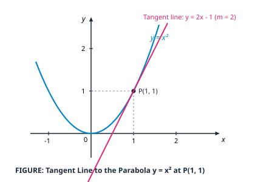
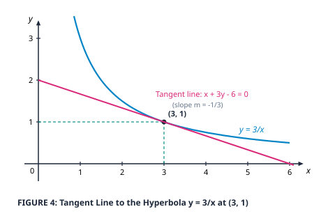
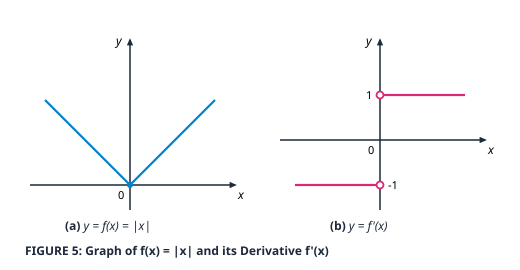
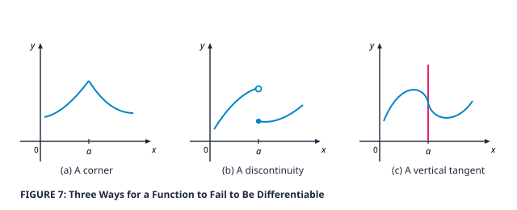
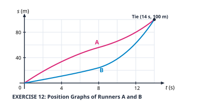

# Calculus Topics & Exercises: Derivatives, Tangent Lines, and Differentiability

Source material: Stewart *Calculus: Early Transcendentals* (Section 2.7: Derivatives and Rates of Change, and Section 2.8: The Derivative as a Function).

## 1. Tangent Lines and the Derivative at a Point

### 1.1 Definition and Geometric Meaning of the Tangent Line

The problem of finding the tangent line to a curve with equation $y = f(x)$ at a specified point $P(a, f(a))$ is the central geometric motivation for differential calculus. 

If we choose a nearby point $Q(x, f(x))$ on the curve, the slope of the secant line passing through $P$ and $Q$ is:
$$m_{PQ} = \frac{f(x) - f(a)}{x - a}$$

As $x$ approaches $a$, the point $Q$ slides along the curve toward $P$. If the secant slope $m_{PQ}$ approaches a limiting value $m$, then we define the tangent line through $P$ to be the line passing through $P$ with slope $m$.

#### Definition 1: Tangent Line to a Curve

The **tangent line** to the curve $y = f(x)$ at the point $P(a, f(a))$ is the line through $P$ with slope
$$m = \lim_{x \to a} \frac{f(x) - f(a)}{x - a}$$
provided that this limit exists.

#### Example 1: Tangent Line to a Parabola

Find an equation of the tangent line to the parabola $y = x^2$ at the point $P(1, 1)$.

**Solution:**

Here we have $a = 1$ and $f(x) = x^2$. The slope of the tangent line is given by Definition 1:
$$m = \lim_{x \to 1} \frac{f(x) - f(1)}{x - 1} = \lim_{x \to 1} \frac{x^2 - 1}{x - 1}$$

Factoring the numerator as a difference of squares:
$$m = \lim_{x \to 1} \frac{(x - 1)(x + 1)}{x - 1} = \lim_{x \to 1} (x + 1) = 1 + 1 = 2$$

Using the point-slope form of the equation of a line ($y - y_1 = m(x - x_1)$), an equation of the tangent line at $(1, 1)$ is:
$$y - 1 = 2(x - 1) \quad\text{or}\quad y = 2x - 1$$

### 1.2 Alternative Formulation Using the Increment $h$

There is an alternative expression for the slope of the tangent line that is often much easier to use in algebraic computations. If we denote the displacement between $x$ and $a$ by $h = x - a$, then $x = a + h$. As $x \to a$, the increment $h \to 0$.

Substituting into Definition 1 gives the alternative formula:
$$m = \lim_{h \to 0} \frac{f(a + h) - f(a)}{h}$$

#### Example 2: Tangent Line to a Hyperbola

Find an equation of the tangent line to the hyperbola $y = \frac{3}{x}$ at the point $(3, 1)$.

**Solution:**

Let $f(x) = \frac{3}{x}$. At the point $(a, f(a)) = (3, 1)$, we apply the increment formulation:
$$m = \lim_{h \to 0} \frac{f(3 + h) - f(3)}{h} = \lim_{h \to 0} \frac{\frac{3}{3 + h} - 1}{h}$$

Finding a common denominator in the numerator:
$$\frac{3}{3 + h} - 1 = \frac{3 - (3 + h)}{3 + h} = \frac{-h}{3 + h}$$

Therefore:
$$m = \lim_{h \to 0} \frac{\frac{-h}{3 + h}}{h} = \lim_{h \to 0} \frac{-h}{h(3 + h)} = \lim_{h \to 0} -\frac{1}{3 + h} = -\frac{1}{3 + 0} = -\frac{1}{3}$$

The slope of the tangent line is $m = -\frac{1}{3}$. Using the point-slope form at $(3, 1)$:
$$y - 1 = -\frac{1}{3}(x - 3)$$

Multiplying both sides by $3$ and rearranging:
$$3y - 3 = -x + 3 \implies x + 3y - 6 = 0$$

### 1.3 The Derivative of a Function at a Number $a$

Limits of the form $\lim_{h \to 0} \frac{f(a+h) - f(a)}{h}$ arise whenever we compute the slope of a tangent line, an instantaneous velocity, or any instantaneous rate of change in physics, chemistry, biology, or economics. Because this specific type of limit occurs so widely, it is given a special name and notation.

#### Definition 4: Derivative at a Number

The **derivative of a function $f$ at a number $a$**, denoted by $f'(a)$, is
$$f'(a) = \lim_{h \to 0} \frac{f(a + h) - f(a)}{h}$$
if this limit exists.

*Notation note*: The symbol $f'(a)$ is read as "$f$ prime of $a$."

If we substitute $x = a + h$, so that $h = x - a$, then $h \to 0$ if and only if $x \to a$. Therefore, an equivalent formulation of the derivative is:
$$f'(a) = \lim_{x \to a} \frac{f(x) - f(a)}{x - a}$$

#### Example 3 (Textbook Example 4): Computing a Derivative Analytically

Find the derivative of the quadratic function $f(x) = x^2 - 8x + 9$ at the number $a$.

**Solution:**

From Definition 4, the derivative is:
$$f'(a) = \lim_{h \to 0} \frac{f(a + h) - f(a)}{h}$$

Evaluating $f(a + h)$ and $f(a)$:
$$f(a + h) = (a + h)^2 - 8(a + h) + 9 = a^2 + 2ah + h^2 - 8a - 8h + 9$$
$$f(a) = a^2 - 8a + 9$$

Subtracting the two expressions:
$$f(a + h) - f(a) = (a^2 + 2ah + h^2 - 8a - 8h + 9) - (a^2 - 8a + 9) = 2ah + h^2 - 8h$$

Now divide by $h$ and compute the limit:
$$f'(a) = \lim_{h \to 0} \frac{2ah + h^2 - 8h}{h} = \lim_{h \to 0} \frac{h(2a + h - 8)}{h} = \lim_{h \to 0} (2a + h - 8) = 2a - 8$$

Thus, the derivative at any point $a$ is $f'(a) = 2a - 8$. For example:
- At $a = 1$, the slope of the tangent line is $f'(1) = 2(1) - 8 = -6$.
- At $a = 4$, the slope of the tangent line is $f'(4) = 2(4) - 8 = 0$ (a horizontal tangent at the vertex).

#### The Tangent Line Defined via the Derivative

Because Definition 4 matches the definition of the slope of the tangent line, we have the foundational geometric relationship:

The **tangent line** to $y = f(x)$ at $(a, f(a))$ is the line through $(a, f(a))$ whose slope is equal to $f'(a)$, the derivative of $f$ at $a$.

## 2. Differentiability and Continuity

### 2.1 The Concept of Differentiability

When we allow the number $a$ to vary, we obtain a new function $f'$, called the **derivative of $f$**, defined by:
$$f'(x) = \lim_{h \to 0} \frac{f(x + h) - f(x)}{h}$$
The domain of $f'$ is the set $\{x \mid f'(x) \text{ exists}\}$, which is contained in the domain of $f$.

#### Definition 3: Differentiability

A function $f$ is **differentiable at $a$** if $f'(a)$ exists.

It is **differentiable on an open interval** $(a, b)$ [or $(a, \infty)$ or $(-\infty, a)$ or $(-\infty, \infty)$] if it is differentiable at every number in the interval.

#### Example 4 (Textbook Example 5): Differentiability of the Absolute Value Function

Where is the function $f(x) = |x|$ differentiable?

**Solution:**

We analyze the function across three domains: $x > 0$, $x < 0$, and $x = 0$.

**1. For $x > 0$:**  
Here $|x| = x$. Choosing $h$ sufficiently small so that $x + h > 0$, we have $|x + h| = x + h$. Therefore:
$$f'(x) = \lim_{h \to 0} \frac{|x + h| - |x|}{h} = \lim_{h \to 0} \frac{(x + h) - x}{h} = \lim_{h \to 0} \frac{h}{h} = \lim_{h \to 0} 1 = 1$$
Thus $f$ is differentiable for every $x > 0$, with $f'(x) = 1$.

**2. For $x < 0$:**  
Here $|x| = -x$. Choosing $h$ sufficiently small so that $x + h < 0$, we have $|x + h| = -(x + h)$. Therefore:
$$f'(x) = \lim_{h \to 0} \frac{|x + h| - |x|}{h} = \lim_{h \to 0} \frac{-(x + h) - (-x)}{h} = \lim_{h \to 0} \frac{-h}{h} = \lim_{h \to 0} (-1) = -1$$
Thus $f$ is differentiable for every $x < 0$, with $f'(x) = -1$.

**3. For $x = 0$:**  
We must evaluate the definition at $0$:
$$f'(0) = \lim_{h \to 0} \frac{f(0 + h) - f(0)}{h} = \lim_{h \to 0} \frac{|0 + h| - |0|}{h} = \lim_{h \to 0} \frac{|h|}{h} \quad (\text{if it exists})$$

To determine whether this two-sided limit exists, we compute the left-hand and right-hand limits separately:
$$\lim_{h \to 0^+} \frac{|h|}{h} = \lim_{h \to 0^+} \frac{h}{h} = \lim_{h \to 0^+} 1 = 1$$
$$\lim_{h \to 0^-} \frac{|h|}{h} = \lim_{h \to 0^-} \frac{-h}{h} = \lim_{h \to 0^-} (-1) = -1$$

Because the right-hand limit ($1$) and left-hand limit ($-1$) are unequal, the two-sided limit does not exist:
$$f'(0) \text{ does not exist}$$

Therefore, $f(x) = |x|$ is **differentiable at all $x$ except $x = 0$**. The derivative function is given by:
$$f'(x) = \begin{cases} 1 & \text{if } x > 0 \\ -1 & \text{if } x < 0 \end{cases}$$

Geometrically, the fact that $f'(0)$ does not exist is reflected in the sharp corner at the origin in Figure 5(a). The curve changes direction abruptly, meaning there is no unique tangent line at $(0, 0)$.

### 2.2 Differentiability Implies Continuity

One of the most fundamental theorems in calculus establishes the relationship between differentiability and continuity.

#### Theorem 4: Differentiability Implies Continuity

If $f$ is differentiable at $a$, then $f$ is continuous at $a$.

#### Complete Proof of Theorem 4

To prove that $f$ is continuous at $a$, we must demonstrate that:
$$\lim_{x \to a} f(x) = f(a)$$
This condition is equivalent to showing that the difference approaches zero:
$$\lim_{x \to a} [f(x) - f(a)] = 0$$

We are given that $f$ is differentiable at $a$, which means the limit
$$f'(a) = \lim_{x \to a} \frac{f(x) - f(a)}{x - a}$$
exists.

To relate the given derivative limit to our unknown difference, we multiply and divide $f(x) - f(a)$ by $x - a$ (which is valid for all $x \ne a$):
$$f(x) - f(a) = \frac{f(x) - f(a)}{x - a} \cdot (x - a)$$

Now apply the Product Law for limits:
$$\lim_{x \to a} [f(x) - f(a)] = \lim_{x \to a} \left[ \frac{f(x) - f(a)}{x - a} \cdot (x - a) \right]$$
$$= \lim_{x \to a} \frac{f(x) - f(a)}{x - a} \cdot \lim_{x \to a} (x - a)$$
$$= f'(a) \cdot 0 = 0$$

Now we use this result to evaluate $\lim_{x \to a} f(x)$ by adding and subtracting $f(a)$:
$$\lim_{x \to a} f(x) = \lim_{x \to a} [f(a) + (f(x) - f(a))]$$
$$= \lim_{x \to a} f(a) + \lim_{x \to a} [f(x) - f(a)]$$
$$= f(a) + 0 = f(a)$$

Therefore, $\lim_{x \to a} f(x) = f(a)$, which proves that $f$ is continuous at $a$. $\blacksquare$

#### Crucial Note on the Converse

The converse of Theorem 4 is **false**: continuity does *not* imply differentiability. The absolute value function $f(x) = |x|$ is continuous everywhere (including at $x = 0$), yet it is not differentiable at $x = 0$.

### 2.3 How Can a Function Fail to Be Differentiable?

Geometrically and analytically, there are three primary ways a function can fail to possess a derivative at a number $a$:

**1. A corner or kink**:  
If the graph of a function changes direction abruptly, the left-hand and right-hand limits of the difference quotient exist but have different values:
$$\lim_{h \to 0^+} \frac{f(a+h) - f(a)}{h} \ne \lim_{h \to 0^-} \frac{f(a+h) - f(a)}{h}$$
Because the one-sided limits disagree, the two-sided limit does not exist, and there is no well-defined tangent line at $(a, f(a))$ (illustrated in Figure 7(a)).

**2. A discontinuity**:  
By the contrapositive of Theorem 4, if a function $f$ is *not* continuous at $a$, then it *cannot* be differentiable at $a$. Any jump discontinuity, removable hole, or infinite vertical asymptote destroys differentiability at that point (illustrated in Figure 7(b)).

**3. A vertical tangent line**:  
A function may be continuous at $a$, but the secant lines become increasingly steep as $x \to a$, so that the slope approaches infinity:
$$\lim_{x \to a} |f'(x)| = \infty$$
Here the curve possesses a vertical tangent line with equation $x = a$. Because a vertical line has undefined (infinite) slope, the derivative $f'(a)$ does not exist as a finite real number (illustrated in Figure 7(c)). An archetype of this behavior is $f(x) = \sqrt[3]{x}$ at $x = 0$.

## 3. Practice Exercises & Solutions

### 3.1 Equations of Tangent Lines (Exercises 5–8)

For each curve and point, find an equation of the tangent line using the limit definition of the slope.

**5.** $y = 4x - 3x^2, \quad (2, -4)$  
*Solution*:  
Let $f(x) = 4x - 3x^2$ and $(a, f(a)) = (2, -4)$. Using the increment definition:
$$m = \lim_{h \to 0} \frac{f(2 + h) - f(2)}{h}$$
Expanding the numerator:
$$f(2 + h) = 4(2 + h) - 3(2 + h)^2 = 8 + 4h - 3(4 + 4h + h^2) = 8 + 4h - 12 - 12h - 3h^2 = -4 - 8h - 3h^2$$
$$f(2 + h) - f(2) = (-4 - 8h - 3h^2) - (-4) = -8h - 3h^2$$
Dividing by $h$:
$$m = \lim_{h \to 0} \frac{-8h - 3h^2}{h} = \lim_{h \to 0} (-8 - 3h) = -8$$
Using point-slope form:
$$y - (-4) = -8(x - 2) \implies y + 4 = -8x + 16 \implies y = -8x + 12$$

**6.** $y = x^3 - 3x + 1, \quad (2, 3)$  
*Solution*:  
Let $f(x) = x^3 - 3x + 1$ and $(a, f(a)) = (2, 3)$. Using Definition 1:
$$m = \lim_{x \to 2} \frac{f(x) - f(2)}{x - 2} = \lim_{x \to 2} \frac{(x^3 - 3x + 1) - 3}{x - 2} = \lim_{x \to 2} \frac{x^3 - 3x - 2}{x - 2}$$
Since substituting $x = 2$ gives $2^3 - 3(2) - 2 = 0$, $x - 2$ is a factor. Dividing polynomials:
$$x^3 - 3x - 2 = (x - 2)(x^2 + 2x + 1) = (x - 2)(x + 1)^2$$
Therefore:
$$m = \lim_{x \to 2} (x + 1)^2 = (2 + 1)^2 = 9$$
Using point-slope form:
$$y - 3 = 9(x - 2) \implies y - 3 = 9x - 18 \implies y = 9x - 15$$

**7.** $y = \sqrt{x}, \quad (1, 1)$  
*Solution*:  
Let $f(x) = \sqrt{x}$ and $(a, f(a)) = (1, 1)$. Using Definition 1:
$$m = \lim_{x \to 1} \frac{\sqrt{x} - 1}{x - 1}$$
Factoring the denominator as a difference of squares ($x - 1 = (\sqrt{x} - 1)(\sqrt{x} + 1)$):
$$m = \lim_{x \to 1} \frac{\sqrt{x} - 1}{(\sqrt{x} - 1)(\sqrt{x} + 1)} = \lim_{x \to 1} \frac{1}{\sqrt{x} + 1} = \frac{1}{\sqrt{1} + 1} = \frac{1}{2}$$
Using point-slope form:
$$y - 1 = \frac{1}{2}(x - 1) \implies y = \frac{1}{2}x + \frac{1}{2} \quad\text{or}\quad x - 2y + 1 = 0$$

**8.** $y = \frac{2x + 1}{x + 2}, \quad (1, 1)$  
*Solution*:  
Let $f(x) = \frac{2x + 1}{x + 2}$ and $(a, f(a)) = (1, 1)$. Using Definition 1:
$$m = \lim_{x \to 1} \frac{\frac{2x + 1}{x + 2} - 1}{x - 1}$$
Simplifying the numerator:
$$\frac{2x + 1}{x + 2} - 1 = \frac{(2x + 1) - (x + 2)}{x + 2} = \frac{x - 1}{x + 2}$$
Dividing by $x - 1$:
$$m = \lim_{x \to 1} \frac{\frac{x - 1}{x + 2}}{x - 1} = \lim_{x \to 1} \frac{1}{x + 2} = \frac{1}{1 + 2} = \frac{1}{3}$$
Using point-slope form:
$$y - 1 = \frac{1}{3}(x - 1) \implies y = \frac{1}{3}x + \frac{2}{3} \quad\text{or}\quad x - 3y + 2 = 0$$

### 3.2 Rates of Change and Kinematic Analysis (Exercise 12)

**12.** Shown are graphs of the position functions of two runners, A and B, who run a 100-m race and finish in a tie.

**(a) Describe and compare how the runners run the race.**  
*Analysis*:
- **Runner A**: Runner A accelerates rapidly off the starting line, as shown by the steep initial slope of curve A at $t = 0$. Runner A builds an early lead and runs with a high, relatively steady velocity through the middle of the race, but decelerates somewhat over the final stretch (the curve is concave down, meaning $s''_A(t) < 0$).
- **Runner B**: Runner B starts slowly, with a very shallow initial slope at $t = 0$. Runner B steadily accelerates throughout the race (the curve is concave up, meaning $s''_B(t) > 0$). In the final third of the race, Runner B surges at high velocity to close the gap and tie Runner A right at the 100-meter finish line ($t \approx 14\text{ s}$).

**(b) At what time is the distance between the runners the greatest?**  
*Analysis*: The distance between the runners is $D(t) = s_A(t) - s_B(t)$. Maximizing $D(t)$ requires finding where its derivative is zero:
$$D'(t) = s'_A(t) - s'_B(t) = 0 \implies s'_A(t) = s'_B(t)$$
This occurs when instantaneous velocities are equal, which geometrically corresponds to where the tangent lines to curves A and B are parallel.
- From the grid, at $t \approx 8\text{ to } 9\text{ seconds}$, the vertical gap between curve A ($s_A \approx 56\text{ m}$) and curve B ($s_B \approx 24\text{ m}$) reaches its maximum separation of approximately $32\text{ meters}$.
- For $t < 8\text{ s}$, Runner A is faster ($s'_A > s'_B$), widening the lead; for $t > 9\text{ s}$, Runner B is faster ($s'_B > s'_A$), closing the gap.  
Thus, the distance between the runners is greatest at approximately **$t \approx 8\text{ to } 9\text{ seconds}$**.

**(c) At what time do they have the same velocity?**  
*Analysis*: The velocity of each runner is $v(t) = s'(t)$. The runners have the same velocity precisely when the slopes of their tangent lines are equal. As established in part (b), this occurs at the exact instant of maximum separation: approximately **$t \approx 8\text{ to } 9\text{ seconds}$** (where both runners travel at approximately $7\text{ m/s}$).
