# Calculus Topics & Exercises: Differentiation, Extreme Values, and the Mean Value Theorem

Source material: Stewart *Calculus: Early Transcendentals* (Section 2.2: Higher Derivatives; Section 2.4: Differentiation Rules; Section 2.5: Chain Rule; Section 2.6: Implicit Differentiation; Chapter 2 Review: True-False Quiz & Exercises; Section 4.1: Maximum and Minimum Values; Section 4.2: The Mean Value Theorem).

## 1. Higher Derivatives

### 1.1 Definition and Leibniz Notation

If $f$ is a differentiable function, then its derivative $f'$ is also a function. Consequently, $f'$ may itself have a derivative of its own, denoted by $(f')' = f''$. This new function $f''$ is called the **second derivative** of $f$ because it is the derivative of the derivative of $f$.

Using Leibniz notation, we write the second derivative of $y = f(x)$ as:
$$\frac{d}{dx}\left(\frac{dy}{dx}\right) = \frac{d^2 y}{dx^2}$$

Other common notations for the second derivative include:
$$f''(x) = (f')'(x) = \frac{d^2 y}{dx^2} = y'' = D^2 f(x) = D_x^2 f(x)$$

The process extends naturally to successive derivatives. Differentiating the second derivative yields the **third derivative**, denoted by $y''' = f'''(x) = \frac{d^3 y}{dx^3}$. In general, the **$n$th derivative** of $f$ is denoted by:
$$y^{(n)} = f^{(n)}(x) = \frac{d^n y}{dx^n} = D^n f(x)$$
where parentheses enclose the integer $n$ in $f^{(n)}(x)$ to distinguish derivative order from algebraic powers.

### 1.2 Geometric and Physical Interpretations

The second derivative has immediate physical and geometric significance:
- **Rate of Change of Slope**: Just as $f'(x)$ gives the slope of the curve $y = f(x)$ at the point $(x, f(x))$, the second derivative $f''(x)$ represents the slope of the curve $y = f'(x)$ at the point $(x, f'(x))$. In other words, $f''(x)$ measures the rate of change of the slope of the original curve $y = f(x)$ (reflecting concavity).
- **Physical Acceleration**: If $s = s(t)$ is the position function of an object moving in a straight line, its first derivative represents the instantaneous velocity $v(t) = s'(t) = \frac{ds}{dt}$. The second derivative is the rate of change of velocity, which is the acceleration:
  $$a(t) = v'(t) = s''(t) = \frac{d^2 s}{dt^2}$$
- **Physical Jerk**: The third derivative represents the rate of change of acceleration, known as the **jerk**:
  $$j(t) = a'(t) = s'''(t) = \frac{d^3 s}{dt^3}$$
  A large jerk corresponds to an abrupt change in acceleration, which causes sudden mechanical shock or passenger discomfort in vehicles.

### 1.3 Example 1: Finding and Interpreting $f''(x)$

If $f(x) = x^3 - x$, find and interpret $f''(x)$.

**Solution:**

From the definition of the derivative, the first derivative is:
$$f'(x) = \lim_{h \to 0} \frac{f(x + h) - f(x)}{h} = \lim_{h \to 0} \frac{[(x + h)^3 - (x + h)] - [x^3 - x]}{h} = 3x^2 - 1$$

To find the second derivative, we differentiate $f'(x)$ using the limit definition:
$$f''(x) = (f')'(x) = \lim_{h \to 0} \frac{f'(x + h) - f'(x)}{h} = \lim_{h \to 0} \frac{[3(x + h)^2 - 1] - [3x^2 - 1]}{h}$$

Expanding the squared binomial in the numerator:
$$f''(x) = \lim_{h \to 0} \frac{3(x^2 + 2xh + h^2) - 1 - 3x^2 + 1}{h} = \lim_{h \to 0} \frac{3x^2 + 6xh + 3h^2 - 1 - 3x^2 + 1}{h}$$

Canceling common terms:
$$f''(x) = \lim_{h \to 0} \frac{6xh + 3h^2}{h} = \lim_{h \to 0} (6x + 3h) = 6x$$

**Interpretation:**

We can interpret $f''(x)$ as the slope of the curve $y = f'(x)$ at the point $(x, f'(x))$. In other words, it is the rate of change of the slope of the original curve $y = f(x)$.

Notice from Figure 10 that:
- **Interval $x < 0$**: $f''(x) < 0$. On this interval, the parabola $y = f'(x)$ has negative slope, and the original cubic curve $y = f(x)$ bends downward (concave downward).
- **Interval $x > 0$**: $f''(x) > 0$. On this interval, the parabola $y = f'(x)$ has positive slope, and the original cubic curve $y = f(x)$ bends upward (concave upward).
- **Point $x = 0$**: $f''(0) = 0$. The tangent to $y = f'(x)$ is horizontal (the minimum of $f'$), and $y = f(x)$ transitions between bending downward and bending upward at the inflection point $(0, 0)$.

Thus, the graphs serve as a mutual check on our calculations.

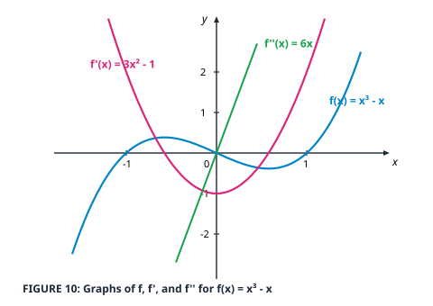

## 2. Graphical Derivative Estimation & Function Matching

### 2.1 Section 2.2 Exercise 1: Estimating Derivatives from a Graph

Use the given graph of $y = f(x)$ to estimate the value of each derivative:
$f'(-3)$, $f'(-2)$, $f'(-1)$, $f'(0)$, $f'(1)$, $f'(2)$, and $f'(3)$.

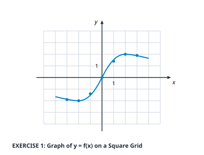

**Estimation and Analysis:**

The derivative $f'(a)$ is the slope of the tangent line to the curve $y = f(x)$ at the point $(a, f(a))$. We estimate the slopes by reading coordinates and drawing tangent lines directly on the grid:

**1.** (a) **$f'(-3) \approx -0.2$** (or $-\frac{1}{5}$): At $x = -3$, the curve is descending very slightly as it approaches the local minimum at $x = -2$. The tangent line has a small negative slope.

(b) **$f'(-2) = 0$**: The curve has a horizontal tangent line at its local minimum point $(-2, -2)$. Hence the slope is exactly $0$.

(c) **$f'(-1) \approx 1$**: Between $x = -2$ and $x = 0$, the curve rises steeply. A tangent line drawn at $(-1, -1.4)$ rises approximately $1$ vertical grid unit for every $1$ horizontal unit, giving a slope of approximately $1$.

(d) **$f'(0) \approx 2$**: At the inflection point $(0, 0)$, the curve has its steepest positive slope. The tangent line rises approximately $2$ units per $1$ horizontal unit, so $f'(0) \approx 2$.

(e) **$f'(1) \approx 1$**: By symmetry of the cubic-like inflection profile, the slope at $x = 1$ matches the slope at $x = -1$, giving $f'(1) \approx 1$.

(f) **$f'(2) = 0$**: The curve attains a local maximum at $(2, 2)$, where the tangent line is completely horizontal. Therefore, $f'(2) = 0$.

(g) **$f'(3) \approx -0.2$**: Past the local peak, the curve gently slopes downward, yielding a small negative slope of approximately $-0.2$.

### 2.2 Section 2.2 Exercise 2: Estimating Derivatives on an Asymmetric Domain

Use the given graph of $y = f(x)$ to estimate the value of each derivative:
$f'(0)$, $f'(1)$, $f'(2)$, $f'(3)$, $f'(4)$, $f'(5)$, $f'(6)$, and $f'(7)$.

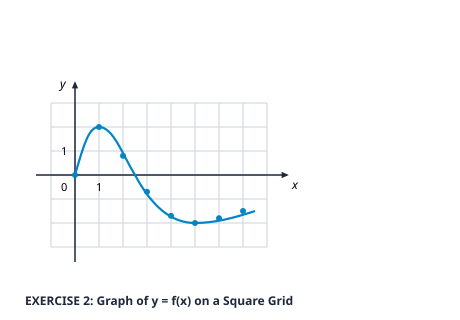

**Estimation and Analysis:**

**2.** (a) **$f'(0) \approx 3$**: At the origin $(0, 0)$, the curve launches upward very steeply. The tangent line rises about $3$ vertical units across $1$ horizontal unit.

(b) **$f'(1) = 0$**: The curve reaches its peak at $(1, 2)$. The tangent line is horizontal, so $f'(1) = 0$.

(c) **$f'(2) \approx -1.3$**: The curve is descending rapidly through $(2, 0.8)$, giving a steep negative slope.

(d) **$f'(3) \approx -1.5$**: The curve continues downward toward the negative trough, maintaining a negative slope of roughly $-\frac{3}{2}$.

(e) **$f'(4) \approx -0.8$**: The descent slows down noticeably as the curve approaches its trough, with the tangent slope flattening toward $-0.8$.

(f) **$f'(5) = 0$**: The curve reaches its local minimum at $(5, -2)$, where the tangent line is horizontal.

(g) **$f'(6) \approx 0.3$**: Beyond the trough, the curve begins a gentle ascent, giving a small positive slope.

(h) **$f'(7) \approx 0.2$**: The upward slope levels off slightly, remaining positive at approximately $0.2$.

### 2.3 Section 2.2 Exercise 3: Matching Functions with Their Derivatives

Match the graph of each function in (a)–(d) with the graph of its derivative in I–IV. Give reasons for your choices.

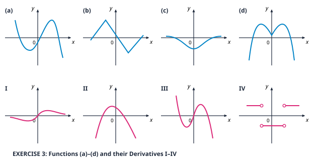

**Analysis and Reasoning:**

**3.** (a) **Function (a) matches Derivative II:**
- Function (a) is a smooth cubic-like curve that decreases from $+\infty$ to a local minimum ($f' < 0$), has a horizontal tangent at the minimum ($f' = 0$), increases to a local maximum ($f' > 0$), has another horizontal tangent at the peak ($f' = 0$), and then decreases toward $-\infty$ ($f' < 0$).
- Its derivative must therefore be negative, pass through zero to become positive, and pass through zero again to become negative.
- This is precisely the behavior of the downward-opening parabola in **II**.

(b) **Function (b) matches Derivative IV:**
- Function (b) is piecewise linear, composed of straight-line segments connected by sharp corners.
- Along straight lines, the derivative is constant (the slope of the line). At the sharp corners, the derivative does not exist.
- Specifically, the function has a constant positive slope, followed by a constant negative slope, followed by a constant positive slope.
- Its derivative must be a step function consisting of horizontal line segments with jump discontinuities (open endpoints), which is exactly graph **IV**.

(c) **Function (c) matches Derivative I:**
- Function (c) is symmetric with horizontal asymptotes $y = 0$ as $x \to \pm\infty$ and a single smooth local minimum at $x = 0$.
- For $x < 0$, the function decreases ($f' < 0$); at $x = 0$, the tangent is horizontal ($f'(0) = 0$); for $x > 0$, the function increases ($f' > 0$).
- As $x \to \pm\infty$, the curve flattens out, meaning $f'(x) \to 0$.
- Graph **I** is negative for $x < 0$, passes through the origin $(0, 0)$, becomes positive for $x > 0$, and approaches $0$ as $x \to \pm\infty$. Thus, (c) matches **I**.

(d) **Function (d) matches Derivative III:**
- Function (d) is a double-peaked curve with three local extrema: a local maximum at $x < 0$, a local minimum at $x = 0$, and another local maximum at $x > 0$.
- Consequently, its derivative must have three zeros: $f'(x) = 0$ at three distinct points.
- The slopes transition as: positive $\to 0 \to$ negative $\to 0 \to$ positive $\to 0 \to$ negative.
- Graph **III** is an odd polynomial-like curve with exactly three $x$-intercepts that follows this exact sign signature. Thus, (d) matches **III**.

## 3. Summary of Differentiation Rules & Graphical Product/Quotient Rules

### 3.1 Table of Differentiation Formulas

| Rule Name | Prime Notation | Leibniz Notation |
| :--- | :--- | :--- |
| **Constant Rule** | $(c)' = 0$ | $\frac{d}{dx}(c) = 0$ |
| **Power Rule** | $(x^n)' = n x^{n-1}$ | $\frac{d}{dx}(x^n) = n x^{n-1}$ |
| **Constant Multiple Rule** | $(cf)' = c f'$ | $\frac{d}{dx}[c f(x)] = c \frac{d}{dx}[f(x)]$ |
| **Sum Rule** | $(f + g)' = f' + g'$ | $\frac{d}{dx}[f(x) + g(x)] = \frac{d}{dx}[f(x)] + \frac{d}{dx}[g(x)]$ |
| **Difference Rule** | $(f - g)' = f' - g'$ | $\frac{d}{dx}[f(x) - g(x)] = \frac{d}{dx}[f(x)] - \frac{d}{dx}[g(x)]$ |
| **Product Rule** | $(fg)' = f g' + g f'$ | $\frac{d}{dx}[f(x)g(x)] = f(x)\frac{d}{dx}[g(x)] + g(x)\frac{d}{dx}[f(x)]$ |
| **Quotient Rule** | $\left(\frac{f}{g}\right)' = \frac{g f' - f g'}{g^2}$ | $\frac{d}{dx}\left[\frac{f(x)}{g(x)}\right] = \frac{g(x)\frac{d}{dx}[f(x)] - f(x)\frac{d}{dx}[g(x)]}{[g(x)]^2}$ |

### 3.2 Section 2.4 Exercise 72: Graphical Product and Quotient Rules

Let $P(x) = F(x)G(x)$ and $Q(x) = \frac{F(x)}{G(x)}$, where $F$ and $G$ are the functions whose graphs are shown.
(a) Find $P'(2)$.
(b) Find $Q'(7)$.

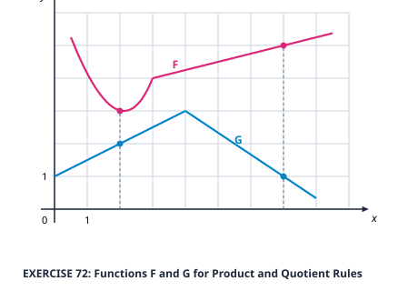

**Solution:**

**72.** (a) **Finding $P'(2)$:**

By the Product Rule:
$$P'(x) = F'(x)G(x) + F(x)G'(x)$$
Evaluating at $x = 2$:
$$P'(2) = F'(2)G(2) + F(2)G'(2)$$

Reading the function values and slopes from the graph at $x = 2$:
- $F(x)$ has a local minimum at $(2, 3)$, so its tangent line is horizontal: $F'(2) = 0$ and $F(2) = 3$.
- $G(x)$ is a linear segment passing through $(0, 1)$ and $(4, 3)$. Its slope is:
  $$G'(2) = \frac{3 - 1}{4 - 0} = \frac{2}{4} = \frac{1}{2}$$
  At $x = 2$, the value is $G(2) = 1 + \frac{1}{2}(2) = 2$.

Substituting these values into the Product Rule formula:
$$P'(2) = (0)(2) + (3)\left(\frac{1}{2}\right) = \frac{3}{2} = 1.5$$

(b) **Finding $Q'(7)$:**

By the Quotient Rule:
$$Q'(x) = \frac{G(x)F'(x) - F(x)G'(x)}{[G(x)]^2}$$
Evaluating at $x = 7$:
$$Q'(7) = \frac{G(7)F'(7) - F(7)G'(7)}{[G(7)]^2}$$

Reading the function values and slopes from the graph at $x = 7$:
- For $x \ge 3$, the graph of $F$ is a straight line passing through $(3, 4)$ and $(7, 5)$. Its slope is:
  $$F'(7) = \frac{5 - 4}{7 - 3} = \frac{1}{4}$$
  and the function value is $F(7) = 5$.
- For $x \ge 4$, the graph of $G$ is a straight line segment passing through $(4, 3)$ and $(7, 1)$. Its slope is:
  $$G'(7) = \frac{1 - 3}{7 - 4} = -\frac{2}{3}$$
  and the function value is $G(7) = 1$.

Substituting into the Quotient Rule:
$$Q'(7) = \frac{(1)\left(\frac{1}{4}\right) - (5)\left(-\frac{2}{3}\right)}{1^2} = \frac{1}{4} + \frac{10}{3} = \frac{3 + 40}{12} = \frac{43}{12} \approx 3.5833$$

## 4. Chain Rule Applications and Graphical Composition

The **Chain Rule** states that if $g$ is differentiable at $x$ and $f$ is differentiable at $g(x)$, then the composite function $F = f \circ g$ defined by $F(x) = f(g(x))$ is differentiable at $x$ and:
$$F'(x) = f'(g(x)) \cdot g'(x)$$

In Leibniz notation, if $y = f(u)$ and $u = g(x)$, then:
$$\frac{dy}{dx} = \frac{dy}{du} \cdot \frac{du}{dx}$$

### 4.1 Section 2.5 Exercise 65: Composite Derivatives from Piecewise Graphs

If $f$ and $g$ are the functions whose graphs are shown, let $u(x) = f(g(x))$, $v(x) = g(f(x))$, and $w(x) = g(g(x))$. Find each derivative, if it exists. If it does not exist, explain why.
(a) $u'(1)$
(b) $v'(1)$
(c) $w'(1)$

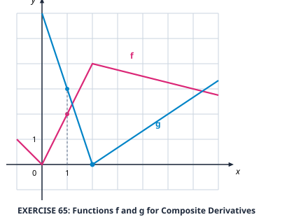

**Solution:**

**65.** (a) **Evaluating $u'(1)$ where $u(x) = f(g(x))$:**

By the Chain Rule:
$$u'(1) = f'(g(1)) \cdot g'(1)$$
- From the graph of $g$ (blue), on the interval $[0, 2]$, $g$ is a line segment from $(0, 6)$ to $(2, 0)$. Its slope is:
  $$g'(1) = \frac{0 - 6}{2 - 0} = -3$$
  At $x = 1$, the value is $g(1) = 6 + (-3)(1) = 3$.
- We now need $f'(g(1)) = f'(3)$. On the interval $[2, 7]$, $f$ is a line segment from $(2, 4)$ to $(6, 3)$ (and $(7, 2.75)$). Its slope is:
  $$f'(3) = \frac{3 - 4}{6 - 2} = -\frac{1}{4}$$
Therefore:
$$u'(1) = f'(3) \cdot g'(1) = \left(-\frac{1}{4}\right)(-3) = \frac{3}{4}$$

(b) **Evaluating $v'(1)$ where $v(x) = g(f(x))$:**

By the Chain Rule:
$$v'(1) = g'(f(1)) \cdot f'(1)$$
- On the interval $[0, 2]$, $f$ is a line segment from $(0, 0)$ to $(2, 4)$, so its slope is $f'(1) = \frac{4 - 0}{2 - 0} = 2$, and $f(1) = 2$.
- We require $g'(f(1)) = g'(2)$. However, looking at the graph of $g$ at $x = 2$, the curve forms a sharp corner:
  $$\lim_{x \to 2^-} g'(x) = -3 \quad\text{while}\quad \lim_{x \to 2^+} g'(x) = \frac{3.33 - 0}{7 - 2} = \frac{2}{3}$$
  Because the left-hand and right-hand derivatives do not match, $g'(2)$ does not exist.
Therefore, **$v'(1)$ does not exist**.

(c) **Evaluating $w'(1)$ where $w(x) = g(g(x))$:**

By the Chain Rule:
$$w'(1) = g'(g(1)) \cdot g'(1)$$
- From part (a), $g(1) = 3$ and $g'(1) = -3$.
- We need $g'(g(1)) = g'(3)$. For $x \in (2, 7)$, $g$ is a line segment from $(2, 0)$ to $(5, 2)$ and $(7, 3.33)$, with slope:
  $$g'(3) = \frac{2 - 0}{5 - 2} = \frac{2}{3}$$
Therefore:
$$w'(1) = g'(3) \cdot g'(1) = \left(\frac{2}{3}\right)(-3) = -2$$

### 4.2 Section 2.5 Exercise 66: Self-Composition and Powers

If $f$ is the function whose graph is shown, let $h(x) = f(f(x))$ and $g(x) = f(x^2)$. Use the graph of $f$ to estimate the value of each derivative.
(a) $h'(2)$
(b) $g'(2)$

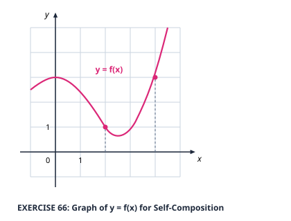

**Solution:**

**66.** (a) **Finding $h'(2)$:**

By the Chain Rule:
$$h'(x) = f'(f(x)) \cdot f'(x) \implies h'(2) = f'(f(2)) \cdot f'(2)$$
- Reading from the graph, $f(2) = 1$.
- Tangent slope at $x = 2$: the curve passes downward through $(2, 1)$ with slope approximately $f'(2) \approx -1$.
- Next we need $f'(f(2)) = f'(1)$. The curve near $x = 1$ is decreasing with slope approximately $f'(1) \approx -1$ (or $-0.8$).
Substituting these estimates:
$$h'(2) = f'(1) \cdot f'(2) \approx (-1)(-1) = 1$$

(b) **Finding $g'(2)$ where $g(x) = f(x^2)$:**

By the Chain Rule:
$$g'(x) = f'(x^2) \cdot \frac{d}{dx}(x^2) = f'(x^2) \cdot 2x$$
Evaluating at $x = 2$:
$$g'(2) = f'(2^2) \cdot 2(2) = f'(4) \cdot 4$$
- At $x = 4$, the curve passes through $(4, 3)$ and is rising steeply. The slope of the tangent line at $(4, 3)$ is approximately $f'(4) \approx 2$.
Therefore:
$$g'(2) \approx 4 \cdot (2) = 8$$

**Geometric Insight:**
- Notice that while $f(x)$ is decreasing at $x = 2$ ($f'(2) \approx -1$), the self-composite function $h(x) = f(f(x))$ is actually increasing at $x = 2$ ($h'(2) \approx +1$). This occurs because the inner function maps $x = 2$ to $f(2) = 1$, where $f$ is also decreasing ($f'(1) \approx -1$). The product of two negative rates of change produces a net positive rate of change: $(-1) \cdot (-1) = +1$.
- For $g(x) = f(x^2)$, squaring the input accelerates the motion along the curve, multiplying the base derivative $f'(4) \approx 2$ by the inner velocity factor $2x = 4$ to produce $g'(2) \approx 8$.

### 4.3 Section 2.5 Exercise 67: Radical Composite with Tangent Line

If $g(x) = \sqrt{f(x)}$, where the graph of $f$ is shown, evaluate $g'(3)$.

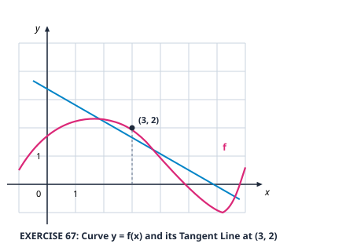

**Solution:**

**67.** Writing $g(x) = [f(x)]^{1/2}$, we differentiate using the Power Chain Rule:
$$g'(x) = \frac{1}{2}[f(x)]^{-1/2} \cdot f'(x) = \frac{f'(x)}{2\sqrt{f(x)}}$$

Evaluating at $x = 3$:
$$g'(3) = \frac{f'(3)}{2\sqrt{f(3)}}$$

From the graph:
- The point $(3, 2)$ lies on the curve $y = f(x)$, so $f(3) = 2$.
- The blue tangent line passes through $(0, 4)$ and $(6, 0)$. Its slope is:
  $$f'(3) = \frac{0 - 4}{6 - 0} = -\frac{4}{6} = -\frac{2}{3}$$

Substituting these exact values into the derivative formula:
$$g'(3) = \frac{-\frac{2}{3}}{2\sqrt{2}} = -\frac{1}{3\sqrt{2}} = -\frac{\sqrt{2}}{6} \approx -0.2357$$

### 4.4 Section 2.5 Exercise 68: General Power Expressions

Suppose $f$ is differentiable on $\mathbb{R}$ and $\alpha$ is a real number. Let $F(x) = f(x^\alpha)$ and $G(x) = [f(x)]^\alpha$. Find expressions for:
(a) $F'(x)$
(b) $G'(x)$

**Solution:**

**68.** (a) **Finding $F'(x)$:**
The function $F(x) = f(x^\alpha)$ has inner function $u(x) = x^\alpha$. By the Chain Rule:
$$F'(x) = f'(x^\alpha) \cdot \frac{d}{dx}(x^\alpha) = \alpha x^{\alpha - 1} f'(x^\alpha)$$

(b) **Finding $G'(x)$:**
The function $G(x) = [f(x)]^\alpha$ has outer function $u^\alpha$ and inner function $f(x)$. By the Power Chain Rule:
$$G'(x) = \alpha [f(x)]^{\alpha - 1} \cdot \frac{d}{dx}[f(x)] = \alpha [f(x)]^{\alpha - 1} f'(x)$$

### 4.5 Section 2.5 Exercise 69: Triple Chain Rule

Let $r(x) = f(g(h(x)))$, where $h(1) = 2$, $g(2) = 3$, $h'(1) = 4$, $g'(2) = 5$, and $f'(3) = 6$. Find $r'(1)$.

**Solution:**

**69.** Applying the Chain Rule successively to the three nested functions:
$$r'(x) = f'(g(h(x))) \cdot \frac{d}{dx}[g(h(x))] = f'(g(h(x))) \cdot g'(h(x)) \cdot h'(x)$$

Now evaluate each factor at $x = 1$:
- Since $h(1) = 2$, the middle argument is $g(h(1)) = g(2) = 3$.
- The outer derivative factor is $f'(g(h(1))) = f'(3) = 6$.
- The middle derivative factor is $g'(h(1)) = g'(2) = 5$.
- The inner derivative factor is $h'(1) = 4$.

Multiplying the three factors together:
$$r'(1) = f'(3) \cdot g'(2) \cdot h'(1) = 6 \cdot 5 \cdot 4 = 120$$

## 5. Implicit Differentiation: Foundations and Classic Curves

### 5.1 Explicit versus Implicit Relations

The functions encountered in introductory calculus are typically described by expressing one variable **explicitly** in terms of another variable—for example:
$$y = \sqrt{x^3 + 1} \quad\text{or}\quad y = x \sin x$$
or, in general, $y = f(x)$.

Some functions, however, are defined **implicitly** by a relation between $x$ and $y$ such as:
$$x^2 + y^2 = 25 \tag{1}$$
or
$$x^3 + y^3 = 6xy \tag{2}$$

In some cases it is possible to solve such an equation for $y$ as an explicit function (or several functions) of $x$. For instance, solving Equation 1 for $y$ yields:
$$y = \pm\sqrt{25 - x^2}$$
Thus, two of the explicit functions determined by the implicit Equation 1 are:
$$f(x) = \sqrt{25 - x^2} \quad\text{and}\quad g(x) = -\sqrt{25 - x^2}$$

The graphs of $f$ and $g$ are the upper and lower semicircles of the circle $x^2 + y^2 = 25$.

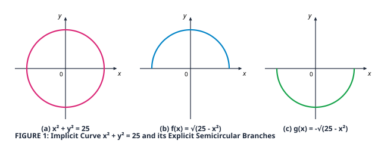

### 5.2 The Folium of Descartes

It is not easy to solve Equation 2, $x^3 + y^3 = 6xy$, explicitly for $y$ as a function of $x$ by hand. (A computer algebra system using Cardano's cubic formula obtains very complicated expressions involving nested cube roots). Nonetheless, Equation 2 is the equation of a famous curve called the **folium of Descartes** (from Latin *folium*, meaning leaf), proposed by René Descartes in 1638 to challenge Pierre de Fermat's newly developed methods of finding tangents.

The folium consists of a loop in the first quadrant with a tip at $(3, 3)$ and two infinite branches asymptotic to the line $x + y + 2 = 0$.

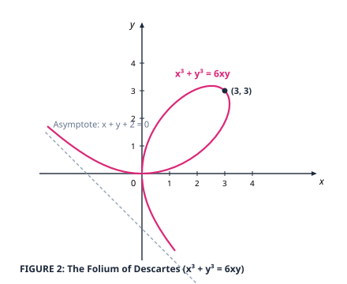

The equation $x^3 + y^3 = 6xy$ implicitly defines $y$ as several distinct single-valued functions of $x$, three of which are shown in Figure 3. When we state that $f$ is a function defined implicitly by Equation 2, we mean that:
$$x^3 + [f(x)]^3 = 6x f(x)$$
holds identically for all values of $x$ in the domain of $f$.

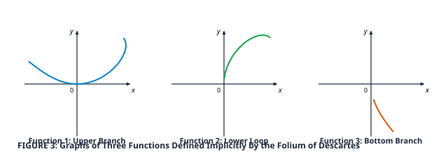

### 5.3 The Method of Implicit Differentiation

Fortunately, we do not need to solve an equation for $y$ in terms of $x$ in order to find the derivative of $y$. Instead, we use the method of **implicit differentiation**:

**Step 1:** Differentiate both sides of the equation with respect to $x$, regarding $y$ as a differentiable function of $x$.

**Step 2:** Apply the Chain Rule whenever differentiating an expression containing $y$:
$$\frac{d}{dx}[g(y)] = \frac{d}{dy}[g(y)] \frac{dy}{dx} = g'(y) y'$$

**Step 3:** Collect all terms involving $y'$ (or $\frac{dy}{dx}$) on one side of the equation and move all other terms to the opposite side.

**Step 4:** Factor out $y'$ and solve algebraically for $y'$.

### 5.4 Example 1: Tangent to a Circle

(a) If $x^2 + y^2 = 25$, find $\frac{dy}{dx}$.  
(b) Find an equation of the tangent to the circle $x^2 + y^2 = 25$ at the point $(3, 4)$.

**Solution 1 (Implicit Differentiation):**

(a) Differentiating both sides of the equation $x^2 + y^2 = 25$ with respect to $x$:
$$\frac{d}{dx}(x^2 + y^2) = \frac{d}{dx}(25)$$
$$\frac{d}{dx}(x^2) + \frac{d}{dx}(y^2) = 0$$

Remembering that $y$ is a function of $x$ and applying the Chain Rule to $y^2$:
$$\frac{d}{dx}(y^2) = \frac{d}{dy}(y^2) \frac{dy}{dx} = 2y \frac{dy}{dx}$$

Thus:
$$2x + 2y \frac{dy}{dx} = 0$$

Solving this linear equation for $\frac{dy}{dx}$:
$$2y \frac{dy}{dx} = -2x \implies \frac{dy}{dx} = -\frac{x}{y}$$

(b) At the point $(3, 4)$, we have $x = 3$ and $y = 4$. Substituting into our formula for $\frac{dy}{dx}$:
$$\frac{dy}{dx}\Big|_{(3, 4)} = -\frac{3}{4}$$

Using the point-slope form of the equation of a line ($y - y_1 = m(x - x_1)$):
$$y - 4 = -\frac{3}{4}(x - 3)$$
Multiplying by $4$ and rearranging:
$$4y - 16 = -3x + 9 \implies 3x + 4y = 25$$

**Solution 2 (Explicit Differentiation):**

Solving $x^2 + y^2 = 25$ explicitly for $y$ yields $y = \pm\sqrt{25 - x^2}$. Because the point $(3, 4)$ has a positive $y$-coordinate, it lies on the upper semicircle:
$$f(x) = \sqrt{25 - x^2} = (25 - x^2)^{1/2}$$

Differentiating $f$ using the Chain Rule:
$$f'(x) = \frac{1}{2}(25 - x^2)^{-1/2} \frac{d}{dx}(25 - x^2) = \frac{1}{2\sqrt{25 - x^2}}(-2x) = -\frac{x}{\sqrt{25 - x^2}}$$

Evaluating at $x = 3$:
$$f'(3) = -\frac{3}{\sqrt{25 - 3^2}} = -\frac{3}{\sqrt{16}} = -\frac{3}{4}$$

This produces the identical tangent line equation $3x + 4y = 25$.

*Note on Generality*: The expression $\frac{dy}{dx} = -\frac{x}{y}$ obtained in Solution 1 expresses the derivative compactly in terms of both $x$ and $y$. It is valid for **any** differentiable function $y$ defined by the relation. For instance:
- On the upper semicircle $y = \sqrt{25 - x^2}$:
  $$\frac{dy}{dx} = -\frac{x}{y} = -\frac{x}{\sqrt{25 - x^2}}$$
- On the lower semicircle $y = -\sqrt{25 - x^2}$:
  $$\frac{dy}{dx} = -\frac{x}{y} = -\frac{x}{-\sqrt{25 - x^2}} = \frac{x}{\sqrt{25 - x^2}}$$

### 5.5 Example 2: Tangents and Extrema on the Folium of Descartes

(a) Find $y'$ if $x^3 + y^3 = 6xy$.  
(b) Find the tangent to the folium of Descartes $x^3 + y^3 = 6xy$ at the point $(3, 3)$.  
(c) At what point in the first quadrant is the tangent line horizontal?

**Solution:**

(a) Differentiating both sides of $x^3 + y^3 = 6xy$ with respect to $x$:
$$\frac{d}{dx}(x^3 + y^3) = \frac{d}{dx}(6xy)$$

Applying the Chain Rule to $y^3$ and the Product Rule to $6xy$:
$$3x^2 + 3y^2 y' = 6(1 \cdot y + x y') = 6y + 6x y'$$

Dividing through by $3$:
$$x^2 + y^2 y' = 2y + 2x y'$$

Collecting all terms with $y'$ on the left side:
$$y^2 y' - 2x y' = 2y - x^2$$
$$(y^2 - 2x)y' = 2y - x^2$$

Solving for $y'$:
$$y' = \frac{2y - x^2}{y^2 - 2x}$$

(b) When $x = 3$ and $y = 3$:
$$y'\Big|_{(3, 3)} = \frac{2(3) - 3^2}{3^2 - 2(3)} = \frac{6 - 9}{9 - 6} = \frac{-3}{3} = -1$$

An equation of the tangent line at $(3, 3)$ is:
$$y - 3 = -1(x - 3) \implies y - 3 = -x + 3 \implies x + y = 6$$

(c) The tangent line is horizontal when its slope is zero: $y' = 0$. Using the formula for $y'$ from part (a):
$$y' = \frac{2y - x^2}{y^2 - 2x} = 0 \iff 2y - x^2 = 0 \quad (\text{provided } y^2 - 2x \ne 0)$$

Solving for $y$ gives:
$$y = \frac{1}{2}x^2$$

Substituting this into the equation of the folium $x^3 + y^3 = 6xy$:
$$x^3 + \left(\frac{1}{2}x^2\right)^3 = 6x\left(\frac{1}{2}x^2\right)$$
$$x^3 + \frac{1}{8}x^6 = 3x^3$$

Subtracting $x^3$ from both sides:
$$\frac{1}{8}x^6 = 2x^3 \implies x^6 = 16x^3$$

Since we seek a point in the first quadrant, $x \ne 0$. Dividing by $x^3$:
$$x^3 = 16 \implies x = 16^{1/3} = (2^4)^{1/3} = 2^{4/3}$$

Now calculate the corresponding $y$-coordinate:
$$y = \frac{1}{2}x^2 = \frac{1}{2}(2^{4/3})^2 = \frac{1}{2}(2^{8/3}) = 2^{8/3 - 1} = 2^{5/3}$$

Thus, the tangent line is horizontal at the point:
$$(x, y) = (2^{4/3}, 2^{5/3}) \approx (2.5198, 3.1748)$$

Notice that at this point, $y^2 - 2x = (2^{5/3})^2 - 2(2^{4/3}) = 2^{10/3} - 2^{7/3} \ne 0$, so the denominator is non-zero.

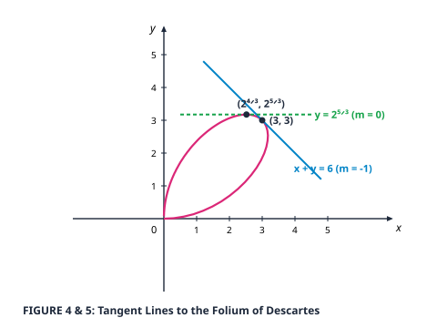

## 6. Comprehensive Implicit Differentiation Exercises

### 6.1 Problems 1–4: Implicit vs Explicit Differentiation and Consistency Checks

For each equation:
(a) Find $y'$ by implicit differentiation.  
(b) Solve the equation explicitly for $y$ and differentiate to get $y'$ in terms of $x$.  
(c) Check that your solutions to parts (a) and (b) are consistent by substituting the expression for $y$ into your solution for part (a).

**1.** $9x^2 - y^2 = 1$

(a) Differentiating implicitly:
$$\frac{d}{dx}(9x^2 - y^2) = \frac{d}{dx}(1) \implies 18x - 2y y' = 0 \implies 2y y' = 18x \implies y' = \frac{9x}{y}$$

(b) Solving explicitly for $y$:
$$y^2 = 9x^2 - 1 \implies y = \pm\sqrt{9x^2 - 1}$$
Differentiating using the Chain Rule:
$$y' = \pm\frac{1}{2\sqrt{9x^2 - 1}} \frac{d}{dx}(9x^2 - 1) = \pm\frac{18x}{2\sqrt{9x^2 - 1}} = \pm\frac{9x}{\sqrt{9x^2 - 1}}$$

(c) Consistency check:
Substituting $y = \pm\sqrt{9x^2 - 1}$ into part (a):
$$y' = \frac{9x}{\pm\sqrt{9x^2 - 1}} = \pm\frac{9x}{\sqrt{9x^2 - 1}}$$
The two results match identically.

**2.** $2x^2 + x + xy = 1$

(a) Differentiating implicitly:
$$\frac{d}{dx}(2x^2 + x + xy) = \frac{d}{dx}(1)$$
$$4x + 1 + (1 \cdot y + x y') = 0$$
$$x y' = -(4x + y + 1) \implies y' = -\frac{4x + y + 1}{x}$$

(b) Solving explicitly for $y$:
$$xy = 1 - x - 2x^2 \implies y = \frac{1 - x - 2x^2}{x} = \frac{1}{x} - 1 - 2x = x^{-1} - 1 - 2x$$
Differentiating directly:
$$y' = -x^{-2} - 2 = -\frac{1}{x^2} - 2 = -\frac{2x^2 + 1}{x^2}$$

(c) Consistency check:
Substituting $y = \frac{1 - x - 2x^2}{x}$ into the implicit expression from part (a):
$$y' = -\frac{4x + \frac{1 - x - 2x^2}{x} + 1}{x} = -\frac{\frac{4x^2 + 1 - x - 2x^2 + x}{x}}{x} = -\frac{2x^2 + 1}{x^2}$$
The two results are identical.

**3.** $\frac{1}{x} + \frac{1}{y} = 1$

(a) Differentiating implicitly:
$$\frac{d}{dx}(x^{-1} + y^{-1}) = \frac{d}{dx}(1) \implies -x^{-2} - y^{-2} y' = 0 \implies -\frac{1}{x^2} - \frac{y'}{y^2} = 0$$
$$\frac{y'}{y^2} = -\frac{1}{x^2} \implies y' = -\frac{y^2}{x^2}$$

(b) Solving explicitly for $y$:
$$\frac{1}{y} = 1 - \frac{1}{x} = \frac{x - 1}{x} \implies y = \frac{x}{x - 1}$$
Differentiating using the Quotient Rule:
$$y' = \frac{(x - 1)(1) - x(1)}{(x - 1)^2} = \frac{x - 1 - x}{(x - 1)^2} = -\frac{1}{(x - 1)^2}$$

(c) Consistency check:
Substituting $y = \frac{x}{x - 1}$ into part (a):
$$y' = -\frac{\left(\frac{x}{x - 1}\right)^2}{x^2} = -\frac{\frac{x^2}{(x - 1)^2}}{x^2} = -\frac{1}{(x - 1)^2}$$
The solutions are completely consistent.

**4.** $\cos x + \sqrt{y} = 5$

(a) Differentiating implicitly:
$$\frac{d}{dx}(\cos x + y^{1/2}) = \frac{d}{dx}(5) \implies -\sin x + \frac{1}{2\sqrt{y}} y' = 0$$
$$\frac{y'}{2\sqrt{y}} = \sin x \implies y' = 2\sqrt{y} \sin x$$

(b) Solving explicitly for $y$:
$$\sqrt{y} = 5 - \cos x \implies y = (5 - \cos x)^2$$
Differentiating using the Chain Rule:
$$y' = 2(5 - \cos x) \cdot \frac{d}{dx}(5 - \cos x) = 2(5 - \cos x)(\sin x)$$

(c) Consistency check:
Substituting $\sqrt{y} = 5 - \cos x$ into part (a):
$$y' = 2(5 - \cos x)\sin x$$
The expressions agree exactly.

### 6.2 Problems 5–20: Finding $\frac{dy}{dx}$ by Implicit Differentiation

Find $\frac{dy}{dx}$ by implicit differentiation.

**5.** $x^3 + y^3 = 1$

Differentiating both sides with respect to $x$:
$$3x^2 + 3y^2 y' = 0 \implies 3y^2 y' = -3x^2 \implies y' = -\frac{x^2}{y^2}$$

**6.** $2\sqrt{x} + \sqrt{y} = 3$

Differentiating both sides with respect to $x$:
$$2\left(\frac{1}{2\sqrt{x}}\right) + \frac{1}{2\sqrt{y}} y' = 0 \implies \frac{1}{\sqrt{x}} + \frac{y'}{2\sqrt{y}} = 0$$
$$\frac{y'}{2\sqrt{y}} = -\frac{1}{\sqrt{x}} \implies y' = -\frac{2\sqrt{y}}{\sqrt{x}}$$

**7.** $x^2 + xy - y^2 = 4$

Differentiating both sides with respect to $x$:
$$2x + (1 \cdot y + x y') - 2y y' = 0$$
$$2x + y + (x - 2y)y' = 0$$
$$(x - 2y)y' = -(2x + y) \implies y' = \frac{2x + y}{2y - x}$$

**8.** $2x^3 + x^2 y - x y^3 = 2$

Differentiating both sides with respect to $x$:
$$6x^2 + (2xy + x^2 y') - (1 \cdot y^3 + x \cdot 3y^2 y') = 0$$
$$6x^2 + 2xy - y^3 + (x^2 - 3xy^2)y' = 0$$
$$(x^2 - 3xy^2)y' = y^3 - 6x^2 - 2xy \implies y' = \frac{y^3 - 6x^2 - 2xy}{x^2 - 3xy^2}$$

**9.** $x^4(x + y) = y^2(3x - y)$

Expanding both sides prior to differentiating:
$$x^5 + x^4 y = 3x y^2 - y^3$$
Differentiating term by term with respect to $x$:
$$5x^4 + \left(4x^3 y + x^4 y'\right) = \left(3y^2 + 3x \cdot 2y y'\right) - 3y^2 y'$$
$$5x^4 + 4x^3 y + x^4 y' = 3y^2 + 6xy y' - 3y^2 y'$$
Collecting $y'$ terms on the left:
$$(x^4 - 6xy + 3y^2)y' = 3y^2 - 5x^4 - 4x^3 y$$
$$y' = \frac{3y^2 - 5x^4 - 4x^3 y}{x^4 - 6xy + 3y^2}$$

**10.** $y^5 + x^2 y^3 = 1 + x^4 y$

Differentiating both sides with respect to $x$:
$$5y^4 y' + \left(2x y^3 + 3x^2 y^2 y'\right) = 0 + \left(4x^3 y + x^4 y'\right)$$
Collecting all terms involving $y'$:
$$(5y^4 + 3x^2 y^2 - x^4)y' = 4x^3 y - 2xy^3$$
$$y' = \frac{4x^3 y - 2xy^3}{5y^4 + 3x^2 y^2 - x^4} = \frac{2xy(2x^2 - y^2)}{5y^4 + 3x^2 y^2 - x^4}$$

**11.** $y \cos x = x^2 + y^2$

Differentiating both sides with respect to $x$:
$$y' \cos x - y \sin x = 2x + 2y y'$$
$$y' \cos x - 2y y' = 2x + y \sin x$$
$$(\cos x - 2y)y' = 2x + y \sin x \implies y' = \frac{2x + y \sin x}{\cos x - 2y}$$

**12.** $\cos(xy) = 1 + \sin y$

Differentiating both sides with respect to $x$:
$$-\sin(xy) \cdot \frac{d}{dx}(xy) = 0 + \cos y \cdot y'$$
$$-\sin(xy)(y + x y') = \cos y \cdot y'$$
$$-y \sin(xy) - x \sin(xy) y' = \cos y \cdot y'$$
Collecting $y'$ terms:
$$(\cos y + x \sin(xy))y' = -y \sin(xy) \implies y' = -\frac{y \sin(xy)}{\cos y + x \sin(xy)}$$

**13.** $4 \cos x \sin y = 1$

Differentiating both sides with respect to $x$:
$$4\left(-\sin x \sin y + \cos x \cos y \cdot y'\right) = 0$$
$$\cos x \cos y \cdot y' = \sin x \sin y$$
$$y' = \frac{\sin x \sin y}{\cos x \cos y} = \tan x \tan y$$

**14.** $y \sin(x^2) = x \sin(y^2)$

Differentiating both sides with respect to $x$:
$$y' \sin(x^2) + y \cos(x^2)(2x) = 1 \cdot \sin(y^2) + x \cos(y^2)(2y y')$$
$$y' \sin(x^2) + 2xy \cos(x^2) = \sin(y^2) + 2xy \cos(y^2) y'$$
Collecting $y'$ terms:
$$(\sin(x^2) - 2xy \cos(y^2))y' = \sin(y^2) - 2xy \cos(x^2)$$
$$y' = \frac{\sin(y^2) - 2xy \cos(x^2)}{\sin(x^2) - 2xy \cos(y^2)}$$

**15.** $\tan(x/y) = x + y$

Differentiating both sides with respect to $x$:
$$\sec^2(x/y) \cdot \frac{y(1) - x y'}{y^2} = 1 + y' \implies y \sec^2(x/y) - x \sec^2(x/y) y' = y^2 + y^2 y'$$
Collecting $y'$ terms:
$$(y^2 + x \sec^2(x/y))y' = y \sec^2(x/y) - y^2 \implies y' = \frac{y \sec^2(x/y) - y^2}{y^2 + x \sec^2(x/y)}$$

**16.** $\sqrt{x + y} = 1 + x^2 y^2$

Writing the left side as $(x + y)^{1/2}$ and differentiating:
$$\frac{1 + y'}{2\sqrt{x + y}} = 2x y^2 + 2x^2 y y' \implies 1 + y' = 4x y^2 \sqrt{x + y} + 4x^2 y \sqrt{x + y} y'$$
Collecting $y'$ terms:
$$(1 - 4x^2 y \sqrt{x + y})y' = 4x y^2 \sqrt{x + y} - 1 \implies y' = \frac{4x y^2 \sqrt{x + y} - 1}{1 - 4x^2 y \sqrt{x + y}}$$

**17.** $\sqrt{xy} = 1 + x^2 y$

Writing $(xy)^{1/2} = 1 + x^2 y$ and differentiating:
$$\frac{y + x y'}{2\sqrt{xy}} = 2x y + x^2 y' \implies y + x y' = 4x y \sqrt{xy} + 2x^2 \sqrt{xy} y'$$
Collecting $y'$ terms:
$$(x - 2x^2 \sqrt{xy})y' = 4xy \sqrt{xy} - y \implies y' = \frac{4xy\sqrt{xy} - y}{x - 2x^2\sqrt{xy}}$$

**18.** $x \sin y + y \sin x = 1$

Differentiating both sides with respect to $x$:
$$(1 \cdot \sin y + x \cos y \cdot y') + (y' \sin x + y \cos x) = 0 \implies (x \cos y + \sin x)y' = -(\sin y + y \cos x)$$
$$y' = -\frac{\sin y + y \cos x}{x \cos y + \sin x}$$

**19.** $y \cos x = 1 + \sin(xy)$

Differentiating both sides with respect to $x$:
$$y' \cos x - y \sin x = \cos(xy)(y + x y') = y \cos(xy) + x \cos(xy) y'$$
Collecting $y'$ terms:
$$(\cos x - x \cos(xy))y' = y \sin x + y \cos(xy) \implies y' = \frac{y(\sin x + \cos(xy))}{\cos x - x \cos(xy)}$$

**20.** $\tan(x - y) = \frac{y}{1 + x^2}$

Differentiating both sides with respect to $x$:
$$\sec^2(x - y)(1 - y') = \frac{(1 + x^2)y' - 2xy}{(1 + x^2)^2}$$
Multiplying through by $(1 + x^2)^2$ and collecting $y'$ terms:
$$(1 + x^2)^2 \sec^2(x - y) - (1 + x^2)^2 \sec^2(x - y) y' = (1 + x^2)y' - 2xy$$
$$y' = \frac{2xy + (1 + x^2)^2 \sec^2(x - y)}{(1 + x^2)\left[1 + (1 + x^2)\sec^2(x - y)\right]}$$

### 6.3 Problems 21–22: Evaluating Derivatives at Specified Points

**21.** If $f(x) + x^2 [f(x)]^3 = 10$ and $f(1) = 2$, find $f'(1)$.

**Solution:**

Differentiating both sides with respect to $x$:
$$f'(x) + \left(2x [f(x)]^3 + 3x^2 [f(x)]^2 f'(x)\right) = 0 \implies \left(1 + 3x^2 [f(x)]^2\right) f'(x) = -2x [f(x)]^3$$
$$f'(x) = -\frac{2x [f(x)]^3}{1 + 3x^2 [f(x)]^2}$$

Evaluating at $x = 1$ with $f(1) = 2$:
$$f'(1) = -\frac{2(1)(2)^3}{1 + 3(1)^2(2)^2} = -\frac{16}{1 + 12} = -\frac{16}{13}$$

**22.** If $g(x) + x \sin g(x) = x^2$, find $g'(0)$.

**Solution:**

Setting $x = 0$ in the original equation gives $g(0) + 0 = 0 \implies g(0) = 0$. Differentiating implicitly:
$$g'(x) + \sin g(x) + x \cos g(x) \cdot g'(x) = 2x \implies (1 + x \cos g(x)) g'(x) = 2x - \sin g(x)$$
$$g'(x) = \frac{2x - \sin g(x)}{1 + x \cos g(x)}$$

Evaluating at $x = 0$ with $g(0) = 0$:
$$g'(0) = \frac{2(0) - \sin(0)}{1 + 0 \cdot \cos(0)} = \frac{0}{1} = 0$$

## 7. Chapter 2 Review: True-False Differentiation Quiz

*Instructions*: Determine whether the statement is true or false. If it is true, explain why. If it is false, explain why or give an example that disproves the statement.

**1.** If $f$ is continuous at $a$, then $f$ is differentiable at $a$.  
*Status*: **False**  
*Explanation & Counterexample*: Continuity is a necessary condition for differentiability, but it is not sufficient. A function can be continuous at a point where its graph has a sharp corner, a cusp, or a vertical tangent line. A classic counterexample is the absolute value function $f(x) = |x|$ at $a = 0$. The function is continuous at $0$ because:
$$\lim_{x \to 0} |x| = 0 = f(0)$$
However, computing the one-sided limits of the difference quotient yields:
$$\lim_{h \to 0^+} \frac{f(0 + h) - f(0)}{h} = \lim_{h \to 0^+} \frac{|h|}{h} = \lim_{h \to 0^+} \frac{h}{h} = 1$$
$$\lim_{h \to 0^-} \frac{f(0 + h) - f(0)}{h} = \lim_{h \to 0^-} \frac{|h|}{h} = \lim_{h \to 0^-} \frac{-h}{h} = -1$$
Because the left-hand and right-hand limits are unequal ($1 \ne -1$), the two-sided limit defining $f'(0)$ does not exist. Thus $f$ is continuous at $0$ but not differentiable at $0$.

**2.** If $f$ and $g$ are differentiable, then $\frac{d}{dx}[f(x) + g(x)] = f'(x) + g'(x)$.  
*Status*: **True**  
*Explanation*: This is the Sum Rule for differentiation. It follows directly from the definition of the derivative and the Sum Law for limits:
$$\frac{d}{dx}[f(x) + g(x)] = \lim_{h \to 0} \frac{[f(x + h) + g(x + h)] - [f(x) + g(x)]}{h}$$
$$= \lim_{h \to 0} \left[ \frac{f(x + h) - f(x)}{h} + \frac{g(x + h) - g(x)}{h} \right] = \lim_{h \to 0} \frac{f(x + h) - f(x)}{h} + \lim_{h \to 0} \frac{g(x + h) - g(x)}{h} = f'(x) + g'(x)$$

**3.** If $f$ and $g$ are differentiable, then $\frac{d}{dx}[f(x)g(x)] = f'(x)g'(x)$.  
*Status*: **False**  
*Explanation & Counterexample*: The derivative of a product is not the product of the individual derivatives. The correct Product Rule is:
$$\frac{d}{dx}[f(x)g(x)] = f'(x)g(x) + f(x)g'(x)$$
For a simple counterexample, let $f(x) = x$ and $g(x) = x$. Differentiating their product directly:
$$\frac{d}{dx}[f(x)g(x)] = \frac{d}{dx}[x \cdot x] = \frac{d}{dx}[x^2] = 2x$$
However, multiplying their individual derivatives gives:
$$f'(x)g'(x) = 1 \cdot 1 = 1$$
Since $2x \ne 1$ in general (they are equal only when $x = 1/2$), the statement is false.

**4.** If $f$ and $g$ are differentiable, then $\frac{d}{dx}[f(g(x))] = f'(g(x))g'(x)$.  
*Status*: **True**  
*Explanation*: This is the Chain Rule for composite functions. If $g$ is differentiable at $x$ and $f$ is differentiable at $g(x)$, then the composite function $F = f \circ g$ defined by $F(x) = f(g(x))$ is differentiable at $x$, and its derivative is the derivative of the outer function evaluated at the inner function multiplied by the derivative of the inner function.

**5.** If $f$ is differentiable, then $\frac{d}{dx}\sqrt{f(x)} = \frac{f'(x)}{2\sqrt{f(x)}}$.  
*Status*: **True**  
*Explanation*: Expressing the radical as a fractional power, $\sqrt{f(x)} = [f(x)]^{1/2}$. Applying the Chain Rule (Generalized Power Rule) where $f(x) > 0$:
$$\frac{d}{dx}[f(x)]^{1/2} = \frac{1}{2}[f(x)]^{-1/2} \cdot \frac{d}{dx}[f(x)] = \frac{1}{2\sqrt{f(x)}} \cdot f'(x) = \frac{f'(x)}{2\sqrt{f(x)}}$$

**6.** If $f$ is differentiable, then $\frac{d}{dx}f(\sqrt{x}) = \frac{f'(x)}{2\sqrt{x}}$.  
*Status*: **False**  
*Explanation & Counterexample*: Applying the Chain Rule to $f(\sqrt{x})$ requires evaluating $f'$ at the inner function $\sqrt{x}$, not at $x$:
$$\frac{d}{dx}f(\sqrt{x}) = f'(\sqrt{x}) \cdot \frac{d}{dx}(\sqrt{x}) = f'(\sqrt{x}) \cdot \frac{1}{2\sqrt{x}} = \frac{f'(\sqrt{x})}{2\sqrt{x}}$$
The statement mistakenly writes $f'(x)$ in the numerator instead of $f'(\sqrt{x})$. For a counterexample, consider $f(x) = x^2$. Then $f(\sqrt{x}) = (\sqrt{x})^2 = x$ (for $x > 0$), so:
$$\frac{d}{dx}f(\sqrt{x}) = \frac{d}{dx}(x) = 1$$
However, evaluating the proposed formula gives:
$$\frac{f'(x)}{2\sqrt{x}} = \frac{2x}{2\sqrt{x}} = \sqrt{x}$$
Since $1 \ne \sqrt{x}$ for all $x > 0$ (for example, at $x = 4$, $1 \ne 2$), the statement is false.

**7.** $\frac{d}{dx}|x^2 + x| = |2x + 1|$.  
*Status*: **False**  
*Explanation & Counterexample*: Recall that the derivative of $|u|$ is $\frac{u}{|u|} u' = \operatorname{sgn}(u) u'$ for $u \ne 0$. For $g(x) = x^2 + x = x(x + 1)$, $g(x) < 0$ on the open interval $(-1, 0)$. On this interval, $|x^2 + x| = -(x^2 + x) = -x^2 - x$, so its true derivative is:
$$\frac{d}{dx}|x^2 + x| = -(2x + 1) = -2x - 1$$
However, the right side $|2x + 1| \ge 0$ for all real numbers. On the subinterval $(-1/2, 0)$, $2x + 1 > 0$, so $|2x + 1| = 2x + 1 > 0$, whereas the true derivative is $-(2x + 1) < 0$. For a specific numerical counterexample, choose $x = -1/4$:
$$x^2 + x = \left(-\frac{1}{4}\right)^2 + \left(-\frac{1}{4}\right) = \frac{1}{16} - \frac{4}{16} = -\frac{3}{16} < 0$$
The actual derivative at $x = -1/4$ is:
$$\frac{d}{dx}\left.(-x^2 - x)\right|_{x = -1/4} = -\left[2\left(-\frac{1}{4}\right) + 1\right] = -\left[-\frac{1}{2} + 1\right] = -\frac{1}{2}$$
However, the proposed formula produces:
$$\left|2\left(-\frac{1}{4}\right) + 1\right| = \left|\frac{1}{2}\right| = \frac{1}{2}$$
Because $-1/2 \ne 1/2$, the claim is false.

**8.** If $f'(r)$ exists, then $\lim_{x \to r} f(x) = f(r)$.  
*Status*: **True**  
*Explanation*: The statement $\lim_{x \to r} f(x) = f(r)$ defines continuity of $f$ at $x = r$. It is a core theorem of calculus that **differentiability implies continuity**: if a function is differentiable at a point, it must be continuous at that point. To prove this, consider the limit of the difference $f(x) - f(r)$ as $x \to r$:
$$\lim_{x \to r} [f(x) - f(r)] = \lim_{x \to r} \left[ \frac{f(x) - f(r)}{x - r} \cdot (x - r) \right] = \lim_{x \to r} \frac{f(x) - f(r)}{x - r} \cdot \lim_{x \to r} (x - r) = f'(r) \cdot 0 = 0$$
Since $\lim_{x \to r} [f(x) - f(r)] = 0$, it follows that $\lim_{x \to r} f(x) = f(r)$.

**9.** If $g(x) = x^5$, then $\lim_{x \to 2} \frac{g(x) - g(2)}{x - 2} = 80$.  
*Status*: **True**  
*Explanation*: By the alternative definition of the derivative at a point $a$:
$$g'(a) = \lim_{x \to a} \frac{g(x) - g(a)}{x - a}$$
With $a = 2$, this limit represents precisely the derivative $g'(2)$. For the power function $g(x) = x^5$, the Power Rule yields $g'(x) = 5x^4$. Evaluating at $x = 2$:
$$g'(2) = 5(2^4) = 5(16) = 80$$
Therefore, the limit is indeed $80$.

**10.** $\frac{d^2 y}{dx^2} = \left(\frac{dy}{dx}\right)^2$.  
*Status*: **False**  
*Explanation & Counterexample*: The notation $\frac{d^2 y}{dx^2}$ denotes the second derivative—the derivative of the derivative, $\frac{d}{dx}\left(\frac{dy}{dx}\right)$. The right side $\left(\frac{dy}{dx}\right)^2$ denotes the algebraic square of the first derivative. These represent completely distinct mathematical operations. For a counterexample, consider $y = x^3$:
$$\frac{dy}{dx} = 3x^2 \implies \frac{d^2 y}{dx^2} = \frac{d}{dx}(3x^2) = 6x$$
Whereas squaring the first derivative yields:
$$\left(\frac{dy}{dx}\right)^2 = (3x^2)^2 = 9x^4$$
Because $6x \ne 9x^4$ for all $x$ (for example, at $x = 1$, $6 \ne 9$), the equation is false.

**11.** An equation of the tangent line to the parabola $y = x^2$ at $(-2, 4)$ is $y - 4 = 2x(x + 2)$.  
*Status*: **False**  
*Explanation & Counterexample*: The equation of a tangent line must be linear (degree 1) in $x$ and $y$, having the point-slope form $y - y_1 = m(x - x_1)$, where $m$ is the constant numerical slope at the point of tangency. For $y = x^2$, the derivative is $y' = 2x$. At the point $(-2, 4)$, the numerical slope is:
$$m = \left. 2x \right|_{x = -2} = 2(-2) = -4$$
The correct equation of the tangent line is:
$$y - 4 = -4(x + 2) \iff y = -4x - 4$$
The proposed formula incorrectly leaves the variable expression $2x$ in place of the constant numerical slope $m$, producing:
$$y - 4 = 2x(x + 2) \iff y = 2x^2 + 4x + 4$$
This represents another quadratic parabola, not a straight tangent line.

**12.** $\frac{d}{dx}(\tan^2 x) = \frac{d}{dx}(\sec^2 x)$.  
*Status*: **True**  
*Explanation*: By the fundamental Pythagorean trigonometric identity, $\sec^2 x = 1 + \tan^2 x$, which can be rearranged as:
$$\sec^2 x - \tan^2 x = 1$$
Because $\sec^2 x$ and $\tan^2 x$ differ by a constant ($1$), and the derivative of any constant is $0$:
$$\frac{d}{dx}[\sec^2 x - \tan^2 x] = \frac{d}{dx}(1) = 0 \implies \frac{d}{dx}(\sec^2 x) - \frac{d}{dx}(\tan^2 x) = 0 \implies \frac{d}{dx}(\tan^2 x) = \frac{d}{dx}(\sec^2 x)$$
Alternatively, computing each derivative directly via the Chain Rule confirms the equivalence:
$$\frac{d}{dx}(\tan^2 x) = 2\tan x \cdot \frac{d}{dx}(\tan x) = 2\tan x \sec^2 x$$
$$\frac{d}{dx}(\sec^2 x) = 2\sec x \cdot \frac{d}{dx}(\sec x) = 2\sec x (\sec x \tan x) = 2\tan x \sec^2 x$$

## 8. Chapter 2 Review: Graphical Derivatives and Physical Applications

### 8.1 Exercise 5: Identifying Graphs of $f$, $f'$, and $f''$

The figure shows the graphs of three functions: $a$, $b$, and $c$. One is $f$, one is $f'$, and one is $f''$. Identify each curve, and explain your choices.

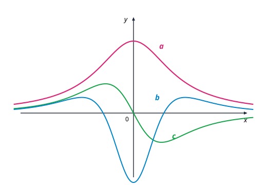

**Systematic Curve Identification:**

**5.** We examine the geometric relationships between horizontal tangent lines (critical points where derivative equals zero) and $x$-intercepts across the three curves:

**1. Curve $a$ as $f$**:
- Curve $a$ is symmetric, bell-shaped, and has a single horizontal tangent line at its peak at $x = 0$ ($a'(0) = 0$).
- Curve $c$ crosses the $x$-axis at $(0, 0)$, so $c(0) = 0$.
- On $(-\infty, 0)$, curve $a$ is strictly increasing, which requires a positive derivative. On this same interval, curve $c$ lies strictly above the $x$-axis ($c(x) > 0$).
- On $(0, \infty)$, curve $a$ is strictly decreasing, which requires a negative derivative. On this same interval, curve $c$ lies strictly below the $x$-axis ($c(x) < 0$).
- Therefore, curve $c$ is the derivative of curve $a$: $a' = c$.

**2. Curve $c$ as $f'$ and Curve $b$ as $f''$**:
- Now consider curve $c$. It attains a local maximum around $x \approx -0.7$ and a local minimum around $x \approx 0.7$, where its tangent lines are completely horizontal ($c' = 0$).
- At these exact same locations ($x \approx \pm 0.7$), curve $b$ crosses the $x$-axis ($b = 0$).
- On $(-0.7, 0.7)$, curve $c$ is strictly decreasing with its steepest descent at $x = 0$. On this same interval, curve $b$ is negative ($b < 0$), reaching its lowest point (deep valley) at $x = 0$.
- For $x < -0.7$ and $x > 0.7$, curve $c$ is increasing (sloping back toward the $x$-axis), and curve $b$ is positive ($b > 0$).
- Therefore, curve $b$ is the derivative of curve $c$: $c' = b$.

**Conclusion:**
- **$a = f$**
- **$c = f'$**
- **$b = f''$**

### 8.2 Exercise 6: Expressing Limits as Derivatives

**6.** Find a function $f$ and a number $a$ such that:
$$\lim_{h \to 0} \frac{(2 + h)^6 - 64}{h} = f'(a)$$

**Solution:**

Recall the fundamental definition of the derivative of a function $f$ at a number $a$:
$$f'(a) = \lim_{h \to 0} \frac{f(a + h) - f(a)}{h}$$

Comparing this general formula directly with the given limit:
$$\lim_{h \to 0} \frac{(2 + h)^6 - 64}{h}$$

we observe:
- **Base Point & Function Rule**: $f(a + h) = (2 + h)^6$, which reveals that the base evaluation point is $a = 2$ and the function rule is the power function $f(x) = x^6$.
- **Constant Check**: Evaluating $f$ at $a = 2$:
  $$f(2) = 2^6 = 64$$
  This matches the constant $-64$ in the numerator.

Therefore, the function is $f(x) = x^6$ and the number is $a = 2$.

*Verification*: Differentiating $f(x) = x^6$ with the Power Rule gives $f'(x) = 6x^5$. Evaluating at $a = 2$:
$$f'(2) = 6(2^5) = 6(32) = 192$$
Direct algebraic expansion confirms that the limit evaluates to $192$.

### 8.3 Exercise 7: Physical Rate of Change — Student Loan Repayment

**7.** The total cost of repaying a student loan at an interest rate of $r\%$ per year is $C = f(r)$.

(a) **What is the meaning of the derivative $f'(r)$? What are its units?**

*Meaning*: The derivative $f'(r) = \frac{dC}{dr}$ represents the instantaneous rate of change of the total repayment cost $C$ with respect to the annual interest rate $r$. In practical financial terms, $f'(r)$ approximates the additional total dollar cost that a borrower must repay if the interest rate increases by $1\%$.

*Units*: Cost $C$ is measured in dollars ($\$$) and the annual interest rate $r$ is measured in percentage points ($\%$) per year. Therefore, the units of the derivative $f'(r)$ are:
$$\text{dollars per percentage point of interest} \quad (\$/\%)$$

(b) **What does the statement $f'(10) = 1200$ mean?**

*Interpretation*: The statement $f'(10) = 1200$ means that when the annual interest rate is $10\%$ per year, the total repayment cost is increasing at an instantaneous rate of $\$1,200$ per $1\%$ increase in the interest rate.

In concrete financial terms, if the interest rate increases from $10\%$ to $11\%$ per year, the total cost required to repay the student loan will increase by approximately $\$1,200$.

(c) **Is $f'(r)$ always positive or does it change sign?**

*Analysis*: The derivative $f'(r)$ is **always positive** ($f'(r) > 0$ for all realistic $r$).

*Reasoning*: For any fixed loan principal balance and repayment amortization schedule, a higher annual interest rate increases the amount of interest that accrues during every billing cycle. As the interest rate $r$ increases, the total sum of money needed to repay the loan in full strictly increases. Because the total cost $C = f(r)$ is a strictly increasing function of $r$ on its entire domain, its rate of change (derivative) must always remain strictly positive. It never changes sign.

## 9. Maximum and Minimum Values

### 9.1 Fundamental Definitions of Extrema

The problem of locating maximum and minimum values of functions is central to optimization across mathematics, engineering, data science, and economics.

**Definition 1: Absolute Extrema**  
Let $c$ be a number in the domain $D$ of a function $f$. Then $f(c)$ is the:
- **absolute maximum** value of $f$ on $D$ if $f(c) \ge f(x)$ for all $x$ in $D$.
- **absolute minimum** value of $f$ on $D$ if $f(c) \le f(x)$ for all $x$ in $D$.

An absolute maximum or minimum is also called a *global maximum* or *global minimum*. The maximum and minimum values of $f$ are called the *extreme values* of $f$.

**Definition 2: Local Extrema**  
The number $f(c)$ is a:
- **local maximum** value of $f$ if $f(c) \ge f(x)$ when $x$ is near $c$ (that is, $f(c) \ge f(x)$ for all $x$ in some open interval containing $c$).
- **local minimum** value of $f$ if $f(c) \le f(x)$ when $x$ is near $c$ (that is, $f(c) \le f(x)$ for all $x$ in some open interval containing $c$).

### 9.2 The Extreme Value Theorem

An arbitrary function on an arbitrary domain is not guaranteed to possess maximum or minimum values. However, if the function is continuous and the domain is a closed, bounded interval, extreme values are guaranteed to exist.

**Theorem 3: The Extreme Value Theorem (EVT)**  
If $f$ is continuous on a closed interval $[a, b]$, then $f$ attains an absolute maximum value $f(c)$ and an absolute minimum value $f(d)$ at some numbers $c$ and $d$ in $[a, b]$.

*Key Requirements*: Both hypotheses are crucial:
- **Closed Interval**: The interval must be closed and bounded ($[a, b]$). If an interval is open, like $(0, 1)$, $f(x) = x$ has no maximum or minimum because the values approach $1$ and $0$ without ever reaching them.
- **Continuity**: The function must be continuous. If a function has a jump or vertical discontinuity on $[a, b]$, it may fail to achieve an extreme value.

### 9.3 Fermat's Theorem and Its Complete Proof

**Theorem 4: Fermat's Theorem**  
If $f$ has a local maximum or minimum at $c$, and if $f'(c)$ exists, then:
$$f'(c) = 0$$

**Complete Proof:**

Suppose, for the sake of definiteness, that $f$ has a local maximum at $c$. Then, according to Definition 2, $f(c) \ge f(x)$ if $x$ is sufficiently close to $c$.

This implies that if $h$ is sufficiently close to $0$, with $h$ being either positive or negative, then:
$$f(c) \ge f(c + h)$$
Subtracting $f(c)$ from both sides yields:
$$f(c + h) - f(c) \le 0$$

Now we consider the difference quotient $\frac{f(c + h) - f(c)}{h}$ under two cases depending on the sign of $h$:

**Case 1: $h > 0$**  
We can divide both sides of the inequality by the positive number $h$ without changing the direction of the inequality:
$$\frac{f(c + h) - f(c)}{h} \le 0$$
Taking the right-hand limit as $h \to 0^+$:
$$\lim_{h \to 0^+} \frac{f(c + h) - f(c)}{h} \le \lim_{h \to 0^+} 0 = 0$$
Because $f'(c)$ exists by hypothesis, the two-sided limit exists and equals both one-sided limits:
$$f'(c) = \lim_{h \to 0} \frac{f(c + h) - f(c)}{h} = \lim_{h \to 0^+} \frac{f(c + h) - f(c)}{h} \le 0$$
Thus, we have established that $f'(c) \le 0$.

**Case 2: $h < 0$**  
If $h < 0$, dividing by the negative number $h$ reverses the direction of the inequality:
$$\frac{f(c + h) - f(c)}{h} \ge 0$$
Taking the left-hand limit as $h \to 0^-$:
$$f'(c) = \lim_{h \to 0} \frac{f(c + h) - f(c)}{h} = \lim_{h \to 0^-} \frac{f(c + h) - f(c)}{h} \ge 0$$
Thus, we have established that $f'(c) \ge 0$.

**Conclusion:**  
We have proven both $f'(c) \le 0$ and $f'(c) \ge 0$. Since both inequalities must hold simultaneously, the only possibility is:
$$f'(c) = 0$$

The case where $f$ has a local minimum at $c$ follows identically by reversing the inequalities, or by applying the local maximum result to $-f$. This completes the proof of Fermat's Theorem.

### 9.4 Cautions: Converse Fails and Non-Differentiable Extrema

Fermat's Theorem is a powerful conditional statement ($P \implies Q$), but its converse ($Q \implies P$) is false in general. We cannot locate extreme values simply by setting $f'(x) = 0$ and solving for $x$.

**Example 5: Horizontal Tangent Without an Extremum ($y = x^3$)**  
Let $f(x) = x^3$. Its derivative is $f'(x) = 3x^2$, so $f'(0) = 0$. However, $f$ has neither a local maximum nor a local minimum at $x = 0$. For $x > 0$, $x^3 > 0$, and for $x < 0$, $x^3 < 0$. The fact that $f'(0) = 0$ simply means that the curve $y = x^3$ has a horizontal tangent line at $(0, 0)$. Instead of turning around, the curve crosses its horizontal tangent at the inflection point $(0, 0)$.

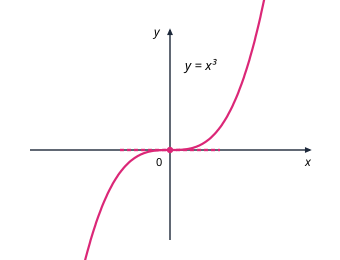

**Example 6: Extremum Without Differentiability ($y = |x|$)**  
The function $f(x) = |x|$ has its local and absolute minimum value at $x = 0$ (since $|0| = 0 \le |x|$ for all $x$). However, this minimum cannot be located by setting $f'(x) = 0$ because $f'(0)$ does not exist due to the sharp corner at the origin.

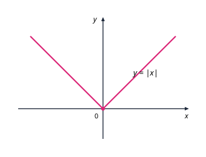

*Critical Takeaways*:
- Even when $f'(c) = 0$, there need not be an extremum at $c$ (the converse of Fermat's Theorem is false).
- A function can achieve an extreme value at a number $c$ where $f'(c)$ does not exist.

### 9.5 Critical Numbers and Rephrased Fermat's Theorem

Because extreme values can occur only where $f'(c) = 0$ or where $f'(c)$ fails to exist, these special points warrant a formal definition:

**Definition 6: Critical Number**  
A **critical number** of a function $f$ is a number $c$ in the domain of $f$ such that either:
$$f'(c) = 0 \quad \text{or} \quad f'(c) \text{ does not exist}$$

Using this concept, Fermat's Theorem can be stated concisely:

**Theorem 7**  
If $f$ has a local maximum or minimum at $c$, then $c$ is a critical number of $f$.

**Example 7: Finding Critical Numbers of a Radical Product**  
Find the critical numbers of $f(x) = x^{3/5}(4 - x)$.

**Solution:**  
Applying the Product Rule:
$$f'(x) = \frac{d}{dx}[x^{3/5}] \cdot (4 - x) + x^{3/5} \cdot \frac{d}{dx}[4 - x]$$
$$f'(x) = \left(\frac{3}{5}x^{-2/5}\right)(4 - x) + x^{3/5}(-1) = \frac{3(4 - x)}{5x^{2/5}} - x^{3/5}$$

Finding a common denominator ($5x^{2/5}$):
$$f'(x) = \frac{3(4 - x) - 5x^{2/5} \cdot x^{3/5}}{5x^{2/5}} = \frac{12 - 3x - 5x}{5x^{2/5}} = \frac{12 - 8x}{5x^{2/5}}$$

*(Alternative method: Expand before differentiating, $f(x) = 4x^{3/5} - x^{8/5}$, giving $f'(x) = \frac{12}{5}x^{-2/5} - \frac{8}{5}x^{3/5} = \frac{12 - 8x}{5x^{2/5}}$).*

Now find where $f'(x) = 0$ or does not exist:

**1.** $f'(x) = 0$ when the numerator equals zero:
$$12 - 8x = 0 \implies 8x = 12 \implies x = \frac{12}{8} = \frac{3}{2} = 1.5$$

**2.** $f'(x)$ does not exist when the denominator equals zero:
$$5x^{2/5} = 0 \implies x = 0$$
Because $0$ is in the domain of $f$ ($f(0) = 0$), $x = 0$ is a valid critical number.

Thus, the critical numbers of $f$ are $x = \frac{3}{2}$ and $x = 0$.

Figure 13 confirms that the curve has a vertical tangent at $x = 0$ and a horizontal tangent at the peak $x = 1.5$.

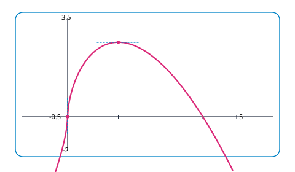

### 9.6 The Closed Interval Method

To find the absolute maximum and minimum values of a continuous function on a closed interval $[a, b]$, the Extreme Value Theorem guarantees that extrema exist. By Theorem 7, any local extremum in the interior $(a, b)$ must occur at a critical number. Otherwise, an extremum occurs at an endpoint ($a$ or $b$).

**The Closed Interval Method:**  
To find the absolute maximum and minimum values of a continuous function $f$ on a closed interval $[a, b]$:
1. Find the values of $f$ at the critical numbers of $f$ in the open interval $(a, b)$.
2. Find the values of $f$ at the endpoints of the interval: $f(a)$ and $f(b)$.
3. The largest of the values from Steps 1 and 2 is the **absolute maximum** value; the smallest of these values is the **absolute minimum** value.

**Example 8: Absolute Extrema on a Closed Interval**  
Find the absolute maximum and minimum values of the function:
$$f(x) = x^3 - 3x^2 + 1 \quad \text{on } \left[-\frac{1}{2}, 4\right]$$

**Solution:**  
Because $f$ is a polynomial, it is continuous everywhere, and we can apply the Closed Interval Method:

**Step 1**: Find critical numbers in the interior $\left(-\frac{1}{2}, 4\right)$. Differentiating:
$$f'(x) = 3x^2 - 6x = 3x(x - 2)$$
Since $f'(x)$ exists for all $x$, setting $f'(x) = 0$:
$$3x(x - 2) = 0 \implies x = 0 \quad \text{or} \quad x = 2$$
Both critical numbers lie inside the interval $\left(-\frac{1}{2}, 4\right)$. Evaluating $f$ at these critical numbers:
$$f(0) = (0)^3 - 3(0)^2 + 1 = 1$$
$$f(2) = (2)^3 - 3(2)^2 + 1 = 8 - 12 + 1 = -3$$

**Step 2**: Evaluate $f$ at the endpoints $x = -\frac{1}{2}$ and $x = 4$:
$$f\left(-\frac{1}{2}\right) = \left(-\frac{1}{2}\right)^3 - 3\left(-\frac{1}{2}\right)^2 + 1 = -\frac{1}{8} - \frac{3}{4} + 1 = -\frac{1}{8} - \frac{6}{8} + \frac{8}{8} = \frac{1}{8}$$
$$f(4) = (4)^3 - 3(4)^2 + 1 = 64 - 48 + 1 = 17$$

**Step 3**: Compare the four evaluated numbers:
$$f\left(-\frac{1}{2}\right) = \frac{1}{8}, \quad f(0) = 1, \quad f(2) = -3, \quad f(4) = 17$$

Comparing these values:
- The largest value is $17$, occurring at the right endpoint $x = 4$.
- The smallest value is $-3$, occurring at the critical number $x = 2$.

Therefore:
- **Absolute maximum value**: $f(4) = 17$
- **Absolute minimum value**: $f(2) = -3$

Notice that in this example, the absolute maximum occurs at an endpoint, whereas the absolute minimum occurs at an interior critical number.

![FIGURE: Graph of y = x³ - 3x² + 1 on [-1/2, 4]](figures/sec4_1_fig_ex8_closed_interval.svg)

## 10. Rolle's Theorem and the Mean Value Theorem

### 10.1 Rolle's Theorem

Rolle's Theorem states that a differentiable curve that starts and ends at the same height must have at least one horizontal tangent line between its endpoints.

**Rolle's Theorem**  
Let $f$ be a function that satisfies the following three hypotheses:
1. $f$ is continuous on the closed interval $[a, b]$.
2. $f$ is differentiable on the open interval $(a, b)$.
3. $f(a) = f(b)$

Then there is a number $c$ in $(a, b)$ such that:
$$f'(c) = 0$$

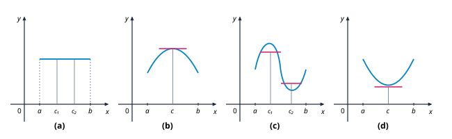

**Complete Proof of Rolle's Theorem:**

There are three cases to consider:

**Case I: $f(x) = k$, a constant for all $x \in [a, b]$**  
If $f$ is constant, then $f'(x) = 0$ for every $x$ in $(a, b)$. Thus, the number $c$ can be chosen to be *any* number in $(a, b)$ (as shown in Figure 1(a) with $c_1, c_2$).

**Case II: $f(x) > f(a)$ for some $x \in (a, b)$**  
By the Extreme Value Theorem (applicable because $f$ is continuous on the closed interval $[a, b]$), $f$ must attain an absolute maximum value somewhere in $[a, b]$. Because $f(x) > f(a)$ for some interior $x$, and $f(a) = f(b)$, the maximum value cannot occur at either endpoint $a$ or $b$. Therefore, $f$ must attain its maximum value at some number $c$ in the open interval $(a, b)$.

Because $c \in (a, b)$, $f$ has a local maximum at $c$. By hypothesis 2, $f$ is differentiable on $(a, b)$, so $f'(c)$ exists. Applying Fermat's Theorem (Theorem 4), we conclude that:
$$f'(c) = 0$$
(This case is illustrated in Figure 1(b) and Figure 1(c)).

**Case III: $f(x) < f(a)$ for some $x \in (a, b)$**  
By the Extreme Value Theorem, $f$ must attain an absolute minimum value somewhere in $[a, b]$. Because $f(x) < f(a)$ for some interior point, and $f(a) = f(b)$, the minimum value cannot occur at $a$ or $b$. Hence, $f$ must attain its minimum value at some number $c$ in the open interval $(a, b)$.

At this interior number $c$, $f$ has a local minimum, and $f'(c)$ exists by hypothesis 2. By Fermat's Theorem, it follows that:
$$f'(c) = 0$$
(This case is illustrated in Figure 1(c) and Figure 1(d)).

Having exhausted all possible cases, the proof of Rolle's Theorem is complete.

### 10.2 The Mean Value Theorem

The Mean Value Theorem (MVT) is one of the most fundamental theorems in calculus. It generalizes Rolle's Theorem by dropping the requirement that $f(a) = f(b)$.

**The Mean Value Theorem**  
Let $f$ be a function that satisfies the following two hypotheses:
1. $f$ is continuous on the closed interval $[a, b]$.
2. $f$ is differentiable on the open interval $(a, b)$.

Then there is a number $c$ in $(a, b)$ such that:
$$f'(c) = \frac{f(b) - f(a)}{b - a}$$
or, equivalently,
$$f(b) - f(a) = f'(c)(b - a)$$

**Geometric Interpretation:**

The expression on the right-hand side represents the slope of the secant line passing through the points $A(a, f(a))$ and $B(b, f(b))$:
$$m_{AB} = \frac{f(b) - f(a)}{b - a}$$

Because $f'(c)$ is the slope of the tangent line to the curve at the point $(c, f(c))$, the Mean Value Theorem asserts that **there is at least one point $P(c, f(c))$ on the curve where the tangent line is parallel to the secant line $AB$**.

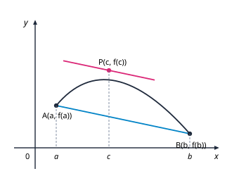

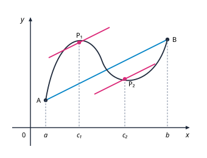

In Figure 3, a single point $P(c, f(c))$ has a tangent line parallel to the secant line $AB$. In Figure 4, an oscillating curve produces two distinct points $P_1(c_1, f(c_1))$ and $P_2(c_2, f(c_2))$ whose tangent lines are both parallel to the secant line $AB$.

### 10.3 Complete Proof of the Mean Value Theorem

**Proof:**

We prove the Mean Value Theorem by applying Rolle's Theorem to an auxiliary function $h(x)$ defined as the vertical difference between the curve $y = f(x)$ and the secant line $AB$.

Using the point-slope form, the equation of the secant line passing through $A(a, f(a))$ with slope $\frac{f(b) - f(a)}{b - a}$ is:
$$y - f(a) = \frac{f(b) - f(a)}{b - a}(x - a) \iff y = f(a) + \frac{f(b) - f(a)}{b - a}(x - a)$$

As illustrated in Figure 5, we define $h(x)$ to be the vertical distance from the secant line to the curve:
$$h(x) = f(x) - f(a) - \frac{f(b) - f(a)}{b - a}(x - a)$$

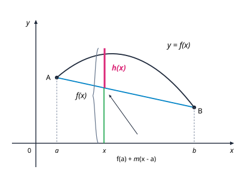

Now we verify that $h(x)$ satisfies the three hypotheses of Rolle's Theorem on $[a, b]$:

**1. Continuity**: The function $h$ is the sum of $f$ and a first-degree linear polynomial. Since $f$ is continuous on $[a, b]$ by hypothesis, and all polynomials are continuous everywhere, $h$ is continuous on $[a, b]$.

**2. Differentiability**: The function $h$ is differentiable on $(a, b)$ because both $f$ and linear polynomials are differentiable. Computing the derivative $h'(x)$ directly (noting that $f(a)$ and $\frac{f(b) - f(a)}{b - a}$ are constants):
$$h'(x) = f'(x) - \frac{f(b) - f(a)}{b - a}$$

**3. Equal Endpoint Values**: Evaluating $h$ at the endpoints:
$$h(a) = f(a) - f(a) - \frac{f(b) - f(a)}{b - a}(a - a) = 0 - 0 = 0$$
$$h(b) = f(b) - f(a) - \frac{f(b) - f(a)}{b - a}(b - a) = f(b) - f(a) - [f(b) - f(a)] = 0$$
Therefore, $h(a) = h(b) = 0$.

Because $h$ satisfies all three hypotheses of Rolle's Theorem, there exists a number $c$ in $(a, b)$ such that $h'(c) = 0$.

Substituting $c$ into the derivative formula for $h'$:
$$0 = h'(c) = f'(c) - \frac{f(b) - f(a)}{b - a}$$
Adding $\frac{f(b) - f(a)}{b - a}$ to both sides yields:
$$f'(c) = \frac{f(b) - f(a)}{b - a}$$

This completes the proof of the Mean Value Theorem.

### 10.4 Example 3: Finding the Tangent Parallel to the Secant Line

To illustrate the Mean Value Theorem with a specific polynomial function:

Let $f(x) = x^3 - x$ on the interval $[0, 2]$ ($a = 0, b = 2$).

**Solution:**

Because $f$ is a polynomial, it is continuous everywhere on $[0, 2]$ and differentiable on $(0, 2)$. Therefore, by the Mean Value Theorem, there exists a number $c$ in $(0, 2)$ such that:
$$f(2) - f(0) = f'(c)(2 - 0)$$

We compute the endpoint values:
$$f(0) = 0^3 - 0 = 0$$
$$f(2) = 2^3 - 2 = 8 - 2 = 6$$

The slope of the secant line connecting $O(0, 0)$ to $B(2, 6)$ is:
$$\frac{f(2) - f(0)}{2 - 0} = \frac{6 - 0}{2} = 3$$

Differentiating $f(x) = x^3 - x$ yields:
$$f'(x) = 3x^2 - 1$$

Setting $f'(c)$ equal to the secant slope $3$:
$$3c^2 - 1 = 3 \implies 3c^2 = 4 \implies c^2 = \frac{4}{3}$$
Taking the square root:
$$c = \pm \frac{2}{\sqrt{3}}$$

Because $c$ must lie strictly in the open interval $(0, 2)$, we discard the negative root and retain:
$$c = \frac{2}{\sqrt{3}} \approx 1.155$$

Figure 6 illustrates this calculation: at $c = \frac{2}{\sqrt{3}}$, the tangent line to $y = x^3 - x$ has slope $3$, exactly parallel to the secant line $OB$.

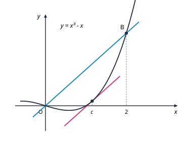
