# Calculus Topics & Exercises: Optimization Problems, Economic Models, and Antiderivatives

Source material: Stewart *Calculus: Early Transcendentals* (Section 3.7: Optimization Problems & Applications to Business and Economics; Section 3.9: Antiderivatives).

## 1. Applied Optimization Problems

The differential calculus methods developed for locating local and absolute extrema have immediate practical significance across the physical sciences, engineering, and commerce:
- A business enterprise seeks to minimize production costs and maximize total profit.
- A traveler or logistics network aims to minimize transportation time or fuel expenditure.
- **Fermat's Principle** in optics dictates that a ray of light traveling between two points follows the path requiring the least time.

In applied optimization, the primary challenge is translating a verbal description into a formal mathematical model by establishing an objective function subject to geometric or physical constraints.

### 1.1 The Six-Step Strategy for Solving Optimization Problems

To systematically formulate and solve applied optimization problems, use the following structured procedure:

**1. Understand the Problem**  
Read the problem carefully until the underlying scenario is clear. Identify:
- The **unknown** quantity to be determined.
- The **given quantities** and constants.
- The **given conditions** or limitations.

**2. Draw a Diagram**  
In geometric and physical problems, sketch a clear visual diagram and identify all known dimensions, fixed constraints, and unknown variables.

**3. Introduce Notation**  
Assign a specific symbol to the primary quantity to be maximized or minimized (such as $Q$, $A$ for area, $V$ for volume, $C$ for cost, or $P$ for profit). Assign distinct symbols (such as $x, y, r, h, \theta$) to all other unknown dimensions and label the diagram accordingly.

**4. Formulate the Objective Equation**  
Write an algebraic equation expressing the target quantity $Q$ in terms of the other symbols introduced in Step 3.

**5. Eliminate Extraneous Variables and State the Domain**  
If the objective equation contains more than one independent variable, use the problem's geometric or physical constraints (relationships among the variables) to eliminate all but one variable. Express $Q$ as a single-variable function:
$$Q = f(x)$$
Determine the practical physical domain of $f$, noting boundary restrictions (such as non-negative lengths or maximum allowable dimensions).

**6. Apply Calculus to Find Absolute Extrema**  
Compute the first derivative $f'(x)$ and locate all critical numbers within the domain.
- If the domain is a closed interval $[a, b]$, evaluate $f$ at all critical numbers and endpoints using the **Closed Interval Method**.
- If the domain is an open interval $(a, b)$, verify the nature of the critical point using the **First Derivative Test for Absolute Extreme Values** or the **Second Derivative Test** (checking concavity via $f''(x)$).

### 1.2 Example 1: Enclosing a Field Bordered by a Straight River

A farmer has $2400\text{ ft}$ of fencing and wishes to fence off a rectangular field that borders a straight river. No fencing is needed along the riverbank. What are the dimensions of the field that will enclose the largest possible area?

#### Exploratory Analysis of Special Cases

To understand the behavior of the area function under the perimeter constraint, we first test three candidate rectangular layouts using the full $2400\text{ ft}$ of fencing:

- **Case 1 (Shallow & Wide)**: Depth $x = 100\text{ ft}$, width along river $y = 2400 - 2(100) = 2200\text{ ft}$.  
  $$\text{Area } A = 100 \times 2200 = 220,000\text{ ft}^2$$
- **Case 2 (Intermediate)**: Depth $x = 700\text{ ft}$, width along river $y = 2400 - 2(700) = 1000\text{ ft}$.  
  $$\text{Area } A = 700 \times 1000 = 700,000\text{ ft}^2$$
- **Case 3 (Deep & Narrow)**: Depth $x = 1000\text{ ft}$, width along river $y = 2400 - 2(1000) = 400\text{ ft}$.  
  $$\text{Area } A = 1000 \times 400 = 400,000\text{ ft}^2$$

Extreme proportions (very shallow or very deep fields) yield relatively small areas. An intermediate configuration produces the global maximum.

#### Mathematical Formulation and Solution

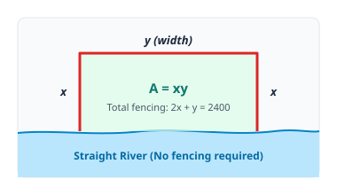

Let $x$ denote the depth of the field perpendicular to the riverbank, and let $y$ denote the width parallel to the riverbank (both measured in feet).

The objective is to maximize the enclosed rectangular area:
$$A = xy$$

The total length of fencing available is $2400\text{ ft}$. Since the riverbank requires no fencing, the perimeter constraint is:
$$2x + y = 2400$$

Solving for $y$ in terms of $x$:
$$y = 2400 - 2x$$

Substituting $y$ into the area equation yields a single-variable quadratic function:
$$A(x) = x(2400 - 2x) = 2400x - 2x^2$$

Because dimensions cannot be negative, $x \ge 0$. Furthermore, $y \ge 0 \implies 2400 - 2x \ge 0 \implies x \le 1200$. The physical domain is the closed interval:
$$0 \le x \le 1200$$

To find the critical numbers, compute the derivative of $A(x)$:
$$A'(x) = 2400 - 4x$$

Setting $A'(x) = 0$:
$$2400 - 4x = 0 \implies 4x = 2400 \implies x = 600\text{ ft}$$

We evaluate $A(x)$ at the critical number and at the interval endpoints using the Closed Interval Method:
- At $x = 0$: $A(0) = 2400(0) - 2(0)^2 = 0\text{ ft}^2$
- At $x = 600$: $A(600) = 2400(600) - 2(600)^2 = 1,440,000 - 720,000 = 720,000\text{ ft}^2$
- At $x = 1200$: $A(1200) = 2400(1200) - 2(1200)^2 = 2,880,000 - 2,880,000 = 0\text{ ft}^2$

*Alternative Concavity Verification*:
$$A''(x) = -4 < 0 \quad \text{for all } x$$
Because $A(x)$ is strictly concave downward everywhere, the local maximum at $x = 600$ is guaranteed to be the unique absolute maximum.

The corresponding field width is:
$$y = 2400 - 2(600) = 1200\text{ ft}$$

**Conclusion**: The rectangular field must be **$600\text{ ft}$ deep** and **$1200\text{ ft}$ wide**, enclosing a maximum area of **$720,000\text{ ft}^2$**.

## 2. Applications to Business and Economics

Calculus provides analytical criteria for optimizing operational metrics in commercial and industrial settings.

### 2.1 Foundational Economic Functions and Rates of Change

Let $x$ denote the number of units of a commodity produced and sold:

- **Cost Function $C(x)$**: The total expenditure incurred in manufacturing $x$ units.
- **Marginal Cost $C'(x)$**: The instantaneous rate of change of total cost with respect to production volume:
  $$\text{Marginal Cost} = \frac{dC}{dx} = C'(x)$$
- **Demand (or Price) Function $p(x)$**: The unit price that a company can charge when $x$ units are demanded by the market. Under normal economic conditions, demand is a decreasing function of quantity ($\frac{dp}{dx} \le 0$).
- **Total Revenue Function $R(x)$**: The gross income generated from selling $x$ units at unit price $p(x)$:
  $$R(x) = x \cdot p(x)$$
- **Marginal Revenue $R'(x)$**: The instantaneous rate of change of revenue with respect to sales volume:
  $$\text{Marginal Revenue} = \frac{dR}{dx} = R'(x)$$
- **Total Profit Function $P(x)$**: The net economic return after deducting production costs from gross revenue:
  $$P(x) = R(x) - C(x)$$
- **Marginal Profit $P'(x)$**: The derivative of the profit function:
  $$\text{Marginal Profit} = P'(x) = R'(x) - C'(x)$$
- **Average Cost Function $c(x)$**: The cost distributed per unit produced:
  $$c(x) = \frac{C(x)}{x}$$

### 2.2 Optimizing Profit and Average Cost

Two fundamental economic optimization principles follow directly from differentiation:

**1. Maximum Profit Condition**  
To find critical points of profit $P(x)$, set $P'(x) = 0$:
$$P'(x) = R'(x) - C'(x) = 0 \implies R'(x) = C'(x)$$
Profit is maximized at a production level where **marginal revenue equals marginal cost**, provided $P''(x) < 0$ ($R''(x) < C''(x)$).

**2. Minimum Average Cost Condition**  
Applying the Quotient Rule to average cost $c(x) = \frac{C(x)}{x}$:
$$c'(x) = \frac{x C'(x) - C(x) \cdot 1}{x^2}$$
Setting $c'(x) = 0$ yields:
$$x C'(x) - C(x) = 0 \implies C'(x) = \frac{C(x)}{x} = c(x)$$
Average cost is minimized at the production level where **marginal cost equals average cost**.

### 2.3 Example 6: Revenue Maximization via Price Rebates

A retailer has been selling $200$ Blu-ray disc players per week at $\$350$ each. A market research survey indicates that for every $\$10$ rebate offered to purchasers, sales volume will increase by $20$ units per week.
(a) Determine the demand function $p(x)$ and the revenue function $R(x)$.
(b) How large a rebate should the store offer to maximize total revenue?

#### Solution

Let $x$ represent the total number of players sold per week.
The weekly increase in units sold beyond baseline is:
$$\Delta x = x - 200$$

For each increase of $20$ units sold, the unit price decreases by $\$10$. Therefore, each single additional unit sold reduces the price by:
$$\frac{\$10}{20} = \$0.50 = \frac{1}{2}$$

The price/demand function is therefore linear:
$$p(x) = 350 - \frac{10}{20}(x - 200) = 350 - \frac{1}{2}(x - 200) = 350 - \frac{1}{2}x + 100 = 450 - \frac{1}{2}x$$

The total revenue function is:
$$R(x) = x \cdot p(x) = x\left(450 - \frac{1}{2}x\right) = 450x - \frac{1}{2}x^2$$

Differentiating $R(x)$ to locate the critical sales volume:
$$R'(x) = 450 - x$$

Setting $R'(x) = 0$:
$$450 - x = 0 \implies x = 450\text{ units}$$

Since $R''(x) = -1 < 0$ everywhere, the quadratic parabola opens downward, confirming that $x = 450$ provides the absolute maximum revenue.

The optimal unit selling price corresponding to $x = 450$ is:
$$p(450) = 450 - \frac{1}{2}(450) = 450 - 225 = \$225$$

The optimal cash rebate to offer buyers is the difference from the original $\$350$ retail price:
$$\text{Rebate} = 350 - 225 = \$125$$

The resulting maximum gross revenue is:
$$R(450) = 450(225) = \$101,250\text{ per week}$$

## 3. Section 3.7 Exercises & Detailed Solutions

### 3.1 Exercise 9: Agricultural Crop Yield Optimization

**9.** A mathematical model used for the yield $Y$ of an agricultural crop as a function of the nitrogen level $N$ in the soil (measured in appropriate agronomic units) is:
$$Y(N) = \frac{k N}{1 + N^2}$$
where $k$ is a strictly positive constant ($k > 0$). What nitrogen level produces the best yield?

#### Solution

We seek to maximize $Y(N)$ over the physical domain $N \ge 0$.
Applying the Quotient Rule to $Y(N)$:
$$Y'(N) = \frac{(1 + N^2) \frac{d}{dN}(kN) - (kN) \frac{d}{dN}(1 + N^2)}{(1 + N^2)^2} = \frac{k(1 + N^2) - kN(2N)}{(1 + N^2)^2} = \frac{k + kN^2 - 2kN^2}{(1 + N^2)^2} = \frac{k(1 - N^2)}{(1 + N^2)^2}$$

Factoring the numerator:
$$Y'(N) = \frac{k(1 - N)(1 + N)}{(1 + N^2)^2}$$

Setting $Y'(N) = 0$ for $N \ge 0$:
$$1 - N^2 = 0 \implies N = 1 \quad (\text{since } N \ge 0)$$

We determine the sign of $Y'(N)$ around $N = 1$:
- For $0 \le N < 1$: $1 - N^2 > 0 \implies Y'(N) > 0$ (yield is increasing).
- For $N > 1$: $1 - N^2 < 0 \implies Y'(N) < 0$ (yield is decreasing due to excessive soil nitrogen toxicity).

By the First Derivative Test for Absolute Extrema, **$N = 1$** produces the absolute maximum crop yield, which equals:
$$Y(1) = \frac{k(1)}{1 + 1^2} = \frac{k}{2}$$

### 3.2 Exercise 11: Dividing a Pasture into Four Equal Pens

**11.** A farmer with $750\text{ ft}$ of fencing wants to enclose a rectangular area and then divide it into four pens with fencing parallel to one side of the rectangle. What is the largest possible total area of the four pens?
(a) Draw several diagrams illustrating the situation, some with shallow, wide pens and some with deep, narrow pens. Find the total areas of these configurations. Does it appear that there is a maximum area? If so, estimate it.
(b) Draw a diagram illustrating the general situation. Introduce notation and label the diagram with your symbols.
(c) Write an expression for the total area.
(d) Use the given information to write an equation that relates the variables.
(e) Use part (d) to write the total area as a function of one variable.
(f) Finish solving the problem and compare the answer with your estimate in part (a).

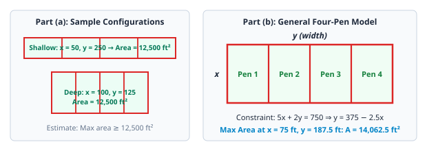

#### Solution

**11.** (a) **Sample Configurations**:
Let $x$ be the length of the five parallel divider fences (the depth), and $y$ be the overall width across the four pens. The fencing constraint requires $5x + 2y = 750$.
- *Configuration 1 (Shallow & Wide)*: Choose $x = 50\text{ ft}$.  
  $$2y = 750 - 5(50) = 500 \implies y = 250\text{ ft}$$  
  $$\text{Area } A = xy = 50 \times 250 = 12,500\text{ ft}^2$$
- *Configuration 2 (Deep & Narrow)*: Choose $x = 100\text{ ft}$.  
  $$2y = 750 - 5(100) = 250 \implies y = 125\text{ ft}$$  
  $$\text{Area } A = xy = 100 \times 125 = 12,500\text{ ft}^2$$
- *Configuration 3 (Very Narrow)*: Choose $x = 120\text{ ft}$.  
  $$2y = 750 - 5(120) = 150 \implies y = 75\text{ ft}$$  
  $$\text{Area } A = 120 \times 75 = 9,000\text{ ft}^2$$

*Estimate*: The area rises from $0$, achieves at least $12,500\text{ ft}^2$ between $x = 50$ and $x = 100$, and declines toward $0$. We estimate the maximum area to be approximately $13,000$ to $14,000\text{ ft}^2$.

(b) **General Diagram & Notation**:  
Let $x$ denote the length of each of the two outer side boundaries and three internal dividing fences (total of $5$ fence segments of length $x$). Let $y$ denote the total length of the two horizontal boundaries (total of $2$ fence segments of length $y$).

(c) **Expression for Total Area**:  
$$\text{Area } A = x \cdot y$$

(d) **Equation Relating Variables**:  
$$\text{Total fencing} = 5x + 2y = 750$$

(e) **Area as a Function of One Variable**:  
Solving the constraint for $y$:
$$2y = 750 - 5x \implies y = 375 - \frac{5}{2}x$$
Substituting into $A = xy$:
$$A(x) = x\left(375 - \frac{5}{2}x\right) = 375x - \frac{5}{2}x^2$$
Physical domain: Since $x \ge 0$ and $y \ge 0 \implies 375 - 2.5x \ge 0$, we have $0 \le x \le 150$.

(f) **Optimal Solution**:  
Differentiating $A(x)$:
$$A'(x) = 375 - 5x$$
Setting $A'(x) = 0$:
$$375 - 5x = 0 \implies 5x = 375 \implies x = 75\text{ ft}$$

Checking concavity:
$$A''(x) = -5 < 0$$
Since $A''(x) < 0$ for all $x$, $x = 75\text{ ft}$ provides an absolute maximum.

The corresponding optimal width is:
$$y = 375 - \frac{5}{2}(75) = 375 - 187.5 = 187.5\text{ ft}$$

The maximum possible total area is:
$$A(75) = 75 \times 187.5 = 14,062.5\text{ ft}^2$$

*Comparison*: The exact optimal value $x = 75\text{ ft}$ lies directly midway between our two exploratory test cases $x = 50$ and $x = 100$. The resulting maximum area of $14,062.5\text{ ft}^2$ exceeds our initial conservative estimate of $12,500\text{ ft}^2$.

### 3.3 Exercise 35: Optimizing Enclosed Area for Cut Wire

**35.** A piece of wire $10\text{ m}$ long is cut into two pieces. One piece is bent into a square and the other is bent into an equilateral triangle. How should the wire be cut so that the total area enclosed is:
(a) a maximum?
(b) a minimum?

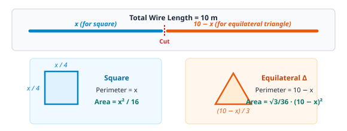

#### Solution

Let $x$ denote the length of wire allocated to the square, where $0 \le x \le 10$.
The remaining wire length allocated to the equilateral triangle is $10 - x$.

- **Square Geometry**:
  Perimeter $= x \implies \text{side length } s = \frac{x}{4}$.
  $$\text{Area of square } A_{\text{sq}} = s^2 = \left(\frac{x}{4}\right)^2 = \frac{x^2}{16}$$

- **Equilateral Triangle Geometry**:
  Perimeter $= 10 - x \implies \text{side length } t = \frac{10 - x}{3}$.  
  An equilateral triangle of side $t$ has altitude $h = t \sin 60^\circ = \frac{\sqrt{3}}{2}t$.  
  $$\text{Area of triangle } A_{\text{tri}} = \frac{1}{2} t h = \frac{1}{2} t \left(\frac{\sqrt{3}}{2}t\right) = \frac{\sqrt{3}}{4}t^2 = \frac{\sqrt{3}}{4}\left(\frac{10 - x}{3}\right)^2 = \frac{\sqrt{3}}{36}(10 - x)^2$$

- **Total Combined Area**:
  $$A(x) = \frac{1}{16}x^2 + \frac{\sqrt{3}}{36}(10 - x)^2, \quad 0 \le x \le 10$$

Differentiating $A(x)$ with respect to $x$:
$$A'(x) = \frac{2}{16}x + \frac{\sqrt{3}}{36} \cdot 2(10 - x)(-1) = \frac{1}{8}x - \frac{\sqrt{3}}{18}(10 - x)$$

Setting $A'(x) = 0$ to find critical numbers:
$$\frac{x}{8} + \frac{\sqrt{3}}{18}x = \frac{10\sqrt{3}}{18}$$
Multiplying by $72$ (the least common multiple of $8$ and $18$):
$$9x + 4\sqrt{3}x = 40\sqrt{3} \implies x(9 + 4\sqrt{3}) = 40\sqrt{3}$$
$$x = \frac{40\sqrt{3}}{9 + 4\sqrt{3}} \approx \frac{69.282}{15.928} \approx 4.35\text{ m}$$

We test the objective function $A(x)$ on the closed interval $[0, 10]$:
- **At $x = 0$** (all wire used for the equilateral triangle):
  $$A(0) = \frac{\sqrt{3}}{36}(10)^2 = \frac{100\sqrt{3}}{36} = \frac{25\sqrt{3}}{9} \approx 4.81\text{ m}^2$$
- **At $x = 10$** (all wire used for the square):
  $$A(10) = \frac{1}{16}(10)^2 = \frac{100}{16} = 6.25\text{ m}^2$$
- **At critical point $x \approx 4.35\text{ m}$**:
  $$A(4.35) = \frac{(4.35)^2}{16} + \frac{\sqrt{3}}{36}(10 - 4.35)^2 \approx 1.183 + 1.536 \approx 2.72\text{ m}^2$$

**Conclusions**:
(a) **Maximum Area**: The wire should **not be cut at all**; all $10\text{ m}$ should be used to form the **square** ($x = 10\text{ m}$), giving maximum area $6.25\text{ m}^2$.  
(b) **Minimum Area**: The wire should be cut so that **$\frac{40\sqrt{3}}{9 + 4\sqrt{3}} \approx 4.35\text{ m}$** is used for the square and **$\approx 5.65\text{ m}$** is used for the equilateral triangle, yielding minimum combined area $\approx 2.72\text{ m}^2$.

### 3.4 Exercise 56: Minimum Area of Triangle Tangent to Parabola

**56.** What is the smallest possible area of the triangle that is cut off by the first quadrant and whose hypotenuse is tangent to the parabola $y = 4 - x^2$ at some point?

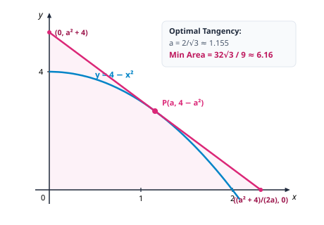

#### Solution

Let $P(a, 4 - a^2)$ be the point of tangency in the first quadrant, where $0 < a < 2$.
The slope of the tangent line to $y = 4 - x^2$ at $x = a$ is:
$$\frac{dy}{dx}\Bigg|_{x=a} = -2a$$

The point-slope equation of the tangent line is:
$$y - (4 - a^2) = -2a(x - a) \implies y = -2ax + 2a^2 + 4 - a^2 \implies y = -2ax + a^2 + 4$$

We find the intercepts of this line with the coordinate axes:
- **$y$-intercept** (set $x = 0$):
  $$y_0 = a^2 + 4$$
- **$x$-intercept** (set $y = 0$):
  $$0 = -2ax + a^2 + 4 \implies 2ax = a^2 + 4 \implies x_0 = \frac{a^2 + 4}{2a}$$

The area of the right triangle formed by the axes and this tangent line in the first quadrant is:
$$A(a) = \frac{1}{2}(\text{base})(\text{height}) = \frac{1}{2} x_0 y_0 = \frac{1}{2} \left(\frac{a^2 + 4}{2a}\right)(a^2 + 4) = \frac{(a^2 + 4)^2}{4a}$$

Expanding the numerator:
$$A(a) = \frac{a^4 + 8a^2 + 16}{4a} = \frac{1}{4}\left(a^3 + 8a + \frac{16}{a}\right)$$

Differentiating with respect to $a$:
$$A'(a) = \frac{1}{4}\left(3a^2 + 8 - \frac{16}{a^2}\right)$$

Setting $A'(a) = 0$:
$$3a^2 + 8 - \frac{16}{a^2} = 0 \implies 3a^4 + 8a^2 - 16 = 0$$
Factoring as a quadratic in $a^2$:
$$(3a^2 - 4)(a^2 + 4) = 0$$
Since $a^2 + 4 > 0$ for all real $a$, we must have:
$$3a^2 - 4 = 0 \implies a^2 = \frac{4}{3} \implies a = \frac{2}{\sqrt{3}} \approx 1.155$$

Checking the second derivative:
$$A''(a) = \frac{1}{4}\left(6a + \frac{32}{a^3}\right) > 0 \quad \text{for all } a > 0$$
Thus, $A(a)$ is strictly concave upward on $(0, 2)$, ensuring that $a = \frac{2}{\sqrt{3}}$ is the absolute minimum.

Calculating the minimum triangle area:
$$a^2 + 4 = \frac{4}{3} + 4 = \frac{16}{3}$$
$$A\left(\frac{2}{\sqrt{3}}\right) = \frac{\left(\frac{16}{3}\right)^2}{4\left(\frac{2}{\sqrt{3}}\right)} = \frac{\frac{256}{9}}{\frac{8}{\sqrt{3}}} = \frac{256}{9} \times \frac{\sqrt{3}}{8} = \frac{32\sqrt{3}}{9} \approx 6.16$$

**Conclusion**: The smallest possible area is **$\frac{32\sqrt{3}}{9} \approx 6.16$**.

### 3.5 Exercise 57: Average Cost vs. Marginal Cost

**57.** (a) If $C(x)$ is the cost of producing $x$ units of a commodity, then the average cost per unit is $c(x) = C(x)/x$. Show that if the average cost is a minimum, then the marginal cost equals the average cost.  
(b) If $C(x) = 16,000 + 200x + 4x^{3/2}$ (in dollars), find:  
(i) the cost, average cost, and marginal cost at a production level of $1000$ units;  
(ii) the production level that will minimize the average cost; and  
(iii) the minimum average cost.

#### Solution

**57.** (a) **Proof**:  
Average cost is defined as $c(x) = \frac{C(x)}{x}$. Differentiating using the Quotient Rule:
$$c'(x) = \frac{x C'(x) - C(x) \cdot 1}{x^2} = \frac{x C'(x) - C(x)}{x^2}$$
If the average cost achieves a local or absolute minimum at production level $x > 0$, then $c'(x) = 0$:
$$\frac{x C'(x) - C(x)}{x^2} = 0 \implies x C'(x) - C(x) = 0 \implies C'(x) = \frac{C(x)}{x}$$
Since $c(x) = \frac{C(x)}{x}$, this proves directly that:
$$C'(x) = c(x)$$
*Marginal cost equals average cost at the production level that minimizes average cost.*

(b) **Calculations for $C(x) = 16,000 + 200x + 4x^{3/2}$**:

**(i) Metrics at $x = 1000$ units**:
- **Total Cost**:
  $$C(1000) = 16,000 + 200(1000) + 4(1000)^{3/2} = 16,000 + 200,000 + 4(1000\sqrt{1000}) = 216,000 + 40,000\sqrt{10}$$
  $$C(1000) \approx 216,000 + 126,491.11 = \$342,491.11$$
- **Average Cost**:
  $$c(1000) = \frac{C(1000)}{1000} \approx \frac{342,491.11}{1000} \approx \$342.49\text{ per unit}$$
- **Marginal Cost**:
  $$C'(x) = \frac{d}{dx}\left(16,000 + 200x + 4x^{3/2}\right) = 200 + 4\left(\frac{3}{2}x^{1/2}\right) = 200 + 6\sqrt{x}$$
  $$C'(1000) = 200 + 6\sqrt{1000} = 200 + 60\sqrt{10} \approx 200 + 189.74 = \$389.74\text{ per unit}$$

**(ii) Production level minimizing average cost**:  
Using the theorem from part (a), equate marginal cost to average cost:
$$C'(x) = c(x) \implies 200 + 6\sqrt{x} = \frac{16,000}{x} + 200 + 4\sqrt{x}$$
Subtracting $200 + 4\sqrt{x}$ from both sides:
$$2\sqrt{x} = \frac{16,000}{x} \implies 2x^{3/2} = 16,000 \implies x^{3/2} = 8,000$$
Raising both sides to the power $\frac{2}{3}$:
$$x = (8,000)^{2/3} = \left(\sqrt[3]{8000}\right)^2 = (20)^2 = 400\text{ units}$$

*First Derivative Sign Check*:
$$c'(x) = \frac{2\sqrt{x} - 16,000/x}{x} = \frac{2(x^{3/2} - 8000)}{x^2}$$
For $x < 400$, $c'(x) < 0$; for $x > 400$, $c'(x) > 0$. Thus, $x = 400$ is the unique absolute minimum.

**(iii) Minimum average cost**:
$$c(400) = \frac{16,000}{400} + 200 + 4\sqrt{400} = 40 + 200 + 4(20) = 40 + 200 + 80 = \$320\text{ per unit}$$
*(Check: $C'(400) = 200 + 6\sqrt{400} = 200 + 120 = \$320$, confirming $C'(400) = c(400)$.*

### 3.6 Exercise 58: Maximum Profit Criterion and Numerical Model

**58.** (a) Show that if the profit $P(x)$ is a maximum, then the marginal revenue equals the marginal cost.  
(b) If $C(x) = 16,000 + 500x - 1.6x^2 + 0.004x^3$ is the cost function and $p(x) = 1700 - 7x$ is the demand function, find the production level that will maximize profit.

#### Solution

**58.** (a) **Proof**:  
Profit is defined as gross revenue minus total cost:
$$P(x) = R(x) - C(x)$$
Differentiating with respect to production volume $x$:
$$P'(x) = R'(x) - C'(x)$$
At any interior production volume where profit is maximized, $P'(x) = 0$:
$$R'(x) - C'(x) = 0 \implies R'(x) = C'(x)$$
Thus, maximum profit requires that **marginal revenue equals marginal cost**.

(b) **Numerical Solution**:  
The revenue function is:
$$R(x) = x \cdot p(x) = x(1700 - 7x) = 1700x - 7x^2$$
Marginal revenue is:
$$R'(x) = 1700 - 14x$$

The given cost function is $C(x) = 16,000 + 500x - 1.6x^2 + 0.004x^3$.  
Marginal cost is:
$$C'(x) = 500 - 3.2x + 0.012x^2$$

Equating $R'(x) = C'(x)$:
$$1700 - 14x = 500 - 3.2x + 0.012x^2$$
Rearranging into standard quadratic form:
$$0.012x^2 + (14 - 3.2)x - (1700 - 500) = 0$$
$$0.012x^2 + 10.8x - 1200 = 0$$

Dividing the entire equation by $0.012$:
$$x^2 + \frac{10.8}{0.012}x - \frac{1200}{0.012} = 0$$
$$x^2 + 900x - 100,000 = 0$$

Factoring the quadratic equation:
$$(x + 1000)(x - 100) = 0$$
Since production level must be positive ($x > 0$), we reject $x = -1000$, leaving:
$$x = 100\text{ units}$$

To verify this critical number maximizes profit, inspect the second derivatives:
$$R''(x) = -14$$
$$C''(x) = -3.2 + 0.024x \implies C''(100) = -3.2 + 2.4 = -0.8$$
$$P''(100) = R''(100) - C''(100) = -14 - (-0.8) = -13.2 < 0$$
Because $P''(100) < 0$, profit is strictly concave downward, confirming that **$x = 100\text{ units}$** maximizes profit.

### 3.7 Exercise 59: Baseball Stadium Ticket Pricing

**59.** A baseball team plays in a stadium that holds $55,000$ spectators. With ticket prices at $\$10$, the average attendance had been $27,000$. When ticket prices were lowered to $\$8$, the average attendance rose to $33,000$.  
(a) Find the demand function, assuming that it is linear.  
(b) How should ticket prices be set to maximize revenue?

#### Solution

**59.** (a) **Finding the Demand Function**:  
Let $x$ denote attendance (quantity of tickets demanded) and $p(x)$ denote ticket price.
We are given two coordinate pairs $(x_1, p_1) = (27,000, 10)$ and $(x_2, p_2) = (33,000, 8)$.

The slope of the linear demand curve is:
$$m = \frac{p_2 - p_1}{x_2 - x_1} = \frac{8 - 10}{33,000 - 27,000} = \frac{-2}{6,000} = -\frac{1}{3000}$$

Using point-slope form with $(27,000, 10)$:
$$p - 10 = -\frac{1}{3000}(x - 27,000)$$
$$p(x) = 10 - \frac{x}{3000} + \frac{27,000}{3000} = 10 - \frac{x}{3000} + 9 = 19 - \frac{x}{3000}$$
The linear demand function is **$p(x) = 19 - \frac{x}{3000}$**.

(b) **Maximizing Revenue**:  
Total revenue is attendance times ticket price:
$$R(x) = x \cdot p(x) = x\left(19 - \frac{x}{3000}\right) = 19x - \frac{x^2}{3000}$$

Differentiating $R(x)$ to find the critical attendance:
$$R'(x) = 19 - \frac{2x}{3000} = 19 - \frac{x}{1500}$$

Setting $R'(x) = 0$:
$$19 - \frac{x}{1500} = 0 \implies x = 19 \times 1500 = 28,500\text{ spectators}$$

Second derivative test:
$$R''(x) = -\frac{1}{1500} < 0$$
Since $R''(x) < 0$, $x = 28,500$ yields the absolute maximum revenue.
Notice that $28,500$ is well within the stadium capacity of $55,000$.

The optimal ticket price is:
$$p(28,500) = 19 - \frac{28,500}{3000} = 19 - 9.50 = \$9.50$$

**Conclusion**: Ticket prices should be set at **$\$9.50$**, generating maximum revenue of $28,500 \times \$9.50 = \mathbf{\$270,750}$.

## 4. Antiderivatives

In earlier chapters, we analyzed the problem of finding the derivative $f'$ of a given function $f$. In countless physical and mathematical contexts, the reverse process is required:
- A physicist who measures the variable velocity $v(t)$ of an object wants to reconstruct its position function $s(t)$.
- An environmental engineer who monitors the variable rate $\frac{dV}{dt}$ at which fluid leaks from a reservoir wishes to determine the total volume lost over an elapsed time.
- A biologist who models the growth rate $\frac{dP}{dt}$ of an organism colony aims to predict future population size.

### 4.1 Formal Definition and Theorem 1

**Definition of an Antiderivative**:  
A function $F$ is called an **antiderivative** of $f$ on an interval $I$ if:
$$F'(x) = f(x) \quad \text{for all } x \in I$$

For example, consider $f(x) = x^2$. Recalling the Power Rule for differentiation, $F(x) = \frac{1}{3}x^3$ satisfies $F'(x) = x^2 = f(x)$. However, $G(x) = \frac{1}{3}x^3 + 100$ and $H(x) = \frac{1}{3}x^3 - \pi$ also satisfy $G'(x) = x^2$ and $H'(x) = x^2$. In fact, any function of the form:
$$F(x) = \frac{1}{3}x^3 + C$$
where $C$ is an arbitrary constant, is an antiderivative of $f(x) = x^2$.

**Theorem 1: The General Antiderivative**:  
If $F$ is an antiderivative of $f$ on an interval $I$, then the **most general antiderivative** of $f$ on $I$ is:
$$F(x) + C$$
where $C$ is an arbitrary constant.

*Proof*: If $F$ and $G$ are both antiderivatives of $f$ on interval $I$, then $F'(x) = f(x)$ and $G'(x) = f(x)$ for all $x \in I$. By the Mean Value Theorem (specifically, Corollary 3.2.7), any two functions with identical derivatives throughout an interval must differ by a constant:
$$\frac{d}{dx}[G(x) - F(x)] = G'(x) - F'(x) = f(x) - f(x) = 0 \implies G(x) - F(x) = C$$
Hence, $G(x) = F(x) + C$. $\blacksquare$

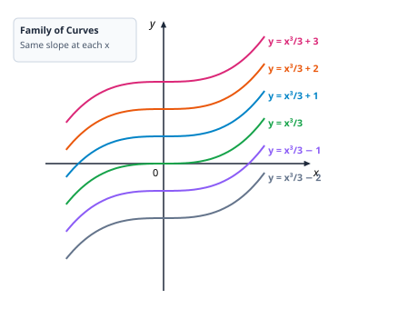

Geometrically, the graphs of the family of antiderivatives $y = \frac{1}{3}x^3 + C$ are vertical translations of one another. At any given value of $x$, every curve in the family has the identical tangent slope $f(x) = x^2$.

### 4.2 Standard Antidifferentiation Formulas

Reading standard differentiation rules in reverse yields the fundamental table of antiderivatives:

| Function $f(x)$ | Particular Antiderivative $F(x)$ | Differentiation Identity |
| :--- | :--- | :--- |
| $c \cdot f(x)$ | $c \cdot F(x)$ | $\frac{d}{dx}[c F(x)] = c F'(x) = c f(x)$ |
| $f(x) + g(x)$ | $F(x) + G(x)$ | $\frac{d}{dx}[F(x) + G(x)] = F'(x) + G'(x) = f(x) + g(x)$ |
| $x^n$ ($n \ne -1$) | $\frac{x^{n+1}}{n+1}$ | $\frac{d}{dx}\left[\frac{x^{n+1}}{n+1}\right] = \frac{(n+1)x^n}{n+1} = x^n$ |
| $\cos x$ | $\sin x$ | $\frac{d}{dx}[\sin x] = \cos x$ |
| $\sin x$ | $-\cos x$ | $\frac{d}{dx}[-\cos x] = -(-\sin x) = \sin x$ |
| $\sec^2 x$ | $\tan x$ | $\frac{d}{dx}[\tan x] = \sec^2 x$ |
| $\sec x \tan x$ | $\sec x$ | $\frac{d}{dx}[\sec x] = \sec x \tan x$ |

To obtain the most general antiderivative from this table, add an arbitrary constant $C$ (or piecewise constants on disconnected domains).

### 4.3 Worked Examples

#### Example 1: Finding General Antiderivatives

Find the most general antiderivative of each function:
(a) $f(x) = \sin x$
(b) $f(x) = x^n$, $n \ge 0$
(c) $f(x) = x^{-3}$

**Solution**:
(a) Since $\frac{d}{dx}(-\cos x) = \sin x$, the general antiderivative is:
$$F(x) = -\cos x + C$$

(b) Applying the Power Rule for antidifferentiation:
$$F(x) = \frac{x^{n+1}}{n+1} + C$$
This is valid for all $n \ge 0$ because $f(x) = x^n$ is continuous on $(-\infty, \infty)$.

(c) Setting $n = -3$ in the Power Rule formula:
$$F(x) = \frac{x^{-3+1}}{-3+1} = \frac{x^{-2}}{-2} = -\frac{1}{2x^2}$$
Notice that $f(x) = x^{-3}$ is undefined at $x = 0$. Theorem 1 applies strictly to connected intervals. Because the domain of $f$ is $(-\infty, 0) \cup (0, \infty)$, the general antiderivative allows independent arbitrary constants on each branch:
$$F(x) = \begin{cases} -\frac{1}{2x^2} + C_1 & \text{if } x > 0 \\ -\frac{1}{2x^2} + C_2 & \text{if } x < 0 \end{cases}$$

#### Example 2: Algebraic Simplification Before Antidifferentiation

Find all functions $g(x)$ such that:
$$g'(x) = 4\sin x + \frac{2x^5 - \sqrt{x}}{x}$$

**Solution**:
First split the rational algebraic expression across the single denominator term $x$:
$$g'(x) = 4\sin x + \frac{2x^5}{x} - \frac{x^{1/2}}{x} = 4\sin x + 2x^4 - x^{-1/2}$$
Now apply the antidifferentiation formulas term by term:
$$g(x) = 4(-\cos x) + 2\left(\frac{x^5}{5}\right) - \frac{x^{1/2}}{1/2} + C = -4\cos x + \frac{2}{5}x^5 - 2\sqrt{x} + C$$

#### Example 3: First-Order Initial Value Problem

Find $f(x)$ if $f'(x) = x\sqrt{x}$ and $f(1) = 2$.

**Solution**:
Express $f'(x)$ as a rational power:
$$f'(x) = x \cdot x^{1/2} = x^{3/2}$$
The general antiderivative is:
$$f(x) = \frac{x^{3/2 + 1}}{\frac{3}{2} + 1} + C = \frac{x^{5/2}}{5/2} + C = \frac{2}{5}x^{5/2} + C$$
Apply the initial condition $f(1) = 2$ to determine $C$:
$$f(1) = \frac{2}{5}(1)^{5/2} + C = 2 \implies \frac{2}{5} + C = 2 \implies C = 2 - \frac{2}{5} = \frac{8}{5}$$
The unique particular solution is:
$$f(x) = \frac{2}{5}x^{5/2} + \frac{8}{5} = \frac{2x^{5/2} + 8}{5}$$

#### Example 4: Second-Order Initial Value Problem

Find $f(x)$ if $f''(x) = 12x^2 + 6x - 4$, with initial boundary values $f(0) = 4$ and $f(1) = 1$.

**Solution**:
Antidifferentiating $f''(x)$ gives the first derivative:
$$f'(x) = 12\left(\frac{x^3}{3}\right) + 6\left(\frac{x^2}{2}\right) - 4x + C = 4x^3 + 3x^2 - 4x + C$$
Antidifferentiating $f'(x)$ yields the function $f(x)$:
$$f(x) = 4\left(\frac{x^4}{4}\right) + 3\left(\frac{x^3}{3}\right) - 4\left(\frac{x^2}{2}\right) + Cx + D = x^4 + x^3 - 2x^2 + Cx + D$$
We use the two given conditions to solve for constants $C$ and $D$:
- From $f(0) = 4$:
  $$f(0) = 0^4 + 0^3 - 2(0)^2 + C(0) + D = 4 \implies D = 4$$
- From $f(1) = 1$ (with $D = 4$):
  $$f(1) = 1^4 + 1^3 - 2(1)^2 + C(1) + 4 = 1$$
  $$1 + 1 - 2 + C + 4 = 1 \implies C + 4 = 1 \implies C = -3$$

The required function is:
$$f(x) = x^4 + x^3 - 2x^2 - 3x + 4$$

#### Example 5: Graphical Reconstruction of an Antiderivative

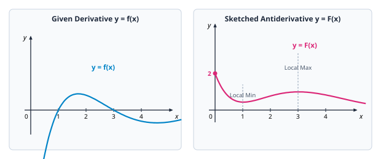

Given the graph of $y = f(x)$ in Figure 2, sketch the graph of an antiderivative $F(x)$ satisfying $F(0) = 2$.

**Solution**:  
Because $F'(x) = f(x)$, the ordinate of $f$ represents the tangent slope of $F$:

- **Initial Value**: The curve begins at $(0, 2)$.
- **Interval $(0, 1)$**: $f(x) < 0 \implies F'(x) < 0$, so $F$ is strictly decreasing.
- **At $x = 1$**: $f(1) = 0 \implies F'(1) = 0$. Since $f$ transitions from negative to positive, $F$ attains a **local minimum**.
- **Interval $(1, 3)$**: $f(x) > 0 \implies F'(x) > 0$, so $F$ is strictly increasing.
- **At $x = 3$**: $f(3) = 0 \implies F'(3) = 0$. Because $f$ transitions from positive to negative, $F$ achieves a **local maximum**.
- **Interval $(3, \infty)$**: $f(x) < 0 \implies F'(x) < 0$, so $F$ decreases. As $x \to \infty$, $f(x) \to 0$, meaning the slope of $F$ approaches zero and the graph flattens asymptotically.

## 5. Section 3.9 Exercises & Detailed Solutions

### 5.1 Exercises 1–18: Finding Most General Antiderivatives

Find the most general antiderivative of each function. (Check every answer by differentiation.)

**1.** $f(x) = x - 3$  
*Antiderivative*:
$$F(x) = \frac{1}{2}x^2 - 3x + C$$
*Check*: $F'(x) = \frac{d}{dx}\left(\frac{1}{2}x^2 - 3x + C\right) = x - 3 = f(x)$.

**2.** $f(x) = \frac{1}{2}x^2 - 2x + 6$  
*Antiderivative*:
$$F(x) = \frac{1}{2}\left(\frac{x^3}{3}\right) - 2\left(\frac{x^2}{2}\right) + 6x + C = \frac{1}{6}x^3 - x^2 + 6x + C$$
*Check*: $F'(x) = \frac{3}{6}x^2 - 2x + 6 = \frac{1}{2}x^2 - 2x + 6 = f(x)$.

**3.** $f(x) = \frac{1}{2} + \frac{3}{4}x^2 - \frac{4}{5}x^3$  
*Antiderivative*:
$$F(x) = \frac{1}{2}x + \frac{3}{4}\left(\frac{x^3}{3}\right) - \frac{4}{5}\left(\frac{x^4}{4}\right) + C = \frac{1}{2}x + \frac{1}{4}x^3 - \frac{1}{5}x^4 + C$$
*Check*: $F'(x) = \frac{1}{2} + \frac{3}{4}x^2 - \frac{4}{5}x^3 = f(x)$.

**4.** $f(x) = 8x^9 - 3x^6 + 12x^3$  
*Antiderivative*:
$$F(x) = 8\left(\frac{x^{10}}{10}\right) - 3\left(\frac{x^7}{7}\right) + 12\left(\frac{x^4}{4}\right) + C = \frac{4}{5}x^{10} - \frac{3}{7}x^7 + 3x^4 + C$$
*Check*: $F'(x) = \frac{40}{5}x^9 - \frac{21}{7}x^6 + 12x^3 = 8x^9 - 3x^6 + 12x^3 = f(x)$.

**5.** $f(x) = (x + 1)(2x - 1)$  
*Expansion*: $f(x) = 2x^2 - x + 2x - 1 = 2x^2 + x - 1$.  
*Antiderivative*:
$$F(x) = 2\left(\frac{x^3}{3}\right) + \frac{x^2}{2} - x + C = \frac{2}{3}x^3 + \frac{1}{2}x^2 - x + C$$
*Check*: $F'(x) = 2x^2 + x - 1 = (x + 1)(2x - 1) = f(x)$.

**6.** $f(x) = x(2 - x)^2$  
*Expansion*: $f(x) = x(4 - 4x + x^2) = 4x - 4x^2 + x^3$.  
*Antiderivative*:
$$F(x) = 4\left(\frac{x^2}{2}\right) - 4\left(\frac{x^3}{3}\right) + \frac{x^4}{4} + C = 2x^2 - \frac{4}{3}x^3 + \frac{1}{4}x^4 + C$$
*Check*: $F'(x) = 4x - 4x^2 + x^3 = x(4 - 4x + x^2) = x(2 - x)^2 = f(x)$.

**7.** $f(x) = 7x^{2/5} + 8x^{-4/5}$  
*Antiderivative*:
$$F(x) = 7\left(\frac{x^{7/5}}{7/5}\right) + 8\left(\frac{x^{1/5}}{1/5}\right) + C = 7\left(\frac{5}{7}x^{7/5}\right) + 8\left(5x^{1/5}\right) + C = 5x^{7/5} + 40x^{1/5} + C$$
*Check*: $F'(x) = 5\left(\frac{7}{5}x^{2/5}\right) + 40\left(\frac{1}{5}x^{-4/5}\right) = 7x^{2/5} + 8x^{-4/5} = f(x)$.

**8.** $f(x) = x^{3.4} - 2x^{\sqrt{2}-1}$  
*Antiderivative*:
$$F(x) = \frac{x^{4.4}}{4.4} - 2\frac{x^{(\sqrt{2}-1)+1}}{(\sqrt{2}-1)+1} + C = \frac{x^{4.4}}{\frac{22}{5}} - \frac{2x^{\sqrt{2}}}{\sqrt{2}} + C = \frac{5}{22}x^{4.4} - \sqrt{2}x^{\sqrt{2}} + C$$
*Check*: $F'(x) = \frac{5}{22}(4.4)x^{3.4} - \sqrt{2}\sqrt{2}x^{\sqrt{2}-1} = x^{3.4} - 2x^{\sqrt{2}-1} = f(x)$.

**9.** $f(x) = \sqrt{2}$  
*Antiderivative*:
$$F(x) = \sqrt{2}x + C$$
*Check*: $F'(x) = \sqrt{2} = f(x)$.

**10.** $f(x) = \pi^2$  
*Antiderivative*:
$$F(x) = \pi^2 x + C$$
*Check*: $F'(x) = \pi^2 = f(x)$.

**11.** $f(x) = \frac{10}{x^9} = 10x^{-9}$  
*Antiderivative*:
$$F(x) = 10\left(\frac{x^{-8}}{-8}\right) + C = -\frac{5}{4}x^{-8} + C = -\frac{5}{4x^8} + C$$
*Check*: $F'(x) = -\frac{5}{4}(-8x^{-9}) = 10x^{-9} = \frac{10}{x^9} = f(x)$.

**12.** $g(x) = \frac{5 - 4x^3 + 2x^6}{x^6}$  
*Expansion*: $g(x) = 5x^{-6} - 4x^{-3} + 2$.  
*Antiderivative*:
$$G(x) = 5\left(\frac{x^{-5}}{-5}\right) - 4\left(\frac{x^{-2}}{-2}\right) + 2x + C = -x^{-5} + 2x^{-2} + 2x + C = -\frac{1}{x^5} + \frac{2}{x^2} + 2x + C$$
*Check*: $G'(x) = 5x^{-6} - 4x^{-3} + 2 = g(x)$.

**13.** $g(t) = \frac{1 + t + t^2}{\sqrt{t}}$  
*Expansion*: $g(t) = t^{-1/2} + t^{1/2} + t^{3/2}$.  
*Antiderivative*:
$$G(t) = \frac{t^{1/2}}{1/2} + \frac{t^{3/2}}{3/2} + \frac{t^{5/2}}{5/2} + C = 2\sqrt{t} + \frac{2}{3}t^{3/2} + \frac{2}{5}t^{5/2} + C$$
*Check*: $G'(t) = 2\left(\frac{1}{2}t^{-1/2}\right) + \frac{2}{3}\left(\frac{3}{2}t^{1/2}\right) + \frac{2}{5}\left(\frac{5}{2}t^{3/2}\right) = t^{-1/2} + t^{1/2} + t^{3/2} = g(t)$.

**14.** $f(t) = 3\cos t - 4\sin t$  
*Antiderivative*:
$$F(t) = 3\sin t - 4(-\cos t) + C = 3\sin t + 4\cos t + C$$
*Check*: $F'(t) = 3\cos t - 4\sin t = f(t)$.

**15.** $h(\theta) = 2\sin\theta - \sec^2\theta$  
*Antiderivative*:
$$H(\theta) = 2(-\cos\theta) - \tan\theta + C = -2\cos\theta - \tan\theta + C$$
*Check*: $H'(\theta) = 2\sin\theta - \sec^2\theta = h(\theta)$.

**16.** $f(\theta) = 6\theta^2 - 7\sec^2\theta$  
*Antiderivative*:
$$F(\theta) = 6\left(\frac{\theta^3}{3}\right) - 7\tan\theta + C = 2\theta^3 - 7\tan\theta + C$$
*Check*: $F'(\theta) = 6\theta^2 - 7\sec^2\theta = f(\theta)$.

**17.** $f(t) = 2\sec t\tan t + \frac{1}{2}t^{-1/2}$  
*Antiderivative*:
$$F(t) = 2\sec t + \frac{1}{2}\left(\frac{t^{1/2}}{1/2}\right) + C = 2\sec t + \sqrt{t} + C$$
*Check*: $F'(t) = 2\sec t\tan t + \frac{1}{2\sqrt{t}} = f(t)$.

**18.** $f(x) = 2\sqrt{x} + 6\cos x = 2x^{1/2} + 6\cos x$  
*Antiderivative*:
$$F(x) = 2\left(\frac{x^{3/2}}{3/2}\right) + 6\sin x + C = \frac{4}{3}x^{3/2} + 6\sin x + C$$
*Check*: $F'(x) = \frac{4}{3}\left(\frac{3}{2}x^{1/2}\right) + 6\cos x = 2\sqrt{x} + 6\cos x = f(x)$.

### 5.2 Exercises 19–20: Particular Antiderivatives with Initial Values

**19.** Find the antiderivative $F$ of $f(x) = 5x^4 - 2x^5$ satisfying $F(0) = 4$.  
*Solution*:  
The general antiderivative is:
$$F(x) = 5\left(\frac{x^5}{5}\right) - 2\left(\frac{x^6}{6}\right) + C = x^5 - \frac{1}{3}x^6 + C$$
Using $F(0) = 4$:
$$F(0) = 0 - 0 + C = 4 \implies C = 4$$
The required particular antiderivative is:
$$F(x) = x^5 - \frac{1}{3}x^6 + 4$$

**20.** Find the antiderivative $F$ of $f(x) = x + 2\sin x$ satisfying $F(0) = -6$.  
*Solution*:  
The general antiderivative is:
$$F(x) = \frac{1}{2}x^2 + 2(-\cos x) + C = \frac{1}{2}x^2 - 2\cos x + C$$
Applying the condition $F(0) = -6$:
$$F(0) = \frac{1}{2}(0)^2 - 2\cos(0) + C = -6 \implies -2(1) + C = -6 \implies C = -4$$
The required particular antiderivative is:
$$F(x) = \frac{1}{2}x^2 - 2\cos x - 4$$

### 5.3 Exercises 21–22: Reconstructing Functions from Second Derivatives

**21.** Find $f$ if $f''(x) = 20x^3 - 12x^2 + 6x$.  
*Solution*:  
Antidifferentiating $f''(x)$ gives $f'(x)$:
$$f'(x) = 20\left(\frac{x^4}{4}\right) - 12\left(\frac{x^3}{3}\right) + 6\left(\frac{x^2}{2}\right) + C = 5x^4 - 4x^3 + 3x^2 + C$$
Antidifferentiating $f'(x)$ gives $f(x)$:
$$f(x) = 5\left(\frac{x^5}{5}\right) - 4\left(\frac{x^4}{4}\right) + 3\left(\frac{x^3}{3}\right) + Cx + D = x^5 - x^4 + x^3 + Cx + D$$
where $C$ and $D$ are arbitrary real constants.

**22.** Find $f$ if $f''(x) = x^6 - 4x^4 + x + 1$.  
*Solution*:  
Antidifferentiating $f''(x)$:
$$f'(x) = \frac{x^7}{7} - 4\left(\frac{x^5}{5}\right) + \frac{x^2}{2} + x + C = \frac{1}{7}x^7 - \frac{4}{5}x^5 + \frac{1}{2}x^2 + x + C$$
Antidifferentiating once more:
$$f(x) = \frac{1}{7}\left(\frac{x^8}{8}\right) - \frac{4}{5}\left(\frac{x^6}{6}\right) + \frac{1}{2}\left(\frac{x^3}{3}\right) + \frac{x^2}{2} + Cx + D = \frac{1}{56}x^8 - \frac{2}{15}x^6 + \frac{1}{6}x^3 + \frac{1}{2}x^2 + Cx + D$$
where $C$ and $D$ are arbitrary constants.

### 5.4 Exercises 43–44: Graphical Antiderivative Identification

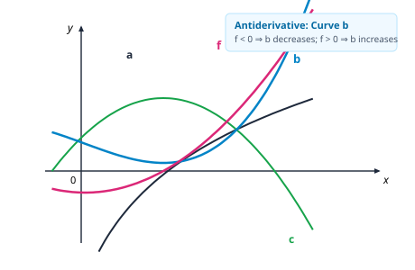

**43.** The graph of a function $f$ (pink) is shown above alongside curves $a$, $b$, and $c$. Which curve is an antiderivative of $f$ and why?

#### Analysis and Justification

Let $F$ denote an antiderivative of $f$, so $F'(x) = f(x)$.

- **Behavior for Small $x$**: On the left portion of the domain, the pink curve $f$ lies below the $x$-axis ($f(x) < 0$). Therefore, the true antiderivative $F$ must have a negative derivative and must be **strictly decreasing**.
  - Curves $a$ and $c$ are both strictly increasing for small $x$, which contradicts $f(x) < 0$.
  - Curve $b$ is decreasing on this interval.
- **Critical Numbers and Transitions**: The pink curve $f$ crosses the $x$-axis from negative to positive at $x \approx 1.4$. At this point, the derivative $F'$ is zero, which requires $F$ to have a horizontal tangent line and transition from decreasing to increasing (a local minimum). Curve $b$ has its local minimum precisely at this $x$-intercept.
- **Behavior for Large $x$**: For $x > 1.4$, $f(x) > 0$ and increases, meaning $F$ must be increasing with positive concavity ($F'' = f' > 0$). Curve $b$ is strictly increasing and concave upward.

**Conclusion**: **Curve $b$ is the antiderivative of $f$**.

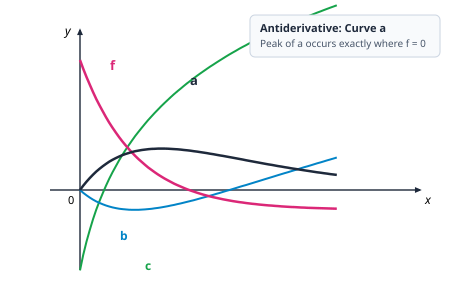

**44.** The graph of a function $f$ (pink) is shown above alongside curves $a$, $b$, and $c$. Which curve is an antiderivative of $f$ and why?

#### Analysis and Justification

Let $F$ denote an antiderivative of $f$, so $F'(x) = f(x)$.

- **Zero Slope Condition**: The pink curve $f$ crosses the $x$-axis from positive to negative at $x \approx 1.2$, so $f(1.2) = 0$. Consequently, the antiderivative must have a horizontal tangent line ($F'(1.2) = 0$).
  - Curve $c$ has a non-zero, steep positive slope at $x \approx 1.2$, immediately eliminating $c$.
  - Curve $b$ is increasing through this $x$-value, failing the horizontal tangent test.
  - Curve $a$ reaches its global peak (horizontal tangent line) exactly at $x \approx 1.2$.
- **Intervals of Increase and Decrease**:
  - For $0 \le x < 1.2$, $f(x) > 0 \implies F$ must be strictly increasing. Curve $a$ increases from $(0, 0)$ to its maximum.
  - For $x > 1.2$, $f(x) < 0 \implies F$ must be strictly decreasing. Curve $a$ decreases steadily toward zero.

**Conclusion**: **Curve $a$ is the antiderivative of $f$**.

### 5.5 Exercises 45–48: Graphical Antiderivative Reconstruction and Analysis

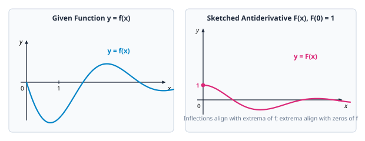

**45.** The graph of a function $f$ is shown above. Make a rough sketch of an antiderivative $F$, given that $F(0) = 1$.

#### Graphical Features of $F(x)$
- **Starting Point**: $F(0) = 1$.
- **Intervals and Extrema**:
  - On the first interval where $f(x) < 0$, $F(x)$ is decreasing. Where $f$ has a local minimum, $F$ has an inflection point (concave downward transitioning to concave upward).
  - When $f(x)$ crosses from negative to positive, $F(x)$ achieves a local minimum.
  - When $f(x) > 0$, $F(x)$ is increasing. At the maximum of $f$, $F$ has another inflection point.
  - When $f(x)$ crosses from positive to negative, $F(x)$ attains a local maximum.

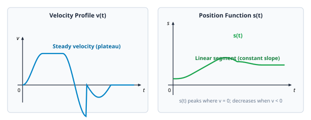

**46.** The graph of the velocity function $v(t)$ of a particle is shown above. Sketch the graph of a position function $s(t)$.

#### Physical and Geometric Relations
- **Concavity**: Because $s''(t) = v'(t)$, position $s(t)$ is concave upward when velocity is increasing, and concave downward when velocity is decreasing.
- **Linear Motion**: During the time interval where $v(t)$ is constant (the horizontal velocity plateau), $s'(t) = v$ is constant. Consequently, the position graph is a **straight line segment** with steady positive slope.
- **Maximum Displacement & Reversal**: When $v(t) = 0$ (crossing the time axis), the particle momentarily stops and reverses direction; $s(t)$ achieves its maximum forward position. During the interval where $v(t) < 0$, $s(t)$ decreases. When $v(t)$ returns to zero, $s(t)$ levels off horizontally.

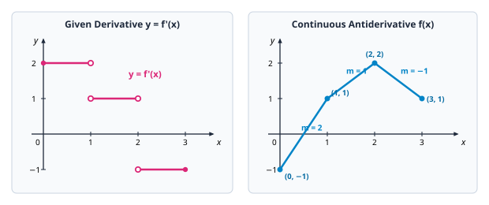

**47.** The graph of $f'$ is shown in the figure (a step function). Sketch the graph of $f$ if $f$ is continuous and $f(0) = -1$.

#### Piecewise Derivation
From the given graph of $f'$, the derivative consists of constant horizontal line segments:
$$f'(x) = \begin{cases} 2 & \text{if } 0 \le x < 1 \\ 1 & \text{if } 1 < x < 2 \\ -1 & \text{if } 2 < x \le 3 \end{cases}$$

Antidifferentiating each constant segment produces a piecewise linear function:
$$f(x) = \begin{cases} 2x + C & \text{if } 0 \le x \le 1 \\ x + D & \text{if } 1 < x < 2 \\ -x + E & \text{if } 2 \le x \le 3 \end{cases}$$

We determine the constants using continuity and the initial condition:

- **On $[0, 1]$**: $f(0) = -1 \implies 2(0) + C = -1 \implies C = -1$.  
  Thus, $f(x) = 2x - 1$ on $[0, 1]$.  
  At the endpoint $x = 1$: $f(1) = 2(1) - 1 = 1$.
- **On $(1, 2)$**: By continuity at $x = 1$, we must have $\lim_{x \to 1^+} f(x) = f(1)$:  
  $$1 + D = 1 \implies D = 0$$  
  Thus, $f(x) = x$ on $[1, 2]$.  
  At the endpoint $x = 2$: $f(2) = 2$.
- **On $[2, 3]$**: By continuity at $x = 2$, $\lim_{x \to 2^+} f(x) = f(2)$:  
  $$-2 + E = 2 \implies E = 4$$  
  Thus, $f(x) = -x + 4$ on $[2, 3]$.  
  At the right endpoint $x = 3$: $f(3) = -3 + 4 = 1$.

The complete continuous function is:
$$f(x) = \begin{cases} 2x - 1 & \text{if } 0 \le x \le 1 \\ x & \text{if } 1 < x < 2 \\ -x + 4 & \text{if } 2 \le x \le 3 \end{cases}$$
The graph is continuous with sharp corners (points of non-differentiability) at $(1, 1)$ and $(2, 2)$.

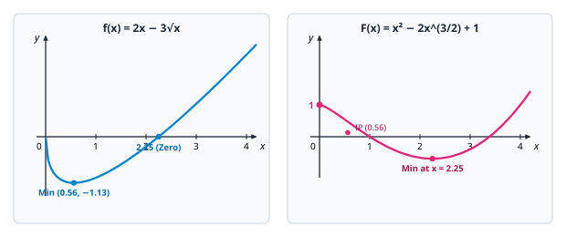

**48.** Consider the function $f(x) = 2x - 3\sqrt{x}$.
(a) Graph $f(x)$ on $[0, 4]$.
(b) Starting with the graph in part (a), sketch a rough graph of the antiderivative $F$ that satisfies $F(0) = 1$.
(c) Use the rules of this section to find an exact analytical expression for $F(x)$.
(d) Graph $F$ using the expression in part (c) and compare with your sketch in part (b).

#### Solution

(a) **Graph of $f(x) = 2x - 3\sqrt{x}$**:  
- The function is defined for $x \ge 0$.
- Finding zeros: $2x - 3\sqrt{x} = 0 \implies \sqrt{x}(2\sqrt{x} - 3) = 0 \implies x = 0$ or $\sqrt{x} = \frac{3}{2} \implies x = \frac{9}{4} = 2.25$.
- Finding local extrema: $f'(x) = 2 - \frac{3}{2\sqrt{x}} = 0 \implies 2 = \frac{3}{2\sqrt{x}} \implies \sqrt{x} = \frac{3}{4} \implies x = \frac{9}{16} = 0.5625$.  
  Value at local minimum: $f(0.5625) = 2\left(\frac{9}{16}\right) - 3\left(\frac{3}{4}\right) = \frac{9}{8} - \frac{9}{4} = -\frac{9}{8} = -1.125$.
- Endpoint value: $f(4) = 2(4) - 3\sqrt{4} = 8 - 6 = 2$.

(b) **Rough Qualitative Sketch of $F(x)$**:
- Starts at $(0, 1)$ because $F(0) = 1$.
- Since $f(x) < 0$ on $(0, 2.25)$, $F(x)$ is decreasing on this interval.
- At $x = 0.5625$, $f'(x) = 0$, so $F(x)$ has an **inflection point** (transitioning from concave downward to concave upward).
- At $x = 2.25$, $f(x) = 0$, so $F(x)$ achieves its **local minimum**.
- For $x > 2.25$, $f(x) > 0$, so $F(x)$ is strictly increasing.

(c) **Analytical Expression for $F(x)$**:  
Writing $f(x) = 2x - 3x^{1/2}$ and antidifferentiating:
$$F(x) = 2\left(\frac{x^2}{2}\right) - 3\left(\frac{x^{3/2}}{3/2}\right) + C = x^2 - 3\left(\frac{2}{3}x^{3/2}\right) + C = x^2 - 2x^{3/2} + C$$
Applying the initial condition $F(0) = 1$:
$$F(0) = 0^2 - 2(0)^{3/2} + C = 1 \implies C = 1$$
Thus, the exact antiderivative is:
$$F(x) = x^2 - 2x^{3/2} + 1$$

(d) **Verification and Comparison**:  
Evaluating the analytical formula at key points:
- At inflection point $x = 0.5625$: $F(0.5625) = (0.5625)^2 - 2(0.5625)^{3/2} + 1 \approx 0.3164 - 0.8438 + 1 \approx 0.473$.
- At minimum point $x = 2.25 = \frac{9}{4}$:  
  $$F(2.25) = \left(\frac{9}{4}\right)^2 - 2\left(\frac{9}{4}\right)^{3/2} + 1 = \frac{81}{16} - 2\left(\frac{27}{8}\right) + 1 = \frac{81}{16} - \frac{27}{4} + 1 = \frac{81 - 108 + 16}{16} = -\frac{11}{16} = -0.6875$$
- At endpoint $x = 4$: $F(4) = 4^2 - 2(4)^{3/2} + 1 = 16 - 2(8) + 1 = 1$.

The calculated features match our qualitative sketch precisely, confirming all graphical deductions.
