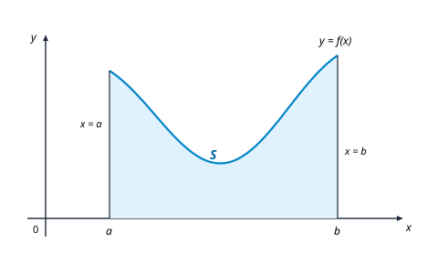
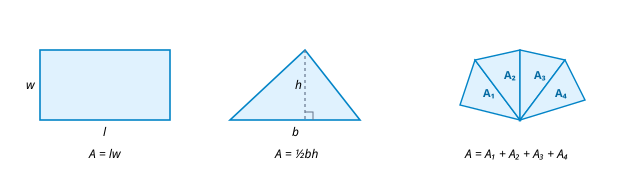
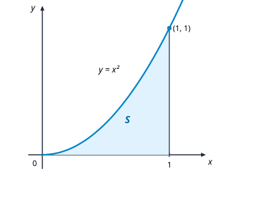
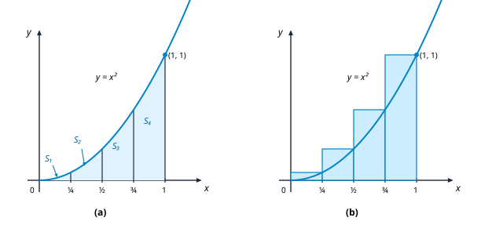
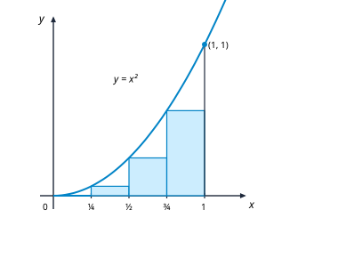
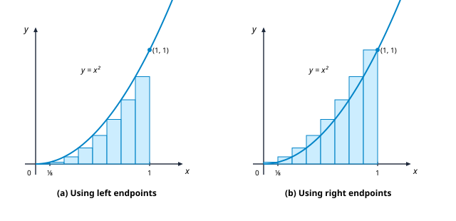
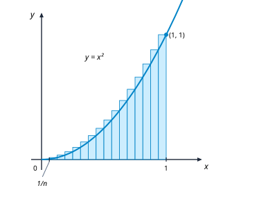
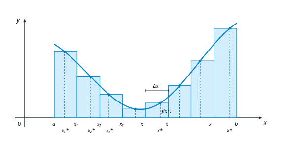
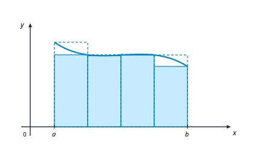

# Calculus Topics & Exercises: Applications of Differentiation Review, Areas and Distances, and the Definite Integral

Source material: Stewart *Calculus: Early Transcendentals* (Chapter 4 Review: True-False Quiz; Section 4.1: Areas and Distances; Section 4.2: The Definite Integral).

## 1. Chapter 4 Review: True-False Quiz

*Instructions*: Determine whether the statement is true or false. If it is true, explain why. If it is false, explain why or give an example that disproves the statement.

**1.** If $f'(c) = 0$, then $f$ has a local maximum or minimum at $c$.  
*Status*: **False**  
*Explanation & Counterexample*: A zero derivative is a necessary condition for a local extremum of a differentiable function (by Fermat's Theorem), but it is not sufficient. A critical point where $f'(c) = 0$ can instead be a horizontal inflection point. Consider the cubic function $f(x) = x^3$ at $c = 0$. Differentiating gives:
$$f'(x) = 3x^2 \implies f'(0) = 0$$
However, $f(x) < 0$ for all $x < 0$ and $f(x) > 0$ for all $x > 0$. Because $f(0) = 0$ is neither greater than all nearby values nor less than all nearby values, $f$ has neither a local maximum nor a local minimum at $c = 0$.

**2.** If $f$ has an absolute minimum value at $c$, then $f'(c) = 0$.  
*Status*: **False**  
*Explanation & Counterexample*: An absolute minimum can occur at an endpoint of the domain, or at an interior point where the derivative does not exist (a critical point of non-differentiability). For example:
- Consider $f(x) = |x|$ on $[-1, 1]$. The function attains its absolute minimum value of $0$ at $c = 0$, but $f'(0)$ does not exist because the graph has a sharp corner (the left-hand derivative is $-1$ and the right-hand derivative is $+1$).
- Alternatively, consider $f(x) = x$ on the closed interval $[0, 1]$. The absolute minimum occurs at the boundary point $c = 0$, where $f'(0) = 1 \ne 0$.

**3.** If $f$ is continuous on $(a, b)$, then $f$ attains an absolute maximum value $f(c)$ and an absolute minimum value $f(d)$ at some numbers $c$ and $d$ in $(a, b)$.  
*Status*: **False**  
*Explanation & Counterexample*: The Extreme Value Theorem guarantees the existence of absolute extrema only when the function is continuous on a **closed and bounded** interval $[a, b]$. On an open interval $(a, b)$, a continuous function need not attain either extremum:
- Consider $f(x) = x$ on the open interval $(0, 1)$. The function is continuous everywhere on $(0, 1)$, and its values are bounded between $0$ and $1$. However, the infimum $0$ and supremum $1$ are approached only as $x \to 0^+$ and $x \to 1^-$. Because $0 \notin (0, 1)$ and $1 \notin (0, 1)$, there are no points in the domain where $f$ attains an absolute minimum or an absolute maximum.
- As an unbounded counterexample, $f(x) = \frac{1}{x}$ on $(0, 1)$ is continuous, but $\lim_{x \to 0^+} f(x) = \infty$, so it has no maximum value.

**4.** If $f$ is differentiable and $f(-1) = f(1)$, then there is a number $c$ such that $|c| < 1$ and $f'(c) = 0$.  
*Status*: **True**  
*Explanation*: Because $f$ is differentiable everywhere on $(-1, 1)$, it is automatically continuous on the closed interval $[-1, 1]$ and differentiable on the open interval $(-1, 1)$. Since $f(-1) = f(1)$, all hypotheses of **Rolle's Theorem** are satisfied on the interval $[-1, 1]$. Therefore, there exists at least one number $c \in (-1, 1)$—which is equivalent to $|c| < 1$—such that:
$$f'(c) = 0$$

**5.** If $f'(x) < 0$ for $1 < x < 6$, then $f$ is decreasing on $(1, 6)$.  
*Status*: **True**  
*Explanation*: This follows directly from the Mean Value Theorem (the Increasing/Decreasing Test). Choose any two numbers $x_1$ and $x_2$ in the interval $(1, 6)$ such that $x_1 < x_2$. The function $f$ is differentiable on $[x_1, x_2]$ and continuous on $[x_1, x_2]$. By the Mean Value Theorem, there exists a number $c \in (x_1, x_2)$ such that:
$$f(x_2) - f(x_1) = f'(c)(x_2 - x_1)$$
Since $1 < x_1 < c < x_2 < 6$, we know from the hypothesis that $f'(c) < 0$. Furthermore, $x_2 - x_1 > 0$. The product of a negative number and a positive number is negative:
$$f(x_2) - f(x_1) < 0 \implies f(x_2) < f(x_1)$$
Hence, $f$ is strictly decreasing on $(1, 6)$.

**6.** If $f''(2) = 0$, then $(2, f(2))$ is an inflection point of the curve $y = f(x)$.  
*Status*: **False**  
*Explanation & Counterexample*: By definition, an inflection point is a point where the curve crosses its tangent line and the concavity changes (either from concave upward to concave downward or vice versa). A zero second derivative is a necessary condition for a twice-differentiable function to have an inflection point, but it is not sufficient. Consider:
$$f(x) = (x - 2)^4$$
Differentiating twice yields:
$$f'(x) = 4(x - 2)^3, \quad f''(x) = 12(x - 2)^2$$
Evaluating at $x = 2$ gives $f''(2) = 12(0)^2 = 0$. However, for all $x \ne 2$, $(x - 2)^2 > 0$, so $f''(x) > 0$. The curve is concave upward on both $(-\infty, 2)$ and $(2, \infty)$. Because the concavity does not change at $x = 2$, the point $(2, 0)$ is a local minimum, not an inflection point.

**7.** If $f'(x) = g'(x)$ for $0 < x < 1$, then $f(x) = g(x)$ for $0 < x < 1$.  
*Status*: **False**  
*Explanation & Counterexample*: If two functions have identical derivatives on an interval, their difference has a derivative of zero:
$$\frac{d}{dx}[f(x) - g(x)] = f'(x) - g'(x) = 0$$
By the corollary to the Mean Value Theorem, this implies $f(x) - g(x) = C$ for some constant $C$, but $C$ does not have to be $0$. For a simple counterexample, let:
$$f(x) = x \quad \text{and} \quad g(x) = x + 5 \quad \text{on } (0, 1)$$
Then $f'(x) = 1$ and $g'(x) = 1$ for all $x \in (0, 1)$, so $f'(x) = g'(x)$. However, $f(x) \ne g(x)$ for any $x \in (0, 1)$.

**8.** There exists a function $f$ such that $f(1) = -2, f(3) = 0$, and $f'(x) > 1$ for all $x$.  
*Status*: **False**  
*Explanation*: Suppose such a differentiable function exists. Then $f$ is continuous on $[1, 3]$ and differentiable on $(1, 3)$. By the Mean Value Theorem, there must exist a number $c \in (1, 3)$ such that:
$$f'(c) = \frac{f(3) - f(1)}{3 - 1} = \frac{0 - (-2)}{2} = \frac{2}{2} = 1$$
However, the given condition asserts that $f'(x) > 1$ for **all** $x$, which means $f'(c) > 1$. This directly contradicts $f'(c) = 1$. Therefore, no such function can exist.

**9.** There exists a function $f$ such that $f(x) > 0, f'(x) < 0$, and $f''(x) > 0$ for all $x$.  
*Status*: **True**  
*Explanation*: Consider the decaying exponential function:
$$f(x) = e^{-x}$$
Computing its first and second derivatives:
$$f'(x) = -e^{-x}, \quad f''(x) = e^{-x}$$
Since $e^{-x} > 0$ for every real number $x$:
- $f(x) = e^{-x} > 0$ (the function values remain strictly positive),
- $f'(x) = -e^{-x} < 0$ (the function is strictly decreasing),
- $f''(x) = e^{-x} > 0$ (the curve is strictly concave upward).  
Thus, $f(x) = e^{-x}$ satisfies all three conditions simultaneously on $(-\infty, \infty)$.

**10.** There exists a function $f$ such that $f(x) < 0, f'(x) < 0$, and $f''(x) > 0$ for all $x$.  
*Status*: **False**  
*Explanation*: Suppose such a function exists on $(-\infty, \infty)$. Since $f''(x) > 0$ for all $x$, the first derivative $f'$ is strictly increasing. Choose any point $x_0 \in \mathbb{R}$. By assumption, $f'(x_0) < 0$; let $f'(x_0) = -k$ for some constant $k > 0$. For any $x < x_0$, since $f'$ is increasing, we have:
$$f'(x) \le f'(x_0) = -k$$
By the Mean Value Theorem, for any $x < x_0$:
$$f(x_0) - f(x) = f'(c)(x_0 - x) \le -k(x_0 - x)$$
Rearranging terms:
$$f(x) \ge f(x_0) + k(x_0 - x)$$
As $x \to -\infty$, the linear term $k(x_0 - x) \to +\infty$, which forces $f(x) \to +\infty$. In particular, for sufficiently negative $x$, $f(x)$ must become positive. This contradicts the requirement that $f(x) < 0$ for all $x \in \mathbb{R}$. Therefore, no such function exists.

**11.** If $f$ and $g$ are increasing on an interval $I$, then $f + g$ is increasing on $I$.  
*Status*: **True**  
*Explanation*: Let $x_1$ and $x_2$ be any two points in $I$ with $x_1 < x_2$. By definition of an increasing function:
$$f(x_1) \le f(x_2) \quad \text{and} \quad g(x_1) \le g(x_2)$$
Adding these two inequalities together yields:
$$f(x_1) + g(x_1) \le f(x_2) + g(x_2) \implies (f + g)(x_1) \le (f + g)(x_2)$$
If the functions are strictly increasing, the inequalities are strict: $f(x_1) < f(x_2)$ and $g(x_1) < g(x_2)$, which gives $(f + g)(x_1) < (f + g)(x_2)$. Alternatively, if $f$ and $g$ are differentiable, $(f + g)'(x) = f'(x) + g'(x) \ge 0$, confirming that $f + g$ is increasing on $I$.

**12.** If $f$ and $g$ are increasing on an interval $I$, then $f - g$ is increasing on $I$.  
*Status*: **False**  
*Explanation & Counterexample*: The difference of two increasing functions depends on which function grows faster. If $g$ increases faster than $f$, then $f - g$ will decrease. For example, let:
$$f(x) = x \quad \text{and} \quad g(x) = 2x \quad \text{on } \mathbb{R}$$
Both $f$ and $g$ are strictly increasing on $\mathbb{R}$ because their derivatives are positive ($f'(x) = 1 > 0$ and $g'(x) = 2 > 0$). However:
$$(f - g)(x) = x - 2x = -x$$
The derivative of $(f - g)(x)$ is $-1 < 0$, which means $f - g$ is strictly decreasing on $\mathbb{R}$, not increasing.

**13.** If $f$ and $g$ are increasing on an interval $I$, then $fg$ is increasing on $I$.  
*Status*: **False**  
*Explanation & Counterexample*: The product of two increasing functions is not necessarily increasing if the functions take negative values. For example, let:
$$f(x) = x \quad \text{and} \quad g(x) = x \quad \text{on the interval } I = (-2, -1)$$
Both $f(x) = x$ and $g(x) = x$ are strictly increasing on $(-2, -1)$. However, their product is:
$$(fg)(x) = x^2$$
On the interval $(-2, -1)$, as $x$ increases from $-2$ to $-1$, $x^2$ decreases from $4$ to $1$. In terms of derivatives:
$$(fg)'(x) = \frac{d}{dx}(x^2) = 2x < 0 \quad \text{for all } x \in (-2, -1)$$
Thus, $fg$ is strictly decreasing on $(-2, -1)$.

**14.** If $f$ and $g$ are positive increasing functions on an interval $I$, then $fg$ is increasing on $I$.  
*Status*: **True**  
*Explanation*: Let $x_1$ and $x_2$ be any two points in $I$ such that $x_1 < x_2$. Since $f$ and $g$ are positive and strictly increasing:
$$0 < f(x_1) < f(x_2) \quad \text{and} \quad 0 < g(x_1) < g(x_2)$$
Multiplying the inequality $f(x_1) < f(x_2)$ by the positive quantity $g(x_1)$ gives:
$$f(x_1)g(x_1) < f(x_2)g(x_1)$$
Multiplying the inequality $g(x_1) < g(x_2)$ by the positive quantity $f(x_2)$ gives:
$$f(x_2)g(x_1) < f(x_2)g(x_2)$$
By transitivity:
$$f(x_1)g(x_1) < f(x_2)g(x_2) \implies (fg)(x_1) < (fg)(x_2)$$
Alternatively, using the Product Rule for differentiable functions:
$$(fg)'(x) = f'(x)g(x) + f(x)g'(x)$$
Since $f(x) > 0, g(x) > 0, f'(x) \ge 0$, and $g'(x) \ge 0$, every term is non-negative, so $(fg)'(x) \ge 0$. Hence, $fg$ is increasing on $I$.

**15.** If $f$ is increasing and $f(x) > 0$ on $I$, then $g(x) = 1/f(x)$ is decreasing on $I$.  
*Status*: **True**  
*Explanation*: Choose any $x_1, x_2 \in I$ such that $x_1 < x_2$. Because $f$ is strictly increasing and positive:
$$0 < f(x_1) < f(x_2)$$
Taking the reciprocal of both sides reverses the inequality for positive numbers:
$$\frac{1}{f(x_1)} > \frac{1}{f(x_2)} \implies g(x_1) > g(x_2)$$
Therefore, $g$ is strictly decreasing on $I$. Using calculus:
$$g'(x) = \frac{d}{dx}\left([f(x)]^{-1}\right) = -\frac{f'(x)}{[f(x)]^2}$$
Since $f'(x) \ge 0$ and $[f(x)]^2 > 0$, the ratio $-\frac{f'(x)}{[f(x)]^2} \le 0$, proving that $g$ is decreasing.

**16.** If $f$ is even, then $f'$ is even.  
*Status*: **False**  
*Explanation & Counterexample*: The derivative of an even function is an **odd** function, not an even function. If $f$ is even, then by definition:
$$f(-x) = f(x) \quad \text{for all } x \text{ in the domain}$$
Differentiating both sides with respect to $x$ using the Chain Rule on the left:
$$\frac{d}{dx}[f(-x)] = f'(-x) \cdot \frac{d}{dx}(-x) = -f'(-x)$$
$$\frac{d}{dx}[f(x)] = f'(x)$$
Equating both sides:
$$-f'(-x) = f'(x) \implies f'(-x) = -f'(x)$$
This identity states that $f'$ is an odd function. For a concrete counterexample, let $f(x) = x^2$ (an even function). Its derivative is $f'(x) = 2x$. Evaluating at $-x$:
$$f'(-x) = 2(-x) = -2x = -f'(x) \ne f'(x)$$
Hence $f'$ is odd, not even.

**17.** If $f$ is periodic, then $f'$ is periodic.  
*Status*: **True**  
*Explanation*: A function $f$ is periodic with period $p \ne 0$ if $f(x + p) = f(x)$ for all $x$ in its domain. Differentiating both sides with respect to $x$ using the Chain Rule on the left:
$$\frac{d}{dx}[f(x + p)] = f'(x + p) \cdot \frac{d}{dx}(x + p) = f'(x + p) \cdot 1 = f'(x + p)$$
Since the right side differentiates to $f'(x)$, we have:
$$f'(x + p) = f'(x)$$
This confirms that $f'$ repeats every $p$ units and is therefore periodic with the same period $p$.

**18.** The most general antiderivative of $f(x) = x^{-2}$ is $F(x) = -\frac{1}{x} + C$.  
*Status*: **False**  
*Explanation*: The function $f(x) = x^{-2} = \frac{1}{x^2}$ is defined on the domain $(-\infty, 0) \cup (0, \infty)$, which consists of two disjoint open intervals. The Constant Difference Theorem (which states that two antiderivatives differ by a constant) applies only on a connected interval. Because the domain has two disconnected components, the constant of integration can be chosen independently on each piece. Therefore, the most general antiderivative of $f(x)$ on its full domain is:
$$F(x) = \begin{cases} -\frac{1}{x} + C_1 & \text{if } x < 0 \\ -\frac{1}{x} + C_2 & \text{if } x > 0 \end{cases}$$
where $C_1$ and $C_2$ are arbitrary constants that need not be equal. The expression $F(x) = -\frac{1}{x} + C$ specifies the same constant on both sides of the vertical asymptote, so it is not the most general antiderivative.

**19.** If $f'(x)$ exists and is nonzero for all $x$, then $f(1) \ne f(0)$.  
*Status*: **True**  
*Explanation*: We prove this by contradiction using **Rolle's Theorem**. Suppose that $f(1) = f(0)$. Since $f'(x)$ exists for all $x$, $f$ is differentiable on the open interval $(0, 1)$ and continuous on the closed interval $[0, 1]$. By Rolle's Theorem, there must exist at least one number $c \in (0, 1)$ such that:
$$f'(c) = 0$$
However, the hypothesis explicitly states that $f'(x) \ne 0$ for all $x \in \mathbb{R}$. This creates an immediate contradiction. Thus, our assumption that $f(1) = f(0)$ must be false, which proves that $f(1) \ne f(0)$.

## 2. Areas and Distances: The Area Problem

### 2.1 The Area Problem and Geometric Foundations

In this section, we discover that trying to find the area under a curve or the distance traveled by an accelerating vehicle leads to the exact same special type of limit: the limit of approximating Riemann sums.

We begin by attempting to solve the **area problem**:  
Find the area of the region $S$ that lies under the curve $y = f(x)$ from $a$ to $b$. This means that $S$ is bounded by the graph of a continuous function $f$ (where $f(x) \ge 0$), the vertical lines $x = a$ and $x = b$, and the $x$-axis.

Set-builder notation expresses this region as:
$$S = \{(x, y) \mid a \le x \le b, \; 0 \le y \le f(x)\}$$

In attempting to solve the area problem, we must first ask: *What is the meaning of the word area?*

For regions with straight boundaries, the definition of area is straightforward and grounded in elementary Euclidean geometry:
- For a **rectangle**, area is defined as the product of its length and width:
  $$A = lw$$
- For a **triangle**, area is defined as half the product of the base and the altitude:
  $$A = \frac{1}{2}bh$$
- For any **polygon**, the area is determined by dividing the polygon into non-overlapping triangles and summing their individual areas:
  $$A = A_1 + A_2 + A_3 + \dots + A_k$$

However, finding the area of a region bounded by curved edges presents a profound mathematical challenge. While we possess an intuitive sense of what the area of a curved shape represents, solving the area problem requires transforming this intuition into a rigorous, exact definition.

Recall how differential calculus defined the slope of a tangent line: we first approximated the tangent slope using secant lines through nearby points, and then computed the limit of these secant slopes as the points approached each other. We adopt an identical philosophical strategy for areas:
1. Approximate the curved region $S$ by collections of straight-sided rectangles.
2. Increase the number of approximating rectangles while shrinking their widths.
3. Define the exact area as the limit of the sum of the rectangular areas as the number of rectangles approaches infinity.

### 2.2 Estimating Area Under a Parabola: Example 1

**Example 1**: Use rectangles to estimate the area under the parabola $y = x^2$ from $0$ to $1$ (the parabolic region $S$).

**Solution**:  
First observe that the region $S$ is contained entirely within a unit square of side length $1$ (since $0 \le x \le 1$ and $0 \le y \le 1$). Because the region occupies only part of this unit square, its area $A$ must satisfy:
$$0 < A < 1$$

To obtain a much closer estimate, we partition the interval $[0, 1]$ into four subintervals of equal width:
$$\Delta x = \frac{1 - 0}{4} = \frac{1}{4}$$
The partition points are $x_0 = 0$, $x_1 = \frac{1}{4}$, $x_2 = \frac{1}{2}$, $x_3 = \frac{3}{4}$, and $x_4 = 1$. Drawing the vertical lines $x = \frac{1}{4}$, $x = \frac{1}{2}$, and $x = \frac{3}{4}$ divides the region $S$ into four vertical strips: $S_1, S_2, S_3$, and $S_4$.

#### Right-Endpoint Approximation ($R_4$)

We approximate each strip by a rectangle whose base is the strip's base and whose height is determined by evaluating $f(x) = x^2$ at the **right endpoint** of each subinterval:
- Subinterval $[0, \frac{1}{4}]$: right endpoint is $\frac{1}{4}$, height is $f(\frac{1}{4}) = (\frac{1}{4})^2 = \frac{1}{16}$
- Subinterval $[\frac{1}{4}, \frac{1}{2}]$: right endpoint is $\frac{1}{2}$, height is $f(\frac{1}{2}) = (\frac{1}{2})^2 = \frac{1}{4}$
- Subinterval $[\frac{1}{2}, \frac{3}{4}]$: right endpoint is $\frac{3}{4}$, height is $f(\frac{3}{4}) = (\frac{3}{4})^2 = \frac{9}{16}$
- Subinterval $[\frac{3}{4}, 1]$: right endpoint is $1$, height is $f(1) = 1^2 = 1$

Summing the areas of these four approximating rectangles yields the right-endpoint sum $R_4$:
$$R_4 = \frac{1}{4}\left(\frac{1}{4}\right)^2 + \frac{1}{4}\left(\frac{1}{2}\right)^2 + \frac{1}{4}\left(\frac{3}{4}\right)^2 + \frac{1}{4}(1)^2$$
$$R_4 = \frac{1}{4}\left[\frac{1}{16} + \frac{4}{16} + \frac{9}{16} + \frac{16}{16}\right] = \frac{1}{4} \cdot \frac{30}{16} = \frac{15}{32} = 0.46875$$

Because $f(x) = x^2$ is strictly increasing on $[0, 1]$, each right-endpoint rectangle circumscribes its corresponding strip and extends above the curve. Therefore, $R_4$ is an upper estimate:
$$A < 0.46875$$

#### Left-Endpoint Approximation ($L_4$)

Alternatively, we can construct approximating rectangles whose heights are given by evaluating $f(x) = x^2$ at the **left endpoints** of each subinterval:
- Subinterval $[0, \frac{1}{4}]$: left endpoint is $0$, height is $f(0) = 0^2 = 0$ (this rectangle has collapsed to zero height)
- Subinterval $[\frac{1}{4}, \frac{1}{2}]$: left endpoint is $\frac{1}{4}$, height is $f(\frac{1}{4}) = (\frac{1}{4})^2 = \frac{1}{16}$
- Subinterval $[\frac{1}{2}, \frac{3}{4}]$: left endpoint is $\frac{1}{2}$, height is $f(\frac{1}{2}) = (\frac{1}{2})^2 = \frac{1}{4}$
- Subinterval $[\frac{3}{4}, 1]$: left endpoint is $\frac{3}{4}$, height is $f(\frac{3}{4}) = (\frac{3}{4})^2 = \frac{9}{16}$

Summing the areas of these left-endpoint rectangles gives $L_4$:
$$L_4 = \frac{1}{4}(0)^2 + \frac{1}{4}\left(\frac{1}{4}\right)^2 + \frac{1}{4}\left(\frac{1}{2}\right)^2 + \frac{1}{4}\left(\frac{3}{4}\right)^2$$
$$L_4 = \frac{1}{4}\left[0 + \frac{1}{16} + \frac{4}{16} + \frac{9}{16}\right] = \frac{1}{4} \cdot \frac{14}{16} = \frac{7}{32} = 0.21875$$

Because each rectangle lies entirely beneath the curve $y = x^2$, $L_4$ provides a lower estimate. Combining our bounds yields:
$$0.21875 < A < 0.46875$$

#### Refining the Partition: Eight Rectangles ($n = 8$)

Dividing the interval $[0, 1]$ into $n = 8$ subintervals of width $\Delta x = \frac{1}{8}$ provides substantially closer lower and upper estimates:

Computing the sums for $n = 8$:
$$L_8 = \frac{1}{8}\sum_{i=0}^7 \left(\frac{i}{8}\right)^2 = \frac{1}{512}(0 + 1 + 4 + 9 + 16 + 25 + 36 + 49) = \frac{140}{512} \approx 0.2734375$$
$$R_8 = \frac{1}{8}\sum_{i=1}^8 \left(\frac{i}{8}\right)^2 = \frac{1}{512}(1 + 4 + 9 + 16 + 25 + 36 + 49 + 64) = \frac{204}{512} \approx 0.3984375$$

Thus, the exact area $A$ is trapped in the narrower range:
$$0.2734375 < A < 0.3984375$$

#### Convergence Table for Large $n$

Increasing the number of strips $n$ tightens the interval between $L_n$ and $R_n$:

| Number of Strips ($n$) | Left-Endpoint Sum ($L_n$) | Right-Endpoint Sum ($R_n$) |
| :---: | :---: | :---: |
| $10$ | $0.2850000$ | $0.3850000$ |
| $20$ | $0.3087500$ | $0.3587500$ |
| $30$ | $0.3168519$ | $0.3501852$ |
| $50$ | $0.3234000$ | $0.3434000$ |
| $100$ | $0.3283500$ | $0.3383500$ |
| $1000$ | $0.3328335$ | $0.3338335$ |

Notice that with $n = 1000$ strips, the area is bounded between $0.3328335$ and $0.3338335$. Averaging these two bounds gives:
$$A \approx \frac{0.3328335 + 0.3338335}{2} = 0.3333335 \approx \frac{1}{3}$$

### 2.3 Exact Area Calculation via Limits: Example 2

The numerical evidence in the table strongly suggests that as $n \to \infty$, both $R_n$ and $L_n$ approach the exact value $\frac{1}{3}$. We now prove this analytically.

**Example 2**: For the parabolic region $S$ in Example 1, show that the sum of the areas of the upper approximating rectangles approaches $\frac{1}{3}$; that is:
$$\lim_{n \to \infty} R_n = \frac{1}{3}$$

**Solution**:  
Divide $[0, 1]$ into $n$ subintervals of equal width:
$$\Delta x = \frac{1 - 0}{n} = \frac{1}{n}$$
The right endpoints of the subintervals are:
$$x_1 = \frac{1}{n}, \quad x_2 = \frac{2}{n}, \quad x_3 = \frac{3}{n}, \quad \dots, \quad x_n = \frac{n}{n} = 1$$

The heights of the rectangles are the function values at these right endpoints:
$$f\left(\frac{1}{n}\right) = \left(\frac{1}{n}\right)^2, \quad f\left(\frac{2}{n}\right) = \left(\frac{2}{n}\right)^2, \quad \dots, \quad f\left(\frac{n}{n}\right) = \left(\frac{n}{n}\right)^2$$

The total area $R_n$ is the sum of the areas of all $n$ rectangles:
$$R_n = \frac{1}{n}\left(\frac{1}{n}\right)^2 + \frac{1}{n}\left(\frac{2}{n}\right)^2 + \frac{1}{n}\left(\frac{3}{n}\right)^2 + \dots + \frac{1}{n}\left(\frac{n}{n}\right)^2$$
Factoring out $\frac{1}{n} \cdot \frac{1}{n^2} = \frac{1}{n^3}$:
$$R_n = \frac{1}{n^3}\left(1^2 + 2^2 + 3^2 + \dots + n^2\right)$$

To evaluate this sum in closed form, we apply the standard formula for the sum of the squares of the first $n$ positive integers:

**Formula 1: Sum of First $n$ Squares**
$$1^2 + 2^2 + 3^2 + \dots + n^2 = \sum_{i=1}^n i^2 = \frac{n(n + 1)(2n + 1)}{6}$$

Substituting Formula 1 into our expression for $R_n$:
$$R_n = \frac{1}{n^3} \cdot \frac{n(n + 1)(2n + 1)}{6} = \frac{(n + 1)(2n + 1)}{6n^2}$$

Now we compute the limit of the sequence $\{R_n\}$ as $n \to \infty$. Splitting the product across the denominator:
$$R_n = \frac{1}{6} \cdot \frac{n + 1}{n} \cdot \frac{2n + 1}{n} = \frac{1}{6}\left(1 + \frac{1}{n}\right)\left(2 + \frac{1}{n}\right)$$

Taking the limit as $n \to \infty$, and using the fundamental limit $\lim_{n \to \infty} \frac{1}{n} = 0$:
$$\lim_{n \to \infty} R_n = \lim_{n \to \infty} \frac{1}{6}\left(1 + \frac{1}{n}\right)\left(2 + \frac{1}{n}\right) = \frac{1}{6}(1 + 0)(2 + 0) = \frac{1}{6} \cdot 2 = \frac{1}{3}$$

An identical derivation for the left-endpoint sums yields:
$$L_n = \frac{(n - 1)(2n - 1)}{6n^2} = \frac{1}{6}\left(1 - \frac{1}{n}\right)\left(2 - \frac{1}{n}\right)$$
Taking the limit as $n \to \infty$:
$$\lim_{n \to \infty} L_n = \frac{1}{6}(1 - 0)(2 - 0) = \frac{1}{3}$$

Because the true area $A$ is trapped between $L_n$ and $R_n$ for all $n$ ($L_n \le A \le R_n$), the Squeeze Theorem confirms that the exact area under the parabola $y = x^2$ from $0$ to $1$ is:
$$A = \frac{1}{3}$$

### 2.4 Formal Definitions of Area

We generalize the procedure from Examples 1 and 2 to any continuous function $f \ge 0$ on $[a, b]$.

Subdivide the interval $[a, b]$ into $n$ subintervals of equal width:
$$\Delta x = \frac{b - a}{n}$$
The partition points are:
$$x_0 = a, \quad x_1 = a + \Delta x, \quad x_2 = a + 2\Delta x, \quad \dots, \quad x_n = a + n\Delta x = b$$

**Definition 2: Area via Right Endpoints**  
The **area** $A$ of the region $S$ that lies under the graph of the continuous function $f$ is the limit of the sum of the areas of approximating rectangles using right endpoints:
$$A = \lim_{n \to \infty} R_n = \lim_{n \to \infty} \left[ f(x_1)\Delta x + f(x_2)\Delta x + \dots + f(x_n)\Delta x \right] = \lim_{n \to \infty} \sum_{i=1}^n f(x_i)\Delta x$$

Because $f$ is continuous on $[a, b]$, it can be proven that this limit always exists and is independent of the choice of endpoints. Using left endpoints gives an equivalent formulation:

**Definition 3: Area via Left Endpoints**  
$$A = \lim_{n \to \infty} L_n = \lim_{n \to \infty} \left[ f(x_0)\Delta x + f(x_1)\Delta x + \dots + f(x_{n-1})\Delta x \right] = \lim_{n \to \infty} \sum_{i=1}^n f(x_{i-1})\Delta x$$

More generally, we need not evaluate $f$ at the boundaries of each subinterval. We can choose an arbitrary point $x_i^* \in [x_{i-1}, x_i]$, called a **sample point**, in each subinterval:

**Definition 4: General Definition of Area**  
$$A = \lim_{n \to \infty} \left[ f(x_1^*)\Delta x + f(x_2^*)\Delta x + \dots + f(x_n^*)\Delta x \right] = \lim_{n \to \infty} \sum_{i=1}^n f(x_i^*)\Delta x$$

*Note on Lower and Upper Darboux Sums*:  
An equivalent, foundational characterization of area states:  
*The area $A$ is the unique real number that is greater than or equal to all lower sums and less than or equal to all upper sums.*

A **lower sum** is constructed by choosing $x_i^*$ such that $f(x_i^*)$ is the absolute minimum of $f$ on $[x_{i-1}, x_i]$ (inscribed rectangles). An **upper sum** is constructed by choosing $x_i^*$ such that $f(x_i^*)$ is the absolute maximum of $f$ on $[x_{i-1}, x_i]$ (circumscribed rectangles). For any continuous function on a closed interval, as $n \to \infty$, the upper sums decrease and the lower sums increase, converging to a unique common limit: the exact area $A$.

## 3. The Definite Integral

### 3.1 Formal Definition of a Definite Integral

In Section 2, we required $f(x) \ge 0$ so that the approximating sums represented physical geometric areas. When we remove the restriction that $f(x) \ge 0$, the exact same limit of sums arises in countless applications across physics, geometry, engineering, probability, and economics. This limit is the **definite integral**.

**Definition of a Definite Integral**  
If $f$ is a function defined for $a \le x \le b$, we divide the interval $[a, b]$ into $n$ subintervals of equal width:
$$\Delta x = \frac{b - a}{n}$$
We let $x_0 (= a), x_1, x_2, \dots, x_n (= b)$ be the endpoints of these subintervals, and we let $x_1^*, x_2^*, \dots, x_n^*$ be any **sample points** in these subintervals, so that $x_i^*$ lies in the $i$th subinterval $[x_{i-1}, x_i]$.

Then the **definite integral of $f$ from $a$ to $b$** is:
$$\int_a^b f(x)\,dx = \lim_{n \to \infty} \sum_{i=1}^n f(x_i^*)\,\Delta x$$
provided that this limit exists and gives the exact same value for all possible choices of sample points. If the limit does exist, we say that $f$ is **integrable** on $[a, b]$.

### 3.2 Anatomy of the Notation and Geometric Meaning

The notation was introduced by Gottfried Wilhelm Leibniz:
- **Integral Sign ($\int$)**: An elongated "S" (for Latin *summa*), indicating the limit of a sum.
- **Integrand ($f(x)$)**: The function being integrated.
- **Limits of Integration ($a$ and $b$)**: $a$ is the lower limit and $b$ is the upper limit.
- **Differential ($dx$)**: Identifies the variable of integration and represents an infinitesimal width $\Delta x$.
- **Riemann Sum**: The finite sum $\sum_{i=1}^n f(x_i^*)\,\Delta x$ honors Bernhard Riemann (1826–1866).

**Geometric Interpretation: Net Signed Area**  
When $f(x) \ge 0$, the definite integral equals the ordinary area under $y = f(x)$ from $a$ to $b$. When $f(x)$ takes both positive and negative values, $f(x_i^*)\Delta x$ is positive for rectangles above the $x$-axis and negative for rectangles below. Consequently, the definite integral evaluates the **net signed area**:
$$\int_a^b f(x)\,dx = A_{\text{above}} - A_{\text{below}}$$
where $A_{\text{above}}$ is the area lying above the $x$-axis and below $y = f(x)$, and $A_{\text{below}}$ is the area lying below the $x$-axis and above $y = f(x)$.
