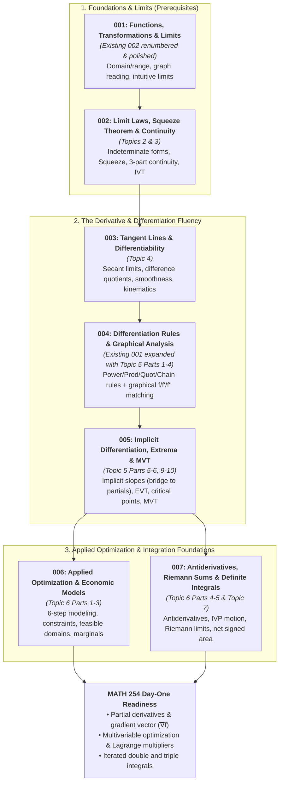

# Master Plan: Calculus Handout Review Suite (Sequential Pedagogical Path for MATH 254)

## 1. Pedagogical Diagnosis & Reordering Rationale

### The Out-of-Order Problem with Handout 001
In the initial project structure, `001-derivative-rules-refresher` jumped immediately into operational differentiation formulas (power, product, quotient, chain, exponentials, trigonometry) before students explored:
1. Functions, domains, and graph transformations.
2. Limits and continuity (the foundational machinery that defines what a derivative actually is).
3. Tangent lines and the difference-quotient limit definition of the derivative ($f'(a) = \lim_{h \to 0} \frac{f(a+h) - f(a)}{h}$).

Placing operational formulas first creates an artificial rupture: students memorize computational tricks without understanding why a derivative represents an instantaneous slope, when a function fails to be differentiable (corners, cusps, vertical tangents), or how limits transition into derivatives.

### The Correct Sequential Learning Pathway
By reordering the suite, the curriculum forms a natural, forward-flowing progression mirroring Stewart's classical architecture and directly servicing the **MATH 254 (Multivariable Calculus)** critical path in [`C:\dev\omscs\math_254_minimal_prerequisites.md`](file:///C:/dev/omscs/math_254_minimal_prerequisites.md):



## 2. Directory Migration & Folder Reorganization Plan

Following project file-safety rules (`mv` only, verify with `ls` first, zero `rm -rf`), the existing packages will be reorganized as follows:

```
C:\dev\calculus\handouts\
  001-functions-transformations-and-limits/          <-- Renamed from 002-functions-transformations-and-limits
  002-limit-laws-squeeze-theorem-and-continuity/     <-- New package (from topics_2.md & topics_3.md)
  003-tangent-lines-differentiability-and-rates/     <-- New package (from topics_4.md)
  004-differentiation-rules-and-graphical-analysis/  <-- Renamed from 001-derivative-rules-refresher & updated
  005-implicit-differentiation-extrema-and-mvt/      <-- New package (from topics_5.md Parts B & C)
  006-applied-optimization-and-economic-models/      <-- New package (from topics_6.md Part A)
  007-antiderivatives-riemann-sums-and-integrals/    <-- New package (from topics_6.md Part B & topics_7.md)
```

## 3. Handout Specifications & Page Budgets (10–16 Pages Each)

Every handout is structured strictly under the `/calculus-create-handout` contract:
- Four-Stage Continuous Problem Framework in blockquote derivation boxes (no `"solution"` or `"try first"`).
- Bold subparts (`**1.**`, `**2.**`), no markdown ordered lists (`1.`).
- Easiest-to-hardest MECE exercises ending with a bare `### QN` capstone.
- Standalone modern SVG figures built with page fonts (`Aptos`, `Cascadia Mono`).

---

### Handout 001: Functions, Transformations, and Limits (Foundations)
- **Status:** Existing package [`002-functions-transformations-and-limits`](file:///C:/dev/calculus/handouts/002-functions-transformations-and-limits) renumbered to `001`.
- **Page Budget:** 10 pages (Handout) / 7 pages (Key) — *Verified within 10–16 page limit*.
- **Role in Sequence:** The true entry point. Establishes functions, natural domain restrictions, reading coordinate graphs, rigid/non-rigid transformations, function composition, and intuitive two-sided and one-sided limits.
- **Image Generator:** [`C:\dev\calculus\topics_from_Stewart\generate_figures.py`](file:///C:/dev/calculus/topics_from_Stewart/generate_figures.py)
- **Updates Needed:**
  - Update YAML front matter to `Handout 001: Functions, Transformations, and Limits`.
  - Update cross-references to point forward to Handout 002.

---

### Handout 002: Limit Laws, Squeeze Theorem, Continuity, and the IVT
- **Status:** New package `002-limit-laws-squeeze-theorem-and-continuity`.
- **Page Budget:** 12–14 pages (Handout).
- **Source Documents:**
  - [`C:\dev\calculus\topics_from_Stewart\topics_2.md`](file:///C:/dev/calculus/topics_from_Stewart/topics_2.md) (Sections 1.1–1.7, 2.1–2.5)
  - [`C:\dev\calculus\topics_from_Stewart\topics_3.md`](file:///C:/dev/calculus/topics_from_Stewart/topics_3.md) (Sections 1.1–1.5, 2)
- **Respective Image Generator Scripts:**
  - [`C:\dev\calculus\topics_from_Stewart\generate_figures_topics2.py`](file:///C:/dev/calculus/topics_from_Stewart/generate_figures_topics2.py)
  - [`C:\dev\calculus\topics_from_Stewart\generate_figures_topics3.py`](file:///C:/dev/calculus/topics_from_Stewart/generate_figures_topics3.py)
- **Figures to Embed:**
  - `sec2_3_figure3_abs_x.svg`, `sec2_3_figure4_sign_step.svg`, `sec2_3_figure5_piecewise_corner.svg`
  - `sec2_3_figure7_squeeze_theorem.svg`, `sec2_3_figure8_squeeze_x2_sin.svg`, `sec2_3_ex2_graphs_fg.svg`
  - `sec2_4_figures4_5_6_eps_delta_strips.svg` (Visual challenge bands; no tedious delta proofs)
  - `sec2_5_figure1_continuity_definition.svg`, `sec2_5_figure2_discontinuities_example1.svg`, `sec2_5_figure3_example2_discontinuity_types.svg`, `sec2_5_figure_ivt.svg`
- **Pedagogical Content:**
  - Algebraic limit techniques: factoring, conjugate rationalization, absolute value splits, piecewise transitions.
  - Squeeze Theorem and oscillating boundaries.
  - Intuitive $\epsilon$-$\delta$ limit definition (visual bands model without grueling algebra).
  - 3-condition continuity definition; removable vs jump vs infinite discontinuities.
  - Intermediate Value Theorem (IVT) and root bounding.
- **Critical Path Link:** Equips students to evaluate limits along multivariable paths ($y = mx$, $y = kx^2$) and detect non-existence in MATH 254.

---

### Handout 003: Tangent Lines, Differentiability, and Rates of Change
- **Status:** New package `003-tangent-lines-differentiability-and-rates`.
- **Page Budget:** 11–13 pages (Handout).
- **Source Documents:**
  - [`C:\dev\calculus\topics_from_Stewart\topics_4.md`](file:///C:/dev/calculus/topics_from_Stewart/topics_4.md) (Sections 1.1–1.3, 2.1–2.3, 3.1–3.2)
- **Respective Image Generator Script:**
  - [`C:\dev\calculus\topics_from_Stewart\generate_figures_topics4.py`](file:///C:/dev/calculus/topics_from_Stewart/generate_figures_topics4.py)
- **Figures to Embed:**
  - `sec2_7_figure_parabola_tangent.svg` (Secant line converging to tangent line)
  - `sec2_7_figure4_hyperbola_tangent.svg` (Tangent slope on reciprocal curve)
  - `sec2_7_exercise12_runners.svg` (Kinematic position-time rate analysis)
  - `sec2_8_figure5_abs_derivative.svg` (Non-differentiability at corner of $|x|$)
  - `sec2_8_figure7_non_differentiable.svg` (Summary: corners, cusps, vertical tangents, discontinuities)
- **Pedagogical Content:**
  - Tangent line defined as the limiting secant chord: $m = \lim_{x \to a}\frac{f(x)-f(a)}{x-a} = \lim_{h \to 0}\frac{f(a+h)-f(a)}{h}$.
  - The derivative at a point $f'(a)$ and linear approximation equation $y - y_0 = f'(x_0)(x - x_0)$.
  - Theorem: Differentiability implies continuity (with proof intuition and counterexample of converse).
  - Failure modes of differentiability: sharp corners, cusps, vertical tangents ($m \to \pm\infty$), jump/removable breaks.
  - Kinematic interpretations: position $s(t)$, average vs instantaneous velocity $v(t)$, acceleration $a(t)$.
- **Critical Path Link:** Builds the exact geometric intuition of tangent hyperplanes and linear approximations $L(x, y)$ in MATH 254.

---

### Handout 004: Differentiation Rules, Higher Derivatives, and Graphical Analysis
- **Status:** Existing package [`001-derivative-rules-refresher`](file:///C:/dev/calculus/handouts/001-derivative-rules-refresher) renumbered to `004` and updated with graphical analysis from Stewart Topic 5.
- **Page Budget:** 13–15 pages (Handout) — *Polishing existing 13-page text to integrate graphical slope interpretation*.
- **Source Documents:**
  - Existing Handout 001 text (`C:\dev\calculus\handouts\001-derivative-rules-refresher\handout.md`)
  - [`C:\dev\calculus\topics_from_Stewart\topics_5.md`](file:///C:/dev/calculus/topics_from_Stewart/topics_5.md) (Sections 1.1–1.3, 2.1–2.3, 3.1–3.2, 4.1–4.5, 7, 8.1–8.3)
- **Respective Image Generator Script:**
  - [`C:\dev\calculus\topics_from_Stewart\generate_figures_topics5.py`](file:///C:/dev/calculus/topics_from_Stewart/generate_figures_topics5.py)
- **Figures to Embed:**
  - `sec2_2_figure10_cubic_derivatives.svg` (Interplay between $f, f', f''$)
  - `sec2_2_ex1_grid.svg` & `sec2_2_ex2_grid.svg` (Estimating derivative values from slope on a grid)
  - `sec2_2_ex3_matching.svg` (Matching 4 curves with their derivative curves)
  - `sec2_4_ex72_grid.svg`, `sec2_5_ex65_grid.svg`, `sec2_5_ex66_grid.svg` (Product, quotient, and chain rules applied directly to piecewise graphs)
- **Pedagogical Content:**
  - Power, constant multiple, sum/difference, product, quotient, reciprocal, and chain rules.
  - Derivatives of transcendental families: exponentials ($e^x, a^x$), logarithms ($\ln x, \log_a x$), trigonometric ($\sin, \cos, \tan, \sec, \csc, \cot$), inverse trigonometric ($\arcsin, \arctan$).
  - Higher-order derivatives ($f'', f'''$) and physical interpretation (jerk, concavity).
  - Graphical slope estimation and function-derivative matching ($f, f', f''$).
  - Evaluating derivatives of $(f \cdot g)'(x)$ and $(f \circ g)'(x)$ from graphs without formulas.
- **Critical Path Link:** Single-variable differentiation fluency is non-negotiable for multivariable partials ($\frac{\partial f}{\partial x}, \frac{\partial f}{\partial y}$) and the multivariable chain rule (backpropagation engine).

---

### Handout 005: Implicit Differentiation, Critical Points, and the Mean Value Theorem
- **Status:** New package `005-implicit-differentiation-extrema-and-mvt`.
- **Page Budget:** 13–15 pages (Handout).
- **Source Documents:**
  - [`C:\dev\calculus\topics_from_Stewart\topics_5.md`](file:///C:/dev/calculus/topics_from_Stewart/topics_5.md) (Sections 5.1–5.5, 6.1–6.3, 9.1–9.6, 10.1–10.4)
- **Respective Image Generator Scripts:**
  - [`C:\dev\calculus\topics_from_Stewart\generate_figures_topics5.py`](file:///C:/dev/calculus/topics_from_Stewart/generate_figures_topics5.py)
  - [`C:\dev\calculus\topics_from_Stewart\generate_figures_topics5_part2.py`](file:///C:/dev/calculus/topics_from_Stewart/generate_figures_topics5_part2.py)
- **Figures to Embed:**
  - `sec2_6_figure1_circle_semicircles.svg` (Implicit circle vs explicit branches)
  - `sec2_6_figure2_folium.svg`, `sec2_6_figure3_folium_branches.svg`, `sec2_6_figure4_folium_tangents.svg` (Folium of Descartes, horizontal and vertical tangents)
  - `sec4_1_fig11_cubic_inflection.svg` (Stationary inflection point $f'(c) = 0$ without extremum)
  - `sec4_1_fig12_abs_value_corner.svg` (Extremum at singular point where derivative is undefined)
  - `sec4_1_fig13_critical_numbers.svg` (Catalog of critical points)
  - `sec4_1_fig_ex8_closed_interval.svg` (Closed Interval Method comparing interior points to boundaries)
  - `sec4_2_fig1_rolles_theorem_cases.svg`, `sec4_2_fig3_mvt_single_tangent.svg`, `sec4_2_fig4_mvt_multiple_tangents.svg` (Rolle's and Mean Value Theorems)
- **Pedagogical Content:**
  - Implicit differentiation: differentiating $F(x, y) = 0$ treating $y$ as $y(x)$, chain rule factor $\frac{dy}{dx}$, second implicit derivatives $\frac{d^2y}{dx^2}$.
  - Horizontal tangents ($dy/dx = 0$) and vertical tangents ($dx/dy = 0$).
  - Absolute and local extrema; Extreme Value Theorem (EVT) on closed bounded intervals $[a, b]$.
  - Fermat's Theorem, interior critical points ($f'(c) = 0$ or undefined), and the Closed Interval Method.
  - Rolle's Theorem and the Mean Value Theorem (secant-parallel tangent existence).
- **Critical Path Link:** Directly called out in MATH 254 as the prerequisite engine for partial differentiation and constraint boundaries in Lagrange multipliers.

---

### Handout 006: Applied Optimization and Economic Models
- **Status:** New package `006-applied-optimization-and-economic-models`.
- **Page Budget:** 12–14 pages (Handout).
- **Source Documents:**
  - [`C:\dev\calculus\topics_from_Stewart\topics_6.md`](file:///C:/dev/calculus/topics_from_Stewart/topics_6.md) (Sections 1.1–1.2, 2.1–2.3, 3.1–3.7)
- **Respective Image Generator Script:**
  - [`C:\dev\calculus\topics_from_Stewart\generate_figures_topics6.py`](file:///C:/dev/calculus/topics_from_Stewart/generate_figures_topics6.py)
- **Figures to Embed:**
  - `sec3_7_fig1_fencing_cases.svg`, `sec3_7_fig2_fencing_general.svg` (River enclosure optimization)
  - `sec3_7_ex11_four_pens.svg` (Multi-compartment pasture fencing)
  - `sec3_7_ex35_wire_shapes.svg` (Wire cut into circle and square: interior vs boundary extrema)
  - `sec3_7_ex56_tangent_triangle.svg` (Geometric minimization of tangent triangle)
- **Pedagogical Content:**
  - The 6-step optimization modeling routine:
    1. Draw diagram and assign variables.
    2. Formulate primary objective function $Q$.
    3. Identify constraint equations relating variables.
    4. Eliminate auxiliary variables to yield $Q = f(x)$.
    5. Determine feasible physical domain $[a, b]$.
    6. Locate absolute extremum via Closed Interval Method or First Derivative Test.
  - Classic configurations: fenced pastures, open-top containers, wire cutting, perimeter/area trade-offs.
  - Business and economics applications: cost, revenue, profit functions, marginal revenue/cost ($MR = MC$), average cost minimization.
- **Critical Path Link:** Establishes the setup discipline required for multivariable constrained optimization (Lagrange multipliers).

---

### Handout 007: Antiderivatives, Riemann Sums, and the Definite Integral
- **Status:** New package `007-antiderivatives-riemann-sums-and-integrals`.
- **Page Budget:** 13–15 pages (Handout).
- **Source Documents:**
  - [`C:\dev\calculus\topics_from_Stewart\topics_6.md`](file:///C:/dev/calculus/topics_from_Stewart/topics_6.md) (Sections 4.1–4.3, 5.1–5.5)
  - [`C:\dev\calculus\topics_from_Stewart\topics_7.md`](file:///C:/dev/calculus/topics_from_Stewart/topics_7.md) (Sections 1, 2.1–2.4, 3.1–3.2)
- **Respective Image Generator Scripts:**
  - [`C:\dev\calculus\topics_from_Stewart\generate_figures_topics6.py`](file:///C:/dev/calculus/topics_from_Stewart/generate_figures_topics6.py)
  - [`C:\dev\calculus\topics_from_Stewart\generate_figures_topics7.py`](file:///C:/dev/calculus/topics_from_Stewart/generate_figures_topics7.py)
- **Figures to Embed:**
  - `sec3_9_fig1_antiderivatives_family.svg` (Family of antiderivatives $+ C$)
  - `sec3_9_fig2_sketch_antiderivative.svg`, `sec3_9_ex45_antiderivative_sketch.svg` (Reconstructing $F(x)$ from graph of $f(x)$)
  - `sec3_9_ex43_antiderivative_matching.svg`, `sec3_9_ex44_antiderivative_matching.svg` (Matching derivatives and antiderivatives)
  - `sec3_9_ex46_velocity_position.svg`, `sec3_9_ex47_step_derivative.svg` (Kinematic position recovery)
  - `sec4_1_figure1_area_under_curve.svg`, `sec4_1_figure2_straight_sided_areas.svg` (Area problem)
  - `sec4_1_figure3_parabola_region.svg` through `sec4_1_figure7_parabola_n_rectangles.svg` (Progression of Riemann partitions $R_4, L_4, R_8 \dots n \to \infty$)
  - `sec4_1_figure13_sample_points.svg`, `sec4_1_figure14_lower_upper_sums.svg` (Arbitrary sample points $x_i^*$ and Darboux bounds)
- **Pedagogical Content:**
  - Antiderivatives: definition, the general antiderivative $F(x) + C$, standard antiderivative formulas (power, reciprocal, exponential, trig).
  - Initial Value Problems (IVPs): 1st and 2nd order differential equations in kinematics ($a(t) \to v(t) \to s(t)$).
  - Graphical reconstruction of antiderivatives from rate graphs.
  - The Area Problem and approximating areas using Riemann rectangles ($L_n, R_n, M_n$).
  - The Definite Integral: formal definition $\int_a^b f(x)\,dx = \lim_{n \to \infty} \sum_{i=1}^n f(x_i^*)\Delta x$, net signed area, linearity, and interval additivity.
- **Critical Path Link:** The essential conceptual bridge to multivariable double and triple iterated integrals ($\iint_D f(x, y)\,dA$).

## 4. Sequence Comparison Matrix

| Step | Previous (Unsorted) | Updated Pedagogical Order | Core Learning Goal | Pages |
| :---: | :--- | :--- | :--- | :---: |
| **1** | Handout 001 (Derivative Rules) | **Handout 001: Functions, Transformations & Limits** | Establish algebraic domain, coordinate reading, and intuitive limits | 10 pp |
| **2** | Handout 002 (Functions & Limits) | **Handout 002: Limit Laws, Squeeze Theorem & Continuity** | Master algebraic indeterminate limits, Squeeze, 3-part continuity, and IVT | 13 pp |
| **3** | Handout 003 (Planned Limit Laws) | **Handout 003: Tangent Lines & Differentiability** | Understand the derivative as a limit of secant slopes; differentiability failure modes | 12 pp |
| **4** | Handout 004 (Planned Tangent Lines) | **Handout 004: Differentiation Rules & Graphical Derivatives** | Apply operational rules and match/read derivatives from visual curves | 14 pp |
| **5** | Handout 005 (Planned Implicit Diff) | **Handout 005: Implicit Differentiation, Extrema & MVT** | Calculate implicit rates (prep for partials), locate extrema on closed intervals | 14 pp |
| **6** | Handout 006 (Planned Optimization) | **Handout 006: Applied Optimization & Economic Models** | Multi-step constraint modeling and feasible domain analysis | 12 pp |
| **7** | Handout 007 (Planned Integrals) | **Handout 007: Antiderivatives, Riemann Sums & Definite Integrals** | Reconstruct functions from rates and transition from Riemann sums to integrals | 14 pp |

## 5. Handout Generation Prompts (`/calculus-create-handout`)

Each handout has a dedicated, self-contained prompt file configured for use with the `/calculus-create-handout` skill:

1. **Handout 001:** [`prompt_handout_001.md`](file:///C:/dev/calculus/topics_from_Stewart/prompt_handout_001.md) — Renumber and polish `001-functions-transformations-and-limits`.
2. **Handout 002:** [`prompt_handout_002.md`](file:///C:/dev/calculus/topics_from_Stewart/prompt_handout_002.md) — Create `002-limit-laws-squeeze-theorem-and-continuity`.
3. **Handout 003:** [`prompt_handout_003.md`](file:///C:/dev/calculus/topics_from_Stewart/prompt_handout_003.md) — Create `003-tangent-lines-differentiability-and-rates`.
4. **Handout 004:** [`prompt_handout_004.md`](file:///C:/dev/calculus/topics_from_Stewart/prompt_handout_004.md) — Renumber and expand `004-differentiation-rules-and-graphical-analysis`.
5. **Handout 005:** [`prompt_handout_005.md`](file:///C:/dev/calculus/topics_from_Stewart/prompt_handout_005.md) — Create `005-implicit-differentiation-extrema-and-mvt`.
6. **Handout 006:** [`prompt_handout_006.md`](file:///C:/dev/calculus/topics_from_Stewart/prompt_handout_006.md) — Create `006-applied-optimization-and-economic-models`.
7. **Handout 007:** [`prompt_handout_007.md`](file:///C:/dev/calculus/topics_from_Stewart/prompt_handout_007.md) — Create `007-antiderivatives-riemann-sums-and-integrals`.

